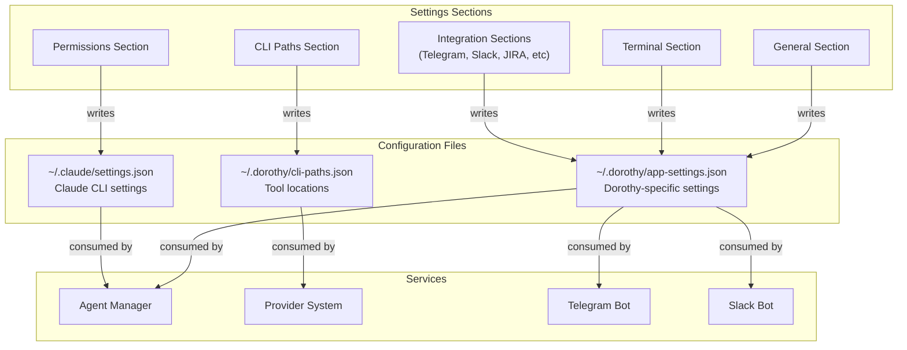
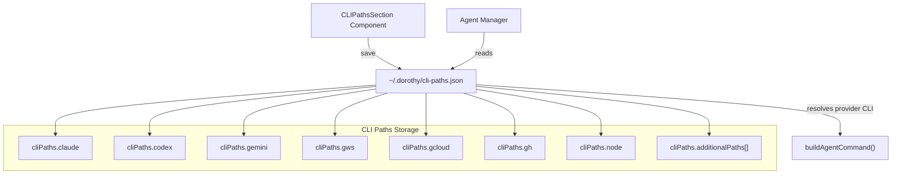
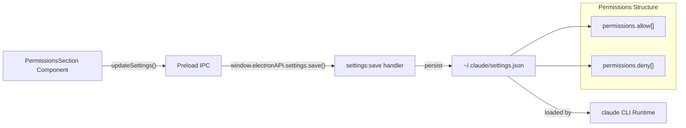
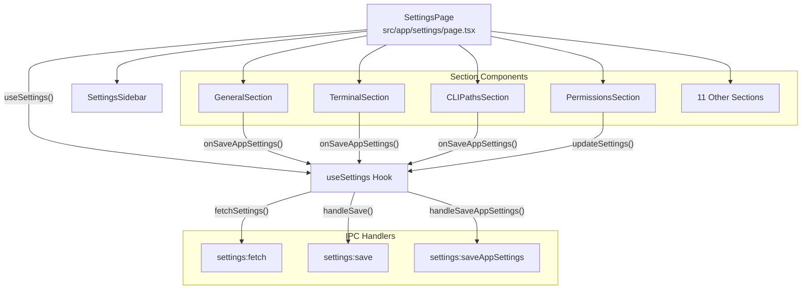
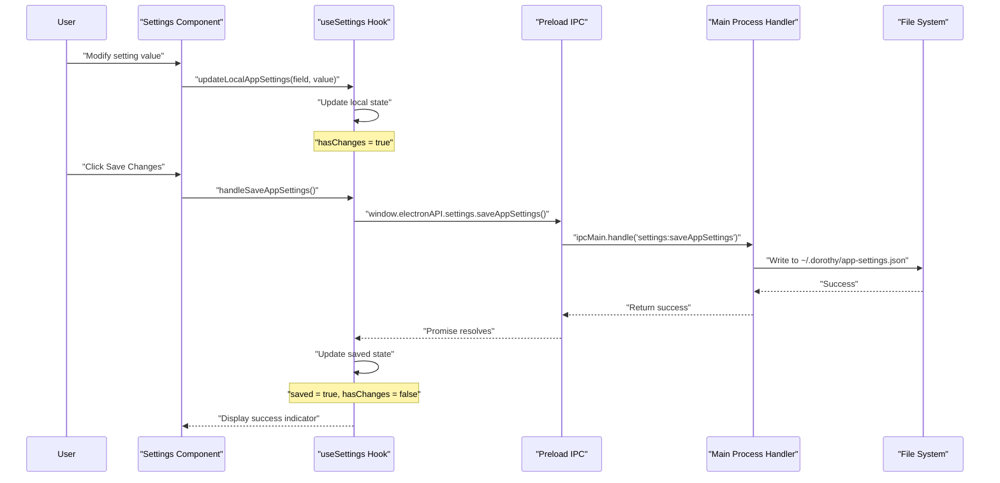

<!-- source: DeepWiki mcp.deepwiki.com · repo Charlie85270/Dorothy · page 2.3 Initial Configuration · fetched 2026-10-26 -->

# Initial Configuration

<details>
<summary>Relevant source files</summary>

The following files were used as context for generating this wiki page:

- [electron/types/index.ts](electron/types/index.ts)
- [src/app/settings/page.tsx](src/app/settings/page.tsx)
- [src/components/Settings/constants.ts](src/components/Settings/constants.ts)
- [src/components/Settings/types.ts](src/components/Settings/types.ts)

</details>


This document guides you through the first-time setup of Dorothy after installation. It covers essential configuration steps including selecting your default AI provider, configuring CLI tool paths, and setting basic preferences. For information about specific integrations (Telegram, Slack, JIRA, etc.), see [Settings](#5.3).

---

## Configuration Storage Model

Dorothy stores configuration across three distinct JSON files, each serving a specific purpose:

**Configuration File Structure**



**Sources:** [electron/types/index.ts:46-84](), [src/components/Settings/types.ts:38-76]()

| File | Purpose | Key Contents |
|------|---------|--------------|
| `~/.dorothy/app-settings.json` | Dorothy application settings | Default provider, integrations, notifications, terminal preferences |
| `~/.claude/settings.json` | Claude CLI permissions and plugins | Permission allow/deny lists, enabled plugins, environment variables |
| `~/.dorothy/cli-paths.json` | Tool executable locations | Paths to `claude`, `codex`, `gemini`, `gh`, `node`, etc. |

---

## Default Settings

On first launch, Dorothy initializes with the following defaults:

**Default Configuration Values**

| Setting | Default Value | Description |
|---------|---------------|-------------|
| `defaultProvider` | `"claude"` | AI provider for agent execution |
| `autoCheckUpdates` | `true` | Automatically check for application updates |
| `terminalFontSize` | `11` | Terminal font size in pixels |
| `terminalTheme` | `"dark"` | Terminal color scheme |
| `notificationsEnabled` | `true` | System notifications for agent events |
| `verboseModeEnabled` | `false` | Extended logging output |

**Sources:** [src/components/Settings/constants.ts:37-84]()

---

## General Settings: Provider Selection

The most critical initial configuration is selecting your default AI provider. This determines which CLI tool Dorothy invokes when starting agents.

**Provider Configuration Flow**

```mermaid
graph LR
    UI["GeneralSection Component"]
    Hook["useSettings Hook"]
    IPC["Preload IPC Bridge"]
    Handler["settings:saveAppSettings"]
    Storage["app-settings.json"]
    AgentMgr["Agent Manager"]
    
    UI -->|"updateLocalAppSettings(defaultProvider)"| Hook
    Hook -->|"handleSaveAppSettings()"| IPC
    IPC -->|"window.electronAPI.settings.saveAppSettings()"| Handler
    Handler -->|"persist"| Storage
    Storage -->|"read on agent start"| AgentMgr
```



**Sources:** [src/app/settings/page.tsx:53-68](), [src/components/Settings/types.ts:72]()

### Available Providers

Dorothy supports four provider types, each mapped to a specific CLI executable:

| Provider | CLI Tool | Description |
|----------|----------|-------------|
| `claude` | `claude` | Anthropic's Claude CLI (default) |
| `codex` | `codex` | OpenAI Codex CLI |
| `gemini` | `gemini` | Google Gemini CLI |
| `local` | Tasmania server | Local AI via Tasmania |

**Sources:** [electron/types/index.ts:8]()

### Setting the Default Provider

1. Navigate to **Settings > General**
2. Locate the "Default Provider" dropdown
3. Select your preferred provider
4. Click "Save Changes"

The `defaultProvider` field in `AppSettings` is stored as an `AgentProvider` enum value and consumed by the Agent Manager when constructing CLI commands for agent execution.

**Sources:** [electron/types/index.ts:8](), [electron/types/index.ts:80]()

---

## CLI Paths Configuration

Dorothy requires absolute paths to various CLI tools. The CLI Paths section allows you to specify these locations, with automatic detection for common installation paths.

**CLI Path Resolution Architecture**



**Sources:** [electron/types/index.ts:35-44](), [src/components/Settings/types.ts:27-36]()

### Required CLI Tools

The following CLI paths are tracked in the `CLIPaths` interface:

```typescript
interface CLIPaths {
  claude: string;        // Anthropic Claude CLI
  codex: string;         // OpenAI Codex CLI
  gemini: string;        // Google Gemini CLI
  gws: string;           // Google Workspace CLI
  gcloud: string;        // Google Cloud CLI
  gh: string;            // GitHub CLI
  node: string;          // Node.js runtime
  additionalPaths: string[];  // Custom PATH additions
}
```

**Sources:** [electron/types/index.ts:35-44]()

### Path Auto-Detection

Dorothy attempts to locate CLI tools in standard locations:
- `/usr/local/bin/`
- `/opt/homebrew/bin/`
- `~/.local/bin/`
- User-specified `additionalPaths`

### Manual Path Configuration

1. Navigate to **Settings > CLI Paths**
2. For each tool, enter the absolute path or click "Browse" to select
3. Use the "Test" button to verify each path resolves to a valid executable
4. Add custom directories to `additionalPaths` if your tools are in non-standard locations
5. Click "Save Changes"

**Sources:** [src/app/settings/page.tsx:139-145](), [src/components/Settings/constants.ts:74-83]()

---

## Terminal Appearance Settings

The Terminal section controls the visual presentation of agent output within Dorothy's embedded terminal emulator (based on xterm.js).

**Terminal Settings Structure**

| Setting | Type | Default | Purpose |
|---------|------|---------|---------|
| `terminalFontSize` | `number` | `11` | Font size in pixels |
| `terminalTheme` | `'dark' \| 'light'` | `'dark'` | Color scheme |

**Sources:** [electron/types/index.ts:82-83](), [src/components/Settings/types.ts:74-75]()

These settings are stored in `app-settings.json` and applied when rendering terminal components throughout the application (agent dashboard, installation modals, etc.).

**Sources:** [src/app/settings/page.tsx:74-75]()

---

## Permissions Configuration

While not strictly required for initial setup, the Permissions section allows you to configure Claude CLI's file system and command execution permissions. This section modifies `~/.claude/settings.json` directly.

**Permission Storage Model**



**Sources:** [src/components/Settings/types.ts:1-7](), [src/app/settings/page.tsx:136]()

The `ClaudeSettings` interface includes:

```typescript
interface ClaudeSettings {
  enabledPlugins: Record<string, boolean>;
  env: Record<string, string>;
  hooks: Record<string, unknown>;
  includeCoAuthoredBy: boolean;
  permissions: { 
    allow: string[];   // Allowed paths/commands
    deny: string[];    // Blocked paths/commands
  };
}
```

**Sources:** [src/components/Settings/types.ts:1-7]()

---

## Auto-Update Configuration

Dorothy includes an integrated update mechanism using electron-updater. The General section controls update behavior.

**Update Settings**

| Setting | Field | Default | Description |
|---------|-------|---------|-------------|
| Auto-Check Updates | `autoCheckUpdates` | `true` | Check GitHub Releases for new versions on startup |

When enabled, Dorothy checks for updates on launch and displays notifications when new versions are available. Users can view release notes and download updates directly from the Settings > General section.

For details on the update mechanism, see [Auto-Update System](#12.4).

**Sources:** [electron/types/index.ts:78](), [src/components/Settings/constants.ts:69]()

---

## Settings Page Architecture

The settings system is implemented through a centralized hook and section components:

**Settings Component Hierarchy**



**Sources:** [src/app/settings/page.tsx:1-261](), [src/app/settings/page.tsx:53-68]()

### Settings Sections

The settings interface is divided into 15 sections, defined in `SECTIONS`:

```typescript
const SECTIONS = [
  { id: 'general', label: 'General', icon: Settings },
  { id: 'terminal', label: 'Terminal', icon: Terminal },
  { id: 'obsidian', label: 'Obsidian', icon: ObsidianIcon },
  { id: 'git', label: 'Git', icon: GitCommit },
  { id: 'notifications', label: 'Notifications', icon: Bell },
  { id: 'telegram', label: 'Telegram', icon: Send },
  { id: 'slack', label: 'Slack', icon: SlackIcon },
  { id: 'jira', label: 'JIRA', icon: JiraIcon },
  { id: 'socialdata', label: 'X (Twitter)', icon: Twitter },
  { id: 'tasmania', label: 'Tasmania', icon: TasmaniaIcon },
  { id: 'google-workspace', label: 'Google Workspace', icon: Cloud },
  { id: 'permissions', label: 'Permissions', icon: Shield },
  { id: 'skills', label: 'Skills & Plugins', icon: Sparkles },
  { id: 'cli', label: 'CLI Paths', icon: Terminal },
  { id: 'system', label: 'System', icon: Monitor }
];
```

**Sources:** [src/components/Settings/constants.ts:19-35]()

---

## Initial Setup Checklist

After installing Dorothy, complete these configuration steps in order:

1. **Launch Dorothy** - Opens to the Agent Dashboard
2. **Navigate to Settings** - Click the gear icon in the sidebar
3. **General Section**:
   - Select your default AI provider (`claude`, `codex`, `gemini`, or `local`)
   - Verify auto-update preference (default: enabled)
4. **CLI Paths Section**:
   - Verify detected paths for required tools
   - Manually specify any missing tool locations
   - Test each path to ensure executable resolution
5. **Terminal Section** _(optional)_:
   - Adjust font size if default is too small/large
   - Switch theme if you prefer light mode
6. **Permissions Section** _(optional)_:
   - Review and adjust Claude CLI file system permissions
   - Add allowed/denied paths as needed
7. **Save Changes** - Click the "Save Changes" button at the top of the page

After completing these steps, Dorothy is ready to create and run agents.

---

## Configuration Persistence

All settings changes are persisted immediately when the "Save Changes" button is clicked. The `useSettings` hook manages synchronization between the UI, IPC bridge, and file system:

**Data Flow: Settings Persistence**



**Sources:** [src/app/settings/page.tsx:53-68](), [src/app/settings/page.tsx:192-219]()

The settings page tracks unsaved changes via the `hasChanges` state and disables the save button when no modifications are pending. A success indicator (checkmark) displays briefly after successful persistence.

**Sources:** [src/app/settings/page.tsx:200-218]()

---

