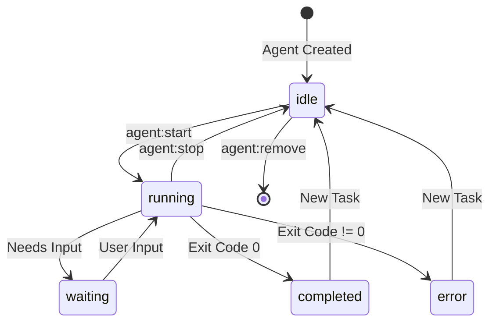
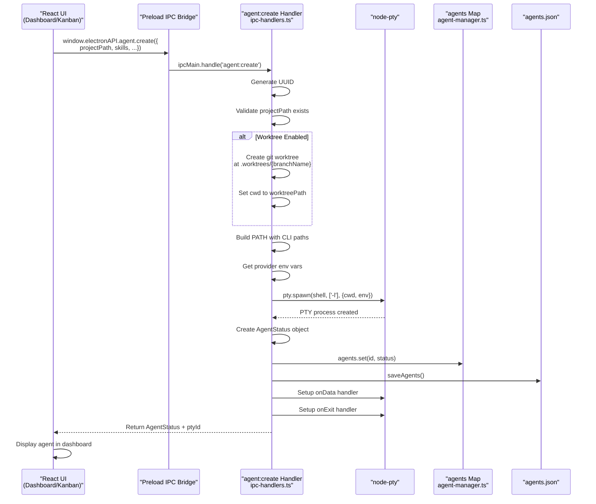
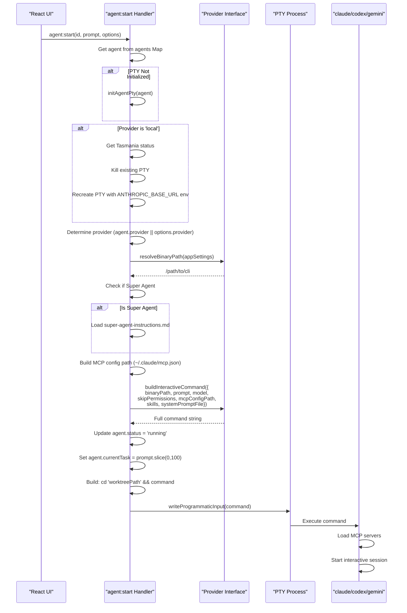
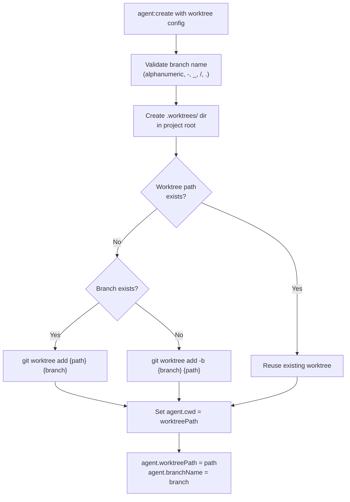
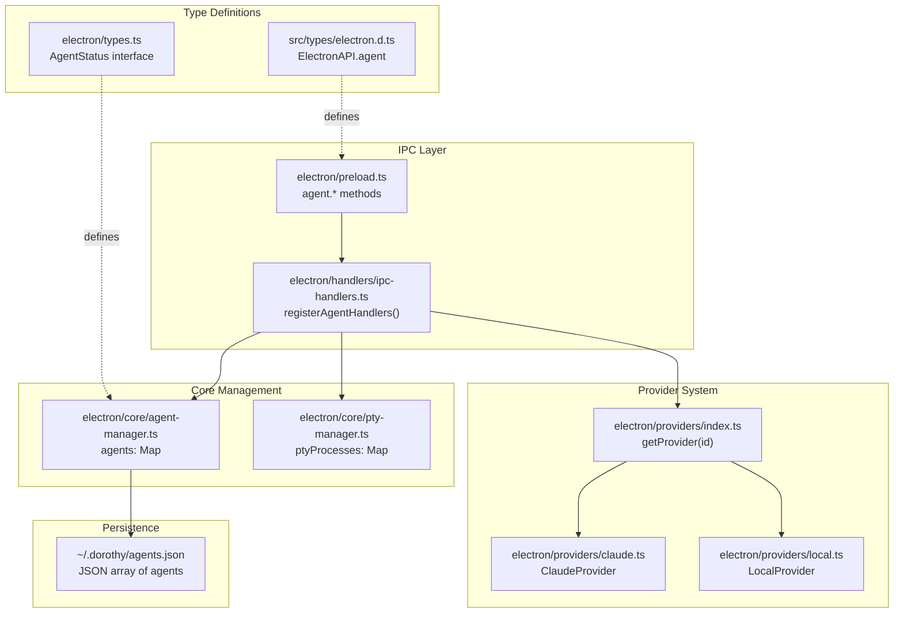

<!-- source: DeepWiki mcp.deepwiki.com · repo Charlie85270/Dorothy · page 3.1 Creating and Managing Agents · fetched 2026-10-26 -->

# Creating and Managing Agents

<details>
<summary>Relevant source files</summary>

The following files were used as context for generating this wiki page:

- [electron/core/agent-manager.ts](electron/core/agent-manager.ts)
- [electron/handlers/ipc-handlers.ts](electron/handlers/ipc-handlers.ts)
- [electron/main.ts](electron/main.ts)
- [electron/preload.ts](electron/preload.ts)
- [src/components/Settings/index.ts](src/components/Settings/index.ts)
- [src/types/electron.d.ts](src/types/electron.d.ts)

</details>


## Purpose and Scope

This document describes the agent system in Dorothy: how agents are created, configured, started, managed, and persisted. An agent is Dorothy's fundamental execution unit—a PTY-backed process running an AI CLI (Claude, Codex, Gemini, or local LLM) with specific configuration, skills, and project context.

For information about agent execution internals and PTY management, see [Agent Execution Model](#3.2). For provider configuration and differences, see [Providers](#3.3). For skills system details, see [Skills and Plugins](#3.4).

---

## What is an Agent?

An **agent** in Dorothy is a long-lived, stateful process that:
- Runs an AI provider CLI (e.g., `claude`) in a pseudo-terminal (PTY)
- Is bound to a specific project directory (and optionally additional directories)
- Has a collection of skills that extend its capabilities
- Maintains persistent state across sessions
- Can work in git worktrees for isolated development
- Supports multiple AI providers (Claude, Codex, Gemini, Tasmania/local)

Each agent runs independently in its own PTY process, allowing multiple agents to work concurrently on different tasks or projects.

**Sources:** [electron/core/agent-manager.ts:1-356](), [electron/types.ts:115-135]()

---

## Agent Properties

The `AgentStatus` interface defines all agent properties tracked by Dorothy:

| Property | Type | Description |
|----------|------|-------------|
| `id` | `string` | Unique UUID identifier |
| `name` | `string` | Human-readable agent name (default: "Agent {id-prefix}") |
| `status` | `'idle' \| 'running' \| 'completed' \| 'error' \| 'waiting'` | Current execution state |
| `character` | `AgentCharacter` | Visual character (robot, ninja, wizard, astronaut, etc.) |
| `projectPath` | `string` | Primary project directory |
| `secondaryProjectPath` | `string?` | Optional additional project via `--add-dir` |
| `worktreePath` | `string?` | Git worktree path if worktree enabled |
| `branchName` | `string?` | Git branch name for worktree |
| `skills` | `string[]` | List of installed skill names |
| `currentTask` | `string?` | Active task description (first 100 chars of prompt) |
| `output` | `string[]` | PTY output buffer (last 100 lines persisted) |
| `lastActivity` | `string` | ISO timestamp of last activity |
| `error` | `string?` | Error message if status is 'error' |
| `ptyId` | `string?` | PTY process identifier (runtime only) |
| `pathMissing` | `boolean?` | True if project path doesn't exist |
| `skipPermissions` | `boolean?` | If true, uses `--dangerously-skip-permissions` |
| `provider` | `AgentProvider?` | Provider: 'claude', 'codex', 'gemini', 'local' (default: 'claude') |
| `localModel` | `string?` | Tasmania model name when provider is 'local' |
| `obsidianVaultPaths` | `string[]?` | Obsidian vaults to mount read-only via `--add-dir` |

**Sources:** [src/types/electron.d.ts:115-135](), [electron/types.ts:115-135]()

---

## Agent Lifecycle States



**State Transitions:**

- **idle**: Agent exists but no CLI process is running. PTY may be initialized (login shell) but no command executing.
- **running**: Claude CLI (or other provider) is actively executing a task.
- **waiting**: Agent is blocked waiting for user input or approval.
- **completed**: Task finished successfully (exit code 0).
- **error**: Task failed (non-zero exit code).

The status transitions are detected via PTY exit events ([electron/handlers/ipc-handlers.ts:356-374]()) and sent to the renderer via `agent:status` IPC events.

**Sources:** [electron/core/agent-manager.ts:40-139](), [electron/handlers/ipc-handlers.ts:356-374]()

---

## Creating Agents

### Creation Flow



### Creation Implementation

The `agent:create` handler ([electron/handlers/ipc-handlers.ts:172-377]()) performs these steps:

1. **Generate ID**: Creates a new UUID for the agent
2. **Validate Path**: Checks if `projectPath` exists, falls back to home directory if missing
3. **Worktree Setup** (if enabled):
   - Creates `.worktrees/` directory in project root
   - Runs `git worktree add` with specified branch name
   - Uses worktree path as agent's working directory
4. **Build Environment**:
   - Constructs `PATH` including CLI paths from settings ([electron/handlers/ipc-handlers.ts:248-258]())
   - Gets provider-specific env vars via `getProvider(config.provider).getPtyEnvVars()` ([electron/handlers/ipc-handlers.ts:270-271]())
   - Adds `world-builder` skill automatically ([electron/handlers/ipc-handlers.ts:267]())
5. **Spawn PTY**:
   - Creates bash login shell with 120x30 terminal
   - Passes constructed environment variables
   - Stores PTY in `ptyProcesses` map ([electron/handlers/ipc-handlers.ts:275-285]())
6. **Create AgentStatus**:
   - Initializes status object with all properties
   - Defaults: `status='idle'`, `character='robot'`
   - Sets `skipPermissions` flag if specified ([electron/handlers/ipc-handlers.ts:306-323]())
7. **Setup Event Handlers**:
   - `onData`: Forwards output to renderer via `agent:output` event ([electron/handlers/ipc-handlers.ts:331-354]())
   - `onExit`: Updates status to 'completed' or 'error', sends `agent:complete` event ([electron/handlers/ipc-handlers.ts:356-374]())
8. **Persist**: Saves agents to `~/.dorothy/agents.json` ([electron/core/agent-manager.ts:141-170]())

**Secondary Project Paths**: If `secondaryProjectPath` is provided and exists, it's stored and will be passed to the CLI as `--add-dir` ([electron/handlers/ipc-handlers.ts:296-304]()).

**Obsidian Vaults**: `obsidianVaultPaths` array is stored and each path will be mounted read-only via `--add-dir` flags.

**Sources:** [electron/handlers/ipc-handlers.ts:172-377](), [electron/core/agent-manager.ts:141-170]()

---

## Starting Agents

### Start Execution Flow



### Start Implementation

The `agent:start` handler ([electron/handlers/ipc-handlers.ts:380-589]()) executes these steps:

1. **Retrieve Agent**: Gets agent from `agents` Map by ID
2. **Initialize PTY**: If agent doesn't have a PTY (e.g., restored from disk), calls `initAgentPty()` ([electron/handlers/ipc-handlers.ts:389-395]())
3. **Provider Selection**: Determines provider from `agent.provider` → `options.provider` → default 'claude' ([electron/handlers/ipc-handlers.ts:398-399]())
4. **Local Provider Special Handling**: For Tasmania/local provider:
   - Fetches Tasmania status to get endpoint and model ([electron/handlers/ipc-handlers.ts:402-408]())
   - Kills existing PTY and recreates with `ANTHROPIC_BASE_URL` and `ANTHROPIC_MODEL` env vars baked in ([electron/handlers/ipc-handlers.ts:417-463]())
   - This ensures env vars are in the process environment, not just shell exports
5. **Resolve Binary**: Calls `provider.resolveBinaryPath(appSettings)` to get CLI path ([electron/handlers/ipc-handlers.ts:519]())
6. **Super Agent Detection**: Checks if agent name contains "super agent" or "orchestrator" ([electron/handlers/ipc-handlers.ts:522-523]())
7. **Build MCP Config Path**: Checks for `~/.claude/mcp.json` if provider uses flag strategy ([electron/handlers/ipc-handlers.ts:528-534]())
8. **Super Agent Instructions**: For Super Agent, loads `super-agent-instructions.md` as system prompt ([electron/handlers/ipc-handlers.ts:537-543]())
9. **Build Command**: Calls `provider.buildInteractiveCommand()` with all parameters ([electron/handlers/ipc-handlers.ts:547-559]())
10. **Update Status**: Sets `agent.status = 'running'`, `agent.currentTask = prompt.slice(0, 100)` ([electron/handlers/ipc-handlers.ts:562-564]())
11. **Execute**: Writes command to PTY with `cd` to working path first ([electron/handlers/ipc-handlers.ts:567-583]())
12. **Delay for Fresh PTY**: If PTY was just created or provider is 'local', waits 500ms before writing command to ensure shell is ready ([electron/handlers/ipc-handlers.ts:573-580]())

**Resume Support**: The `options.resume` flag is passed but not currently used by the providers.

**Model Override**: `options.model` overrides the default model for the session (not applicable for local provider).

**Sources:** [electron/handlers/ipc-handlers.ts:380-589](), [electron/providers/index.ts:1-50]()

---

## Managing Agents

### Update Operations

The `agent:update` handler ([electron/handlers/ipc-handlers.ts:612-652]()) allows updating agent properties:

**Updatable Fields:**
- `skills`: Replace entire skills array
- `secondaryProjectPath`: Add/remove secondary project (validated to exist)
- `skipPermissions`: Toggle dangerous mode
- `name`: Change display name
- `character`: Change visual character

**Update Logic:**
```typescript
// Example: Update skills
window.electronAPI.agent.update({
  id: agentId,
  skills: ['browser', 'mcp-vault']
})

// Example: Remove secondary project
window.electronAPI.agent.update({
  id: agentId,
  secondaryProjectPath: null
})
```

Updates are persisted immediately via `saveAgents()` ([electron/handlers/ipc-handlers.ts:649]()).

**Sources:** [electron/handlers/ipc-handlers.ts:612-652]()

### Stop Operation

The `agent:stop` handler ([electron/handlers/ipc-handlers.ts:655-680]()) terminates the agent's PTY:

1. Kills PTY process via `ptyProcess.kill()`
2. Removes PTY from `ptyProcesses` map
3. Clears `agent.ptyId`
4. Sets `agent.status = 'idle'`
5. Clears `agent.currentTask`
6. Marks agent with `_manuallyStoppedAt` timestamp to prevent status detection from overriding
7. Sends `agent:status` event to renderer immediately

**Sources:** [electron/handlers/ipc-handlers.ts:655-680]()

### Remove Operation

The `agent:remove` handler ([electron/handlers/ipc-handlers.ts:683-712]()) performs cleanup:

1. Kills PTY if running
2. Removes PTY from map
3. **Worktree Cleanup**: If agent has a worktree:
   - Executes `git worktree remove {path} --force` ([electron/handlers/ipc-handlers.ts:697-699]())
   - Continues even if worktree removal fails
4. Deletes agent from `agents` map
5. Persists via `saveAgents()`

**Sources:** [electron/handlers/ipc-handlers.ts:683-712]()

### Send Input

The `agent:input` handler ([electron/handlers/ipc-handlers.ts:741-756]()) writes data directly to the agent's PTY:

```typescript
// Example: Send 'y' to approve a permission prompt
window.electronAPI.agent.sendInput({
  id: agentId,
  input: 'y\n'
})
```

This is used for interactive prompts when the agent is in 'waiting' state.

**Sources:** [electron/handlers/ipc-handlers.ts:741-756]()

---

## Data Persistence

### Storage Format

Agents are persisted to `~/.dorothy/agents.json` with the following transformations:

**On Save** ([electron/core/agent-manager.ts:141-170]()):
- `ptyId` → `undefined` (PTY is runtime-only)
- `pathMissing` → `undefined` (recalculated on load)
- `output` → last 100 lines only (prevents file bloat)
- `status` → 'idle' if 'running' (no processes survive restarts)

**On Load** ([electron/core/agent-manager.ts:172-221]()):
- Validates `projectPath` and `worktreePath` exist, sets `pathMissing = true` if not
- Resets `status = 'idle'` for all agents
- Clears `ptyId` (PTY will be recreated on first use)

**Backup Mechanism**: Before writing, current file is copied to `agents.backup.json`. If `agents.json` is empty on load, backup is restored ([electron/core/agent-manager.ts:184-193]()).

**Example agents.json:**
```json
[
  {
    "id": "a1b2c3d4-e5f6-7890-abcd-ef1234567890",
    "name": "Frontend Agent",
    "status": "idle",
    "projectPath": "/Users/dev/my-project",
    "secondaryProjectPath": "/Users/dev/shared-lib",
    "skills": ["browser", "mcp-vault", "world-builder"],
    "character": "ninja",
    "output": ["Last terminal lines..."],
    "lastActivity": "2024-01-15T10:30:00.000Z",
    "skipPermissions": false,
    "provider": "claude"
  }
]
```

**Sources:** [electron/core/agent-manager.ts:141-221](), [electron/constants.ts:5-10]()

---

## Worktree Support

### Git Worktree Integration

Dorothy supports creating agents in git worktrees for isolated branch work. This is configured during agent creation:

**Worktree Configuration:**
```typescript
{
  worktree: {
    enabled: true,
    branchName: 'feature/new-feature'
  }
}
```

**Worktree Creation Flow:**



**Implementation Details:**

1. **Branch Name Validation**: Must match `/^[a-zA-Z0-9._\-\/]+$/` ([electron/handlers/ipc-handlers.ts:200-202]())
2. **Worktree Location**: `.worktrees/{branchName}` relative to project root ([electron/handlers/ipc-handlers.ts:203-204]())
3. **Branch Creation**: If branch doesn't exist, creates with `-b` flag ([electron/handlers/ipc-handlers.ts:222-230]())
4. **Working Directory**: Agent's `cwd` is set to worktree path, all commands execute there ([electron/handlers/ipc-handlers.ts:235]())
5. **Cleanup**: On `agent:remove`, worktree is removed with `git worktree remove --force` ([electron/handlers/ipc-handlers.ts:694-703]())

**Worktree Priority**: When starting an agent, the working path resolution is `agent.worktreePath || agent.projectPath` ([electron/handlers/ipc-handlers.ts:567]()).

**Sources:** [electron/handlers/ipc-handlers.ts:195-242](), [electron/handlers/ipc-handlers.ts:694-703]()

---

## Provider System

### Multi-Provider Support

Dorothy supports multiple AI providers through an abstraction layer:

| Provider | Binary | Config Strategy | Notes |
|----------|--------|-----------------|-------|
| `claude` | `claude` | MCP via `--mcp-config` flag | Default, uses ~/.claude/mcp.json |
| `codex` | `codex` | Environment variables | Codex-specific MCP setup |
| `gemini` | `gemini` | Environment variables | Gemini-specific MCP setup |
| `local` | `claude` | Environment override | Uses Tasmania server, sets ANTHROPIC_BASE_URL |

**Provider Interface** ([electron/providers/index.ts:7-28]()):

```typescript
interface Provider {
  id: AgentProvider;
  name: string;
  resolveBinaryPath(settings: AppSettings): string;
  buildInteractiveCommand(params: CommandParams): string;
  getPtyEnvVars(agentId: string, projectPath: string, skills: string[]): Record<string, string>;
  getMcpConfigStrategy(): 'flag' | 'env';
  getSkillDirectories(): string[];
  getInstalledSkills(): string[];
}
```

**Provider Selection**: During `agent:start`, the provider is resolved as:
1. `agent.provider` (stored with agent)
2. `options.provider` (passed in start call)
3. Default: `'claude'`

For details on provider-specific behavior, see [Providers](#3.3).

**Local Provider Special Case**: The Tasmania/local provider uses the Claude binary but overrides the API endpoint:
- Recreates PTY with `ANTHROPIC_BASE_URL` pointing to Tasmania server ([electron/handlers/ipc-handlers.ts:402-463]())
- Sets `ANTHROPIC_MODEL` to the loaded local model
- Sets `CLAUDE_CODE_DISABLE_NONESSENTIAL_TRAFFIC=1` to reduce cloud calls

**Sources:** [electron/providers/index.ts:1-50](), [electron/handlers/ipc-handlers.ts:398-510]()

---

## Agent IPC API Reference

### IPC Methods

**Creation:**
```typescript
window.electronAPI.agent.create({
  projectPath: string;
  skills: string[];
  worktree?: { enabled: boolean; branchName: string };
  character?: AgentCharacter;
  name?: string;
  secondaryProjectPath?: string;
  skipPermissions?: boolean;
  provider?: AgentProvider;
  localModel?: string;
  obsidianVaultPaths?: string[];
}): Promise<AgentStatus & { ptyId: string }>
```

**Management:**
```typescript
agent.start({ id: string; prompt: string; options?: {...} }): Promise<{ success: boolean }>
agent.stop(id: string): Promise<{ success: boolean }>
agent.remove(id: string): Promise<{ success: boolean }>
agent.update({ id: string; skills?: string[]; ... }): Promise<{ success: boolean; agent?: AgentStatus }>
agent.sendInput({ id: string; input: string }): Promise<{ success: boolean }>
```

**Query:**
```typescript
agent.get(id: string): Promise<AgentStatus | null>
agent.list(): Promise<AgentStatus[]>
```

**Events:**
```typescript
agent.onOutput((event: AgentEvent) => void): () => void
agent.onComplete((event: AgentEvent) => void): () => void
agent.onStatus((event: { type: string; agentId: string; status: string; timestamp: string }) => void): () => void
```

**Sources:** [src/types/electron.d.ts:164-198](), [electron/preload.ts:44-108]()

---

## Agent State Management in UI

### React Integration

The UI interacts with agents through Electron IPC and maintains reactive state:

**Agent List Fetching:**
```typescript
const [agents, setAgents] = useState<AgentStatus[]>([]);

useEffect(() => {
  window.electronAPI.agent.list().then(setAgents);
}, []);
```

**Real-time Updates**: The UI subscribes to IPC events:
- `agent:output` - Terminal output streaming
- `agent:status` - Status transitions (idle → running → completed)
- `agent:complete` - Task completion with exit code

**Event Handling Pattern:**
```typescript
useEffect(() => {
  const unsubscribe = window.electronAPI.agent.onStatus((event) => {
    setAgents(prev => prev.map(a => 
      a.id === event.agentId 
        ? { ...a, status: event.status } 
        : a
    ));
  });
  return unsubscribe;
}, []);
```

The Agent Dashboard ([page 5.2](#5.2)) provides the primary UI for viewing and controlling agents.

**Sources:** [src/types/electron.d.ts:193-197](), [electron/preload.ts:83-107]()

---

## Code Entity Map

### Key Files and Their Roles



**Sources:** [electron/handlers/ipc-handlers.ts:156-775](), [electron/core/agent-manager.ts:1-356](), [electron/providers/index.ts:1-50]()

---

