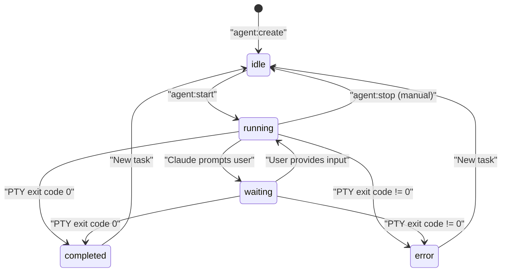
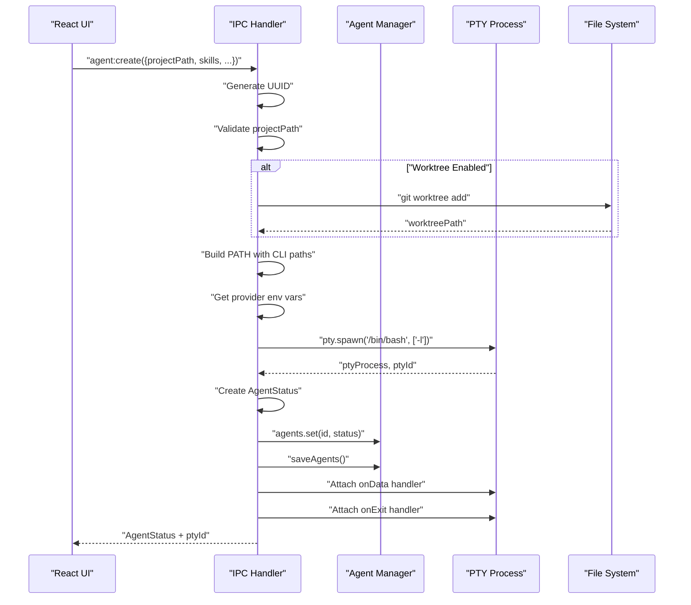
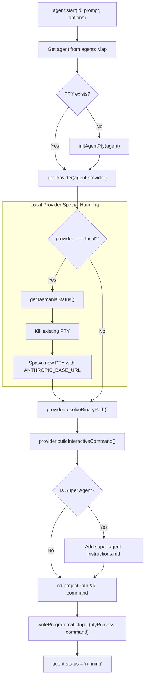
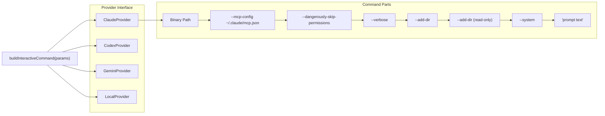
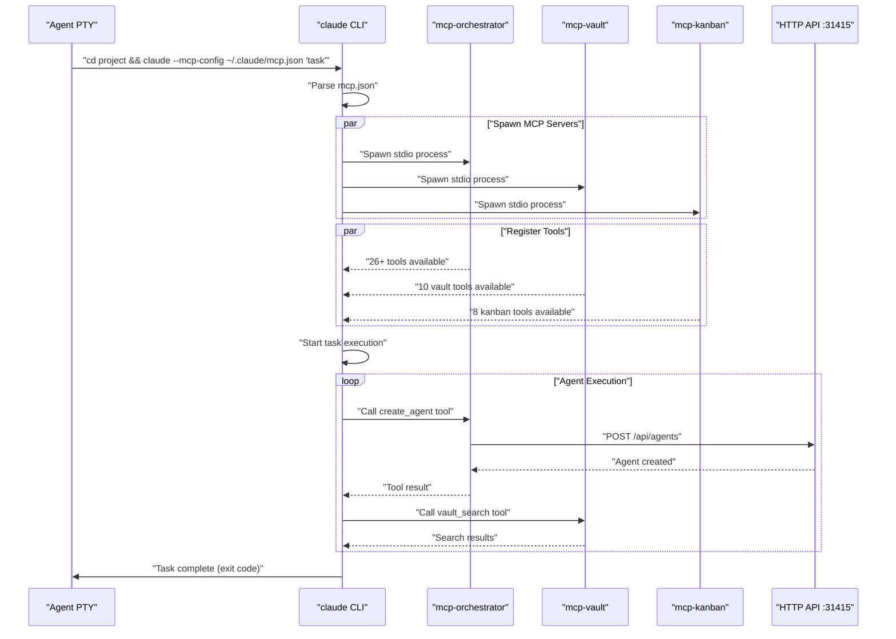
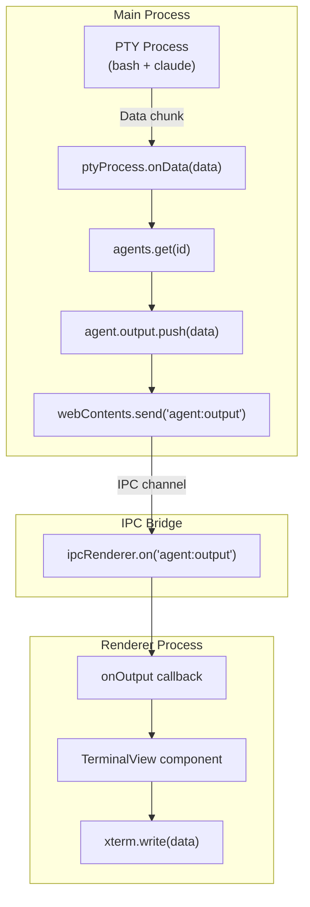
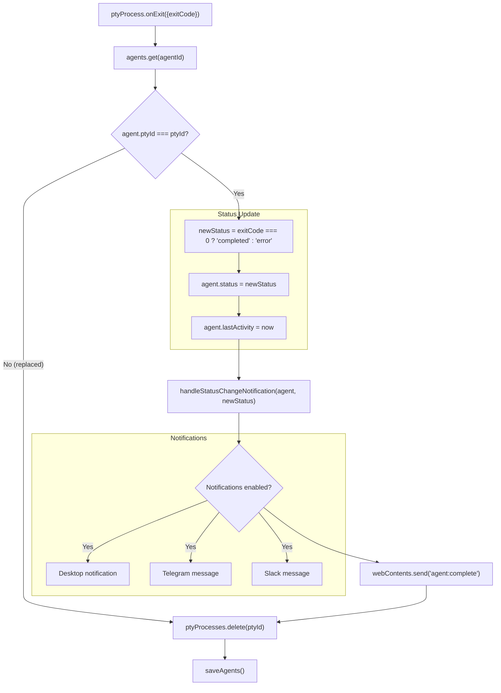

<!-- source: DeepWiki mcp.deepwiki.com · repo Charlie85270/Dorothy · page 3.2 Agent Execution Model · fetched 2026-10-26 -->

# Agent Execution Model

<details>
<summary>Relevant source files</summary>

The following files were used as context for generating this wiki page:

- [electron/core/agent-manager.ts](electron/core/agent-manager.ts)
- [electron/handlers/ipc-handlers.ts](electron/handlers/ipc-handlers.ts)
- [electron/main.ts](electron/main.ts)
- [electron/preload.ts](electron/preload.ts)
- [src/components/Settings/index.ts](src/components/Settings/index.ts)
- [src/types/electron.d.ts](src/types/electron.d.ts)

</details>


## Purpose and Scope

This document describes how Dorothy executes agents through a PTY-based architecture. It covers the agent status state machine, PTY (pseudo-terminal) infrastructure, provider abstraction, command construction, and MCP server integration during agent execution.

For information about creating and managing agents, see [Creating and Managing Agents](#3.1). For details on the provider abstraction layer, see [Providers](#3.3). For MCP server tools and capabilities, see [MCP Ecosystem](#4).

---

## Agent Status States

Agents transition through five distinct status states during their lifecycle:

| Status | Description | Transition From | Transition To |
|--------|-------------|-----------------|---------------|
| `idle` | Agent exists but no task is running | Initial state, `completed`, `error`, manual stop | `running` |
| `running` | Agent is actively executing a task | `idle` | `waiting`, `completed`, `error` |
| `waiting` | Agent needs user input or approval | `running` | `running`, `completed`, `error` |
| `completed` | Agent finished task successfully (exit code 0) | `running`, `waiting` | `idle` (new task) |
| `error` | Agent encountered an error (non-zero exit code) | `running`, `waiting` | `idle` (new task) |

### Status State Machine



**Sources:** [src/types/electron.d.ts:115-135](), [electron/core/agent-manager.ts:40-139]()

---

## PTY-Based Execution Architecture

Each agent executes in a dedicated pseudo-terminal (PTY) process. The PTY spawns a bash login shell (`/bin/bash -l`) in the agent's project directory, providing an interactive environment for the Claude CLI.

### PTY Process Map

Dorothy maintains several PTY process maps for different execution contexts:

```typescript
// From electron/core/pty-manager.ts
export const ptyProcesses: Map<string, pty.IPty>;      // Agent PTYs
export const quickPtyProcesses: Map<string, pty.IPty>; // Quick terminal PTYs
export const skillPtyProcesses: Map<string, pty.IPty>; // Skill installation PTYs
export const pluginPtyProcesses: Map<string, pty.IPty>; // Plugin installation PTYs
```

### PTY Environment Variables

Each PTY is spawned with a customized environment that includes:

- **PATH**: Enhanced to include CLI paths from `app-settings.json` (Claude, Codex, Gemini, GWS, gh, node)
- **Provider-specific env vars**: `CLAUDE_AGENT_ID`, `CLAUDE_PROJECT_PATH`, `CLAUDE_SKILLS`
- **Tasmania env vars** (local provider): `ANTHROPIC_BASE_URL`, `ANTHROPIC_MODEL`
- **MCP configuration**: `CLAUDE_CODE_ADDITIONAL_DIRECTORIES_CLAUDE_MD=1`

**Sources:** [electron/handlers/ipc-handlers.ts:244-285](), [electron/core/agent-manager.ts:223-303]()

---

## Agent Lifecycle

### Agent Creation Flow



**Key Steps:**

1. **UUID Generation**: Each agent receives a unique ID via `uuid.v4()`
2. **Path Validation**: Verify `projectPath` exists, fall back to home directory
3. **Worktree Creation** (optional): Create git worktree at `.worktrees/<branchName>`
4. **PATH Construction**: Build enhanced PATH from `cliPaths` in app settings
5. **Provider Environment**: Get provider-specific env vars (e.g., `CLAUDE_AGENT_ID`)
6. **PTY Spawn**: Create bash login shell with customized environment
7. **Event Handlers**: Attach `onData` (output streaming) and `onExit` (completion detection)
8. **Persistence**: Save agent state to `~/.dorothy/agents.json`

**Sources:** [electron/handlers/ipc-handlers.ts:172-377](), [electron/core/agent-manager.ts:141-170]()

---

### Starting an Agent

When a user starts an agent with a prompt, Dorothy builds and executes a CLI command in the agent's PTY.

#### Start Command Flow



**Local Provider Special Case:**

For the `local` provider (Tasmania), Dorothy recreates the PTY with Tasmania environment variables baked into the process environment:

```typescript
// Tasmania env vars must be in process.env, not exported in shell
env: {
  ...cleanEnv,
  PATH: fullPath,
  ...providerEnvVars,
  ANTHROPIC_BASE_URL: endpoint,      // Without /v1 suffix
  ANTHROPIC_MODEL: model,             // Local model name
  CLAUDE_CODE_DISABLE_NONESSENTIAL_TRAFFIC: '1',
}
```

This ensures the variables are available before the Claude CLI starts, avoiding race conditions with shell `export` commands.

**Sources:** [electron/handlers/ipc-handlers.ts:380-589]()

---

### Command Construction

The provider system constructs CLI commands via the `buildInteractiveCommand` method:



**Example Command:**

```bash
cd '/Users/dev/project' && claude \
  --mcp-config ~/.claude/mcp.json \
  --dangerously-skip-permissions \
  --verbose \
  --add-dir /Users/dev/other-project \
  --add-dir /Users/dev/Obsidian/Vault \
  --system ~/.dorothy/super-agent-instructions.md \
  'Implement the feature described in issue #123'
```

**Sources:** [electron/handlers/ipc-handlers.ts:516-559](), [electron/providers/claude-provider.ts]()

---

## MCP Server Integration

When an agent starts, the Claude CLI loads MCP servers configured in `~/.claude/mcp.json`. These servers communicate with the CLI via stdio.

### MCP Loading Process



**MCP Configuration Path Resolution:**

```typescript
// For Claude provider (flag strategy)
if (cliProvider.getMcpConfigStrategy() === 'flag') {
  const mcpPath = path.join(app.getPath('home'), '.claude', 'mcp.json');
  if (fs.existsSync(mcpPath)) {
    mcpConfigPath = mcpPath;
  }
}
```

**Sources:** [electron/handlers/ipc-handlers.ts:526-534](), [electron/services/mcp-orchestrator.ts]()

---

## Output Streaming and IPC Communication

Agent output streams from the PTY to the renderer process in real-time through IPC events.

### Output Flow Architecture



**PTY Data Handler:**

The data handler in [electron/handlers/ipc-handlers.ts:330-354]() performs:

1. **Output Buffering**: Append data to `agent.output` array
2. **Activity Tracking**: Update `agent.lastActivity` timestamp
3. **Super Agent Capture**: If Super Agent + Telegram task, buffer for response
4. **IPC Emission**: Send `agent:output` event to renderer

**Event Structure:**

```typescript
{
  type: 'output',
  agentId: string,
  ptyId: string,
  data: string,
  timestamp: string
}
```

**Sources:** [electron/handlers/ipc-handlers.ts:330-354](), [electron/preload.ts:83-87]()

---

## PTY Exit and Completion

When the Claude CLI exits, the PTY emits an `onExit` event with the exit code, triggering status updates and notifications.

### Exit Handler Flow



**Notification Debouncing:**

Status change notifications are debounced by 5 seconds to avoid false positives from brief state transitions:

```typescript
const timeoutId = setTimeout(() => {
  // Verify agent still has this status after 5 seconds
  const currentAgent = agents.get(agent.id);
  if (currentAgent?.status === newStatus) {
    // Send notification
  }
}, 5000);
```

**Sources:** [electron/handlers/ipc-handlers.ts:356-374](), [electron/core/agent-manager.ts:40-139]()

---

## Agent State Persistence

Agent state persists to `~/.dorothy/agents.json` after each modification:

### Saved State

```typescript
{
  id: string,
  status: 'idle' | 'completed' | 'error',  // running → idle on save
  projectPath: string,
  secondaryProjectPath?: string,
  worktreePath?: string,
  branchName?: string,
  skills: string[],
  currentTask?: string,
  output: string[],  // Last 100 items only
  lastActivity: string,
  character: AgentCharacter,
  name: string,
  skipPermissions: boolean,
  provider: AgentProvider,
  localModel?: string,
  obsidianVaultPaths: string[]
  // ptyId is excluded (ephemeral)
}
```

**On Application Restart:**

1. Load agents from `agents.json`
2. Set all agents to `idle` status
3. Clear `ptyId` (PTYs are ephemeral)
4. Mark agents with missing paths as `pathMissing: true`

When an agent is accessed after restart, Dorothy calls `initAgentPty()` to recreate the PTY process.

**Sources:** [electron/core/agent-manager.ts:141-221]()

---

## Provider-Specific Execution Differences

### Claude Provider

- **Binary**: `claude` (from PATH or `cliPaths.claude`)
- **MCP Strategy**: Flag-based (`--mcp-config`)
- **Env Vars**: `CLAUDE_AGENT_ID`, `CLAUDE_PROJECT_PATH`, `CLAUDE_SKILLS`

### Codex Provider

- **Binary**: `codex` (from PATH or `cliPaths.codex`)
- **MCP Strategy**: Flag-based (`--mcp-config`)
- **Env Vars**: Similar to Claude

### Gemini Provider

- **Binary**: `gemini` (from PATH or `cliPaths.gemini`)
- **MCP Strategy**: Flag-based (`--mcp-config`)
- **Env Vars**: Similar to Claude

### Local Provider (Tasmania)

- **Binary**: `claude` (uses Claude CLI with overridden endpoints)
- **MCP Strategy**: Flag-based
- **Env Vars**: 
  - All Claude env vars
  - `ANTHROPIC_BASE_URL`: Tasmania endpoint (without `/v1` suffix)
  - `ANTHROPIC_MODEL`: Local model name
  - `CLAUDE_CODE_DISABLE_NONESSENTIAL_TRAFFIC: '1'`
- **Special Handling**: PTY recreated on each start with Tasmania env vars baked in

**Sources:** [electron/handlers/ipc-handlers.ts:402-510](), [electron/providers/]()

---

