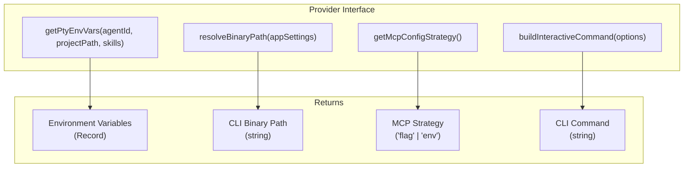
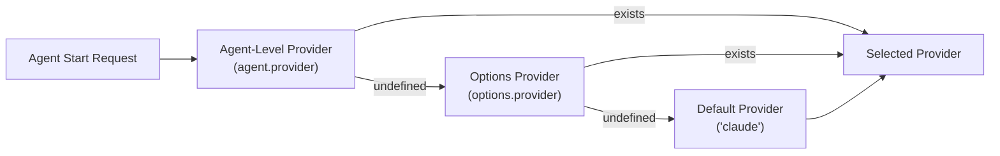
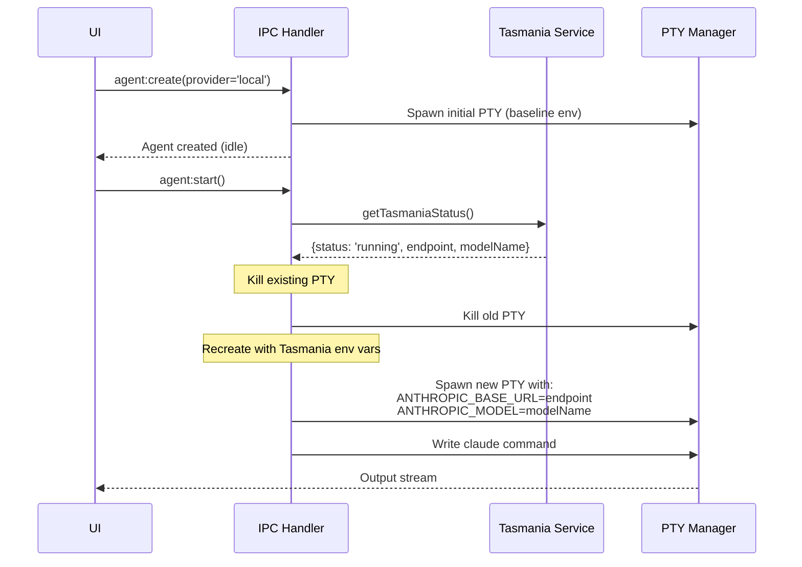

<!-- source: DeepWiki mcp.deepwiki.com · repo Charlie85270/Dorothy · page 3.3 Providers · fetched 2026-10-26 -->

# Providers

<details>
<summary>Relevant source files</summary>

The following files were used as context for generating this wiki page:

- [electron/core/agent-manager.ts](electron/core/agent-manager.ts)
- [electron/handlers/ipc-handlers.ts](electron/handlers/ipc-handlers.ts)
- [electron/preload.ts](electron/preload.ts)
- [electron/types/index.ts](electron/types/index.ts)
- [src/components/Settings/constants.ts](src/components/Settings/constants.ts)
- [src/components/Settings/index.ts](src/components/Settings/index.ts)
- [src/components/Settings/types.ts](src/components/Settings/types.ts)
- [src/types/electron.d.ts](src/types/electron.d.ts)

</details>


## Purpose and Scope

This document describes Dorothy's **provider abstraction system**, which enables agents to use different AI CLI tools and local LLM servers. Providers handle binary path resolution, environment variable configuration, PTY initialization, and CLI command construction for each supported AI backend.

For information about creating and managing agents that use these providers, see [Creating and Managing Agents](#3.1). For Tasmania-specific setup and configuration, see the Tasmania integration documentation in [Settings](#5.3).

---

## Overview

Dorothy implements a provider abstraction to support multiple AI CLI backends within a unified agent execution model. Each agent can specify which provider to use, allowing heterogeneous agent deployments where different agents use different AI models or backends.

**Sources:** [electron/types/index.ts:8](), [src/types/electron.d.ts:113](), [electron/handlers/ipc-handlers.ts:18]()

---

## Supported Providers

Dorothy supports four provider types, defined by the `AgentProvider` type:

| Provider | CLI Binary | Description | MCP Support |
|----------|-----------|-------------|-------------|
| `claude` | `claude` | Anthropic's Claude Code CLI (default) | Full MCP via `--mcp-config` flag |
| `codex` | `codex` | Codex CLI | Full MCP via `--mcp-config` flag |
| `gemini` | `gemini` | Google's Gemini CLI | Full MCP via `--mcp-config` flag |
| `local` | `claude` | Tasmania local LLM server | Full MCP (uses Claude CLI with custom endpoint) |

**Sources:** [electron/types/index.ts:8](), [src/types/electron.d.ts:113]()

### Provider Type Definition

```typescript
export type AgentProvider = 'claude' | 'codex' | 'gemini' | 'local';
```

Agents store their provider configuration in the `AgentStatus` interface:

```typescript
provider?: AgentProvider;   // 'claude' (default) or 'local' (Tasmania)
localModel?: string;        // Tasmania model name when provider is 'local'
```

**Sources:** [electron/types/index.ts:8-9](), [electron/types/index.ts:30-31]()

---

## Provider Interface

Each provider implements a standardized interface that handles the provider-specific aspects of agent execution:



**Provider Interface Methods**

### `getPtyEnvVars(agentId: string, projectPath: string, skills: string[]): Record<string, string>`

Returns environment variables to inject into the agent's PTY process. This method is called during PTY creation to configure provider-specific environment settings.

**Sources:** [electron/handlers/ipc-handlers.ts:270-271](), [electron/core/agent-manager.ts:287-288]()

### `resolveBinaryPath(appSettings: AppSettings): string`

Resolves the file system path to the CLI binary for this provider. Uses `appSettings.cliPaths` configuration to locate provider-specific binaries.

**Sources:** [electron/handlers/ipc-handlers.ts:518-519]()

### `getMcpConfigStrategy(): 'flag' | 'env'`

Returns the strategy for providing MCP configuration to the CLI:
- `'flag'`: MCP config passed via `--mcp-config` command-line flag
- `'env'`: MCP config passed via environment variables

**Sources:** [electron/handlers/ipc-handlers.ts:528]()

### `buildInteractiveCommand(options): string`

Constructs the complete CLI command string with all necessary flags and arguments. Options include:

- `binaryPath`: Resolved CLI binary path
- `prompt`: User prompt for the agent
- `model`: Optional model override (ignored for local provider)
- `verbose`: Enable verbose logging
- `skipPermissions`: Skip permission checks
- `secondaryProjectPath`: Additional project directory
- `obsidianVaultPaths`: Read-only Obsidian vault paths
- `mcpConfigPath`: Path to MCP configuration file
- `systemPromptFile`: Custom system prompt file (for Super Agent)
- `skills`: Array of skill names to load
- `isSuperAgent`: Whether this is the Super Agent

**Sources:** [electron/handlers/ipc-handlers.ts:547-559]()

---

## Provider Resolution and Selection

Provider selection follows a hierarchical fallback strategy:



**Selection Logic**

The provider is determined at agent start time using this precedence:

1. **Agent-level provider** (`agent.provider`): Set during agent creation and persisted
2. **Options provider** (`options.provider`): Specified in the start request
3. **Default fallback**: `'claude'` if no provider is specified

**Sources:** [electron/handlers/ipc-handlers.ts:398-399]()

---

## Binary Path Resolution

Each provider's CLI binary path is resolved from `AppSettings.cliPaths`:

```typescript
interface CLIPaths {
  claude: string;
  codex: string;
  gemini: string;
  gws: string;
  gcloud: string;
  gh: string;
  node: string;
  additionalPaths: string[];
}
```

The `resolveBinaryPath()` method maps the provider type to the corresponding path:

- `claude` → `cliPaths.claude`
- `codex` → `cliPaths.codex`
- `gemini` → `cliPaths.gemini`
- `local` → `cliPaths.claude` (reuses Claude binary with custom endpoint)

Paths are auto-detected during initial setup and can be manually configured in Settings → CLI Paths.

**Sources:** [electron/types/index.ts:35-44](), [src/components/Settings/types.ts:27-36]()

---

## Environment Variable Configuration

Providers inject environment variables into the PTY process to configure the AI CLI runtime. This happens at two stages:

### PTY Creation (agent:create)

When an agent is created, the provider's `getPtyEnvVars()` method is called to get baseline environment variables:

```
1. Get provider instance via getProvider(config.provider)
2. Call provider.getPtyEnvVars(id, projectPath, skills)
3. Spawn PTY with merged environment:
   - Base process.env (cleaned)
   - PATH with CLI tool directories
   - Provider-specific env vars
```

**Sources:** [electron/handlers/ipc-handlers.ts:270-284]()

### Agent Start (agent:start)

For the **local provider only**, the PTY is recreated with Tasmania-specific environment variables baked into the process environment:

```
ANTHROPIC_BASE_URL=<Tasmania endpoint without /v1>
ANTHROPIC_MODEL=<local model name>
CLAUDE_CODE_DISABLE_NONESSENTIAL_TRAFFIC=1
```

This ensures the Claude CLI connects to the local Tasmania server instead of Anthropic's API.

**Sources:** [electron/handlers/ipc-handlers.ts:402-509]()

---

## Local Provider: Tasmania Integration

The `local` provider is a special case that enables agents to use locally-hosted LLM servers via Tasmania. Unlike other providers, it:

1. **Reuses the Claude CLI binary** but redirects it to a local endpoint
2. **Recreates the PTY** at agent start time to inject Tasmania environment variables
3. **Requires Tasmania to be running** before the agent can start

### PTY Lifecycle for Local Provider



**Why PTY Recreation is Necessary**

Environment variables must be in the process environment from spawn time. Writing `export ANTHROPIC_BASE_URL=...` to an already-running shell is racy—the shell may not process the export before the `claude` command runs. Baking variables into `pty.spawn()` guarantees they're available from the start.

**Sources:** [electron/handlers/ipc-handlers.ts:402-509]()

### Tasmania Endpoint Handling

Tasmania's endpoint requires special processing to avoid double-pathing:

```
Tasmania reports: http://127.0.0.1:8080/v1
Claude SDK appends: /v1/messages
Result without stripping: http://127.0.0.1:8080/v1/v1/messages ❌

Solution: Strip /v1 suffix from endpoint
Correct result: http://127.0.0.1:8080/v1/messages ✓
```

**Sources:** [electron/handlers/ipc-handlers.ts:414](), [electron/core/agent-manager.ts:272]()

---

## MCP Configuration Strategy

Providers use different strategies to provide MCP server configuration to the CLI:

### Flag Strategy (`'flag'`)

Used by Claude, Codex, and Gemini providers. MCP configuration is passed via the `--mcp-config` command-line flag:

```bash
claude --mcp-config ~/.claude/mcp.json <prompt>
```

The MCP config file path is resolved from `~/.claude/mcp.json` and only included if the file exists.

**Sources:** [electron/handlers/ipc-handlers.ts:525-533]()

### Environment Strategy (`'env'`)

Alternative strategy where MCP config is provided via environment variables instead of flags. (Implementation details not shown in provided files.)

---

## Command Construction

The `buildInteractiveCommand()` method constructs the complete CLI invocation with all necessary flags:

### Common Command Structure

```bash
<binary_path> [--verbose] [--dangerously-skip-permissions] \
  [--add-dir <secondary_path>] \
  [--add-dir <obsidian_vault_1>] ... \
  [--mcp-config <mcp_path>] \
  [--system-prompt <prompt_file>] \
  <prompt>
```

### Example Commands

**Claude Provider (Default)**
```bash
claude --mcp-config ~/.claude/mcp.json "Implement feature X"
```

**Claude Provider with Skills**
```bash
claude --verbose --add-dir ~/.claude/projects/skill-project \
  --mcp-config ~/.claude/mcp.json "Deploy to production"
```

**Super Agent with System Prompt**
```bash
claude --mcp-config ~/.claude/mcp.json \
  --system-prompt ~/.dorothy/super-agent-instructions.md \
  "Check agent status"
```

**Local Provider (Tasmania)**
```bash
# Same command structure, but env vars redirect to local server:
# ANTHROPIC_BASE_URL=http://127.0.0.1:8080
# ANTHROPIC_MODEL=llama-3.1-70b-instruct
claude --mcp-config ~/.claude/mcp.json "Analyze codebase"
```

**Sources:** [electron/handlers/ipc-handlers.ts:547-569]()

---

## Provider Registration and Access

### Accessing Providers

Providers are accessed via the `getProvider()` and `getAllProviders()` functions imported from `../providers`:

```typescript
import { getProvider, getAllProviders } from '../providers';

// Get specific provider
const provider = getProvider('claude');
const envVars = provider.getPtyEnvVars(agentId, projectPath, skills);

// Get all providers
const allProviders = getAllProviders();
```

**Sources:** [electron/handlers/ipc-handlers.ts:18](), [electron/handlers/ipc-handlers.ts:270](), [electron/handlers/ipc-handlers.ts:518]()

---

## Default Provider Configuration

The default provider for new agents is configured in `AppSettings`:

```typescript
defaultProvider?: AgentProvider;
```

This setting is managed through Settings → General and defaults to `'claude'` if not specified.

When creating an agent without specifying a provider, the default provider from app settings is used.

**Sources:** [electron/types/index.ts:80](), [src/components/Settings/constants.ts:70]()

---

## File Structure

Provider implementation is organized in the `electron/providers` directory:

```
electron/
├── providers/
│   ├── index.ts              # Provider registration and getProvider()
│   ├── base-provider.ts      # Base provider interface/abstract class
│   ├── claude-provider.ts    # Claude Code implementation
│   ├── codex-provider.ts     # Codex implementation
│   ├── gemini-provider.ts    # Gemini implementation
│   └── local-provider.ts     # Tasmania local LLM implementation
```

(Note: Exact file structure inferred from import patterns. Implementation details not included in provided files.)

**Sources:** [electron/handlers/ipc-handlers.ts:18](), [electron/core/agent-manager.ts:12]()

---

## Provider-Specific Features

### Skills and Provider Linking

Skills can be linked to specific providers, allowing the same skill to have provider-specific implementations. This is managed through the `skill:linkToProvider` IPC handler.

**Sources:** [src/types/electron.d.ts:209]()

### Model Override

When starting an agent with a specific provider, an optional model parameter can override the default model for that provider. This is ignored for the local provider, which uses the model loaded in Tasmania.

```typescript
agent.start({
  id: agentId,
  prompt: "Task description",
  options: {
    model: "claude-3-5-sonnet-20241022",  // Override default model
    provider: "claude"
  }
});
```

**Sources:** [electron/handlers/ipc-handlers.ts:380-383](), [electron/handlers/ipc-handlers.ts:550]()

---

## Summary

The provider system enables Dorothy to support multiple AI backends through a clean abstraction layer:

1. **Four providers**: Claude (default), Codex, Gemini, and Local (Tasmania)
2. **Standardized interface**: All providers implement the same methods
3. **Flexible selection**: Per-agent, per-request, or global default
4. **Binary resolution**: Auto-detected or manually configured CLI paths
5. **Environment configuration**: Provider-specific PTY environment variables
6. **Command construction**: Unified command building with provider-specific flags
7. **MCP integration**: Full MCP support across all providers

The local provider's special PTY recreation mechanism demonstrates the system's flexibility in adapting to different backend requirements while maintaining a consistent agent execution model.

**Sources:** [electron/handlers/ipc-handlers.ts:156-775](), [electron/core/agent-manager.ts:1-355](), [electron/types/index.ts:1-85]()

---

