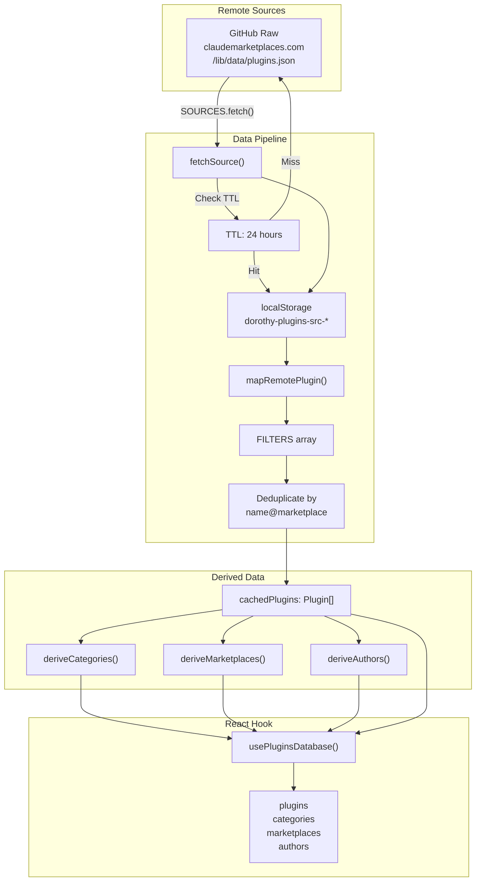
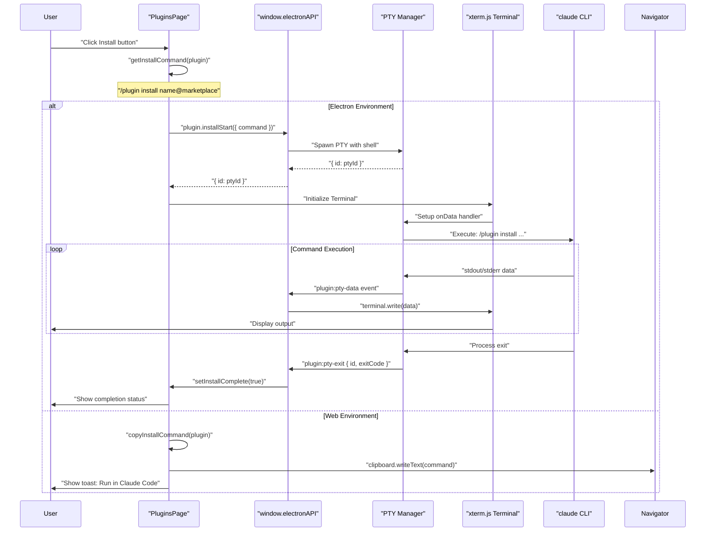

<!-- source: DeepWiki mcp.deepwiki.com · repo Charlie85270/Dorothy · page 3.4 Skills and Plugins · fetched 2026-10-26 -->

# Skills and Plugins

<details>
<summary>Relevant source files</summary>

The following files were used as context for generating this wiki page:

- [electron/types/index.ts](electron/types/index.ts)
- [src/app/plugins/page.tsx](src/app/plugins/page.tsx)
- [src/components/PokemonGame/interiors/PluginShopContent.tsx](src/components/PokemonGame/interiors/PluginShopContent.tsx)
- [src/components/Settings/constants.ts](src/components/Settings/constants.ts)
- [src/components/Settings/types.ts](src/components/Settings/types.ts)
- [src/lib/plugins-database.ts](src/lib/plugins-database.ts)

</details>


This page documents Dorothy's extensibility mechanisms: **skills** (agent capability extensions) and **plugins** (Claude Code marketplace integrations). Skills define reusable capabilities that agents can invoke, while plugins extend the Claude CLI with additional tools and features. For configuration details, see [Settings](#5.3).

---

## Skills System

Skills are named capabilities that extend what agents can do. Dorothy supports three skill sources:

| Source | Location | Scope | Example |
|--------|----------|-------|---------|
| Project | `<project>/.claude/skills/` | Single project | Project-specific workflows |
| User | `~/.claude/skills/` | All projects | Personal tools and utilities |
| Plugin | Via Claude Code plugins | All projects | Marketplace extensions |

### Skill Interface

Skills are identified by their source and path in the `Skill` interface:

[src/components/Settings/types.ts:19-25]()

```typescript
interface Skill {
  name: string;
  source: 'project' | 'user' | 'plugin';
  path: string;
  description?: string;
  projectName?: string;  // For project-scoped skills
}
```

### Skills in Agent Configuration

Agents specify which skills to load via the `skills` array in `AgentStatus`:

[electron/types/index.ts:10-33]()

Skills are passed to the Claude CLI at agent execution time, enabling the CLI to load and make those capabilities available during task execution.

**Sources:**
- [electron/types/index.ts:10-33]()
- [src/components/Settings/types.ts:19-25]()

---

## Plugins System

Plugins are Claude Code-specific extensions that add new tools, output styles, integrations, and capabilities to the Claude CLI. **Plugins are only available for the Claude provider** - Codex and Gemini do not support plugins.

### Plugin Compatibility

[src/app/plugins/page.tsx:562-566]()

The plugin marketplace displays a banner indicating Claude-only support. When agents use non-Claude providers, plugins in their configuration are ignored.

### Plugin Interface

Plugins are defined in the `Plugin` interface:

[src/lib/plugins-database.ts:8-18]()

```typescript
interface Plugin {
  name: string;
  description: string;
  category: string;           // e.g., "Code Intelligence", "External Integrations"
  marketplace: string;        // Source identifier (e.g., "anthropics-claude-code")
  author?: string;
  tags?: string[];
  homepage?: string;
  binaryRequired?: string;    // External CLI dependency
  installCommand?: string;
}
```

**Sources:**
- [src/lib/plugins-database.ts:8-18]()
- [src/app/plugins/page.tsx:562-566]()

---

## Plugin Marketplace Architecture

The plugin marketplace aggregates plugins from multiple sources, caches them in localStorage, and provides a searchable UI for installation.

### Plugin Database Flow Diagram



**Sources:**
- [src/lib/plugins-database.ts:45-76]()
- [src/lib/plugins-database.ts:86-114]()
- [src/lib/plugins-database.ts:168-187]()
- [src/lib/plugins-database.ts:197-236]()

### Multi-Source Aggregation

The plugin database supports multiple remote sources defined in the `SOURCES` array:

[src/lib/plugins-database.ts:64-76]()

Each source has:
- **id**: Cache key suffix (`dorothy-plugins-src-{id}`)
- **name**: Human-readable label
- **fetch**: Async function returning `RemotePlugin[]`
- **ttl**: Cache lifetime (default: 24 hours)

### Cache Strategy

Per-source localStorage caching with TTL:

[src/lib/plugins-database.ts:86-114]()

The `fetchSource` function:
1. Checks cache freshness using TTL
2. Returns cached data if fresh
3. Fetches from remote on cache miss
4. Falls back to stale cache on fetch failure
5. Writes successful fetches to cache

**Sources:**
- [src/lib/plugins-database.ts:45-76]()
- [src/lib/plugins-database.ts:86-114]()
- [src/lib/plugins-database.ts:168-187]()

---

## Plugin Installation

Plugins are installed using the command format: `/plugin install <name>@<marketplace>`. Dorothy provides two installation mechanisms depending on the execution environment.

### Installation Flow Diagram



**Sources:**
- [src/app/plugins/page.tsx:475-513]()
- [src/app/plugins/page.tsx:299-324]()
- [src/app/plugins/page.tsx:862-936]()

### Electron Installation with Terminal UI

When running in Electron, clicking "Install" opens a terminal modal that executes the plugin installation command in a PTY:

[src/app/plugins/page.tsx:862-936]()

The installation flow:
1. User clicks "Install" → `handleInstall()`
2. Command is queued in `pendingInstallCommand`
3. xterm.js terminal initializes → `setTerminalReady(true)`
4. PTY spawns with command → `installStart()`
5. PTY output streams to terminal → `onPtyData` listener
6. Process exits → `onPtyExit` updates completion state

### Terminal Initialization

[src/app/plugins/page.tsx:219-297]()

The xterm.js terminal:
- Uses custom theme matching Dorothy's color scheme
- Configures FitAddon for responsive sizing
- Handles bidirectional I/O (user input → PTY, PTY output → terminal)
- Notifies PTY of resize events for proper rendering

### Web Installation (Copy Command)

In non-Electron environments (e.g., landing page preview), the Install button copies the command to clipboard:

[src/app/plugins/page.tsx:479-498]()

**Sources:**
- [src/app/plugins/page.tsx:475-513]()
- [src/app/plugins/page.tsx:219-297]()
- [src/app/plugins/page.tsx:862-936]()

---

## Plugin Marketplace UI

The plugin marketplace provides search, filtering, and category navigation for browsing and installing plugins.

### Filtering and Search

The UI supports multiple filter dimensions:

| Filter | Type | Implementation |
|--------|------|----------------|
| Search | Text | Name, description, category, tags |
| Category | Dropdown | 6 categories (Code Intelligence, External Integrations, etc.) |
| Marketplace | Dropdown | Source filter (anthropics-claude-code, custom) |
| Author | Dropdown | Plugin author filter |

[src/app/plugins/page.tsx:421-457]()

The filtering logic:
1. Applies text search (debounced 200ms)
2. Filters by selected category/marketplace/author
3. Sorts installed plugins first using O(1) Set lookups

### Installed Plugin Detection

Installed plugins are detected by checking `enabledPlugins` in Claude settings:

[src/app/plugins/page.tsx:363-389]()

The `installedLookup` creates three O(1) lookup Sets:
- `exact`: Exact match on `name@marketplace`
- `lower`: Case-insensitive match
- `byName`: Match by name only (ignoring marketplace)

### Custom Plugin Entries

Plugins installed outside the database (e.g., local or unlisted plugins) are displayed as "Custom" entries:

[src/app/plugins/page.tsx:392-418]()

Custom plugins:
- Show "Custom" badge
- Display marketplace as "custom"
- Tagged with `['custom', 'installed']`

**Sources:**
- [src/app/plugins/page.tsx:421-457]()
- [src/app/plugins/page.tsx:363-389]()
- [src/app/plugins/page.tsx:392-418]()

---

## Plugin Categories and Icons

Plugins are categorized with visual icons and color coding:

[src/app/plugins/page.tsx:34-50]()

```typescript
const CATEGORY_ICONS: Record<string, typeof Code2> = {
  'Code Intelligence': Code2,
  'External Integrations': Globe,
  'Development Workflows': Wrench,
  'Output Styles': Palette,
  'Security': Shield,
  'Productivity': Zap,
};

const CATEGORY_COLORS: Record<string, string> = {
  'Code Intelligence': 'text-blue-400 bg-blue-500/20',
  'External Integrations': 'text-primary bg-primary/20',
  // ... etc
};
```

Categories are derived from plugin data:

[src/lib/plugins-database.ts:131-138]()

Only categories starting with a capital letter are exposed in the UI to filter out internal/system categories.

**Sources:**
- [src/app/plugins/page.tsx:34-50]()
- [src/lib/plugins-database.ts:131-138]()

---

## Configuration and Settings

Plugin and skill configuration is managed through multiple settings files and the Settings UI.

### Settings Integration

The "Skills & Plugins" section appears in settings:

[src/components/Settings/constants.ts:32]()

### Enabled Plugins Storage

Enabled plugins are stored in `~/.claude/settings.json`:

[src/components/Settings/types.ts:1-7]()

```typescript
interface ClaudeSettings {
  enabledPlugins: Record<string, boolean>;  // { "plugin@marketplace": true }
  env: Record<string, string>;
  hooks: Record<string, unknown>;
  includeCoAuthoredBy: boolean;
  permissions: { allow: string[]; deny: string[] };
}
```

The `enabledPlugins` map tracks which plugins are active. Plugin names follow the format `name@marketplace`.

### CLI Paths Configuration

CLI tool paths required by some plugins are configured in settings:

[src/components/Settings/types.ts:27-36]()

These paths are persisted to `~/.dorothy/cli-paths.json` and used for provider system CLI path resolution.

**Sources:**
- [src/components/Settings/constants.ts:32]()
- [src/components/Settings/types.ts:1-7]()
- [src/components/Settings/types.ts:27-36]()

---

## Integration with Pokemon World

Dorothy's Pokemon-themed 3D world includes a Plugin Shop interior where users can browse and install plugins in a retro game interface:

[src/components/PokemonGame/interiors/PluginShopContent.tsx:8-91]()

The shop uses the same plugin database and installation logic as the main marketplace, rendering plugins as menu items with install/leave actions.

**Sources:**
- [src/components/PokemonGame/interiors/PluginShopContent.tsx:8-91]()

---

## Summary

**Skills** extend agent capabilities through three sources (project, user, plugin) and are specified per-agent. **Plugins** extend the Claude CLI with marketplace-distributed tools and features, using a multi-source database with localStorage caching. Installation is handled through PTY-based terminal execution in Electron or clipboard copy in web environments. Both systems integrate with Dorothy's settings for configuration and activation tracking.

---

