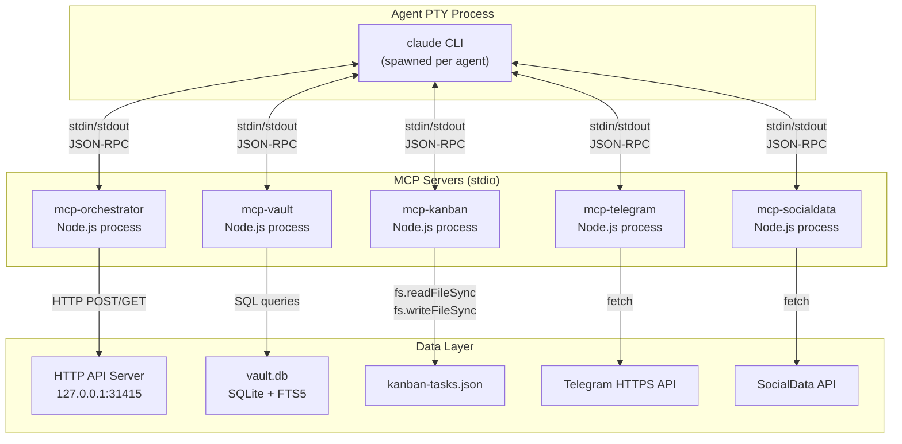
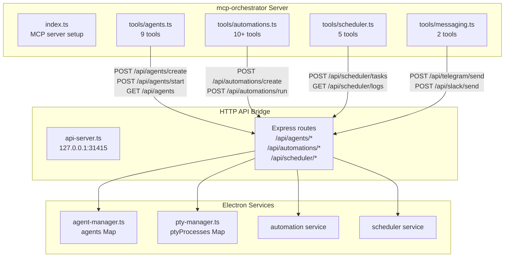
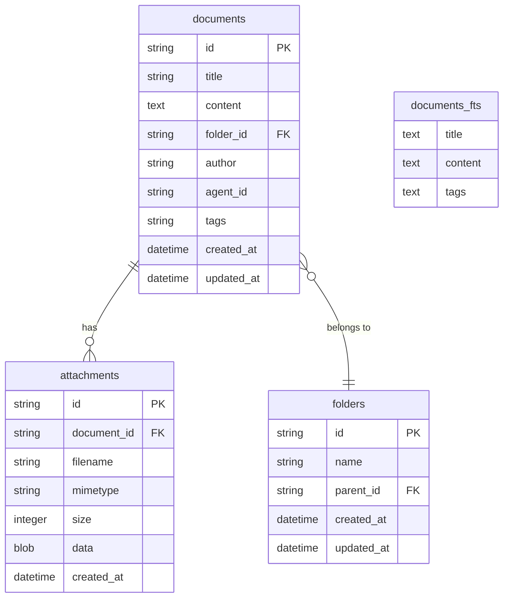
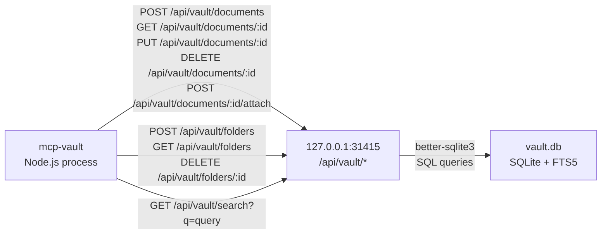
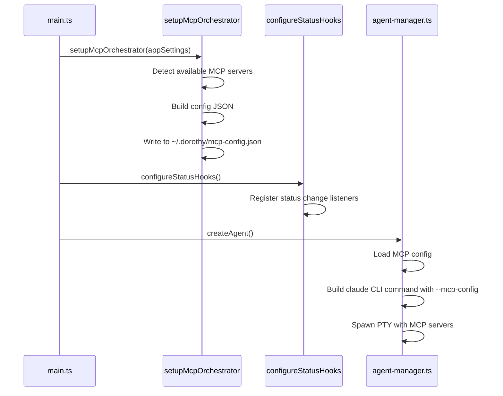

<!-- source: DeepWiki mcp.deepwiki.com · repo Charlie85270/Dorothy · page 4 MCP Ecosystem · fetched 2026-10-26 -->

# MCP Ecosystem

<details>
<summary>Relevant source files</summary>

The following files were used as context for generating this wiki page:

- [README.md](README.md)
- [__tests__/mcp/mcp-socialdata.test.ts](__tests__/mcp/mcp-socialdata.test.ts)
- [__tests__/mcp/mcp-vault.test.ts](__tests__/mcp/mcp-vault.test.ts)
- [electron/main.ts](electron/main.ts)
- [landing/public/kanban.png](landing/public/kanban.png)
- [landing/public/ollama-icon.svg](landing/public/ollama-icon.svg)
- [landing/src/app/page.tsx](landing/src/app/page.tsx)
- [screenshots/kanban.png](screenshots/kanban.png)

</details>


This document describes Dorothy's Model Context Protocol (MCP) ecosystem, which provides 40+ programmatic tools for agent orchestration, task management, document storage, messaging, and social data access. These tools are exposed through five MCP servers that communicate with agents via stdio, enabling sophisticated agent workflows and cross-agent coordination.

For information about agent creation and management, see [Agents](#3). For automation configuration that uses MCP tools, see [Automations](#7). For the internal HTTP API server that bridges MCP servers to Electron services, see [HTTP API Server](#11.4).

---

## Overview

Dorothy implements five primary MCP servers, each providing specialized functionality:

| Server | Tools | Purpose | Storage |
|--------|-------|---------|---------|
| `mcp-orchestrator` | 26+ | Agent management, messaging, scheduling, automations | HTTP API (port 31415) |
| `mcp-vault` | 10 | Document storage with full-text search | SQLite (`~/.dorothy/vault.db`) |
| `mcp-kanban` | 8 | Task management across workflow columns | JSON (`~/.dorothy/kanban-tasks.json`) |
| `mcp-telegram` | 4 | Media-rich Telegram messaging | HTTPS API |
| `mcp-socialdata` | 5 | Twitter/X data retrieval | External API |

All MCP servers use the `@modelcontextprotocol/sdk` library and communicate exclusively via stdio. Tool parameters are validated using Zod schemas. Servers are registered in each agent's Claude CLI process through MCP config files, making tools available to all running agents.

**Sources:** [README.md:409-531](), [electron/main.ts:1-103]()

---

## Communication Architecture

### Stdio Protocol

MCP servers communicate with Claude CLI processes through standard input/output streams. Each agent spawns a dedicated Claude CLI instance that establishes stdio connections to all configured MCP servers.

**Agent-to-MCP Communication Flow:**



**Sources:** [README.md:576-644](), [electron/core/agent-manager.ts:1-50]()

### MCP Configuration

MCP servers are registered in agent PTY processes through the `--mcp-config` flag passed to the Claude CLI. Configuration includes the stdio transport type and server launch command.

The Agent Manager builds MCP configurations dynamically based on available servers:

[electron/core/agent-manager.ts:100-250]()

**Sources:** [electron/core/agent-manager.ts:1-300]()

---

## mcp-orchestrator

The primary orchestration server providing 26+ tools across four categories: agent management, messaging, scheduling, and automations. This server enables the Super Agent to programmatically control Dorothy's entire agent fleet.

### Architecture



**Sources:** [mcp-orchestrator/src/index.ts:1-100](), [electron/services/api-server.ts:1-100]()

### Agent Management Tools

| Tool | Parameters | Description |
|------|-----------|-------------|
| `list_agents` | — | Returns all agents with status, ID, name, project path, current task |
| `get_agent` | `id: string` | Retrieves detailed agent info including full output history |
| `get_agent_output` | `id: string`<br/>`lines?: number` | Reads recent terminal output (default: 100 lines) |
| `create_agent` | `projectPath: string`<br/>`name?: string`<br/>`skills?: string[]`<br/>`character?: string`<br/>`skipPermissions?: boolean`<br/>`secondaryProjectPath?: string` | Creates new agent in idle state (skipPermissions defaults to true) |
| `start_agent` | `id: string`<br/>`prompt: string`<br/>`model?: string` | Starts idle agent or sends message to running agent |
| `send_message` | `id: string`<br/>`message: string` | Sends input to running agent's PTY (auto-starts idle agents) |
| `stop_agent` | `id: string` | Sends Ctrl+C to terminate running agent (returns to idle) |
| `remove_agent` | `id: string` | Permanently deletes agent and kills PTY process |
| `wait_for_agent` | `id: string`<br/>`timeoutSeconds?: number`<br/>`pollIntervalSeconds?: number` | Polls agent status until completion/error/waiting (timeout default: 300s) |

All agent tools communicate with the HTTP API server at `127.0.0.1:31415`, which forwards requests to the Agent Manager in the Electron main process.

**Sources:** [README.md:418-429](), [mcp-orchestrator/src/tools/agents.ts:1-500]()

### Messaging Tools

| Tool | Parameters | Description |
|------|-----------|-------------|
| `send_telegram` | `message: string` | Sends text to configured Telegram chat (truncates at 4096 chars) |
| `send_slack` | `message: string` | Sends text to configured Slack channel (truncates at 4000 chars) |

These tools enable agents to deliver results directly to messaging platforms. The Super Agent uses these extensively when responding to remote control commands.

**Sources:** [README.md:431-437](), [mcp-orchestrator/src/tools/messaging.ts:1-200]()

### Scheduler Tools

| Tool | Parameters | Description |
|------|-----------|-------------|
| `list_scheduled_tasks` | — | Returns all recurring tasks with cron schedule and next run time |
| `create_scheduled_task` | `prompt: string`<br/>`schedule: string`<br/>`projectPath: string`<br/>`autonomous?: boolean` | Creates recurring task (cron format, autonomous defaults to true) |
| `delete_scheduled_task` | `taskId: string` | Removes scheduled task and its launchd/cron entry |
| `run_scheduled_task` | `taskId: string` | Executes task immediately (bypasses schedule) |
| `get_scheduled_task_logs` | `taskId: string`<br/>`lines?: number` | Retrieves execution logs (default: 50 lines) |

Tasks are stored in `~/.claude/schedules.json`. Scripts are generated in `~/.dorothy/scripts/` and registered with launchd (macOS) or cron (Linux).

**Sources:** [README.md:438-446](), [electron/handlers/scheduler-handlers.ts:1-300]()

### Automation Tools

Automations poll external sources (GitHub, JIRA) and spawn agents to process items.

| Tool | Parameters | Description |
|------|-----------|-------------|
| `list_automations` | — | Returns all automations with status, source type, schedule |
| `get_automation` | `id: string` | Retrieves automation details including recent run history |
| `create_automation` | `name: string`<br/>`sourceType: string`<br/>`sourceConfig: string`<br/>[+ 20 optional fields](#automation-parameters) | Creates new automation with polling and agent processing |
| `update_automation` | `id: string`<br/>[+ optional fields] | Updates automation configuration |
| `delete_automation` | `id: string` | Removes automation and stops polling |
| `run_automation` | `id: string` | Triggers automation immediately (bypasses schedule) |
| `pause_automation` | `id: string` | Pauses scheduled execution |
| `resume_automation` | `id: string` | Resumes paused automation |
| `run_due_automations` | — | Checks all automations and runs due ones (called by scheduler) |
| `get_automation_logs` | `id: string`<br/>`limit?: number` | Retrieves execution history (default: 10 runs) |
| `update_jira_issue` | `issueKey: string`<br/>`transitionName?: string`<br/>`comment?: string` | Updates JIRA issue status and/or adds comment |

#### Automation Parameters

When calling `create_automation`, these parameters configure the automation:

| Parameter | Type | Required | Description |
|-----------|------|----------|-------------|
| `name` | string | Yes | Human-readable automation name |
| `sourceType` | enum | Yes | `github`, `jira`, `pipedrive`, `twitter`, `rss`, `custom` |
| `sourceConfig` | JSON string | Yes | Source-specific config (e.g., repos, JQL query) |
| `scheduleMinutes` | number | No | Poll interval in minutes (default: 30) |
| `scheduleCron` | string | No | Cron expression (alternative to interval) |
| `eventTypes` | string[] | No | Filter by event type (e.g., `["pr", "issue"]`) |
| `onNewItem` | boolean | No | Trigger on new items (default: true) |
| `onUpdatedItem` | boolean | No | Trigger on updated items |
| `agentEnabled` | boolean | No | Enable agent processing (default: true) |
| `agentPrompt` | string | No | Prompt template with `{{variables}}` |
| `agentProjectPath` | string | No | Project path for spawned agents |
| `agentModel` | enum | No | `sonnet`, `opus`, or `haiku` |
| `outputTelegram` | boolean | No | Post results to Telegram |
| `outputSlack` | boolean | No | Post results to Slack |
| `outputGitHubComment` | boolean | No | Post results as GitHub PR/issue comment |
| `outputJiraComment` | boolean | No | Post results as JIRA issue comment |
| `outputJiraTransition` | boolean | No | Transition JIRA issue status after processing |
| `outputTemplate` | string | No | Custom output message template |

Automations are stored in `~/.dorothy/automations.json`. Processed items are tracked in `~/.dorothy/automations-processed.json` using content hashing for deduplication.

**Sources:** [README.md:448-485](), [electron/handlers/automation-handlers.ts:1-500]()

---

## mcp-vault

Document management server with SQLite-backed storage and FTS5 full-text search. Provides persistent, searchable knowledge base accessible across all agents.

### Database Schema

The vault uses SQLite with three main tables:



The `documents_fts` table is a virtual FTS5 table that indexes `title`, `content`, and `tags` columns for full-text search. It's automatically synchronized with the `documents` table via triggers.

**Sources:** [electron/services/vault-db.ts:1-150]()

### Document Tools

| Tool | Parameters | Description |
|------|-----------|-------------|
| `vault_create_document` | `title: string`<br/>`content: string`<br/>`folder: string`<br/>`tags?: string[]` | Creates document (auto-creates folder if doesn't exist) |
| `vault_update_document` | `document_id: string`<br/>`title?: string`<br/>`content?: string`<br/>`tags?: string[]`<br/>`folder_id?: string` | Updates existing document (partial update) |
| `vault_get_document` | `document_id: string` | Retrieves document with full content and metadata |
| `vault_list_documents` | `folder_id?: string`<br/>`tags?: string[]` | Lists documents with optional filters |
| `vault_delete_document` | `document_id: string` | Permanently deletes document and attachments |
| `vault_attach_file` | `document_id: string`<br/>`file_path: string` | Attaches file to document (stores as blob) |

Documents derive `author` from `CLAUDE_AGENT_NAME` environment variable (set by Agent Manager). Tags are stored as JSON-stringified arrays in the database.

**Sources:** [README.md:335-346](), [__tests__/mcp/mcp-vault.test.ts:1-250]()

### Folder Tools

| Tool | Parameters | Description |
|------|-----------|-------------|
| `vault_create_folder` | `name: string`<br/>`parent_id?: string` | Creates folder (supports nesting) |
| `vault_list_folders` | — | Returns all folders as hierarchical tree structure |
| `vault_delete_folder` | `folder_id: string`<br/>`recursive?: boolean` | Deletes folder (recursive: deletes contents, non-recursive: moves docs to root) |

Folders support unlimited nesting depth. The `vault_list_folders` tool returns a tree structure where child folders are nested under their parents.

**Sources:** [__tests__/mcp/mcp-vault.test.ts:367-433]()

### Search Tool

| Tool | Parameters | Description |
|------|-----------|-------------|
| `vault_search` | `query: string`<br/>`limit?: number` | Full-text search across title, content, tags (default limit: 20) |

The search tool uses SQLite's FTS5 for advanced full-text queries:
- **Boolean operators:** `query AND term`, `query OR term`, `NOT query`
- **Phrase matching:** `"exact phrase"`
- **Prefix matching:** `prefix*`

Search results include snippets with `<mark>` tags highlighting matched terms. The MCP tool strips these tags and replaces them with `**` for markdown bold.

**Sources:** [__tests__/mcp/mcp-vault.test.ts:470-545]()

### HTTP API Bridge

The vault MCP server communicates with the Electron vault service via HTTP:



**Sources:** [electron/handlers/vault-handlers.ts:1-200](), [electron/services/vault-db.ts:1-300]()

---

## mcp-kanban

Task management server with workflow columns and agent assignment. Tasks persist in JSON and integrate with the kanban automation service.

### Workflow States

Tasks flow through four columns:

```
backlog → planned → ongoing → done
```

| Column | Description | Auto-assignment |
|--------|-------------|-----------------|
| `backlog` | Unscheduled tasks awaiting planning | Yes (if skills match) |
| `planned` | Scheduled for future work | No |
| `ongoing` | Currently being worked on | Yes (agent working on task) |
| `done` | Completed tasks with summary | No |

**Sources:** [README.md:195-224]()

### Task Tools

| Tool | Parameters | Description |
|------|-----------|-------------|
| `list_tasks` | `column?: string`<br/>`assigned_to_me?: boolean` | Lists tasks with optional filters |
| `get_task` | `task_id: string` | Retrieves full task details (supports prefix matching) |
| `create_task` | `title: string`<br/>`description: string`<br/>`project_path?: string`<br/>`priority?: string`<br/>`labels?: string[]` | Creates task in backlog column |
| `move_task` | `task_id: string`<br/>`column: string` | Moves task between columns |
| `update_task_progress` | `task_id: string`<br/>`progress: number` | Sets progress (0-100%) |
| `mark_task_done` | `task_id: string`<br/>`summary: string` | Completes task and moves to done column |
| `assign_task` | `task_id: string`<br/>`agent_id?: string` | Assigns task to agent (uses current agent if omitted) |
| `delete_task` | `task_id: string` | Permanently removes task |

Tasks are identified by UUID, but all tools support prefix matching on `task_id` (e.g., `"abcd1234"` matches `"abcd1234-5678-90ab-cdef-1234567890ab"`).

**Sources:** [README.md:507-518]()

### Auto-assignment Integration

The Kanban Automation service watches for new backlog tasks and automatically:

1. Matches task skill requirements against available agents
2. Creates new agent if no match found
3. Assigns task to agent and moves to `ongoing`
4. Monitors agent progress via PTY exit events
5. Moves task to `done` when agent completes

This integration is registered in the main process initialization:

[electron/main.ts:391-539]()

**Sources:** [electron/services/kanban-automation.ts:1-300](), [electron/main.ts:391-539]()

### Storage Format

Tasks are stored in `~/.dorothy/kanban-tasks.json`:

```json
{
  "tasks": [
    {
      "id": "abcd1234-5678-90ab-cdef-1234567890ab",
      "title": "Implement authentication",
      "description": "Add JWT-based auth to API",
      "column": "backlog",
      "priority": "high",
      "progress": 0,
      "labels": ["backend", "security"],
      "project_path": "/Users/dev/myproject",
      "assigned_to": null,
      "skills_required": ["backend", "security"],
      "created_at": "2024-01-15T10:00:00.000Z",
      "updated_at": "2024-01-15T10:00:00.000Z"
    }
  ]
}
```

**Sources:** [electron/handlers/kanban-handlers.ts:1-300]()

---

## mcp-telegram

Standalone MCP server for Telegram messaging with media support. Communicates directly with Telegram's HTTPS Bot API.

### Media Tools

| Tool | Parameters | Description |
|------|-----------|-------------|
| `send_telegram` | `message: string`<br/>`chat_id?: string` | Sends text message (supports markdown) |
| `send_telegram_photo` | `photo_path: string`<br/>`chat_id?: string`<br/>`caption?: string` | Uploads and sends photo/image |
| `send_telegram_video` | `video_path: string`<br/>`chat_id?: string`<br/>`caption?: string` | Uploads and sends video |
| `send_telegram_document` | `document_path: string`<br/>`chat_id?: string`<br/>`caption?: string` | Uploads and sends document/file |

All media tools use multipart form-data for file uploads. The `chat_id` parameter defaults to the configured chat ID in app settings if omitted.

**Sources:** [README.md:488-499]()

### Configuration

The server reads Telegram credentials from app settings:

[electron/main.ts:114-119]()

These settings are managed in the Telegram section of the Settings UI. The bot token is required; the chat ID is auto-populated when users send `/start` to the bot.

**Sources:** [electron/main.ts:114-119](), [src/app/settings/telegram/page.tsx:1-200]()

---

## mcp-socialdata

Twitter/X data retrieval server using the SocialData API. Provides search, user profiles, and engagement metrics.

### Twitter Tools

| Tool | Parameters | Description |
|------|-----------|-------------|
| `twitter_search` | `query: string`<br/>`type?: string`<br/>`cursor?: string` | Searches tweets with advanced operators (`from:`, `min_faves:`, `filter:images`) |
| `twitter_get_tweet` | `tweet_id: string` | Retrieves full tweet details with engagement metrics |
| `twitter_get_tweet_comments` | `tweet_id: string`<br/>`cursor?: string` | Fetches replies/comments on a tweet |
| `twitter_get_user` | `username: string` | Retrieves user profile (strips leading `@` if present) |
| `twitter_get_user_tweets` | `user_id: string`<br/>`include_replies?: boolean`<br/>`cursor?: string` | Fetches recent tweets from user |

All tools support cursor-based pagination for large result sets. The `type` parameter in `twitter_search` accepts `"Top"` or `"Latest"`.

**Sources:** [README.md:350-369](), [__tests__/mcp/mcp-socialdata.test.ts:1-400]()

### Search Query Operators

The `twitter_search` tool supports Twitter's advanced search operators:

| Operator | Example | Description |
|----------|---------|-------------|
| `from:` | `from:elonmusk` | Tweets from specific user |
| `to:` | `to:support` | Tweets mentioning user |
| `min_faves:` | `min_faves:100` | Minimum like count |
| `min_retweets:` | `min_retweets:50` | Minimum retweet count |
| `filter:images` | `filter:images` | Only tweets with images |
| `filter:videos` | `filter:videos` | Only tweets with videos |
| `filter:links` | `filter:links` | Only tweets with URLs |
| `lang:` | `lang:en` | Language filter |
| `-filter:retweets` | — | Exclude retweets |

Operators can be combined: `from:user min_faves:100 filter:images`

**Sources:** [__tests__/mcp/mcp-socialdata.test.ts:441-466]()

### API Configuration

The server reads the SocialData API key from app settings:

[electron/main.ts:129-130]()

Error handling includes specific messages for common API errors:
- **402 Payment Required:** "Insufficient SocialData API credits. Please top up your account."
- **404 Not Found:** "Resource not found on Twitter/X."
- **422 Unprocessable Entity:** "Validation error: [details]"

**Sources:** [__tests__/mcp/mcp-socialdata.test.ts:335-381]()

---

## Tool Registration Flow

### MCP Server Initialization

When Dorothy launches, it sets up MCP servers and registers them with the MCP orchestrator:



The `setupMcpOrchestrator` function detects which MCP servers are available and builds a configuration file that's passed to all agent processes:

[electron/services/mcp-orchestrator.ts:1-200]()

**Sources:** [electron/main.ts:549-551](), [electron/services/mcp-orchestrator.ts:1-200]()

### Agent PTY with MCP

When an agent starts, the Agent Manager includes MCP configuration in the Claude CLI command:

[electron/core/agent-manager.ts:100-300]()

The PTY process spawns with environment variables including `CLAUDE_AGENT_NAME` and `CLAUDE_AGENT_ID`, which MCP tools use to identify the calling agent.

**Sources:** [electron/core/agent-manager.ts:100-300]()

---

## HTTP API Bridge

The internal HTTP API server at `127.0.0.1:31415` bridges MCP servers to Electron services that can't communicate via stdio (agent management, automations, scheduler).

### API Routes

| Route | Method | Purpose | Handler |
|-------|--------|---------|---------|
| `/api/agents` | GET | List all agents | `AgentManager.agents` |
| `/api/agents/create` | POST | Create new agent | `AgentManager.createAgent` |
| `/api/agents/:id/start` | POST | Start agent with prompt | `AgentManager.startAgent` |
| `/api/agents/:id/stop` | POST | Stop running agent | Send Ctrl+C to PTY |
| `/api/agents/:id/output` | GET | Get agent terminal output | `AgentStatus.output` |
| `/api/automations` | GET | List automations | Load from JSON |
| `/api/automations/create` | POST | Create automation | Save to JSON |
| `/api/automations/:id/run` | POST | Run automation now | Trigger poller |
| `/api/scheduler/tasks` | GET | List scheduled tasks | Load from JSON |
| `/api/scheduler/tasks` | POST | Create task | Save to JSON + register cron |
| `/api/vault/*` | * | Vault operations | Forward to vault-db service |
| `/api/telegram/send` | POST | Send Telegram message | Call bot.sendMessage |
| `/api/slack/send` | POST | Send Slack message | Call app.client.chat.postMessage |

Authentication is enforced via `X-API-Key` header. The key is randomly generated at startup and shared only with MCP servers running on localhost.

**Sources:** [electron/services/api-server.ts:1-300]()

### Security Model

The API server implements basic security:
1. **Localhost only:** Binds to `127.0.0.1`, not accessible from network
2. **API key authentication:** Required for all requests
3. **Process isolation:** Runs in Electron main process, separate from renderer

MCP servers receive the API key through environment variables when spawned, ensuring only Dorothy-managed servers can access the API.

**Sources:** [electron/services/api-server.ts:1-100]()

---

