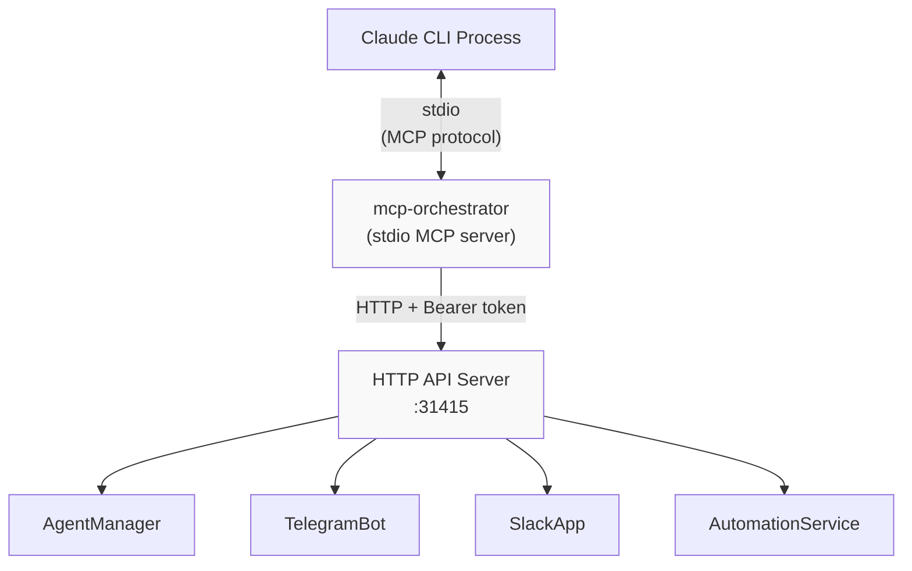
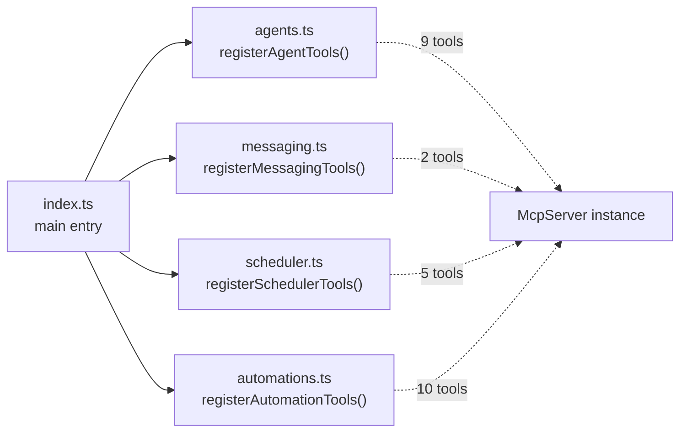
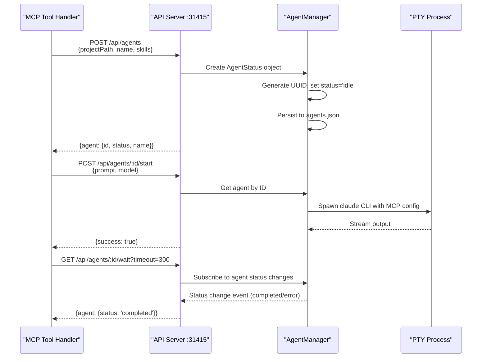
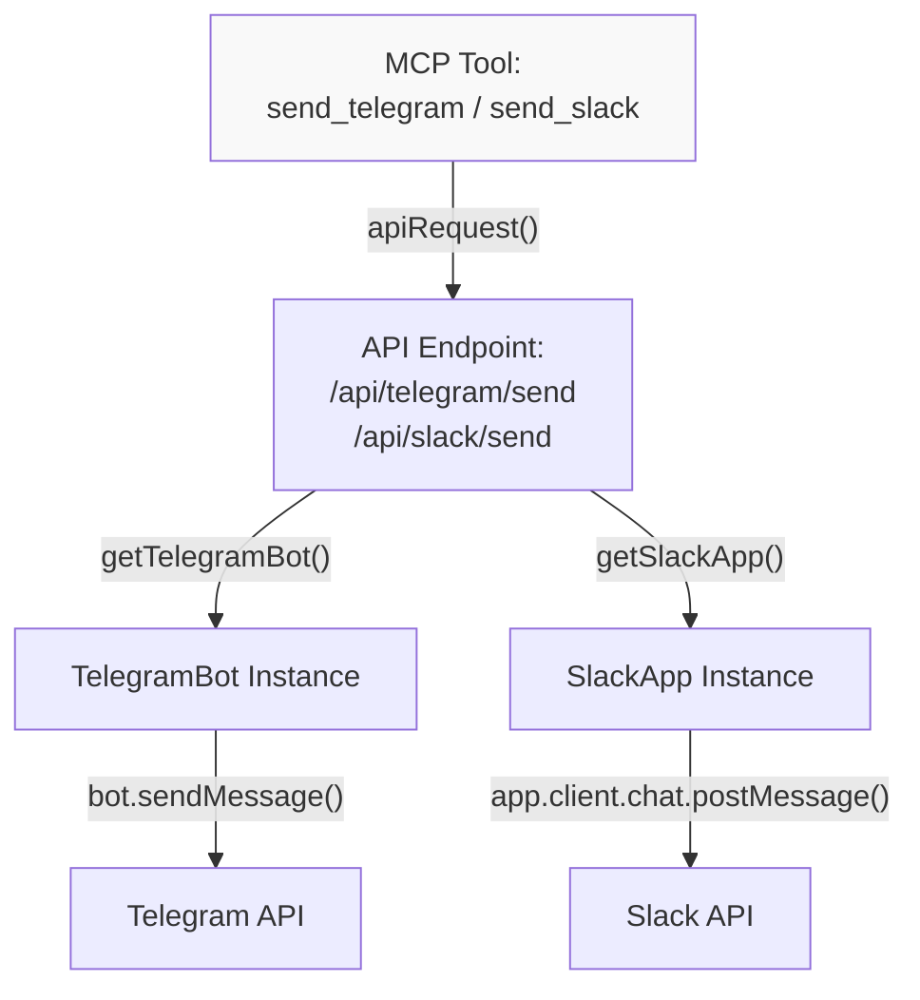
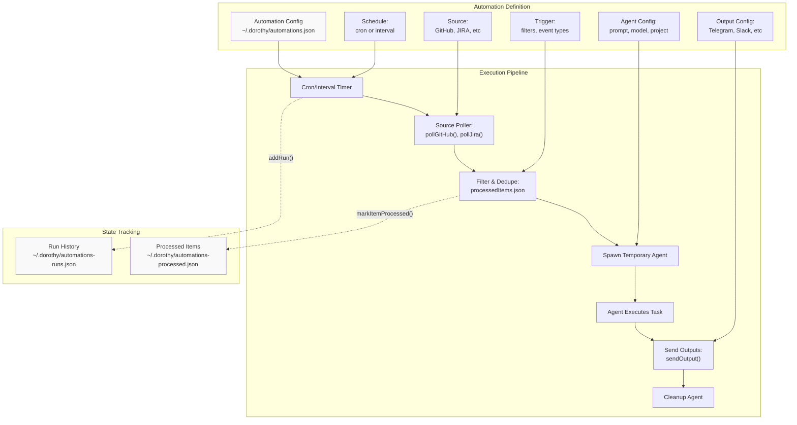

<!-- source: DeepWiki mcp.deepwiki.com · repo Charlie85270/Dorothy · page 4.1 mcp-orchestrator · fetched 2026-10-26 -->

# mcp-orchestrator

<details>
<summary>Relevant source files</summary>

The following files were used as context for generating this wiki page:

- [README.md](README.md)
- [__tests__/mcp/mcp-socialdata.test.ts](__tests__/mcp/mcp-socialdata.test.ts)
- [__tests__/mcp/mcp-vault.test.ts](__tests__/mcp/mcp-vault.test.ts)
- [electron/services/api-server.ts](electron/services/api-server.ts)
- [landing/public/kanban.png](landing/public/kanban.png)
- [landing/public/ollama-icon.svg](landing/public/ollama-icon.svg)
- [landing/src/app/page.tsx](landing/src/app/page.tsx)
- [mcp-orchestrator/src/tools/automations.ts](mcp-orchestrator/src/tools/automations.ts)
- [mcp-orchestrator/src/tools/index.ts](mcp-orchestrator/src/tools/index.ts)
- [mcp-orchestrator/src/utils/api.ts](mcp-orchestrator/src/utils/api.ts)
- [mcp-orchestrator/src/utils/automations.ts](mcp-orchestrator/src/utils/automations.ts)
- [mcp-orchestrator/src/utils/index.ts](mcp-orchestrator/src/utils/index.ts)
- [screenshots/kanban.png](screenshots/kanban.png)

</details>


## Purpose and Scope

The `mcp-orchestrator` MCP server provides 26+ tools that enable programmatic control of Dorothy's agent management, messaging, scheduling, and automation systems. It serves as the primary interface for Claude agents to create, start, stop, and monitor other agents, send messages to Telegram and Slack, manage scheduled tasks, and configure automations that poll external sources like GitHub and JIRA.

This server communicates with Dorothy's Electron main process via an HTTP API server running on port 31415, bridging the gap between Claude's MCP tool execution and Dorothy's core services.

**Related pages:**
- For vault document management tools, see [mcp-vault](#4.2)
- For kanban task management tools, see [mcp-kanban](#4.3)
- For automation configuration in the UI, see [Creating Automations](#7.1)

---

## Architecture

### Communication Model



**Sources:** [electron/services/api-server.ts:1-199](), [mcp-orchestrator/src/utils/api.ts:1-62]()

The orchestrator operates as a stdio-based MCP server spawned by each Claude CLI instance. Tools make authenticated HTTP requests to Dorothy's internal API server at `http://127.0.0.1:31415`, using a Bearer token stored in `~/.dorothy/api-token`.

### Authentication Mechanism

| Component | Location | Purpose |
|-----------|----------|---------|
| `API_TOKEN_FILE` | `~/.dorothy/api-token` | Auto-generated 64-char hex token |
| `apiRequest()` | [mcp-orchestrator/src/utils/api.ts:21-61]() | Reads token and injects `Authorization` header |
| `initApiToken()` | [electron/services/api-server.ts:21-40]() | Generates token on first run with mode `0o600` |

**Sources:** [mcp-orchestrator/src/utils/api.ts:1-62](), [electron/services/api-server.ts:21-47]()

The API server exempts certain local-only endpoints from authentication: `/api/local-file`, `/api/health`, `/api/hooks/*`, `/api/kanban/complete`, and `/api/scheduler/status`.

---

## Tool Categories and Registration

### Tool Registration Architecture



**Sources:** [mcp-orchestrator/src/tools/index.ts:1-5]()

---

## Agent Management Tools

### Tool Inventory

| Tool Name | HTTP Endpoint | Purpose |
|-----------|---------------|---------|
| `list_agents` | `GET /api/agents` | List all agents with status, name, project |
| `get_agent` | `GET /api/agents/:id` | Get detailed agent info including output |
| `get_agent_output` | `GET /api/agents/:id/output` | Read recent terminal output (default: 100 lines) |
| `create_agent` | `POST /api/agents` | Create new agent in idle state |
| `start_agent` | `POST /api/agents/:id/start` | Start agent with task prompt |
| `send_message` | `POST /api/agents/:id/message` | Send input to running agent |
| `stop_agent` | `POST /api/agents/:id/stop` | Terminate running agent |
| `remove_agent` | `POST /api/agents/:id/remove` | Permanently delete agent |
| `wait_for_agent` | `GET /api/agents/:id/wait` | Long-poll until completion (default timeout: 300s) |

**Sources:** [README.md:418-429]()

### Agent Lifecycle Flow



**Sources:** [README.md:613-622](), [Diagram 8 from high-level architecture]()

### Key Parameters

#### `create_agent` Parameters

```typescript
{
  projectPath: string,           // Absolute path to project directory
  name?: string,                 // Display name (auto-generated if omitted)
  skills?: string[],             // Skills to install (e.g., ["gws-gmail"])
  character?: string,            // Character/personality template
  skipPermissions?: boolean,     // Default: true for autonomous execution
  secondaryProjectPath?: string  // Additional context directory (--add-dir)
}
```

#### `start_agent` Parameters

```typescript
{
  prompt: string,                // Task description
  model?: "sonnet" | "opus" | "haiku", // Claude model variant
  skipPermissions?: boolean      // Override permissions check
}
```

**Sources:** [README.md:424-427]()

### Agent Status States

| State | Description | Terminal State |
|-------|-------------|----------------|
| `idle` | Agent created but not started | No |
| `running` | Actively executing task | No |
| `waiting` | Waiting for user input | No |
| `completed` | Task finished successfully | Yes |
| `error` | Execution failed | Yes |

**Sources:** [README.md:59]()

---

## Messaging Tools

### Tool Inventory

| Tool Name | Endpoint | Max Length | Truncation |
|-----------|----------|------------|------------|
| `send_telegram` | `POST /api/telegram/send` | 4096 chars | Auto-truncate |
| `send_slack` | `POST /api/slack/send` | 4000 chars | Auto-truncate |

**Sources:** [README.md:432-436]()

### Message Delivery Flow



**Sources:** [electron/services/api-server.ts:73-99](), [README.md:432-436]()

Both tools check if the respective integration is enabled in `~/.dorothy/app-settings.json` before attempting to send messages. If the bot token is not configured, the API returns an error.

---

## Scheduler Tools

### Tool Inventory

| Tool Name | Endpoint | Purpose |
|-----------|----------|---------|
| `list_scheduled_tasks` | `GET /api/scheduler/tasks` | List all recurring tasks with cron schedule |
| `create_scheduled_task` | `POST /api/scheduler/tasks` | Create new cron-based task |
| `delete_scheduled_task` | `DELETE /api/scheduler/tasks/:id` | Remove scheduled task |
| `run_scheduled_task` | `POST /api/scheduler/tasks/:id/run` | Execute task immediately |
| `get_scheduled_task_logs` | `GET /api/scheduler/tasks/:id/logs` | Retrieve execution logs (default: 50 lines) |

**Sources:** [README.md:438-446]()

### Cron Expression Format

```
┌───────────── minute (0-59)
│ ┌───────────── hour (0-23)
│ │ ┌───────────── day of month (1-31)
│ │ │ ┌───────────── month (1-12)
│ │ │ │ ┌───────────── day of week (0-7, 0 and 7 = Sunday)
│ │ │ │ │
* * * * *
```

**Common patterns:**

| Expression | Description |
|------------|-------------|
| `0 9 * * *` | Daily at 9:00 AM |
| `0 9 * * 1-5` | Weekdays at 9:00 AM |
| `*/15 * * * *` | Every 15 minutes |
| `0 */2 * * *` | Every 2 hours |
| `30 14 * * 1` | Mondays at 2:30 PM |

**Sources:** [README.md:231-249]()

### Task Storage and Execution

| Platform | Scheduler | Script Location | Log Location |
|----------|-----------|-----------------|--------------|
| macOS | `launchd` | `~/.dorothy/scripts/` | `~/.claude/logs/` |
| Linux | `cron` | `~/.dorothy/scripts/` | `~/.claude/logs/` |

**Sources:** [README.md:252-260]()

Scheduled tasks persist to `~/.claude/schedules.json`. Each task generates a shell script that invokes the Claude CLI with the configured prompt and project path. The scheduler service monitors these scripts and registers them with the OS-level scheduler.

---

## Automation Tools

### Tool Inventory

| Tool Name | Purpose |
|-----------|---------|
| `list_automations` | List all automations with status, source type, schedule |
| `get_automation` | Get details including recent runs |
| `create_automation` | Create new automation with source, triggers, and outputs |
| `update_automation` | Modify automation configuration |
| `delete_automation` | Remove automation |
| `run_automation` | Trigger immediate execution |
| `pause_automation` | Disable scheduled execution |
| `resume_automation` | Re-enable paused automation |
| `run_due_automations` | Check and run all due automations |
| `get_automation_logs` | Retrieve execution history (default limit: 10) |
| `update_jira_issue` | Update JIRA issue status/comment (used by automations) |

**Sources:** [README.md:448-462]()

### Automation Architecture



**Sources:** [mcp-orchestrator/src/tools/automations.ts:1-954](), [README.md:100-192]()

### Source Pollers

#### GitHub Poller

```typescript
// Via gh CLI
async function pollGitHub(config: GitHubSourceConfig) {
  for (const repo of config.repos) {
    for (const pollFor of config.pollFor) {
      if (pollFor === "pull_requests") {
        const { stdout } = await execAsync(
          `gh pr list --repo ${repo} --state open --json number,title,url,author,body,labels,createdAt,updatedAt,headRefOid --limit 20`
        );
        // Parse JSON and create items
      }
      // Similar for "issues", "releases"
    }
  }
}
```

**Sources:** [mcp-orchestrator/src/tools/automations.ts:170-254]()

#### JIRA Poller

```typescript
// Via REST API v3
async function pollJira(config: JiraSourceConfig) {
  const { domain, email, apiToken } = loadJiraCredentials(config);
  const jql = config.jql || `project IN (${projectKeys}) ORDER BY updated DESC`;
  
  const res = await fetch(`https://${domain}.atlassian.net/rest/api/3/search/jql`, {
    method: "POST",
    headers: jiraAuthHeaders(email, apiToken),
    body: JSON.stringify({
      jql,
      maxResults: 20,
      fields: ["summary", "description", "status", "issuetype", ...]
    })
  });
  // Parse issues and create items
}
```

**Sources:** [mcp-orchestrator/src/tools/automations.ts:377-453]()

### Item Deduplication

Items are deduplicated using a combination of ID and content hash:

```typescript
function createItemId(source: string, repo: string, type: string, number: string): string {
  return `${source}:${repo}:${type}:${number}`;
}

function hashContent(content: string): string {
  return createHash("sha256").update(content).digest("hex");
}
```

**Sources:** [mcp-orchestrator/src/utils/automations.ts:234-250]()

For GitHub PRs, the hash includes the `headRefOid` (commit SHA) and `updatedAt` timestamp. For JIRA issues, it uses only `updatedAt`. This allows detection of updates to existing items when `onUpdatedItem: true`.

### Template Variable Interpolation

Automation prompts and output templates support variable substitution:

#### GitHub Variables

| Variable | Source Field |
|----------|--------------|
| `{{title}}` | `pr.title` or `issue.title` |
| `{{url}}` | Item URL |
| `{{author}}` | `pr.author.login` |
| `{{body}}` | `pr.body` or `issue.body` |
| `{{labels}}` | Comma-separated label names |
| `{{repo}}` | Repository name |
| `{{number}}` | PR or issue number |
| `{{type}}` | `"pr"`, `"issue"`, or `"release"` |

#### JIRA Variables

| Variable | Source Field |
|----------|--------------|
| `{{key}}` | Issue key (e.g., `PROJ-123`) |
| `{{summary}}` | `fields.summary` |
| `{{status}}` | `fields.status.name` |
| `{{issueType}}` | `fields.issuetype.name` |
| `{{priority}}` | `fields.priority.name` |
| `{{assignee}}` | `fields.assignee.displayName` |
| `{{reporter}}` | `fields.reporter.displayName` |
| `{{url}}` | Issue URL |
| `{{body}}` | Extracted ADF text from `fields.description` |

**Sources:** [README.md:129-156](), [mcp-orchestrator/src/tools/automations.ts:658-683]()

### JIRA Kanban Integration

JIRA automations automatically create kanban tasks:

```typescript
function createKanbanTaskFromJiraItem(item: PollResult["items"][0], automation: Automation) {
  const jiraKey = item.raw.key as string;
  // Check for existing task with label "jira:PROJ-123"
  const existingTask = tasks.find(t => t.labels?.includes(`jira:${jiraKey}`));
  if (existingTask) return;
  
  // Map JIRA priority to kanban priority (high/medium/low)
  const priority = mapJiraPriority(item.raw.priority);
  
  const newTask = {
    id: generateId() + generateId(),
    title: `[${jiraKey}] ${item.title}`,
    description: `**JIRA Issue:** ${item.url}\n...\n${item.body}`,
    column: "backlog",
    projectPath: automation.agent.projectPath,
    priority,
    labels: [`jira:${jiraKey}`, "jira", item.type],
    // ...
  };
  
  tasks.push(newTask);
  fs.writeFileSync(KANBAN_FILE, JSON.stringify(tasks, null, 2));
}
```

**Sources:** [mcp-orchestrator/src/tools/automations.ts:263-337]()

### Output Types

#### Telegram Output

```typescript
case "telegram":
  await apiRequest("/api/telegram/send", "POST", { message: finalMessage });
  break;
```

#### Slack Output

```typescript
case "slack":
  await apiRequest("/api/slack/send", "POST", { message: finalMessage });
  break;
```

#### GitHub Comment Output

```typescript
case "github_comment":
  const cmd = type === "issue"
    ? `gh issue comment ${number} --repo ${repo} --body '${finalMessage}'`
    : `gh pr comment ${number} --repo ${repo} --body '${finalMessage}'`;
  await execAsync(cmd);
  break;
```

#### JIRA Comment Output

```typescript
case "jira_comment":
  await fetch(`https://${domain}.atlassian.net/rest/api/3/issue/${issueKey}/comment`, {
    method: "POST",
    headers: jiraAuthHeaders(email, apiToken),
    body: JSON.stringify({
      body: {
        type: "doc",
        version: 1,
        content: [{ type: "paragraph", content: [{ type: "text", text: finalMessage }] }]
      }
    })
  });
  break;
```

#### JIRA Transition Output

```typescript
case "jira_transition":
  // Fetch available transitions
  const transRes = await fetch(`https://${domain}.atlassian.net/rest/api/3/issue/${issueKey}/transitions`);
  const transData = await transRes.json();
  const transition = transData.transitions.find(t => t.name.toLowerCase() === targetTransition.toLowerCase());
  
  // Apply transition
  await fetch(`https://${domain}.atlassian.net/rest/api/3/issue/${issueKey}/transitions`, {
    method: "POST",
    body: JSON.stringify({ transition: { id: transition.id } })
  });
  break;
```

**Sources:** [mcp-orchestrator/src/tools/automations.ts:478-576]()

### Webhook Output Security

Webhook URLs are validated to prevent SSRF attacks:

```typescript
function isAllowedWebhookUrl(urlString: string): boolean {
  const parsed = new URL(urlString);
  if (parsed.protocol !== 'https:') return false;
  
  // Block localhost, 127.0.0.1, ::1
  if (hostname === 'localhost' || hostname === '[::1]') return false;
  
  // Block private IP ranges (10.0.0.0/8, 172.16.0.0/12, 192.168.0.0/16)
  // Block link-local (169.254.0.0/16)
  // ...
  
  return true;
}
```

**Sources:** [mcp-orchestrator/src/tools/automations.ts:44-74]()

Only HTTPS URLs to public internet hosts are allowed.

### Execution Flow with Agent Instructions

When `agent.enabled: true`, the automation injects output instructions into the agent prompt:

```typescript
const outputInstructions: string[] = [];
for (const output of automation.outputs) {
  if (output.enabled) {
    if (output.type === "telegram") {
      outputInstructions.push("- Use the send_telegram MCP tool to send your final result to Telegram");
    }
    if (output.type === "github_comment") {
      outputInstructions.push(`- Post your result as a comment on GitHub PR #${number} in ${repo} using: gh pr comment ${number} --repo ${repo} --body "YOUR_CONTENT"`);
    }
    if (output.type === "jira_comment") {
      outputInstructions.push(`- When done, update the JIRA issue ${issueKey} by calling the update_jira_issue MCP tool with a comment containing your results`);
    }
    // ...
  }
}

const prompt = `${basePrompt}

IMPORTANT INSTRUCTIONS:
- Work autonomously without asking for user feedback
- Generate your content and then send it using the tools below
${outputInstructions.join("\n")}
- Do NOT output explanations or multiple options - just create and send the final content`;
```

**Sources:** [mcp-orchestrator/src/tools/automations.ts:688-722]()

This ensures the agent knows how to deliver its output using the appropriate MCP tools.

---

## CLI Path Resolution

The orchestrator needs to execute external CLI tools like `gh` (GitHub CLI) and `claude`. It resolves paths using a shared configuration:

```typescript
const CLI_PATHS_CONFIG_FILE = path.join(os.homedir(), ".dorothy", "cli-paths.json");

function buildFullPath(): string {
  const config = loadCLIPathsConfig();
  if (config?.fullPath) {
    return config.fullPath;
  }
  
  // Fallback: construct PATH from common locations
  const additionalPaths = [
    "/opt/homebrew/bin",
    "/usr/local/bin",
    path.join(homeDir, ".local/bin"),
    // NVM node versions, etc.
  ];
  
  return [...new Set([...additionalPaths, ...existingPath.split(":")])].join(":");
}
```

**Sources:** [mcp-orchestrator/src/tools/automations.ts:76-136]()

This shared configuration is written by the Electron app's settings page (see [CLI Paths Settings](#13.3)) and ensures that automation pollers can find tools like `gh` even when running in non-interactive shell contexts.

---

## Data Persistence

### Storage Locations

| File | Purpose | Format |
|------|---------|--------|
| `~/.dorothy/api-token` | API authentication token | Plain text (64-char hex) |
| `~/.dorothy/automations.json` | Automation definitions | JSON array of `Automation` |
| `~/.dorothy/automations-processed.json` | Deduplication tracking | JSON map of `ProcessedItem` |
| `~/.dorothy/automations-runs.json` | Execution history (capped at 1000) | JSON array of `AutomationRun` |
| `~/.claude/schedules.json` | Scheduled task definitions | JSON array |

**Sources:** [mcp-orchestrator/src/utils/automations.ts:147-150](), [README.md:736-744]()

### Automation State Types

```typescript
export interface Automation {
  id: string;
  name: string;
  enabled: boolean;
  schedule: { type: "cron" | "interval"; cron?: string; intervalMinutes?: number };
  source: { type: SourceType; config: SourceConfig };
  trigger: { eventTypes: string[]; filters?: FilterRule[]; onNewItem: boolean; onUpdatedItem?: boolean };
  agent: { enabled: boolean; projectPath?: string; prompt: string; model?: "sonnet" | "opus" | "haiku"; timeout?: number };
  outputs: OutputConfig[];
}

export interface ProcessedItem {
  id: string;           // e.g., "github:owner/repo:pr:42"
  sourceType: SourceType;
  itemType: string;     // "pr", "issue", "release"
  itemId: string;
  lastProcessedAt: string;
  lastHash?: string;    // For update detection
}

export interface AutomationRun {
  id: string;
  automationId: string;
  startedAt: string;
  completedAt?: string;
  status: "running" | "completed" | "error";
  itemsFound: number;
  itemsProcessed: number;
  error?: string;
  agentOutput?: string;
}
```

**Sources:** [mcp-orchestrator/src/utils/automations.ts:73-141]()

### Run History Capping

To prevent unbounded growth, the run history is capped:

```typescript
export function addRun(run: AutomationRun): void {
  const state = loadState();
  state.runs.push(run);
  // Cap at 1000 most recent runs
  if (state.runs.length > 1000) {
    state.runs = state.runs.slice(-1000);
  }
  saveState(state);
}
```

**Sources:** [mcp-orchestrator/src/utils/automations.ts:219-228]()

---

## Error Handling

### Long-Poll Timeout

The `wait_for_agent` tool uses a long-poll mechanism with configurable timeout:

```typescript
// In apiRequest()
const isLongPoll = endpoint.includes("/wait");
const timeoutMs = isLongPoll ? 600_000 : 30_000; // 10 min for long-poll, 30s default

const controller = new AbortController();
const timer = setTimeout(() => controller.abort(), timeoutMs);
```

**Sources:** [mcp-orchestrator/src/utils/api.ts:34-38]()

If the agent doesn't complete within the timeout, the request is aborted and the tool handler receives a timeout error.

### Automation Error Recovery

When an automation run fails, the error is captured in the run record:

```typescript
try {
  // Automation execution logic
} catch (error) {
  run.status = "error";
  run.error = error instanceof Error ? error.message : String(error);
  run.completedAt = new Date().toISOString();
  updateRun(run);
}
```

**Sources:** [mcp-orchestrator/src/tools/automations.ts:582-789]()

Failed runs are logged and do not block subsequent executions. The automation remains enabled unless explicitly paused.

---

## Integration with Super Agent

The Super Agent (see [Super Agent](#9.3)) has access to all mcp-orchestrator tools, enabling high-level orchestration:

**Example workflow:**
1. Super Agent receives Telegram message: "Review all open PRs in myorg/myrepo"
2. Calls `create_automation` with:
   - Source: GitHub (`repos: ["myorg/myrepo"]`, `pollFor: ["pull_requests"]`)
   - Trigger: New PRs only
   - Agent: Review prompt with model `sonnet`
   - Output: GitHub comments + Telegram summary
3. Calls `run_automation` to trigger immediate execution
4. Monitors execution via `get_automation_logs`
5. Reports results via `send_telegram`

This pattern allows the Super Agent to dynamically create and manage automations based on natural language requests.

**Sources:** [README.md:66-75](), [Diagram 6 from high-level architecture]()

---

