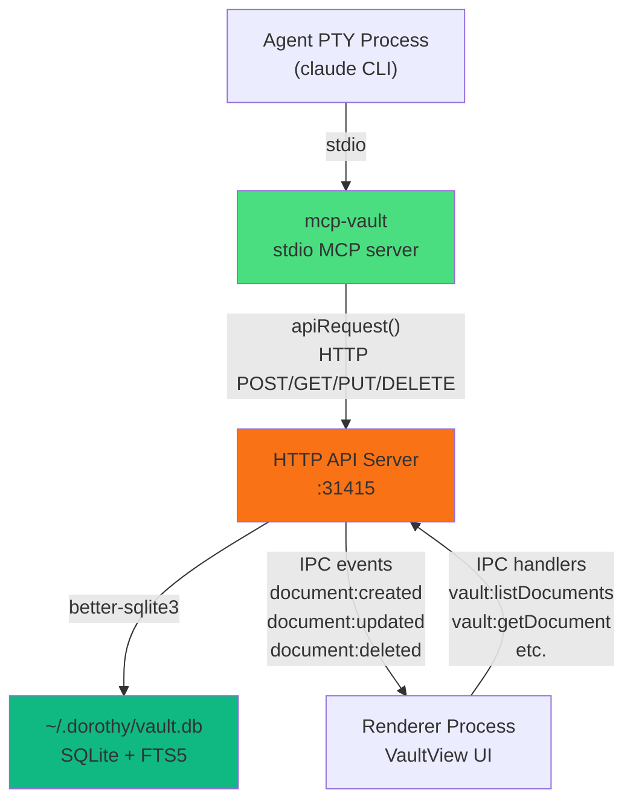
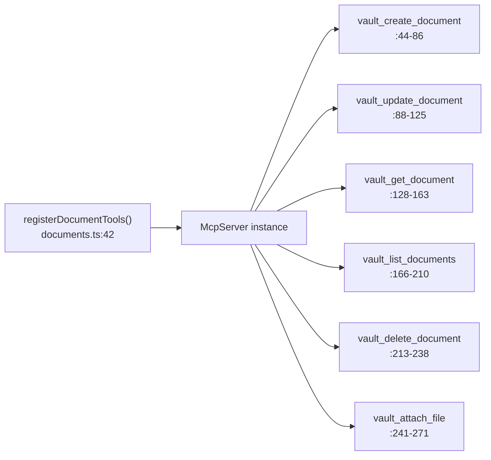
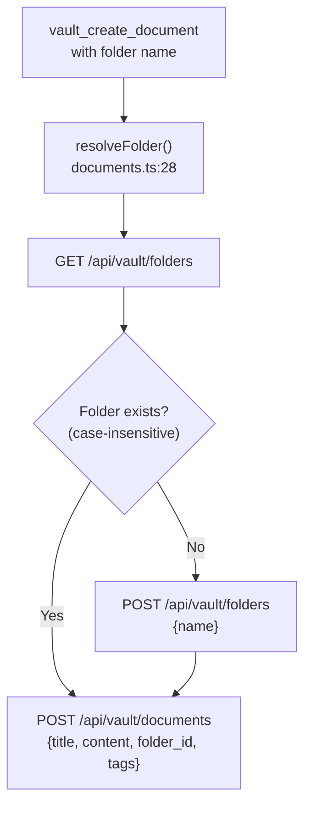
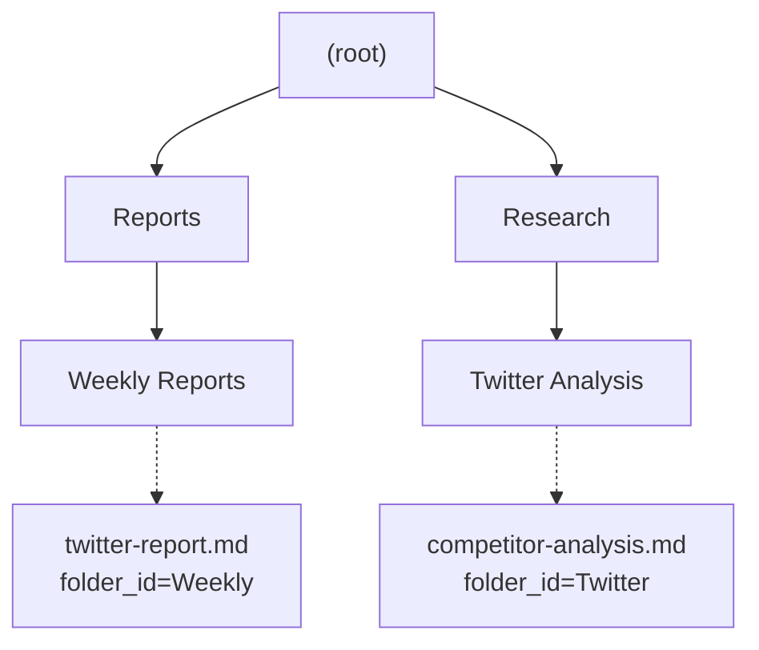
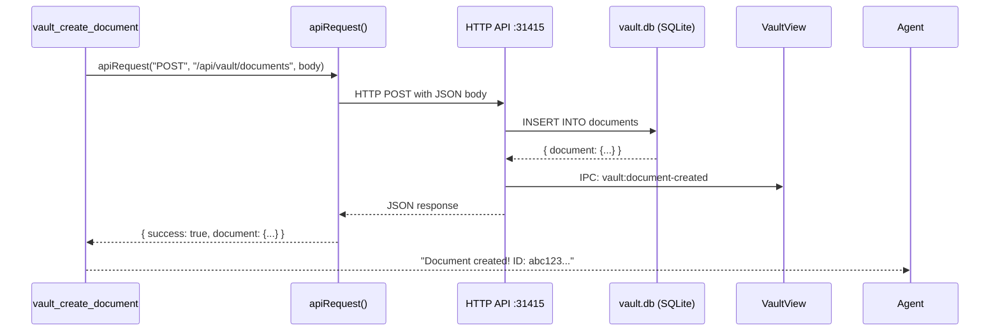
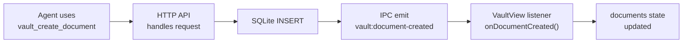
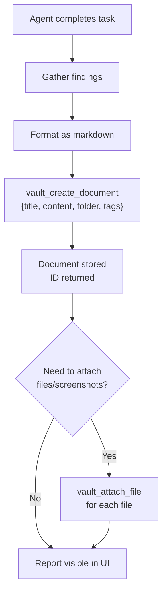

<!-- source: DeepWiki mcp.deepwiki.com · repo Charlie85270/Dorothy · page 4.2 mcp-vault · fetched 2026-10-26 -->

# mcp-vault

<details>
<summary>Relevant source files</summary>

The following files were used as context for generating this wiki page:

- [CLAUDE.md](CLAUDE.md)
- [bun.lock](bun.lock)
- [electron/handlers/memory-handlers.ts](electron/handlers/memory-handlers.ts)
- [mcp-vault/src/tools/documents.ts](mcp-vault/src/tools/documents.ts)
- [src/app/globals.css](src/app/globals.css)
- [src/app/memory/page.tsx](src/app/memory/page.tsx)
- [src/app/recurring-tasks/page.tsx](src/app/recurring-tasks/page.tsx)
- [src/app/vault/page.tsx](src/app/vault/page.tsx)
- [src/components/ClientLayout.tsx](src/components/ClientLayout.tsx)
- [src/components/Memory/AgentKnowledgeGraph.tsx](src/components/Memory/AgentKnowledgeGraph.tsx)
- [src/components/Sidebar.tsx](src/components/Sidebar.tsx)
- [src/components/VaultView/components/FolderTree.tsx](src/components/VaultView/components/FolderTree.tsx)
- [src/components/VaultView/index.tsx](src/components/VaultView/index.tsx)

</details>


**mcp-vault** is an MCP (Model Context Protocol) server that provides agents with programmatic access to Dorothy's SQLite-based document vault. It exposes 10 tools for creating, reading, updating, deleting, and searching structured documents with folders, tags, and file attachments. Unlike the native Claude Code memory system (covered in [6.1](#6.1)), the vault is Dorothy-specific and designed for storing reports, research findings, and persistent knowledge that agents generate during their work.

For UI-based vault access, see [6.3](#6.3). For the broader MCP ecosystem overview, see [4](#4).

---

## Architecture and Communication

**mcp-vault** runs as a stdio-based MCP server spawned per agent. It does not directly access the SQLite database; instead, it communicates with Dorothy's HTTP API server (port 31415) to perform all operations. This architecture ensures consistent access control and real-time event propagation to the UI.



**Sources:** High-level diagram 3 (Agent Execution and MCP Tool Ecosystem), [mcp-vault/src/tools/documents.ts:1-85]()

---

## Database Schema

The vault database (`~/.dorothy/vault.db`) uses SQLite with three main tables and an FTS5 virtual table for full-text search:

| Table | Columns | Purpose |
|-------|---------|---------|
| `documents` | `id`, `title`, `content`, `folder_id`, `author`, `agent_id`, `tags` (JSON), `created_at`, `updated_at` | Core document storage with markdown content |
| `folders` | `id`, `name`, `parent_id`, `created_at`, `updated_at` | Hierarchical folder structure (unlimited nesting) |
| `attachments` | `id`, `document_id`, `filename`, `mimetype`, `size`, `file_path`, `created_at` | File attachments linked to documents |
| `documents_fts` (virtual) | FTS5 index on `title` and `content` | Full-text search powered by SQLite FTS5 |

**Key characteristics:**
- Documents support markdown content (rendered in UI via `MarkdownRenderer`)
- Tags stored as JSON array strings (e.g., `'["report", "weekly"]'`)
- `folder_id` nullable (root-level documents)
- `parent_id` nullable (root-level folders)
- `agent_id` tracks which agent created a document (from `CLAUDE_AGENT_ID` env var)
- Attachments reference files on disk; actual file data not stored in DB

**Sources:** [mcp-vault/src/tools/documents.ts:5-23](), High-level diagram 3

---

## MCP Tool Registration

All vault tools are registered via `registerDocumentTools()` in a single registration function. Each tool follows the same pattern: validate inputs with Zod schemas, call `apiRequest()` helper, return formatted results.



**Sources:** [mcp-vault/src/tools/documents.ts:42-271]()

---

## Document Tools

### vault_create_document

Creates a new document with automatic folder resolution. If a folder name is specified, the tool searches for an existing folder with that name (case-insensitive) or creates a new root-level folder.

**Inputs:**
- `title` (string): Document title
- `content` (string): Markdown content
- `folder` (string): Folder name (not ID) — automatically resolved or created
- `tags` (string[], optional): Tag array for categorization

**Folder resolution flow:**



**Example invocation:**
```typescript
// Agent calls via MCP
vault_create_document({
  title: "Twitter Analysis Report",
  content: "# Findings\n\n...",
  folder: "Weekly Reports",
  tags: ["report", "twitter", "competitor"]
})
```

**Implementation details:**
- `resolveFolder()` helper at [mcp-vault/src/tools/documents.ts:28-40]()
- Main tool implementation at [mcp-vault/src/tools/documents.ts:44-86]()
- Author extracted from `process.env.CLAUDE_AGENT_NAME` or `CLAUDE_AGENT_ID`
- `agent_id` stored if available for audit trail

**Sources:** [mcp-vault/src/tools/documents.ts:44-86]()

---

### vault_update_document

Updates an existing document. All fields are optional — only specified fields are updated.

**Inputs:**
- `document_id` (string): Target document ID
- `title` (string, optional): New title
- `content` (string, optional): New content (replaces entire content)
- `tags` (string[], optional): New tags (replaces existing)
- `folder_id` (string, optional): Move to different folder

**Implementation:** [mcp-vault/src/tools/documents.ts:88-125]()

---

### vault_get_document

Retrieves a single document with full content and attachment metadata.

**Inputs:**
- `document_id` (string): Document to retrieve

**Output format:**
```
Title: <title>
ID: <id>
Author: <author>
Folder: <folder_id or "Root">
Tags: <tag1, tag2, ...>
Created: <ISO timestamp>
Updated: <ISO timestamp>
Attachments:
  - <filename> (<mimetype>, <size> bytes)

---

<content markdown>
```

**Implementation:** [mcp-vault/src/tools/documents.ts:128-163]()

---

### vault_list_documents

Lists documents with optional filtering by folder or tags.

**Inputs:**
- `folder_id` (string, optional): Filter by folder
- `tags` (string[], optional): Filter by tags (matches any)

**Query construction:**
```typescript
// Example: filter by folder and tags
path = "/api/vault/documents?folder_id=abc123&tags=report,weekly"
```

**Output:** Summary list with truncated metadata per document:
```
Found N document(s):
- [<id-prefix>] <title> (by <author>, <date>, tags: <tag1, tag2>)
```

**Implementation:** [mcp-vault/src/tools/documents.ts:166-210]()

---

### vault_delete_document

Permanently deletes a document and all its attachments.

**Inputs:**
- `document_id` (string): Document to delete

**Implementation:** [mcp-vault/src/tools/documents.ts:213-238]()

---

### vault_attach_file

Attaches a file from the filesystem to a document. The file is copied to Dorothy's attachment storage.

**Inputs:**
- `document_id` (string): Target document
- `file_path` (string): Absolute path to file

**API endpoint:** `POST /api/vault/documents/:id/attach`

**Output:**
```
File attached successfully!
Attachment ID: <id>
Filename: <filename>
Type: <mimetype>
Size: <bytes> bytes
```

**Implementation:** [mcp-vault/src/tools/documents.ts:241-271]()

**Sources:** [mcp-vault/src/tools/documents.ts:241-271]()

---

## Folder Management

While folder tools are not shown in the provided `documents.ts` excerpt, the system supports hierarchical folder organization. From the UI code and high-level diagrams, folder tools include:

1. **vault_create_folder**: Creates a folder with optional `parent_id`
2. **vault_list_folders**: Lists all folders
3. **vault_delete_folder**: Deletes a folder (documents must be moved first)

Folders support unlimited nesting depth. The `resolveFolder()` helper automatically creates root-level folders when needed.

**Folder hierarchy example:**



**Sources:** High-level diagram 3, [src/components/VaultView/components/FolderTree.tsx:1-370]()

---

## Full-Text Search (FTS5)

The vault uses SQLite FTS5 for fast full-text search across document titles and content. Search is exposed via the `vault_search` tool (not in provided documents.ts excerpt but referenced in system diagrams).

**Search capabilities:**
- Title and content indexed
- Boolean queries supported (AND, OR, NOT)
- Phrase matching with quotes
- Ranked results by relevance
- Snippet generation for result previews

**Example search invocation:**
```typescript
vault_search({ query: "twitter AND competitor" })
// Returns ranked list of matching documents
```

**UI integration:** Search bar in VaultView at [src/components/VaultView/index.tsx:349-374]() triggers `window.electronAPI.vault.search()`.

**Sources:** High-level diagram 3, [src/components/VaultView/index.tsx:199-217]()

---

## HTTP API Integration

All MCP tools communicate with Dorothy's HTTP API server via the `apiRequest()` helper. The API layer handles:

1. **Authentication:** Validates requests (token-based or local-only)
2. **Database operations:** Executes SQLite queries via `better-sqlite3`
3. **Event emission:** Broadcasts IPC events for real-time UI updates
4. **Error handling:** Returns structured error responses

**API request flow:**



**API endpoints used by mcp-vault:**

| Method | Endpoint | Purpose |
|--------|----------|---------|
| GET | `/api/vault/documents` | List documents (with filters) |
| POST | `/api/vault/documents` | Create document |
| GET | `/api/vault/documents/:id` | Get single document |
| PUT | `/api/vault/documents/:id` | Update document |
| DELETE | `/api/vault/documents/:id` | Delete document |
| POST | `/api/vault/documents/:id/attach` | Attach file |
| GET | `/api/vault/folders` | List folders |
| POST | `/api/vault/folders` | Create folder |
| DELETE | `/api/vault/folders/:id` | Delete folder |

**Sources:** [mcp-vault/src/tools/documents.ts:29](), [mcp-vault/src/tools/documents.ts:61](), [mcp-vault/src/tools/documents.ts:107]()

---

## Real-Time UI Synchronization

When agents create or modify vault documents, the UI updates immediately without polling. This is achieved through IPC event listeners registered in `VaultView`.

**Event flow:**



**Listener registration in VaultView:**

[src/components/VaultView/index.tsx:151-180]()
- `onDocumentCreated`: Prepends new document to list
- `onDocumentUpdated`: Updates document in place
- `onDocumentDeleted`: Removes document from list

**Unread document tracking:**

The UI tracks which documents have been viewed using `localStorage` (`vault-read-docs` key). When an agent creates a document via MCP, it appears with an unread badge until the user opens it. Badge count synced to sidebar via Zustand store.

**Sources:** [src/components/VaultView/index.tsx:151-180](), [src/components/Sidebar.tsx:110-125]()

---

## Usage Patterns

### Agent Workflow: Creating a Report



### Example: Weekly Twitter Analysis

```typescript
// 1. Create report document
const doc = await vault_create_document({
  title: "Twitter Competitor Analysis - Week 12",
  content: `# Executive Summary\n\n...`,
  folder: "Weekly Reports",
  tags: ["report", "twitter", "competitors", "week12"]
});

// 2. Attach supporting data
await vault_attach_file({
  document_id: doc.id,
  file_path: "/tmp/twitter-metrics.csv"
});

// 3. Update with additional findings later
await vault_update_document({
  document_id: doc.id,
  content: doc.content + "\n\n## Addendum\n\n..."
});
```

**Sources:** [mcp-vault/src/tools/documents.ts:44-86](), [mcp-vault/src/tools/documents.ts:241-271]()

---

## Comparison with Memory System

Dorothy provides two distinct knowledge storage systems:

| Feature | **Vault** (mcp-vault) | **Memory** ([6.1](#6.1)) |
|---------|----------------------|-------------------------|
| Storage | SQLite (`~/.dorothy/vault.db`) | Claude Code native (`~/.claude/projects/*/memory/`) |
| Structure | Documents with folders, tags, attachments | Markdown files (MEMORY.md + topic files) |
| Access | MCP tools + UI | File I/O + UI browser |
| Search | FTS5 full-text search | Manual file search |
| Scope | Dorothy-specific | Claude Code-wide |
| Use case | Reports, structured research, artifacts | Project context, patterns, architectural notes |
| Agent creation | Explicit (vault_create_document) | Automatic (Claude Code writes memory) |

**When to use vault:**
- Storing discrete reports or analyses
- Organizing by topic with folders/tags
- Attaching reference files
- Sharing knowledge across agents

**When to use memory:**
- Recording project-specific learnings
- Documenting code patterns
- Maintaining context for a single agent

**Sources:** High-level diagram 7, [CLAUDE.md:1-12]()

---

## Configuration and Initialization

**mcp-vault** is loaded per agent via MCP config. Each agent's `mcp.json` includes:

```json
{
  "mcpServers": {
    "vault": {
      "command": "node",
      "args": ["~/.dorothy/mcp-servers/mcp-vault/dist/index.js"]
    }
  }
}
```

The server initializes by:
1. Importing tool registration functions
2. Calling `registerDocumentTools(server)`
3. Starting stdio transport for MCP communication

**Environment variables used:**
- `CLAUDE_AGENT_NAME`: Agent name (for author field)
- `CLAUDE_AGENT_ID`: Agent ID (for agent_id field)
- `DOROTHY_API_URL`: HTTP API base URL (defaults to `http://localhost:31415`)

**Database initialization:** The SQLite database is created automatically by the HTTP API server on first access if it doesn't exist.

**Sources:** High-level diagram 3, [mcp-vault/src/tools/documents.ts:55-56]()

---

## Error Handling

All tools follow a consistent error handling pattern:

1. Wrap operations in try-catch
2. Return structured error responses with `isError: true`
3. Include descriptive error messages

**Example from vault_create_document:**

[mcp-vault/src/tools/documents.ts:76-84]()
```typescript
} catch (error) {
  return {
    content: [{
      type: "text" as const,
      text: `Error creating document: ${error instanceof Error ? error.message : String(error)}`,
    }],
    isError: true,
  };
}
```

**Common error scenarios:**
- Document not found (404 from API)
- Invalid folder ID
- File attachment path doesn't exist
- SQLite constraint violations (e.g., duplicate folder names)

**Sources:** [mcp-vault/src/tools/documents.ts:76-84]()

---

