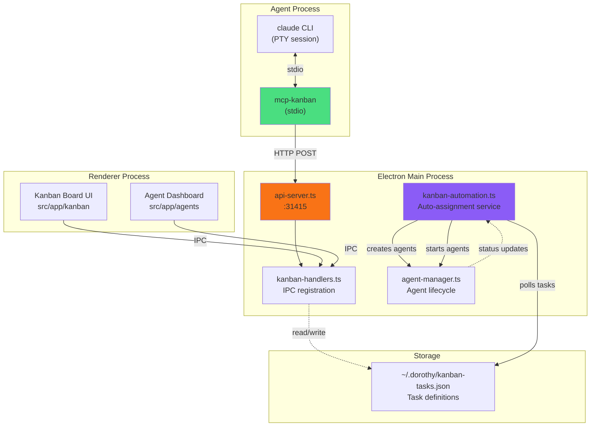
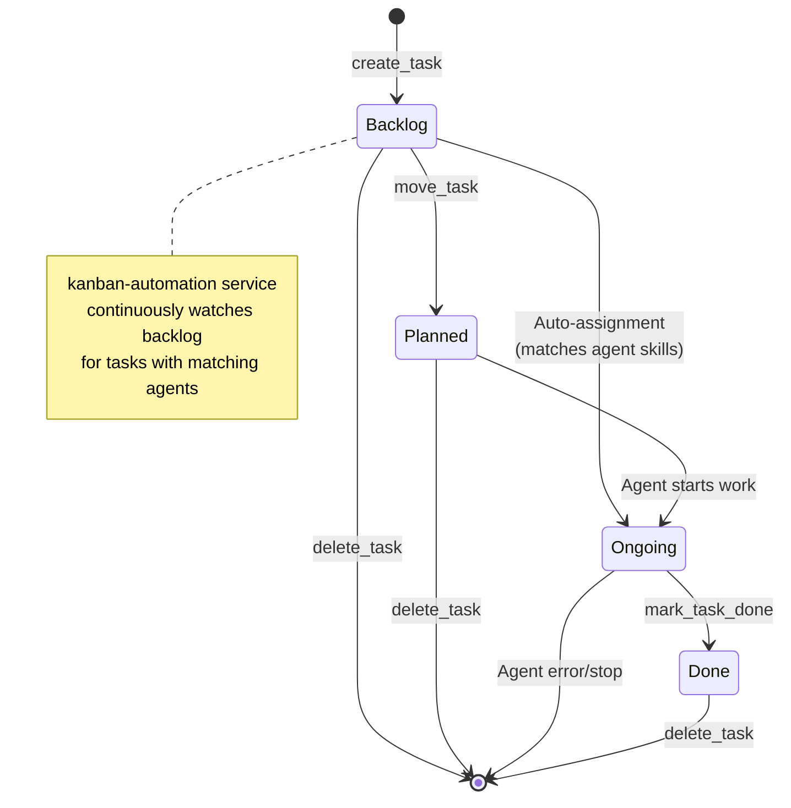
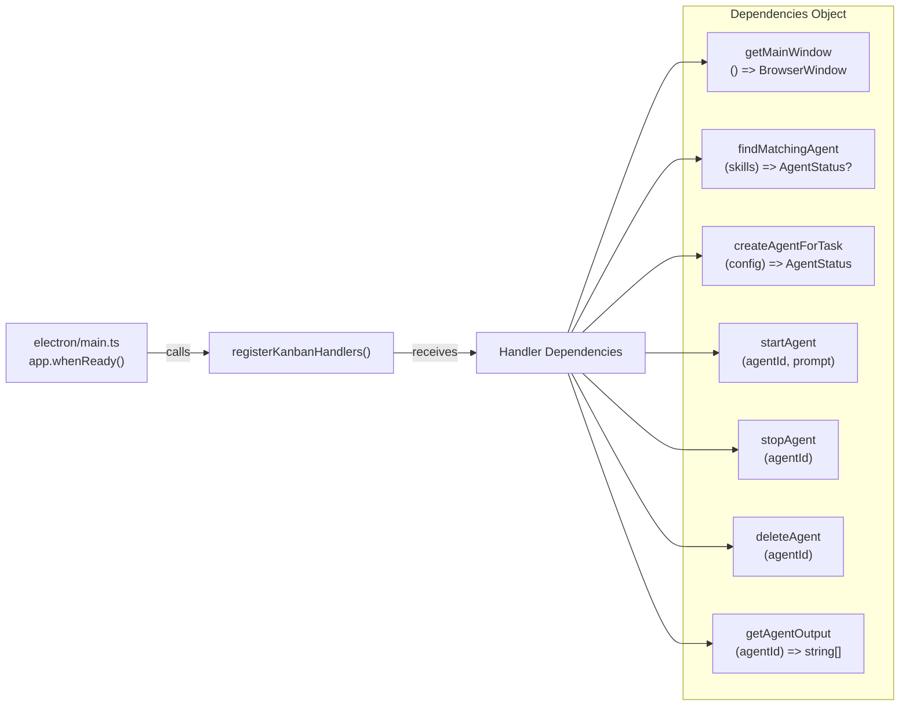
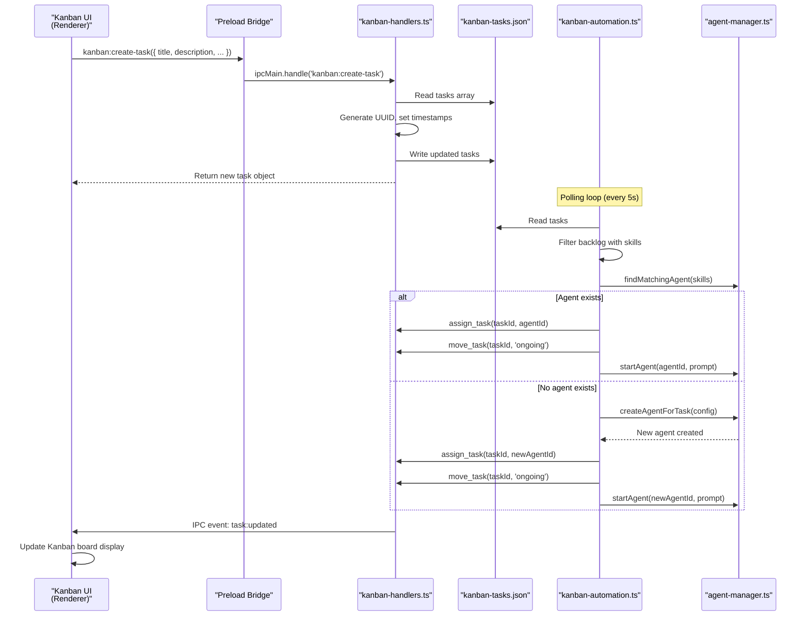
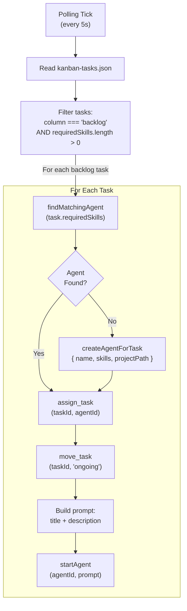

<!-- source: DeepWiki mcp.deepwiki.com · repo Charlie85270/Dorothy · page 4.3 mcp-kanban · fetched 2026-10-26 -->

# mcp-kanban

<details>
<summary>Relevant source files</summary>

The following files were used as context for generating this wiki page:

- [README.md](README.md)
- [__tests__/mcp/mcp-socialdata.test.ts](__tests__/mcp/mcp-socialdata.test.ts)
- [__tests__/mcp/mcp-vault.test.ts](__tests__/mcp/mcp-vault.test.ts)
- [electron/main.ts](electron/main.ts)
- [landing/public/kanban.png](landing/public/kanban.png)
- [landing/public/ollama-icon.svg](landing/public/ollama-icon.svg)
- [landing/src/app/page.tsx](landing/src/app/page.tsx)
- [screenshots/kanban.png](screenshots/kanban.png)

</details>


**mcp-kanban** is an MCP (Model Context Protocol) server that provides programmatic task management capabilities for Dorothy's Kanban board. It exposes 8 tools that allow agents to create, read, update, delete, and organize tasks across workflow columns. This system enables autonomous task assignment, progress tracking, and agent-task coordination.

For general Kanban board UI features, see [Kanban Task Management](#5.2). For automation integration (GitHub/JIRA → Kanban tasks), see [Automations](#7). For the Super Agent's task orchestration capabilities, see [Super Agent](#9.3).

---

## System Overview

The mcp-kanban server operates as a standalone MCP server that communicates with Dorothy's main process via HTTP API. Agents access Kanban functionality through MCP tools registered in their Claude CLI sessions, while the UI interacts with tasks through Electron IPC handlers.

### Architecture Diagram



**Sources:** [README.md:502-519](), [electron/main.ts:86-380]()

---

## Workflow and Columns

Tasks flow through a four-column Kanban board representing their lifecycle state:

| Column | Status | Description |
|--------|--------|-------------|
| **Backlog** | `backlog` | New tasks waiting to be planned or auto-assigned |
| **Planned** | `planned` | Tasks scheduled for execution but not yet started |
| **Ongoing** | `ongoing` | Tasks currently being worked on by agents |
| **Done** | `done` | Completed tasks with optional summary |

### State Transitions



**Sources:** [README.md:195-224](), [electron/main.ts:332-380]()

---

## Data Model

### Task Structure

Tasks are stored as JSON objects with the following schema:

```typescript
interface KanbanTask {
  id: string;                    // UUID v4
  title: string;                 // Task title/summary
  description: string;           // Detailed description
  column: 'backlog' | 'planned' | 'ongoing' | 'done';
  priority: 'low' | 'medium' | 'high';
  progress: number;              // 0-100
  labels: string[];              // Tags for categorization
  assignedAgentId?: string;      // Agent currently working on task
  projectPath?: string;          // Project directory for agent
  requiredSkills?: string[];     // Skills needed to complete task
  completionSummary?: string;    // Agent's final report
  createdAt: string;             // ISO 8601 timestamp
  updatedAt: string;             // ISO 8601 timestamp
  source?: string;               // 'jira', 'manual', 'automation', etc.
  externalId?: string;           // JIRA key or external reference
}
```

### Storage Format

Tasks persist to `~/.dorothy/kanban-tasks.json` as a JSON array. The file is read/written atomically by the IPC handlers, with auto-save on every mutation.

**Example file content:**

```json
[
  {
    "id": "550e8400-e29b-41d4-a716-446655440000",
    "title": "Review PR #123: Add authentication",
    "description": "Review security implications and test coverage",
    "column": "ongoing",
    "priority": "high",
    "progress": 60,
    "labels": ["security", "code-review"],
    "assignedAgentId": "agent-001",
    "projectPath": "/Users/dev/myrepo",
    "requiredSkills": ["code-review", "security-audit"],
    "createdAt": "2024-01-15T10:00:00Z",
    "updatedAt": "2024-01-15T11:30:00Z",
    "source": "github-automation"
  }
]
```

**Sources:** [README.md:195-224](), [electron/main.ts:332-380]()

---

## MCP Tools Reference

All mcp-kanban tools communicate with Dorothy's HTTP API server at `http://127.0.0.1:31415`. The MCP server constructs HTTP requests, handles responses, and formats output for the agent.

### Tool Catalog

| Tool | Purpose | Parameters |
|------|---------|------------|
| `list_tasks` | Query tasks by filter | `column?`, `assigned_to_me?` |
| `get_task` | Retrieve full task details | `task_id` (prefix matching) |
| `create_task` | Create new task in backlog | `title`, `description`, `project_path?`, `priority?`, `labels?` |
| `move_task` | Change task column | `task_id`, `column` |
| `update_task_progress` | Set completion percentage | `task_id`, `progress` (0-100) |
| `mark_task_done` | Complete task with summary | `task_id`, `summary` |
| `assign_task` | Assign to agent | `task_id`, `agent_id?` (optional self-assignment) |
| `delete_task` | Remove task permanently | `task_id` |

**Sources:** [README.md:502-519]()

### list_tasks

Lists tasks with optional filtering by column or agent assignment.

**Parameters:**
- `column` (optional): Filter by column name (`backlog`, `planned`, `ongoing`, `done`)
- `assigned_to_me` (optional, boolean): Filter tasks assigned to the calling agent

**Returns:** Formatted list of tasks with IDs (first 8 chars), title, priority, progress, and assignment status.

**Example output:**
```
Found 3 tasks in column "ongoing":

- [550e8400] Review PR #123 (Priority: high, Progress: 60%, Assigned: agent-001)
- [661f9511] Fix bug in auth flow (Priority: medium, Progress: 30%, Assigned: agent-002)
- [772f0622] Update documentation (Priority: low, Progress: 10%, Unassigned)
```

**Agent usage:**
```
list_tasks({ column: "backlog" })
list_tasks({ assigned_to_me: true })
```

**Sources:** [README.md:507-519]()

---

### get_task

Retrieves complete details for a specific task. Supports prefix matching on task IDs (minimum 8 characters).

**Parameters:**
- `task_id` (required): Full UUID or 8+ character prefix

**Returns:** Comprehensive task details including all metadata, history, and associated agent information.

**Example output:**
```
Task Details:
ID: 550e8400-e29b-41d4-a716-446655440000
Title: Review PR #123: Add authentication
Description: Review security implications and test coverage for the new JWT implementation.
Column: ongoing
Priority: high
Progress: 60%
Labels: security, code-review
Assigned Agent: agent-001 (Security Reviewer)
Project Path: /Users/dev/myrepo
Required Skills: code-review, security-audit
Created: 2024-01-15T10:00:00Z
Updated: 2024-01-15T11:30:00Z
Source: github-automation
External ID: github:myorg/myrepo#123
```

**Agent usage:**
```
get_task({ task_id: "550e8400" })
```

**Sources:** [README.md:507-519]()

---

### create_task

Creates a new task in the `backlog` column. Auto-generates UUID, sets timestamps, and applies default values.

**Parameters:**
- `title` (required): Task title/summary
- `description` (required): Detailed description of work required
- `project_path` (optional): Project directory for agent execution
- `priority` (optional): `low`, `medium`, or `high` (default: `medium`)
- `labels` (optional): Array of string tags

**Returns:** Confirmation message with created task ID and properties.

**Example output:**
```
Task created successfully!
ID: 550e8400-e29b-41d4-a716-446655440000
Title: Review PR #123: Add authentication
Column: backlog
Priority: high
Labels: security, code-review

The task is now in the backlog. If it has required skills and a matching agent exists, it may be auto-assigned.
```

**Agent usage:**
```
create_task({
  title: "Refactor authentication module",
  description: "Extract JWT logic into separate service with proper error handling",
  project_path: "/Users/dev/myrepo",
  priority: "high",
  labels: ["refactoring", "security"]
})
```

**Sources:** [README.md:507-519]()

---

### move_task

Moves a task to a different column. Used for manual workflow transitions when auto-assignment doesn't apply.

**Parameters:**
- `task_id` (required): Task UUID or prefix
- `column` (required): Target column (`backlog`, `planned`, `ongoing`, `done`)

**Returns:** Confirmation message with updated column.

**Example output:**
```
Task 550e8400 moved to column "ongoing".
```

**Agent usage:**
```
move_task({ task_id: "550e8400", column: "planned" })
```

**Sources:** [README.md:507-519]()

---

### update_task_progress

Updates the completion percentage for a task. Typically called by agents as they make progress on work.

**Parameters:**
- `task_id` (required): Task UUID or prefix
- `progress` (required): Integer between 0 and 100

**Returns:** Confirmation message with new progress value.

**Example output:**
```
Task 550e8400 progress updated to 75%.
```

**Agent usage:**
```
update_task_progress({ task_id: "550e8400", progress: 75 })
```

**Sources:** [README.md:507-519]()

---

### mark_task_done

Completes a task by moving it to the `done` column and attaching a completion summary. This is the preferred way to finish work rather than using `move_task`.

**Parameters:**
- `task_id` (required): Task UUID or prefix
- `summary` (required): Agent's report of work completed

**Returns:** Confirmation message with task ID and summary.

**Example output:**
```
Task 550e8400 marked as done.

Completion Summary:
Reviewed PR #123. Security implementation looks good - JWT signing uses proper algorithms, token expiry is set correctly, and refresh token rotation is implemented. Suggested minor refactoring in error handling. Approved with comments.
```

**Agent usage:**
```
mark_task_done({
  task_id: "550e8400",
  summary: "Completed code review. Found 2 security issues, filed tickets PROJ-456 and PROJ-457. Overall architecture is sound."
})
```

**Sources:** [README.md:507-519]()

---

### assign_task

Assigns a task to a specific agent or self-assigns to the calling agent.

**Parameters:**
- `task_id` (required): Task UUID or prefix
- `agent_id` (optional): Target agent UUID. If omitted, assigns to calling agent (via `CLAUDE_AGENT_ID` env var)

**Returns:** Confirmation message with assignment details.

**Example output:**
```
Task 550e8400 assigned to agent agent-001 (Security Reviewer).
```

**Agent usage:**
```
# Self-assign
assign_task({ task_id: "550e8400" })

# Assign to specific agent
assign_task({ task_id: "550e8400", agent_id: "agent-002" })
```

**Sources:** [README.md:507-519]()

---

### delete_task

Permanently removes a task from the Kanban board. Irreversible operation.

**Parameters:**
- `task_id` (required): Task UUID or prefix

**Returns:** Confirmation message.

**Example output:**
```
Task 550e8400 deleted successfully.
```

**Agent usage:**
```
delete_task({ task_id: "550e8400" })
```

**Sources:** [README.md:507-519]()

---

## IPC Handlers

The Electron main process registers Kanban IPC handlers to bridge the UI with task data and agent operations. These handlers are registered in `registerKanbanHandlers` and provide dependencies for agent lifecycle management.

### Handler Registration



**Sources:** [electron/main.ts:332-380]()

### Handler Dependencies

The Kanban handlers receive a dependency object that enables tight integration with agent management:

| Dependency | Type | Purpose |
|------------|------|---------|
| `getMainWindow` | `() => BrowserWindow \| null` | Get main window for IPC events |
| `findMatchingAgent` | `(skills: string[]) => AgentStatus \| undefined` | Find agent with required skills |
| `createAgentForTask` | `(config: AgentConfig) => Promise<AgentStatus>` | Create new agent for task |
| `startAgent` | `(agentId: string, prompt: string) => Promise<void>` | Start agent with task prompt |
| `stopAgent` | `(agentId: string) => Promise<void>` | Stop running agent (Ctrl+C) |
| `deleteAgent` | `(agentId: string) => Promise<void>` | Delete agent and clean up PTY |
| `getAgentOutput` | `(agentId: string) => string[]` | Retrieve agent's terminal output |

### IPC Event Flow

When the UI creates or modifies tasks, the following sequence occurs:



**Sources:** [electron/main.ts:332-380]()

---

## Kanban Automation Service

The `kanban-automation` service (`initKanbanAutomation` in [electron/main.ts:391-539]()) continuously monitors the backlog for tasks with skill requirements and automatically assigns them to capable agents or creates new agents on demand.

### Auto-Assignment Algorithm



### Agent Matching Logic

The `findMatchingAgent` function searches for an idle agent whose skill set overlaps with the task's required skills:

1. **Filter idle agents**: `status === 'idle'`
2. **Match skills**: `agent.skills.some(s => task.requiredSkills.includes(s))`
3. **Return first match** or `undefined`

If no match is found, `createAgentForTask` spawns a new agent with:
- **Name**: Derived from task title
- **Skills**: Task's `requiredSkills` array + `world-builder` (always included)
- **Project Path**: Task's `projectPath` or `~/`
- **Skip Permissions**: Always `true` for autonomous operation

### Integration with Agent Manager

The automation service interacts with the agent system at [electron/main.ts:391-539]():

```typescript
initKanbanAutomation({
  agents,                        // Map<string, AgentStatus>
  createAgent: async (config) => {
    // Spawns PTY process, registers agent
    // Returns AgentStatus object
  },
  startAgent: async (agentId, prompt) => {
    // Builds claude command with --dangerously-skip-permissions
    // Writes command to agent's PTY
    // Updates agent status to 'running'
  },
  saveAgents,                    // Persist agent state to disk
});
```

### Status Monitoring

Agents emit status events via IPC when they complete or error. The Kanban UI listens for these events to update task progress automatically:

| IPC Event | When Emitted | Task Update |
|-----------|--------------|-------------|
| `agent:status` | Agent status changes | Check if agent's task should move columns |
| `agent:complete` | Agent exits with code 0 | Auto-call `mark_task_done` if configured |
| `agent:output` | Agent produces output | Extract progress indicators (optional) |

**Sources:** [electron/main.ts:391-539](), [electron/main.ts:458-481]()

---

## JIRA Integration

When JIRA automations create Kanban tasks (see [JIRA Automations](#7.3)), they populate additional fields:

| Field | Source | Example |
|-------|--------|---------|
| `source` | Always `'jira'` | `"jira"` |
| `externalId` | JIRA issue key | `"PROJ-123"` |
| `title` | JIRA summary | `"[PROJ-123] Fix login bug"` |
| `description` | JIRA description + metadata | Full issue body + priority + assignee |
| `priority` | Mapped from JIRA priority | `"high"`, `"medium"`, `"low"` |
| `labels` | JIRA labels + issue type | `["bug", "backend", "authentication"]` |
| `projectPath` | Automation config | From automation's `agentProjectPath` |

JIRA tasks automatically trigger the auto-assignment flow, allowing agents to pick up JIRA issues as if they were manually created tasks.

**Sources:** [README.md:176-192]()

---

## Storage and Persistence

### File Format

Tasks are stored at `~/.dorothy/kanban-tasks.json` as a JSON array with no schema versioning. The file is:

- **Read synchronously** on handler initialization
- **Written atomically** after each mutation (create, update, delete, move)
- **Locked** during writes (in-memory queue prevents concurrent modification)

### Data Integrity

The handlers ensure data integrity through:

1. **UUID validation**: All task IDs are validated as UUIDv4 or 8+ character prefixes
2. **Enum validation**: `column` and `priority` fields are validated against allowed values
3. **Timestamp management**: `createdAt` is immutable; `updatedAt` is set on every mutation
4. **Prefix matching**: `get_task`, `delete_task`, etc. support 8+ character prefixes for convenience

### Migration Strategy

No formal migration system exists. If the JSON file is corrupted or missing:

1. The file is recreated as an empty array `[]`
2. All existing tasks are lost (no backup mechanism)
3. The UI displays an empty Kanban board

**Sources:** [electron/main.ts:332-380]()

---

## Error Handling

### MCP Tool Errors

When an MCP tool encounters an error, it returns:

```json
{
  "content": [
    {
      "type": "text",
      "text": "Error performing operation: <error message>"
    }
  ],
  "isError": true
}
```

Common error scenarios:

| Error | Cause | Resolution |
|-------|-------|------------|
| `Task not found` | Invalid task ID or prefix | Verify ID with `list_tasks` |
| `Invalid column` | Column name typo | Use: `backlog`, `planned`, `ongoing`, `done` |
| `Agent not found` | Invalid agent ID in `assign_task` | Check agent exists with agent management tools |
| `API server unreachable` | Dorothy not running or port conflict | Ensure Dorothy is running on port 31415 |
| `Invalid progress value` | Progress < 0 or > 100 | Use integer between 0-100 |

### IPC Handler Errors

IPC handlers catch and log errors but return error responses to the UI:

```typescript
try {
  // Perform operation
} catch (error) {
  console.error('Kanban handler error:', error);
  return { success: false, error: error.message };
}
```

The UI displays error toasts and reverts optimistic updates on failure.

**Sources:** [electron/main.ts:332-380]()

---

## Testing

The mcp-kanban tool handlers can be tested using the pattern established in `__tests__/mcp/mcp-vault.test.ts` and `__tests__/mcp/mcp-socialdata.test.ts`. Key test categories:

1. **Tool parameter validation**: Zod schema validation for required/optional fields
2. **Prefix matching logic**: 8-character UUID prefix resolution
3. **Column transitions**: Valid/invalid state machine transitions
4. **Output formatting**: Verify human-readable tool responses
5. **Error handling**: API errors, missing tasks, invalid input
6. **Auto-assignment logic**: Skill matching algorithm correctness

**Sources:** [__tests__/mcp/mcp-vault.test.ts:1-612](), [__tests__/mcp/mcp-socialdata.test.ts:1-850]()

---

## Configuration

The mcp-kanban server requires no explicit configuration. It derives all necessary information from:

1. **Environment variables**:
   - `CLAUDE_AGENT_ID`: Used for self-assignment in `assign_task` (optional)
   - `CLAUDE_AGENT_NAME`: Used for task assignment display names (optional)

2. **Dorothy API server**: Hardcoded to `http://127.0.0.1:31415`

3. **Storage path**: Hardcoded to `~/.dorothy/kanban-tasks.json`

The server is automatically registered in agent MCP configs when Dorothy starts, requiring no manual setup.

**Sources:** [README.md:502-519](), [electron/main.ts:332-380]()

---

