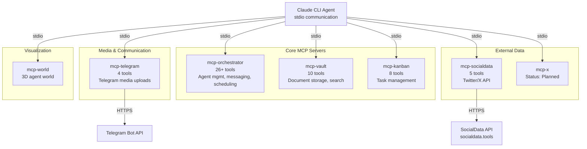
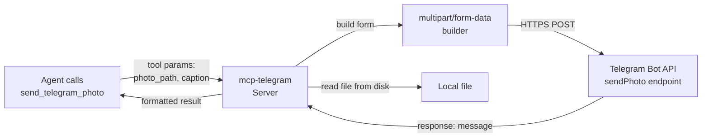
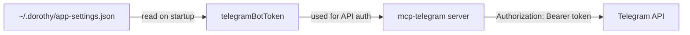
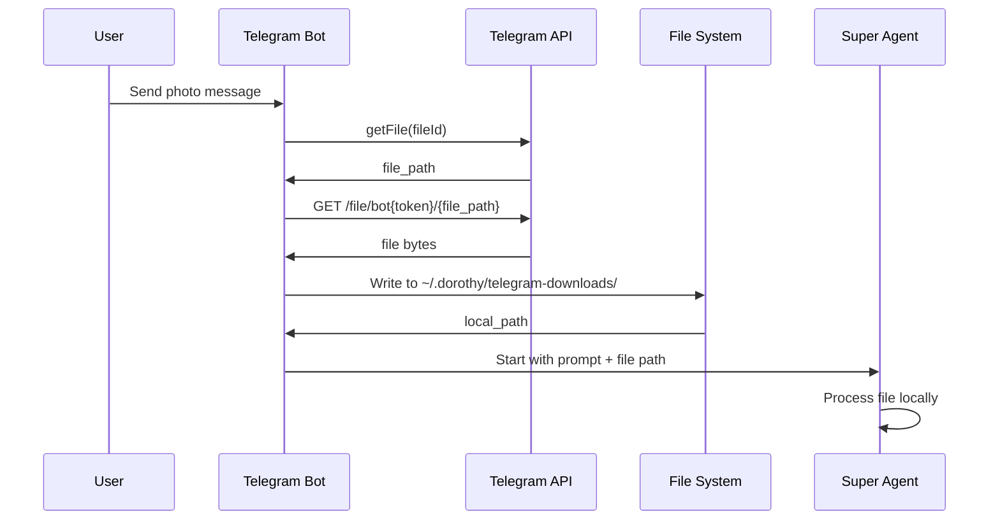
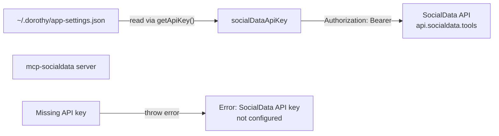
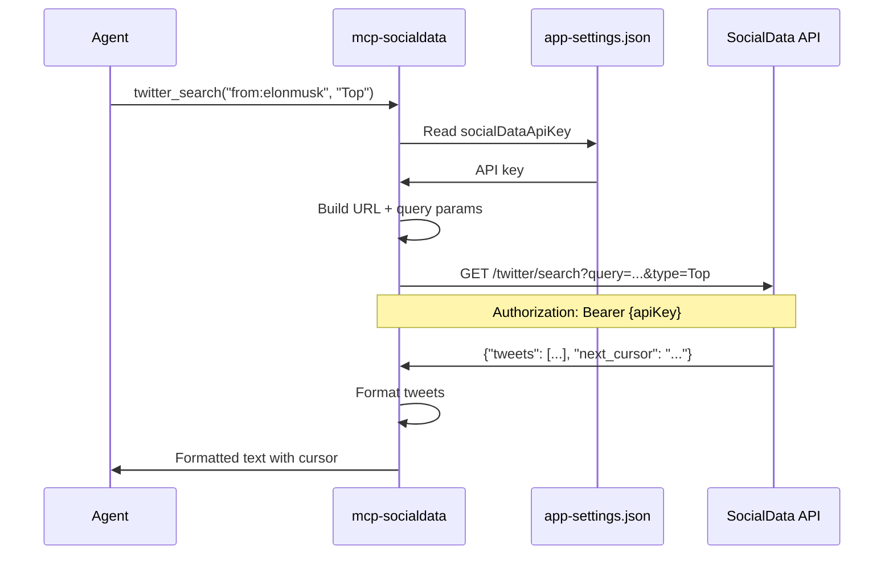

<!-- source: DeepWiki mcp.deepwiki.com · repo Charlie85270/Dorothy · page 4.4 Other MCP Servers · fetched 2026-10-26 -->

# Other MCP Servers

<details>
<summary>Relevant source files</summary>

The following files were used as context for generating this wiki page:

- [README.md](README.md)
- [__tests__/mcp/mcp-socialdata.test.ts](__tests__/mcp/mcp-socialdata.test.ts)
- [__tests__/mcp/mcp-vault.test.ts](__tests__/mcp/mcp-vault.test.ts)
- [electron/resources/telegram-instructions.md](electron/resources/telegram-instructions.md)
- [electron/services/slack-bot.ts](electron/services/slack-bot.ts)
- [electron/services/telegram-bot.ts](electron/services/telegram-bot.ts)
- [electron/utils/index.ts](electron/utils/index.ts)
- [landing/public/kanban.png](landing/public/kanban.png)
- [landing/public/ollama-icon.svg](landing/public/ollama-icon.svg)
- [landing/src/app/page.tsx](landing/src/app/page.tsx)
- [screenshots/kanban.png](screenshots/kanban.png)
- [src/components/Settings/TelegramSection.tsx](src/components/Settings/TelegramSection.tsx)
- [src/components/Settings/Toggle.tsx](src/components/Settings/Toggle.tsx)

</details>


This page documents the supplementary MCP servers in Dorothy's ecosystem: `mcp-telegram`, `mcp-socialdata`, `mcp-x`, and `mcp-world`. These servers extend agent capabilities beyond the core orchestration, vault, and kanban functionality covered in sections [4.1](#4.1), [4.2](#4.2), and [4.3](#4.3).

---

## MCP Server Ecosystem

Dorothy integrates seven MCP servers, with three primary servers (orchestrator, vault, kanban) and four supplementary servers providing specialized capabilities.



**Sources:** [README.md:409-531](), [Diagram 1 from high-level overview]()

---

## mcp-telegram

The `mcp-telegram` server provides MCP tools for uploading media files to Telegram. It complements the orchestrator's `send_telegram` text messaging tool by enabling photo, video, and document uploads.

### Architecture



### Tool Reference

| Tool | Parameters | Description |
|------|-----------|-------------|
| `send_telegram` | `message`, `chat_id?` | Send text message (Markdown supported, 4096 char limit) |
| `send_telegram_photo` | `photo_path`, `chat_id?`, `caption?` | Upload and send image file |
| `send_telegram_video` | `video_path`, `chat_id?`, `caption?` | Upload and send video file |
| `send_telegram_document` | `document_path`, `chat_id?`, `caption?` | Upload and send document/file |

**Sources:** [README.md:488-500]()

### Configuration

The server reads the Telegram bot token from Dorothy's app settings:



Chat ID resolution:
- If `chat_id` parameter is provided, use it directly
- Otherwise, use `telegramAuthorizedChatIds[0]` from app settings
- Fallback to `telegramChatId` for backward compatibility

**Sources:** [electron/services/telegram-bot.ts:64-93](), [src/components/Settings/TelegramSection.tsx:268-328]()

### File Download Flow

When the Telegram bot receives media from users, Dorothy downloads files locally before passing them to agents:



File naming convention: `{timestamp}-{originalBaseName}{ext}`

Example: `1705315200000-image.jpg`

**Sources:** [electron/services/telegram-bot.ts:294-345]()

### File Type Detection

The server includes heuristics to describe file types for agents:

| MIME Type / Extension | Description |
|----------------------|-------------|
| `image/*`, `.jpg`, `.png` | `image` |
| `video/*`, `.mp4`, `.mov` | `video` |
| `application/pdf`, `.pdf` | `PDF document` |
| `.doc`, `.docx`, `.odt` | `document` |
| `.xls`, `.xlsx`, `.csv` | `spreadsheet` |
| `.js`, `.ts`, `.py` | `code file` |

Full logic: [electron/services/telegram-bot.ts:348-374]()

### Implementation Details

- **Transport:** Direct HTTPS calls to `https://api.telegram.org`
- **Multipart uploads:** Uses Node.js `fs.createWriteStream` for downloads, `FormData` for uploads
- **Markdown support:** Telegram's Markdown format in text messages and captions
- **Truncation:** Messages truncated at 4000 chars with `_(truncated)_` suffix

**Sources:** [README.md:488-500](), [electron/services/telegram-bot.ts:64-374]()

---

## mcp-socialdata

The `mcp-socialdata` server provides read-only access to Twitter/X data via the SocialData API. Agents can search tweets, retrieve user profiles, and analyze engagement metrics.

### Tool Reference

| Tool | Parameters | Description |
|------|-----------|-------------|
| `twitter_search` | `query`, `type?`, `cursor?` | Search tweets with advanced operators |
| `twitter_get_tweet` | `tweet_id` | Get full tweet details with engagement metrics |
| `twitter_get_tweet_comments` | `tweet_id`, `cursor?` | Get replies/comments on a tweet |
| `twitter_get_user` | `username` | Get user profile (bio, followers, stats) |
| `twitter_get_user_tweets` | `user_id`, `include_replies?`, `cursor?` | Get recent tweets from a user |

All tools support cursor-based pagination for large result sets.

**Sources:** [README.md:359-369](), [__tests__/mcp/mcp-socialdata.test.ts:1-10]()

### Configuration



Setup steps:
1. Obtain API key from [socialdata.tools](https://socialdata.tools)
2. Add to **Settings → SocialData API Key**
3. Saved to `~/.dorothy/app-settings.json` as `socialDataApiKey`

**Sources:** [README.md:355-357](), [__tests__/mcp/mcp-socialdata.test.ts:243-257]()

### API Request Flow



**Sources:** [__tests__/mcp/mcp-socialdata.test.ts:294-333]()

### Search Query Operators

Twitter search supports advanced operators in the `query` parameter:

| Operator | Example | Description |
|----------|---------|-------------|
| `from:` | `from:elonmusk` | Tweets from specific user |
| `min_faves:` | `min_faves:100` | Minimum like count |
| `filter:images` | `filter:images` | Only tweets with images |
| `filter:videos` | `filter:videos` | Only tweets with videos |
| `filter:links` | `filter:links` | Only tweets with URLs |
| `-filter:retweets` | `-filter:retweets` | Exclude retweets |

Operators can be combined: `"from:elonmusk min_faves:100 filter:images"`

**Sources:** [README.md:359-369]()

### Response Formatting

The server formats API responses into human-readable text for agents:

#### Tweet Format

```
@username (Display Name) — 2024-01-15T10:00:00Z
Tweet text content here...
  ❤️ 25  🔁 5  💬 3  👁 500  🔖 2
  Tweet ID: 1729591119699124560
```

**Sources:** [__tests__/mcp/mcp-socialdata.test.ts:171-178]()

#### Tweet Detail Format

Includes additional metadata: hashtags, URLs, media, mentions, reply context, author stats.

Example:
```
Tweet by @username (Display Name)
Date: 2024-01-15T10:00:00Z
Tweet ID: 1729591119699124560

Tweet text content here...

Engagement:
  ❤️ Likes: 25
  🔁 Retweets: 5
  💬 Replies: 3
  🔄 Quotes: 1
  👁 Views: 500
  🔖 Bookmarks: 2

Hashtags: #AI #Tech
Links: https://example.com
Media: photo: https://pbs.twimg.com/media/...
Mentions: @user1 @user2

Author: @username — 1,000 followers, 500 following
```

**Sources:** [__tests__/mcp/mcp-socialdata.test.ts:180-216]()

#### User Profile Format

```
Display Name (@username)
User ID: 12345678

Bio text here...

📍 Location: San Francisco
🔗 URL: https://example.com
📅 Joined: 2010-01-01T00:00:00Z

👥 Followers: 10,000
👤 Following: 500
📝 Tweets: 2,000
❤️ Likes: 5,000
📋 Listed: 100

Protected: No
Verified: Yes
Can DM: Yes
```

**Sources:** [__tests__/mcp/mcp-socialdata.test.ts:218-240]()

### Pagination

All listing tools return a `next_cursor` when more results are available:

```
Found 20 tweets:

[tweet 1]
---
[tweet 2]
...

📄 More results available. Use cursor: "DAABCgABGPmw__8" to get the next page.
```

To fetch the next page, pass the cursor value to the same tool call.

**Sources:** [__tests__/mcp/mcp-socialdata.test.ts:422-439]()

### Error Handling

The server maps HTTP status codes to specific error messages:

| Status Code | Error Message |
|-------------|---------------|
| 402 | `Insufficient SocialData API credits. Please top up your account.` |
| 404 | `Resource not found on Twitter/X.` |
| 422 | `Validation error: {detail}` |
| 500+ | `SocialData API error (HTTP {code}): {body}` |

**Sources:** [__tests__/mcp/mcp-socialdata.test.ts:335-381]()

### Implementation Details

- **Base URL:** `https://api.socialdata.tools`
- **Authentication:** Bearer token in `Authorization` header
- **Rate limiting:** Subject to SocialData API limits
- **Response format:** JSON
- **Query encoding:** URLSearchParams for query strings

Example URL construction:
```
https://api.socialdata.tools/twitter/search?query=from%3Aelonmusk&type=Top
```

**Sources:** [__tests__/mcp/mcp-socialdata.test.ts:294-323]()

---

## mcp-x

The `mcp-x` server is mentioned in the landing page feature list but appears to be in planning or early development stages. No implementation details are currently available in the codebase.

**Status:** Planned

**Sources:** [landing/src/app/page.tsx:1-266]()

---

## mcp-world

The `mcp-world` server provides a 3D visualization of agents in an animated office environment. This is a visual feature rather than a tool-based MCP server.

**Features:**
- 3D rendered agent world
- Visual representation of agent activity
- Interactive display in Dorothy UI

**Status:** Implemented (UI feature)

**Sources:** [landing/src/app/page.tsx:121](), [README.md:141](), [Diagram 1 from high-level overview]()

---

## Server Registration

All MCP servers are registered in the agent's configuration through the `~/.claude/settings.json` file. Dorothy automatically configures this during agent creation:

```json
{
  "mcpServers": {
    "mcp-orchestrator": {
      "command": "node",
      "args": ["/path/to/mcp-orchestrator/build/index.js"],
      "transport": "stdio"
    },
    "mcp-telegram": {
      "command": "node",
      "args": ["/path/to/mcp-telegram/build/index.js"],
      "transport": "stdio"
    },
    "mcp-socialdata": {
      "command": "node",
      "args": ["/path/to/mcp-socialdata/build/index.js"],
      "transport": "stdio"
    }
  }
}
```

**Sources:** [README.md:411-531](), [Diagram 3 from high-level overview]()

---

## Usage Examples

### Example: Tweet Analysis Agent

```
Task: "Analyze sentiment of recent tweets about @anthropic"

Agent workflow:
1. twitter_search("@anthropic", type="Latest")
2. Collect 50 recent tweets
3. Parse engagement metrics
4. Generate sentiment report
5. vault_create_document("Anthropic Sentiment Report", content)
```

### Example: Media Response

```
Task: "Find the top tweet about AI today and send it to Telegram"

Agent workflow:
1. twitter_search("AI filter:images", type="Top")
2. twitter_get_tweet(top_result.id)
3. Format tweet details
4. send_telegram(formatted_text)
```

**Sources:** [README.md:350-369](), [README.md:488-500]()

---

