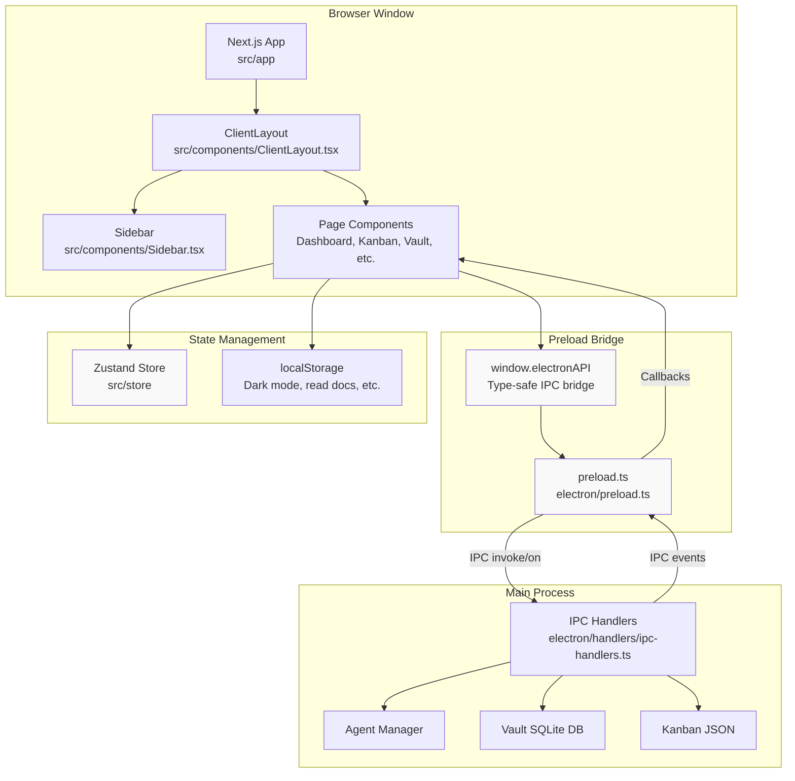
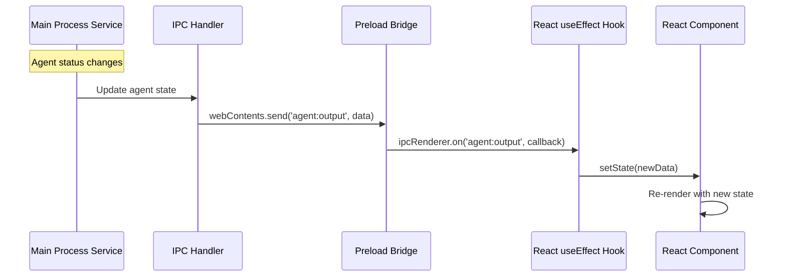
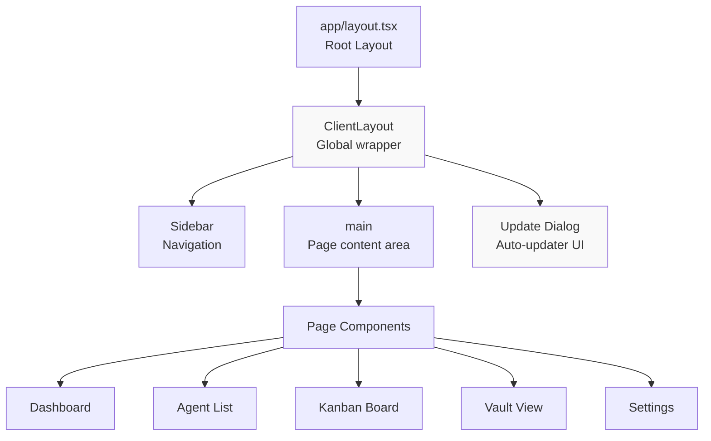
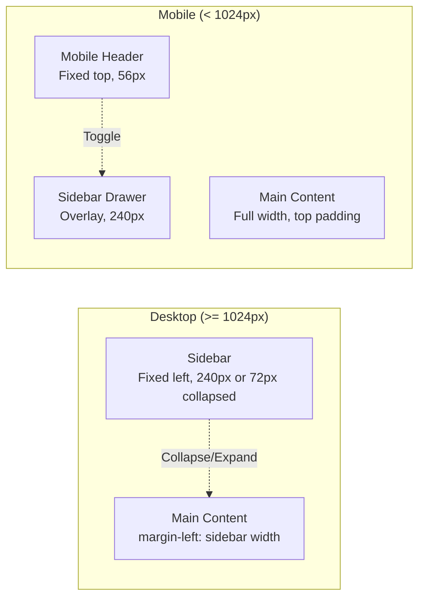
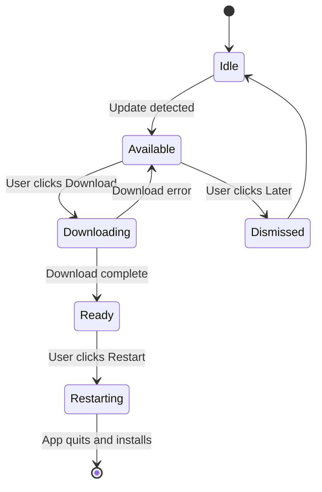
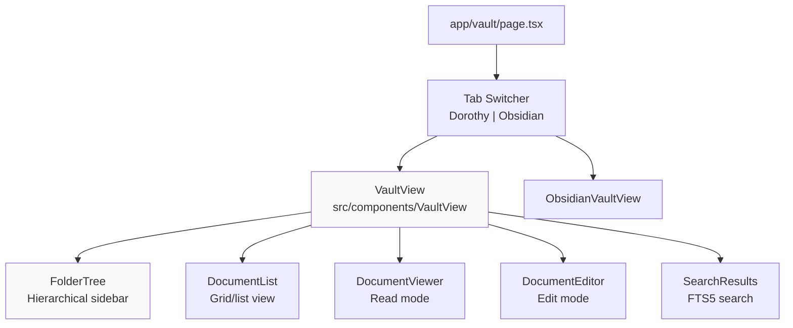

<!-- source: DeepWiki mcp.deepwiki.com · repo Charlie85270/Dorothy · page 5 User Interface · fetched 2026-10-26 -->

# User Interface

<details>
<summary>Relevant source files</summary>

The following files were used as context for generating this wiki page:

- [electron/core/agent-manager.ts](electron/core/agent-manager.ts)
- [electron/handlers/ipc-handlers.ts](electron/handlers/ipc-handlers.ts)
- [electron/preload.ts](electron/preload.ts)
- [mcp-vault/src/tools/documents.ts](mcp-vault/src/tools/documents.ts)
- [src/app/globals.css](src/app/globals.css)
- [src/app/vault/page.tsx](src/app/vault/page.tsx)
- [src/components/ClientLayout.tsx](src/components/ClientLayout.tsx)
- [src/components/Settings/index.ts](src/components/Settings/index.ts)
- [src/components/Sidebar.tsx](src/components/Sidebar.tsx)
- [src/components/VaultView/components/FolderTree.tsx](src/components/VaultView/components/FolderTree.tsx)
- [src/components/VaultView/index.tsx](src/components/VaultView/index.tsx)
- [src/types/electron.d.ts](src/types/electron.d.ts)

</details>


Dorothy's user interface is a React/Next.js application running in Electron's renderer process. The UI provides a desktop-native experience with a sidebar navigation model, real-time updates via IPC events, and a warm retro aesthetic featuring a cream-and-teal color scheme. The interface is fully responsive, adapting from desktop multi-panel layouts to mobile drawer navigation.

For details on specific UI sections, see:
- Application Shell and layout structure: [#5.1](#5.1)
- Agent Dashboard interface: [#5.2](#5.2)
- Settings configuration: [#5.3](#5.3)
- Memory and Vault interfaces: [#6](#6)
- Kanban board: [#4.3](#4.3)

---

## Architecture Overview

### Renderer Process Structure



**Sources:** [src/components/ClientLayout.tsx:1-350](), [electron/preload.ts:1-634](), [electron/handlers/ipc-handlers.ts:1-86](), [src/types/electron.d.ts:1-794]()

The UI follows a strict separation between the renderer process (React UI) and main process (Node.js services). Communication happens exclusively through the IPC bridge exposed as `window.electronAPI`.

---

## IPC Communication Pattern

### Type-Safe Bridge Architecture

```mermaid
graph LR
    subgraph "Renderer Process"
        Component["React Component"]
        ElectronAPI["window.electronAPI"]
    end
    
    subgraph "Preload Script (Sandboxed)"
        ContextBridge["contextBridge.exposeInMainWorld"]
        IPCRenderer["ipcRenderer.invoke / on"]
    end
    
    subgraph "Main Process"
        IPCMain["ipcMain.handle"]
        Handler["Handler Function"]
        Service["Service Layer"]
    end
    
    Component -->|"electronAPI.agent.list()"| ElectronAPI
    ElectronAPI --> ContextBridge
    ContextBridge --> IPCRenderer
    IPCRenderer -->|"invoke('agent:list')"| IPCMain
    IPCMain --> Handler
    Handler --> Service
    Service -->|"AgentStatus[]"| Handler
    Handler -->|"Promise"| IPCMain
    IPCMain --> IPCRenderer
    IPCRenderer --> ElectronAPI
    ElectronAPI -->|"Promise<AgentStatus[]>"| Component
```



**Sources:** [electron/preload.ts:18-634](), [electron/handlers/ipc-handlers.ts:60-77](), [src/types/electron.d.ts:152-785]()

### IPC Handler Categories

| Category | Namespace | Handler Examples | Purpose |
|----------|-----------|------------------|---------|
| Agent Management | `agent` | `agent:create`, `agent:start`, `agent:list`, `agent:stop` | Control agent lifecycle and PTY processes |
| Vault | `vault` | `vault:listDocuments`, `vault:createDocument`, `vault:search` | Document storage and retrieval |
| Kanban | `kanban` | `kanban:list`, `kanban:create`, `kanban:move` | Task board operations |
| Settings | `appSettings` | `app:getSettings`, `app:saveSettings` | Configuration management |
| Skills | `skill` | `skill:install-start`, `skill:list-installed` | Skill installation and linking |
| Memory | `memory` | `memory:list-projects`, `memory:read-file` | Claude Code memory file access |
| Obsidian | `obsidian` | `obsidian:scan`, `obsidian:readFile` | Obsidian vault integration |
| Scheduler | `scheduler` | `scheduler:listTasks`, `scheduler:createTask` | Recurring task scheduling |
| Automation | `automation` | `automation:list`, `automation:create`, `automation:run` | Automation management |

**Sources:** [electron/preload.ts:44-634](), [src/types/electron.d.ts:152-785]()

### Real-Time Event Flow



**Sources:** [electron/handlers/ipc-handlers.ts:330-375](), [electron/preload.ts:83-107](), [src/components/ClientLayout.tsx:72-108]()

Dorothy uses a bi-directional IPC model:
- **Request-Response**: `ipcRenderer.invoke()` + `ipcMain.handle()` for queries and commands
- **Event Streaming**: `webContents.send()` + `ipcRenderer.on()` for real-time updates (agent output, vault changes, kanban updates)

---

## Layout Structure

### Component Hierarchy



**Sources:** [src/components/ClientLayout.tsx:61-350](), [src/components/Sidebar.tsx:1-280]()

### Responsive Layout Modes



**Sources:** [src/components/ClientLayout.tsx:181-229](), [src/components/Sidebar.tsx:50-280]()

The layout adapts based on screen width:
- **Desktop**: Fixed sidebar with collapse/expand toggle, main content margin adjusts via Framer Motion
- **Mobile**: Hamburger menu in header, sidebar becomes a drawer overlay with backdrop, main content full-width

### Window Drag Regions (macOS)

[src/components/ClientLayout.tsx:186-187]() defines a window drag bar at the top for macOS traffic light buttons:

```typescript
<div className="window-drag hidden lg:block fixed top-0 left-0 right-0 h-7 z-[60]" />
```

The `.window-drag` class in [src/app/globals.css:617-619]() enables `-webkit-app-region: drag` for native window dragging.

**Sources:** [src/components/ClientLayout.tsx:186-187](), [src/app/globals.css:617-623]()

---

## Theme System

### Color Palette

Dorothy uses a warm retro aesthetic inspired by 1960s print design. The theme is defined in [src/app/globals.css:61-214]() with dual light/dark modes.

#### Light Mode Colors

| Token | Value | Usage |
|-------|-------|-------|
| `--background` | `#F0E8D5` | Warm cream, page background |
| `--foreground` | `#2C2418` | Dark brown, primary text |
| `--card` | `#FAF4EA` | Off-white, card surfaces |
| `--primary` | `#3D9B94` | Vibrant teal, accent color |
| `--accent` | `#CD7F4A` | Copper/orange, secondary accent |
| `--border` | `#D5CAB4` | Warm tan, borders |

#### Dark Mode Colors

| Token | Value | Usage |
|-------|-------|-------|
| `--background` | `#1A1714` | Deep warm gray, page background |
| `--foreground` | `#E8DEC8` | Warm cream, primary text |
| `--card` | `#242019` | Dark warm gray, card surfaces |
| `--primary` | `#4DB8B0` | Brighter teal for dark bg |
| `--accent` | `#CD7F4A` | Same copper, stays warm |
| `--border` | `#3A342B` | Dark warm border |

**Sources:** [src/app/globals.css:61-214]()

### Dark Mode Toggle

[src/components/ClientLayout.tsx:132-143]() manages dark mode state:

```typescript
// Initialize from localStorage on mount
useEffect(() => {
  const saved = localStorage.getItem('dorothy-dark-mode');
  if (saved === 'true') setDarkMode(true);
}, [setDarkMode]);

// Sync to DOM and localStorage
useEffect(() => {
  document.documentElement.classList.toggle('dark', darkMode);
  localStorage.setItem('dorothy-dark-mode', String(darkMode));
}, [darkMode]);
```

The Zustand store [src/store:1-50]() provides `darkMode`, `toggleDarkMode()`, and `setDarkMode()` for global access.

**Sources:** [src/components/ClientLayout.tsx:132-143](), [src/components/Sidebar.tsx:160-165]()

### Typography

[src/app/globals.css:1-2]() imports DM Serif Display for retro headings:

```css
@import url('https://fonts.googleapis.com/css2?family=DM+Serif+Display:ital@0;1&display=swap');
```

Body text uses Geist Sans with tabular numerals for data tables [src/app/globals.css:307-331]().

**Sources:** [src/app/globals.css:1-331]()

---

## Navigation and Routing

### Sidebar Navigation Structure

```mermaid
graph TB
    Sidebar["Sidebar Component"]
    
    Nav["Navigation Items"]
    Dashboard["Dashboard<br/>'/'"]
    Agents["Agents<br/>'/agents'"]
    Kanban["Kanban<br/>'/kanban'"]
    Vault["Vault<br/>'/vault'"]
    Projects["Projects<br/>'/projects'"]
    Skills["Skills<br/>'/skills'"]
    Plugins["Plugins<br/>'/plugins'"]
    RecurringTasks["Scheduled Tasks<br/>'/recurring-tasks'"]
    Automations["Automations<br/>'/automations'"]
    Usage["Usage<br/>'/usage'"]
    Memory["Memory<br/>'/memory'"]
    PalletTown["ClaudeMon<br/>'/pallet-town'"]
    
    Footer["Footer Actions"]
    Settings["Settings<br/>'/settings'"]
    DarkMode["Dark Mode Toggle"]
    Collapse["Collapse Toggle"]
    
    Sidebar --> Nav
    Nav --> Dashboard
    Nav --> Agents
    Nav --> Kanban
    Nav --> Vault
    Nav --> Projects
    Nav --> Skills
    Nav --> Plugins
    Nav --> RecurringTasks
    Nav --> Automations
    Nav --> Usage
    Nav --> Memory
    Nav --> PalletTown
    
    Sidebar --> Footer
    Footer --> Settings
    Footer --> DarkMode
    Footer --> Collapse
    
    style Vault fill:#f9f9f9
    style Settings fill:#f9f9f9
```



**Sources:** [src/components/Sidebar.tsx:31-44](), [src/components/Sidebar.tsx:145-179]()

### Active Route Detection

[src/components/Sidebar.tsx:93-95]() determines active state:

```typescript
const isActive = item.href === '/'
  ? pathname === '/'
  : pathname === item.href || pathname.startsWith(`${item.href}/`);
```

This ensures sub-routes (e.g., `/settings/telegram`) highlight their parent navigation item.

**Sources:** [src/components/Sidebar.tsx:93-95]()

### Unread Badges

The Vault navigation item displays an unread document count. [src/components/ClientLayout.tsx:145-172]() tracks this globally:

```typescript
useEffect(() => {
  // Compute initial unread count on app start
  const initUnread = async () => {
    const result = await window.electronAPI!.vault!.listDocuments();
    if (result?.documents) {
      const readIds = loadVaultReadDocs();
      const unread = result.documents.filter(d => !readIds.has(d.id)).length;
      setVaultUnreadCount(unread);
    }
  };
  initUnread();

  // Listen for real-time document creation
  const unsub = window.electronAPI!.vault!.onDocumentCreated(() => {
    setVaultUnreadCount(useStore.getState().vaultUnreadCount + 1);
  });
  return unsub;
}, [setVaultUnreadCount]);
```

[src/components/Sidebar.tsx:110-114]() and [src/components/Sidebar.tsx:121-125]() render the badge differently for collapsed vs. expanded states.

**Sources:** [src/components/ClientLayout.tsx:145-172](), [src/components/Sidebar.tsx:110-125]()

---

## State Management

### Zustand Store Schema

[src/store:1-50]() defines the global client-side state:

```typescript
interface StoreState {
  sidebarCollapsed: boolean;
  toggleSidebar: () => void;
  mobileMenuOpen: boolean;
  setMobileMenuOpen: (open: boolean) => void;
  darkMode: boolean;
  toggleDarkMode: () => void;
  setDarkMode: (mode: boolean) => void;
  vaultUnreadCount: number;
  setVaultUnreadCount: (count: number) => void;
}
```

This store is intentionally minimal — most state lives in React component state or is fetched/streamed from the main process via IPC.

**Sources:** [src/store:1-50]()

### Local Storage Keys

| Key | Type | Purpose |
|-----|------|---------|
| `dorothy-dark-mode` | `'true' \| 'false'` | Persist dark mode preference |
| `vault-read-docs` | `string[]` (JSON) | Track which vault documents have been read |

[src/components/ClientLayout.tsx:49-58]() and [src/components/VaultView/index.tsx:28-46]() manage these keys.

**Sources:** [src/components/ClientLayout.tsx:49-58](), [src/components/VaultView/index.tsx:28-46]()

### Real-Time Updates

Components subscribe to IPC events using `useEffect` hooks with cleanup:

```typescript
useEffect(() => {
  if (!window.electronAPI?.vault) return;

  const unsubCreated = window.electronAPI.vault.onDocumentCreated((doc) => {
    setDocuments(prev => [doc, ...prev]);
  });

  const unsubUpdated = window.electronAPI.vault.onDocumentUpdated((doc) => {
    setDocuments(prev => prev.map(d => d.id === doc.id ? doc : d));
  });

  return () => {
    unsubCreated();
    unsubUpdated();
  };
}, []);
```

This pattern is used throughout:
- [src/components/VaultView/index.tsx:150-180]() for vault documents
- [src/components/ClientLayout.tsx:72-108]() for app updates
- Agent dashboard (referenced in [#5.2](#5.2))

**Sources:** [src/components/VaultView/index.tsx:150-180](), [src/components/ClientLayout.tsx:72-108]()

---

## Auto-Update UI Flow

### Update State Machine



**Sources:** [src/components/ClientLayout.tsx:47-129]()

### Update Dialog Implementation

[src/components/ClientLayout.tsx:233-346]() renders a modal dialog with progress tracking:

| State | UI Display |
|-------|------------|
| `available` | "Download Update" button, release notes |
| `downloading` | Progress bar, download speed, percent |
| `ready` | "Restart to Apply" button (green) |
| `restarting` | Loading spinner, "Restarting..." |

The dialog auto-appears when `window.electronAPI.updates.onUpdateAvailable` fires [src/components/ClientLayout.tsx:76-84]().

For fallback updates (no in-app download available), the download button opens the browser to the GitHub release URL [src/components/ClientLayout.tsx:112-124]().

**Sources:** [src/components/ClientLayout.tsx:233-346](), [src/components/ClientLayout.tsx:76-84](), [src/components/ClientLayout.tsx:112-124]()

---

## Vault Interface Components

### Vault View Architecture



**Sources:** [src/app/vault/page.tsx:1-59](), [src/components/VaultView/index.tsx:48-505](), [src/components/VaultView/components/FolderTree.tsx:1-371]()

### View Mode State Machine

[src/components/VaultView/index.tsx:26-500]() manages view modes:

```typescript
type ViewMode = 'list' | 'view' | 'edit' | 'search';
```

| Mode | Trigger | Display |
|------|---------|---------|
| `list` | Default, folder selection, search cancel | Document list/grid |
| `view` | Document selected | Read-only viewer with markdown rendering |
| `edit` | "New Document" or "Edit" clicked | WYSIWYG editor with folder selector |
| `search` | Search query submitted | FTS5 results with snippets |

**Sources:** [src/components/VaultView/index.tsx:26-500]()

### Folder Tree Unread Count Logic

[src/components/VaultView/components/FolderTree.tsx:43-56]() recursively counts unread documents in folders:

```typescript
function countUnreadInFolder(
  folderId: string,
  allFolders: VaultFolderElectron[],
  documents: VaultDocumentElectron[],
  readDocIds: Set<string>
): number {
  let count = documents.filter(d => d.folder_id === folderId && !readDocIds.has(d.id)).length;
  const children = allFolders.filter(f => f.parent_id === folderId);
  for (const child of children) {
    count += countUnreadInFolder(child.id, allFolders, documents, readDocIds);
  }
  return count;
}
```

This ensures parent folders show the aggregate unread count of all descendants.

**Sources:** [src/components/VaultView/components/FolderTree.tsx:43-56](), [src/components/VaultView/components/FolderTree.tsx:93-96]()

---

## Styling and CSS Architecture

### CSS Layers

[src/app/globals.css:1-636]() is organized into sections:

1. **CSS Variables (`:root`)**: Light theme tokens [src/app/globals.css:61-135]()
2. **Dark Theme Overrides (`.dark`)**: Dark mode tokens [src/app/globals.css:140-214]()
3. **Base Styles**: Typography, focus outlines, heading styles [src/app/globals.css:307-352]()
4. **Rounded Corner Overrides**: Force rounded corners globally [src/app/globals.css:360-380]()
5. **Scrollbar Styling**: Professional squared scrollbars [src/app/globals.css:385-412]()
6. **Utility Classes**: Status colors, hover effects, transitions [src/app/globals.css:416-501]()
7. **Animations**: Fade-in, slide-up, pulse [src/app/globals.css:506-547]()

**Sources:** [src/app/globals.css:1-636]()

### Rounded Corner Enforcement

Dorothy's retro aesthetic requires rounded corners everywhere. [src/app/globals.css:361-380]() overrides hardcoded `rounded-none` classes:

```css
/* Override rounded-none on cards, panels, modals */
.rounded-none:not(.xterm *):not([class*="xterm"]):not(canvas) {
  border-radius: 14px !important;
}

/* Buttons - match card rounding */
button, [role="button"] {
  border-radius: 14px;
}
```

**Sources:** [src/app/globals.css:361-380]()

### Scrollbar Theming

[src/app/globals.css:385-411]() styles scrollbars to match the theme:

```css
* {
  scrollbar-width: thin;
  scrollbar-color: #C4B89A #E8DEC8; /* thumb track */
}

*::-webkit-scrollbar-thumb:hover {
  background: #3D9B94; /* Primary teal on hover */
}
```

Dark mode overrides at [src/app/globals.css:217-235]().

**Sources:** [src/app/globals.css:385-411](), [src/app/globals.css:217-235]()

---

## Settings Interface

Settings are organized into 15 sections exported from [src/components/Settings/index.ts:1-33]():

| Section Component | Purpose | IPC Namespace |
|-------------------|---------|---------------|
| `GeneralSection` | Default provider, auto-updates | `updates`, `appSettings` |
| `TerminalSection` | Font size, theme | `appSettings` |
| `ObsidianSection` | Vault paths | `obsidian`, `appSettings` |
| `GitSection` | Worktree config | `appSettings` |
| `NotificationsSection` | Desktop notifications | `appSettings` |
| `TelegramSection` | Bot token, auth | `telegram`, `appSettings` |
| `SlackSection` | App token, channel | `slack`, `appSettings` |
| `JiraSection` | Domain, credentials | `jira`, `appSettings` |
| `SocialDataSection` | API keys | `socialData`, `appSettings` |
| `TasmaniaSection` | Local LLM server | `tasmania`, `appSettings` |
| `GoogleWorkspaceSection` | GWS CLI setup | `gws`, `appSettings` |
| `PermissionsSection` | Claude permissions | `settings` (Claude) |
| `SkillsSection` | Skill marketplace, installs | `skill` |
| `CLIPathsSection` | Binary path detection | `cliPaths` |
| `SystemSection` | Version info | `settings` |

Each section uses the `useSettings` hook pattern to fetch/save configuration via IPC. For detailed settings documentation, see [#5.3](#5.3).

**Sources:** [src/components/Settings/index.ts:1-33]()

---

## Keyboard Shortcuts

The sidebar defines numeric shortcuts for navigation [src/components/Sidebar.tsx:31-44]():

| Shortcut | Destination |
|----------|-------------|
| `1` | Dashboard |
| `2` | Agents |
| `3` | Kanban |
| `4` | Vault |
| `5` | Projects |
| `6` | Skills |
| `7` | Plugins |
| `8` | Scheduled Tasks |
| `9` | Automations |
| `0` | Usage |
| `M` | Memory |

These shortcuts are not currently implemented in the UI but are defined in the `navItems` array for future keyboard navigation support.

**Sources:** [src/components/Sidebar.tsx:31-44]()

---

## Error Boundaries and Loading States

Components use conditional rendering for Electron availability:

```typescript
function isElectron(): boolean {
  return typeof window !== 'undefined' && !!window.electronAPI?.vault;
}

if (!isElectron()) {
  return (
    <VaultEmptyState
      icon={Archive}
      title="Vault"
      description="Available in the desktop app"
    />
  );
}
```

[src/components/VaultView/index.tsx:22-332]() demonstrates this pattern. Most features gracefully degrade or show placeholders when running outside Electron (e.g., web preview mode).

**Sources:** [src/components/VaultView/index.tsx:22-332]()

Loading states use Framer Motion for smooth transitions:

```typescript
<AnimatePresence mode="wait">
  {viewMode === 'list' && (
    <motion.div
      key="list"
      initial={{ opacity: 0 }}
      animate={{ opacity: 1 }}
      exit={{ opacity: 0 }}
    >
      <DocumentList />
    </motion.div>
  )}
</AnimatePresence>
```

[src/components/VaultView/index.tsx:422-499]() shows this pattern for view mode transitions.

**Sources:** [src/components/VaultView/index.tsx:422-499]()

---

