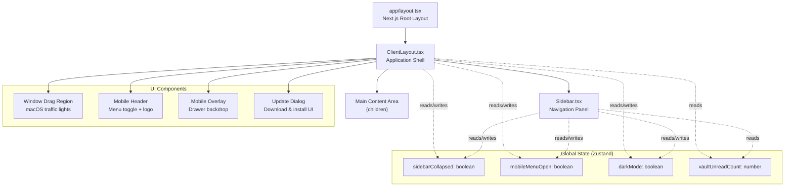
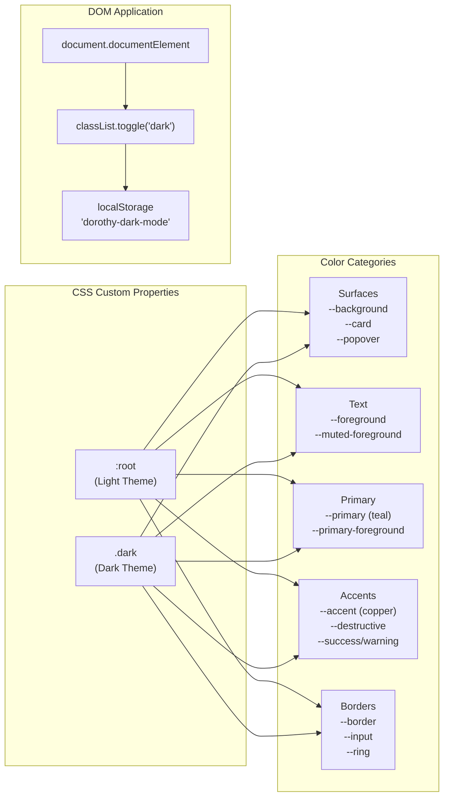
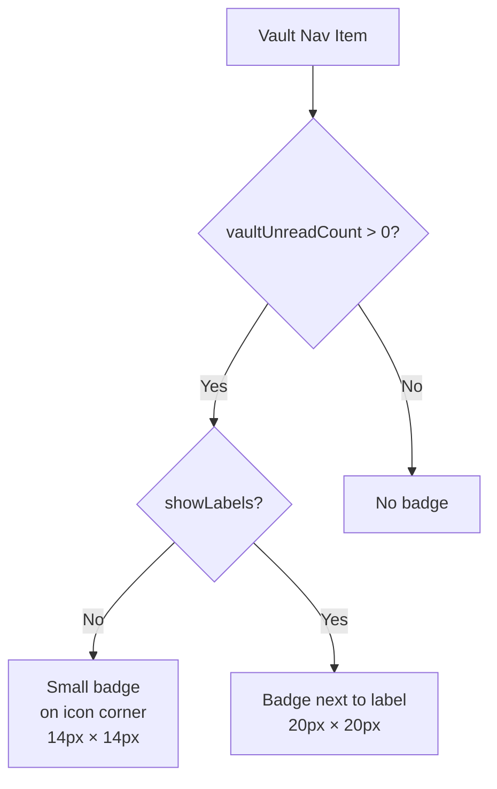
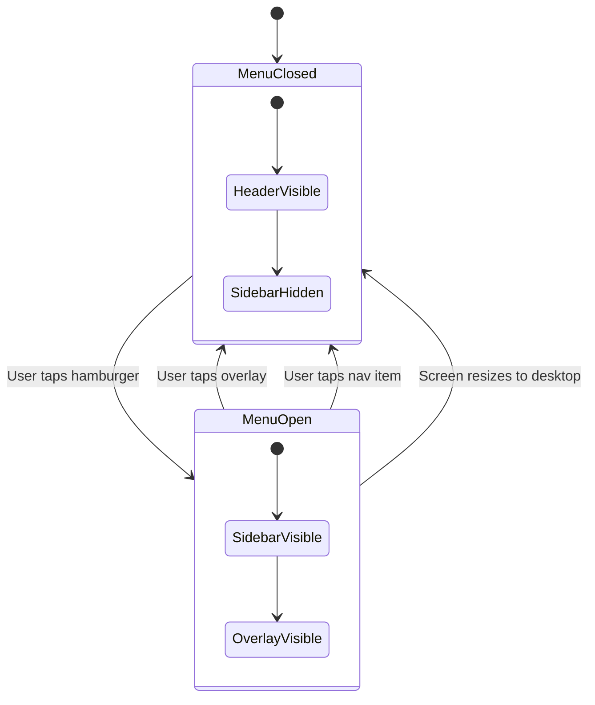
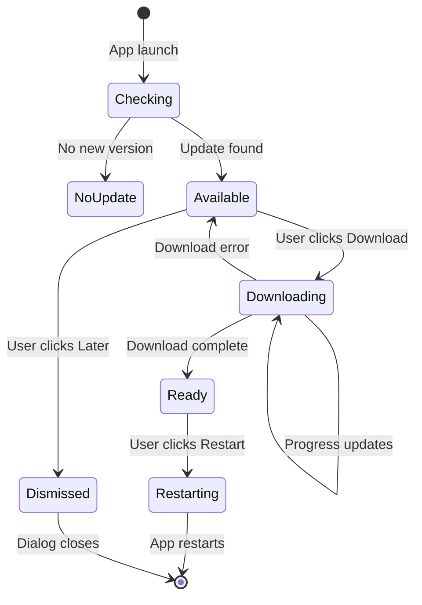
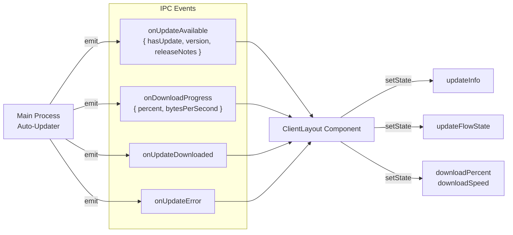
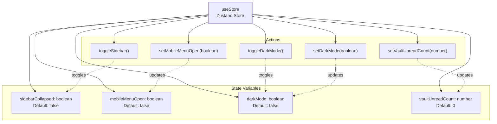
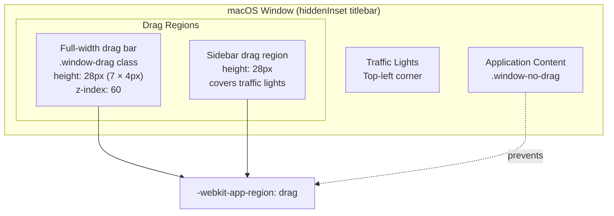

<!-- source: DeepWiki mcp.deepwiki.com · repo Charlie85270/Dorothy · page 5.1 Application Shell · fetched 2026-10-26 -->

# Application Shell

<details>
<summary>Relevant source files</summary>

The following files were used as context for generating this wiki page:

- [mcp-vault/src/tools/documents.ts](mcp-vault/src/tools/documents.ts)
- [src/app/globals.css](src/app/globals.css)
- [src/app/vault/page.tsx](src/app/vault/page.tsx)
- [src/components/ClientLayout.tsx](src/components/ClientLayout.tsx)
- [src/components/Sidebar.tsx](src/components/Sidebar.tsx)
- [src/components/VaultView/components/FolderTree.tsx](src/components/VaultView/components/FolderTree.tsx)
- [src/components/VaultView/index.tsx](src/components/VaultView/index.tsx)

</details>


The Application Shell provides the foundational layout structure, navigation system, and global UI features for Dorothy's desktop interface. It encompasses the sidebar navigation, dark/light theme system, mobile responsiveness, update notification dialogs, and the overall page layout that wraps all application views.

For information about specific UI pages (Dashboard, Vault, etc.), see [User Interface](#5). For state management implementation details, see [State Management](#11.6).

---

## Layout Architecture

The Application Shell follows a three-layer component hierarchy with `ClientLayout` as the root wrapper, `Sidebar` as the navigation panel, and dynamic page content in the main area.

**Component Structure Diagram**



**Sources:** [src/components/ClientLayout.tsx:61-350](), [src/components/Sidebar.tsx:50-280]()

### ClientLayout Component

`ClientLayout` is the primary shell component that provides:

- **Responsive Layout**: Dynamic margin calculation based on sidebar state and screen size
- **Theme Management**: Dark mode initialization from `localStorage` and synchronization to DOM
- **Update UI**: Full-screen modal dialog for app updates with download progress
- **Vault Badge**: Real-time unread document count tracking
- **Mobile Support**: Hamburger menu, drawer overlay, and touch-optimized header

The layout uses Framer Motion for smooth sidebar width transitions:

| State | Desktop Sidebar Width | Mobile Sidebar Width | Main Margin Left |
|-------|----------------------|---------------------|------------------|
| Expanded | 240px | 240px | 240px |
| Collapsed | 72px | N/A | 72px |
| Mobile Closed | Hidden | N/A | 0px |

**Sources:** [src/components/ClientLayout.tsx:181-230](), [src/components/ClientLayout.tsx:61-62]()

### Sidebar Component

The `Sidebar` component renders differently based on viewport size:

- **Desktop (≥1024px)**: Fixed position sidebar with collapse functionality
- **Mobile (<1024px)**: Animated drawer that slides in from left

Navigation items are defined in a static array with icons, labels, and keyboard shortcuts:

```typescript
const navItems = [
  { href: '/', icon: LayoutDashboard, label: 'Dashboard', shortcut: '1' },
  { href: '/agents', icon: Bot, label: 'Agents', shortcut: '2' },
  { href: '/kanban', icon: Columns, label: 'Kanban', shortcut: '3' },
  // ... 11 total items
];
```

**Sources:** [src/components/Sidebar.tsx:31-44](), [src/components/Sidebar.tsx:66-181]()

---

## Theme System

Dorothy implements a dual-theme system with warm retro colors inspired by 1960s print aesthetics. The theme is defined entirely through CSS custom properties, allowing instant switching without CSS recompilation.

**Theme Variable Structure**



**Sources:** [src/app/globals.css:61-136](), [src/app/globals.css:140-214]()

### Color Palette

The theme uses a warm cream/beige base in light mode with vibrant teal (`#3D9B94`) as the primary accent and copper (`#CD7F4A`) as the secondary accent:

| Variable | Light Value | Dark Value | Usage |
|----------|-------------|------------|-------|
| `--background` | `#F0E8D5` | `#1A1714` | Page background |
| `--foreground` | `#2C2418` | `#E8DEC8` | Primary text |
| `--card` | `#FAF4EA` | `#242019` | Card backgrounds |
| `--primary` | `#3D9B94` | `#4DB8B0` | Interactive elements |
| `--accent` | `#CD7F4A` | `#CD7F4A` | Copper highlights |
| `--border` | `#D5CAB4` | `#3A342B` | Dividers |

**Sources:** [src/app/globals.css:62-92](), [src/app/globals.css:142-171]()

### Dark Mode Implementation

Dark mode state flows through three layers:

1. **Zustand Store**: `darkMode` boolean state ([src/store/index.ts]())
2. **LocalStorage**: Persistent `'dorothy-dark-mode'` key
3. **DOM Class**: `dark` class on `<html>` element

The synchronization happens in `ClientLayout`:

```typescript
// Initialize from localStorage on mount
useEffect(() => {
  const saved = localStorage.getItem('dorothy-dark-mode');
  if (saved === 'true') setDarkMode(true);
}, [setDarkMode]);

// Sync to DOM and persist whenever changed
useEffect(() => {
  document.documentElement.classList.toggle('dark', darkMode);
  localStorage.setItem('dorothy-dark-mode', String(darkMode));
}, [darkMode]);
```

**Sources:** [src/components/ClientLayout.tsx:132-143]()

---

## Navigation System

The navigation system supports both mouse/touch interaction and visual feedback for active routes. Each navigation item displays an icon, label (when expanded), and optional badge.

**Navigation State Flow**

```mermaid
sequenceDiagram
    participant User
    participant Link as "Next.js Link"
    participant Router as "usePathname"
    participant Sidebar
    participant Store as "useStore"
    
    User->>Link: Click navigation item
    Link->>Router: Navigate to href
    Router-->>Sidebar: pathname updated
    Sidebar->>Sidebar: Check isActive logic
    
    alt pathname matches
        Sidebar->>Sidebar: Apply active styles<br/>bg-primary/20 + border-l-2
    else pathname doesn't match
        Sidebar->>Sidebar: Apply default styles<br/>text-muted-foreground
    end
    
    alt Mobile
        Link->>Store: setMobileMenuOpen(false)
        Store-->>Sidebar: mobileMenuOpen = false
        Sidebar->>Sidebar: Close drawer
    end
```

**Sources:** [src/components/Sidebar.tsx:92-128](), [src/components/Sidebar.tsx:59-63]()

### Active State Logic

Route matching uses exact matching for root and prefix matching for sub-routes:

```typescript
const isActive = item.href === '/'
  ? pathname === '/'
  : pathname === item.href || pathname.startsWith(`${item.href}/`);
```

Active items receive distinct styling:
- Background: `bg-primary/20`
- Text: `text-primary font-medium`
- Border: `border-l-2 border-primary` (left accent)

**Sources:** [src/components/Sidebar.tsx:93-95](), [src/components/Sidebar.tsx:102-105]()

### Unread Badge System

The Vault navigation item displays an unread document count badge. The count is managed globally through Zustand and updated in real-time:

1. **Initial Load**: Compute unread count by comparing all documents against `localStorage` read IDs
2. **Real-Time Updates**: Listen to `vault:document-created` IPC events and increment counter
3. **Mark as Read**: When user opens a document, add its ID to `localStorage` set

**Badge Rendering Logic:**



**Sources:** [src/components/Sidebar.tsx:110-125](), [src/components/ClientLayout.tsx:146-172]()

---

## Mobile Responsiveness

The Application Shell adapts to small screens (<1024px) with a completely different interaction model.

**Mobile vs Desktop Layout**

| Feature | Desktop (≥1024px) | Mobile (<1024px) |
|---------|------------------|------------------|
| Sidebar | Always visible, collapsible | Hidden drawer |
| Header | None (window drag region) | Fixed header with hamburger |
| Menu Toggle | Collapse button in sidebar | Hamburger in header |
| Overlay | N/A | Semi-transparent backdrop |
| Navigation | Sidebar stays open | Drawer closes on selection |

**Mobile State Machine**



**Sources:** [src/components/ClientLayout.tsx:189-203](), [src/components/ClientLayout.tsx:206-217]()

### Mobile Header

The mobile header (`lg:hidden`) contains:
- Hamburger/close icon toggle button
- Dorothy logo (8×8 image, scaled 150%)
- App name in serif font

**Sources:** [src/components/ClientLayout.tsx:189-203]()

### Responsive Sidebar

The sidebar uses AnimatePresence for smooth drawer animations:

```typescript
// Mobile: slide in from left
<motion.aside
  initial={{ x: -sidebarWidth }}
  animate={{ x: 0 }}
  exit={{ x: -sidebarWidth }}
  transition={{ duration: 0.2, ease: 'easeInOut' }}
  className="fixed left-0 top-0 h-screen z-50 lg:hidden"
/>
```

**Sources:** [src/components/Sidebar.tsx:185-194]()

---

## Update Notification System

The Application Shell includes a comprehensive update UI that handles the entire electron-updater flow: checking, downloading, and installing updates.

**Update Flow State Machine**



**Sources:** [src/components/ClientLayout.tsx:47-48](), [src/components/ClientLayout.tsx:66-67]()

### Update Dialog Components

The update dialog displays different UI based on `updateFlowState`:

| State | Button | Icon | Behavior |
|-------|--------|------|----------|
| `available` | "Download Update" | Download or ExternalLink | Starts download or opens browser |
| `downloading` | "Downloading..." (disabled) | Loader2 (spinning) | Shows progress bar |
| `ready` | "Restart to Apply" | RotateCw | Calls quitAndInstall |
| `restarting` | "Restarting..." (disabled) | Loader2 (spinning) | App closing |

**Progress Bar Display:**

During download, a progress bar shows percentage and speed:

```typescript
<div className="flex items-center justify-between">
  <span>Downloading... {downloadPercent.toFixed(0)}%</span>
  <span>{(downloadSpeed / 1024 / 1024).toFixed(1)} MB/s</span>
</div>
<div className="h-2 bg-secondary rounded-full">
  <div style={{ width: `${downloadPercent}%` }} />
</div>
```

**Sources:** [src/components/ClientLayout.tsx:278-292]()

### IPC Event Listeners

The dialog responds to four update-related IPC events:



**Sources:** [src/components/ClientLayout.tsx:72-107]()

### Fallback Mode

If `electron-updater` cannot perform in-app downloads (e.g., unsigned builds), the dialog switches to "fallback mode":

- Detected by presence of `updateInfo.downloadUrl`
- "Download Update" button has ExternalLink icon
- Clicking opens default browser to download page
- Dialog auto-dismisses after click

**Sources:** [src/components/ClientLayout.tsx:110-124]()

---

## State Management Integration

The Application Shell integrates with Dorothy's Zustand store for global UI state. The store is accessed via the `useStore` hook.

**Shell State Variables**



**Sources:** [src/components/ClientLayout.tsx:62](), [src/components/Sidebar.tsx:52]()

### Sidebar Collapse Synchronization

When sidebar collapse state changes, the main content area's left margin animates:

```typescript
const mainMarginLeft = isMobile ? 0 : (sidebarCollapsed ? 72 : 240);

<motion.main
  animate={{ marginLeft: mainMarginLeft }}
  transition={{ duration: 0.2, ease: 'easeInOut' }}
>
  {children}
</motion.main>
```

Both sidebar width and main margin animate simultaneously for a cohesive transition.

**Sources:** [src/components/ClientLayout.tsx:181](), [src/components/ClientLayout.tsx:223-227]()

---

## Window Integration (Electron)

The Application Shell integrates with Electron's window chrome to provide a native-feeling experience on macOS with hidden titlebar.

**Window Drag Regions**



**Implementation Details:**

1. **Full-Width Bar**: A fixed-position div at the top of the viewport (`hidden lg:block`) allows dragging the window from any horizontal position
2. **Sidebar Drag Area**: The sidebar includes its own 28px drag region that covers the macOS traffic light area
3. **Interactive Elements**: All buttons, links, and inputs have `window-no-drag` class to prevent interfering with clicks

**Sources:** [src/components/ClientLayout.tsx:186](), [src/components/Sidebar.tsx:75](), [src/app/globals.css:617-623]()

### CSS Implementation

The drag functionality uses webkit-specific properties:

```css
.window-drag {
  -webkit-app-region: drag;
}

.window-no-drag {
  -webkit-app-region: no-drag;
}
```

All interactive elements inherit `-webkit-app-region: no-drag` to remain clickable within drag regions.

**Sources:** [src/app/globals.css:617-623]()

---

## Styling System

The Application Shell enforces global styling conventions through `globals.css`.

**Global Style Layers**

| Layer | Purpose | Key Features |
|-------|---------|--------------|
| Theme Variables | Color definitions | CSS custom properties, light/dark variants |
| Base Styles | Typography, focus | Geist fonts, serif headings, focus outlines |
| Shape Overrides | Border radius | Force 14px radius on cards, 10px on inputs |
| Scrollbar | Custom scrollbars | Squared design, teal highlight on hover |
| Utilities | Helper classes | `.text-success`, `.card-hover`, `.shadow-elevated` |
| Animations | Motion | `@keyframes` for fade-in, slide-up, pulse |

**Sources:** [src/app/globals.css:1-636]()

### Forced Rounded Corners

The design enforces generous rounded corners (14px for cards, 10px for inputs) even when components use `rounded-none`:

```css
/* Override rounded-none globally (except terminal canvas) */
.rounded-none:not(.xterm *):not([class*="xterm"]):not(canvas) {
  border-radius: 14px !important;
}

button, [role="button"] {
  border-radius: 14px;
}

input, textarea, select {
  border-radius: 10px;
}
```

**Sources:** [src/app/globals.css:361-380]()

### Scrollbar Styling

Custom scrollbars use professional squared design with theme colors:

```css
*::-webkit-scrollbar {
  width: 10px;
  height: 10px;
}

*::-webkit-scrollbar-thumb {
  background: #C4B89A; /* Light mode */
  border-radius: 5px;
}

*::-webkit-scrollbar-thumb:hover {
  background: #3D9B94; /* Teal highlight */
}
```

Dark mode overrides these with darker shades.

**Sources:** [src/app/globals.css:385-411](), [src/app/globals.css:217-234]()

---

## Summary

The Application Shell provides:

- **Unified Layout**: Consistent sidebar + content structure across all pages
- **Theme System**: CSS variable-based dual theme with instant switching
- **Responsive Design**: Mobile drawer pattern with touch-optimized UI
- **Navigation**: Active route highlighting with keyboard shortcuts
- **Update Management**: Complete electron-updater integration with progress UI
- **Window Integration**: macOS-native drag regions for hidden titlebar
- **Global Styling**: Enforced design system through CSS overrides

All shell components are client-side React components using Framer Motion for animations and Next.js App Router for routing.

**Key Files:**
- [src/components/ClientLayout.tsx]() - Main shell wrapper
- [src/components/Sidebar.tsx]() - Navigation component
- [src/app/globals.css]() - Theme and global styles
- [src/store/index.ts]() - UI state management

---

