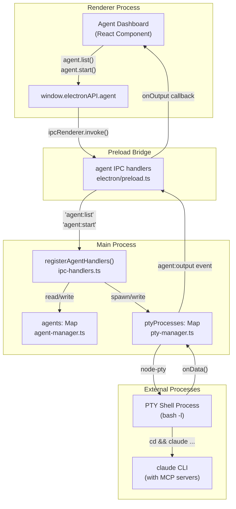
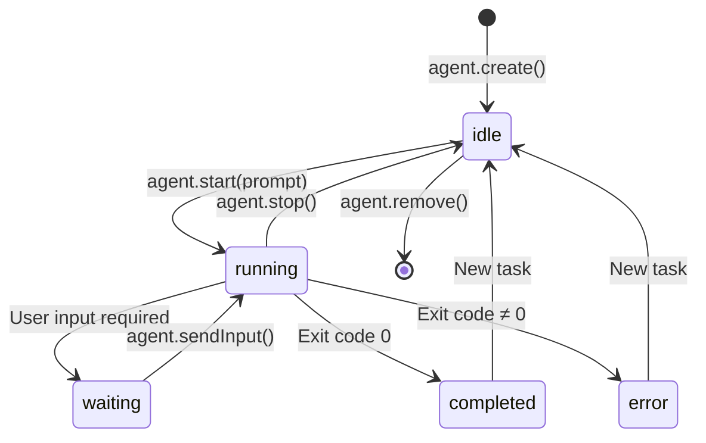
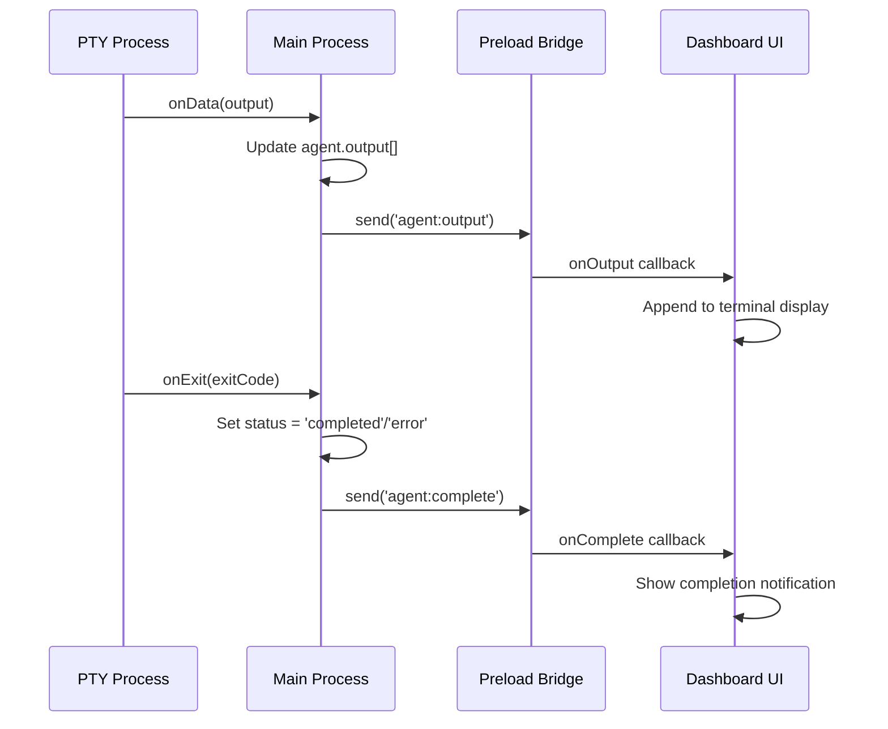
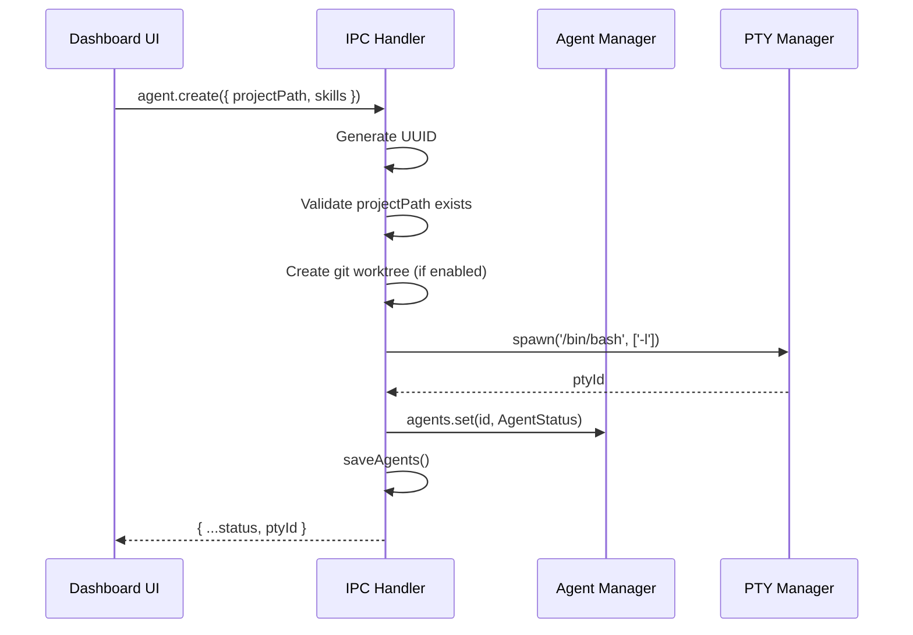
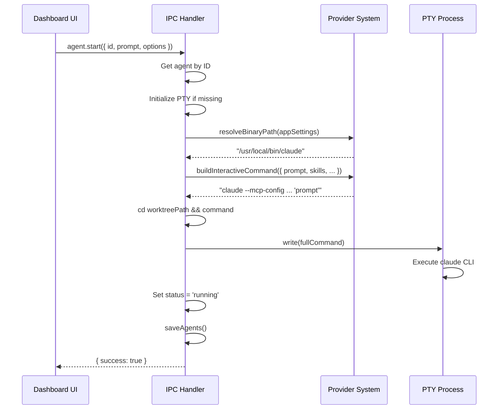
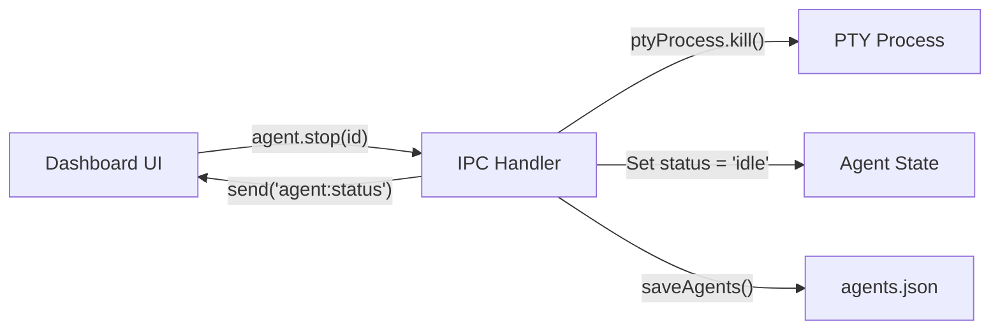
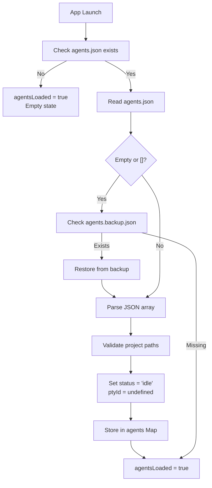
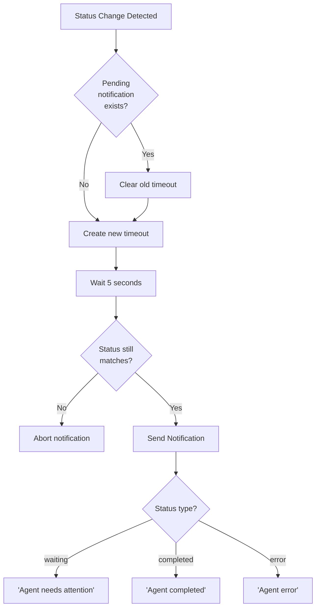

<!-- source: DeepWiki mcp.deepwiki.com · repo Charlie85270/Dorothy · page 5.2 Agent Dashboard · fetched 2026-10-26 -->

# Agent Dashboard

<details>
<summary>Relevant source files</summary>

The following files were used as context for generating this wiki page:

- [electron/core/agent-manager.ts](electron/core/agent-manager.ts)
- [electron/handlers/ipc-handlers.ts](electron/handlers/ipc-handlers.ts)
- [electron/preload.ts](electron/preload.ts)
- [mcp-vault/src/tools/documents.ts](mcp-vault/src/tools/documents.ts)
- [src/app/globals.css](src/app/globals.css)
- [src/app/vault/page.tsx](src/app/vault/page.tsx)
- [src/components/ClientLayout.tsx](src/components/ClientLayout.tsx)
- [src/components/Settings/index.ts](src/components/Settings/index.ts)
- [src/components/Sidebar.tsx](src/components/Sidebar.tsx)
- [src/components/VaultView/components/FolderTree.tsx](src/components/VaultView/components/FolderTree.tsx)
- [src/components/VaultView/index.tsx](src/components/VaultView/index.tsx)
- [src/types/electron.d.ts](src/types/electron.d.ts)

</details>


## Purpose and Scope

The Agent Dashboard is the primary user interface for viewing, monitoring, and controlling AI agents in Dorothy. It displays a real-time list of all agents, their current status, output streams, and provides controls for starting, stopping, and managing agents. The dashboard connects to the Electron main process via IPC to access agent state and PTY processes.

This document covers the dashboard UI layer and its integration with the agent management system. For details on creating and configuring agents, see [Creating and Managing Agents](#3.1). For the underlying PTY execution model, see [Agent Execution Model](#3.2). For the overall application layout, see [Application Shell](#5.1).

---

## Agent Data Model

### AgentStatus Interface

The dashboard operates on the `AgentStatus` interface, which represents the complete state of an agent:

| Field | Type | Description |
|-------|------|-------------|
| `id` | `string` | Unique agent identifier (UUID) |
| `status` | `'idle' \| 'running' \| 'completed' \| 'error' \| 'waiting'` | Current execution state |
| `projectPath` | `string` | Primary project directory |
| `secondaryProjectPath` | `string?` | Optional second project (via `--add-dir`) |
| `worktreePath` | `string?` | Git worktree path if using isolated branch |
| `branchName` | `string?` | Git branch name for worktree |
| `skills` | `string[]` | Installed skills (e.g. `['gh', 'jira']`) |
| `currentTask` | `string?` | Current task prompt (truncated) |
| `output` | `string[]` | Terminal output lines (last 100 saved) |
| `lastActivity` | `string` | ISO timestamp of last update |
| `error` | `string?` | Error message if status is `'error'` |
| `ptyId` | `string?` | PTY process ID (ephemeral, not persisted) |
| `character` | `AgentCharacter?` | Avatar character |
| `name` | `string?` | Display name |
| `pathMissing` | `boolean?` | True if project path no longer exists |
| `skipPermissions` | `boolean?` | Uses `--dangerously-skip-permissions` flag |
| `provider` | `AgentProvider?` | `'claude' \| 'codex' \| 'gemini' \| 'local'` |
| `localModel` | `string?` | Tasmania model name when provider is `'local'` |
| `obsidianVaultPaths` | `string[]?` | Obsidian vaults mounted via `--add-dir` |

**Sources:** [src/types/electron.d.ts:115-135]()

---

## Dashboard Architecture

The dashboard follows Dorothy's three-tier architecture: React UI → IPC Bridge → Electron Main Process.

### Component Data Flow



**Sources:** [electron/preload.ts:44-108](), [electron/handlers/ipc-handlers.ts:156-170](), [electron/core/agent-manager.ts:14]()

---

## Agent Lifecycle States

Agents transition through five primary states, managed by the `status` field:



### State Descriptions

| Status | Description | Triggers |
|--------|-------------|----------|
| `idle` | Agent exists but not running, PTY may be uninitialized | Created, stopped, or ready for next task |
| `running` | Claude CLI is actively executing a task | `agent.start()` called, command written to PTY |
| `waiting` | Agent paused, awaiting user input | Claude prompts with `[yes/no]` or needs clarification |
| `completed` | Task finished successfully | PTY exits with code 0 |
| `error` | Task failed | PTY exits with non-zero code |

**Status Detection:** The main process monitors PTY exit events to transition from `running` to `completed`/`error`. The `waiting` state is inferred by parsing terminal output for known prompts (e.g. `[yes/no]`).

**Sources:** [src/types/electron.d.ts:117](), [electron/handlers/ipc-handlers.ts:356-375]()

---

## Real-time Updates

The dashboard receives real-time agent updates via IPC events:

### Event Flow



### IPC Event Types

| Event | Payload | Purpose |
|-------|---------|---------|
| `agent:output` | `{ type, agentId, ptyId, data, timestamp }` | Terminal output chunk |
| `agent:error` | `{ type, agentId, data, timestamp, exitCode? }` | Error occurred |
| `agent:complete` | `{ type, agentId, ptyId, exitCode, timestamp }` | Task finished |
| `agent:tool_use` | `{ type, agentId, data, timestamp }` | MCP tool invocation (parsed from output) |
| `agent:status` | `{ type, agentId, status, timestamp }` | Status change (e.g. idle → running) |

**Event Listeners:** The dashboard registers callbacks via `window.electronAPI.agent.onOutput()`, `onError()`, `onComplete()`, etc. These return cleanup functions to unsubscribe.

**Sources:** [electron/preload.ts:83-107](), [src/types/electron.d.ts:1-8](), [electron/handlers/ipc-handlers.ts:330-354]()

---

## Agent Operations

### Creating an Agent



**Key Steps:**
1. **UUID Generation:** Each agent gets a unique ID via `uuidv4()`
2. **Path Validation:** Checks if `projectPath` exists; falls back to home directory if missing
3. **Worktree Creation:** If `worktree.enabled`, creates `.worktrees/<branchName>` directory and git worktree
4. **PTY Spawn:** Creates bash PTY with login shell (`-l`) to load environment
5. **Environment Setup:** Injects provider-specific env vars (e.g. `CLAUDE_AGENT_ID`, `CLAUDE_AGENT_NAME`)
6. **State Persistence:** Saves to `~/.dorothy/agents.json`

**Sources:** [electron/handlers/ipc-handlers.ts:172-377]()

---

### Starting an Agent



**Command Construction:**
- **Provider Selection:** Defaults to `'claude'`, can override per agent
- **MCP Config:** Passes `~/.claude/mcp.json` via `--mcp-config` flag (Claude provider only)
- **Skills:** Injects skills via `--add-skill` flags
- **System Prompt:** Super Agent gets special `super-agent-instructions.md`
- **Directory Context:** Uses `cd 'worktreePath' && ...` to set working directory

**Provider-Specific Behavior:**
- **Local Provider (Tasmania):** Recreates PTY with `ANTHROPIC_BASE_URL` and `ANTHROPIC_MODEL` env vars baked in
- **Codex/Gemini:** Uses different binary paths and command syntax

**Sources:** [electron/handlers/ipc-handlers.ts:380-589](), [electron/providers/index.ts]()

---

### Stopping an Agent



**Behavior:**
1. Kills the PTY process via `ptyProcess.kill()`
2. Sets `status = 'idle'` and clears `currentTask`
3. Marks as manually stopped to prevent status detection from re-running
4. Emits `agent:status` event to UI immediately
5. Persists state to disk

**Sources:** [electron/handlers/ipc-handlers.ts:655-680]()

---

### Removing an Agent

**Cleanup Operations:**
1. **Kill PTY:** Terminates the PTY process if running
2. **Remove Worktree:** Executes `git worktree remove --force` if worktree exists
3. **Delete State:** Removes from `agents` Map and persists to disk
4. **No UI Notification:** Deletion is immediate, UI polls or re-fetches list

**Sources:** [electron/handlers/ipc-handlers.ts:683-712]()

---

## Data Persistence

### Storage Location

Agents are persisted to `~/.dorothy/agents.json` as a JSON array. The file is written on every state change (create, update, stop, remove).

### Serialization Strategy

```typescript
const agentsArray = Array.from(agents.values()).map(agent => ({
  ...agent,
  ptyId: undefined,           // Ephemeral, not saved
  pathMissing: undefined,     // Recomputed on load
  output: agent.output.slice(-100), // Truncate to last 100 lines
  status: agent.status === 'running' ? 'idle' : agent.status, // Reset running agents
}));
```

**Key Points:**
- **No PTY IDs:** PTY processes are ephemeral; agents initialize new PTYs on startup
- **Output Truncation:** Keeps only last 100 output lines to prevent file bloat
- **Status Reset:** Running agents are saved as `'idle'` since PTY is gone
- **Backup System:** Creates `agents.backup.json` before overwriting main file

**Sources:** [electron/core/agent-manager.ts:141-170]()

### Loading on Startup



**Path Validation:** On load, each agent's `worktreePath` or `projectPath` is checked. If missing, `pathMissing = true` flag is set, and the dashboard can show a warning.

**Sources:** [electron/core/agent-manager.ts:172-221]()

---

## Status Detection and Notifications

### Notification System

The agent manager monitors status changes and triggers system notifications after a 5-second debounce delay. This prevents rapid status flickers from spamming notifications.



**Notification Triggers:**
- **Waiting State:** Desktop notification + Telegram message (if enabled)
- **Completed:** Desktop notification only (unless Super Agent)
- **Error:** Desktop notification + Telegram message (if enabled)

**Super Agent Behavior:** When the Super Agent completes a Telegram task, its output buffer is sent back to Telegram instead of a generic notification.

**Sources:** [electron/core/agent-manager.ts:40-139]()

---

## Dashboard UI Components

### Agent List View

The dashboard typically displays agents in a grid or list layout with the following information per agent:

| Element | Data Source | Description |
|---------|-------------|-------------|
| Avatar | `agent.character` | Visual identifier (robot, ninja, wizard, etc.) |
| Name | `agent.name` | Display name or default "Agent {id}" |
| Status Badge | `agent.status` | Colored badge (idle/running/completed/error) |
| Project Path | `agent.projectPath` | Truncated path display |
| Current Task | `agent.currentTask` | First 50-100 chars of prompt |
| Last Activity | `agent.lastActivity` | Relative time (e.g. "2 minutes ago") |
| Output Preview | `agent.output.slice(-5)` | Last few lines of terminal |

### Action Buttons

- **Start:** Opens prompt input modal, calls `agent.start()`
- **Stop:** Calls `agent.stop()`, disables if not running
- **View Output:** Expands terminal view with full output stream
- **Edit:** Opens agent configuration modal, calls `agent.update()`
- **Delete:** Confirmation dialog, calls `agent.remove()`

**Sources:** Inferred from IPC API structure

---

## Agent Dashboard API Reference

### IPC Methods

| Method | Parameters | Returns | Description |
|--------|------------|---------|-------------|
| `agent.create()` | `{ projectPath, skills, worktree?, character?, name?, ... }` | `AgentStatus & { ptyId }` | Create new agent with PTY |
| `agent.list()` | None | `AgentStatus[]` | Get all agents |
| `agent.get()` | `id: string` | `AgentStatus \| null` | Get single agent by ID |
| `agent.start()` | `{ id, prompt, options? }` | `{ success: boolean }` | Start agent with task |
| `agent.stop()` | `id: string` | `{ success: boolean }` | Stop running agent |
| `agent.remove()` | `id: string` | `{ success: boolean }` | Delete agent permanently |
| `agent.update()` | `{ id, skills?, name?, character?, ... }` | `{ success, agent? }` | Update agent configuration |
| `agent.sendInput()` | `{ id, input }` | `{ success: boolean }` | Send input to agent PTY |
| `agent.resize()` | `{ id, cols, rows }` | `{ success: boolean }` | Resize agent terminal |

### Event Listeners

| Listener | Callback Signature | Description |
|----------|-------------------|-------------|
| `agent.onOutput()` | `(event: AgentEvent) => void` | Terminal output received |
| `agent.onError()` | `(event: AgentEvent) => void` | Error occurred |
| `agent.onComplete()` | `(event: AgentEvent) => void` | Task completed/failed |
| `agent.onToolUse()` | `(event: AgentEvent) => void` | MCP tool invoked |
| `agent.onStatus()` | `(event: { agentId, status, timestamp }) => void` | Status changed |

All listeners return cleanup functions to unsubscribe.

**Sources:** [src/types/electron.d.ts:164-198](), [electron/preload.ts:44-108]()

---

## Integration with Other Systems

### Kanban Board

Agents can be assigned to Kanban tasks. When a task moves to the "Ongoing" column, Dorothy automatically:
1. Checks if agent with matching skills exists
2. If not, creates new agent via `agent.create()`
3. Starts agent with task description via `agent.start()`
4. Links agent ID to task (`task.assignedAgentId`)

**Sources:** Referenced in Kanban workflow (see [Kanban Board](#5.3))

### Automations

Automations can spawn ephemeral agents to process external triggers (GitHub PRs, JIRA issues). These agents:
- Are created with temporary names (e.g. "PR #123 Automation")
- Run autonomously without user interaction
- Are automatically removed after completion
- Have outputs sent to configured channels (Telegram, Slack)

**Sources:** Referenced in automation system (see [Automations](#7))

### Remote Control

The Super Agent appears in the dashboard like any other agent but has special behavior:
- Name contains "super agent" or "orchestrator"
- Has access to `send_telegram` and `send_slack` MCP tools
- Output buffer is captured for Telegram responses
- Can control other agents via `create_agent`, `start_agent`, etc. MCP tools

**Sources:** [electron/core/agent-manager.ts:9](), referenced in [Super Agent](#9.3)

---

