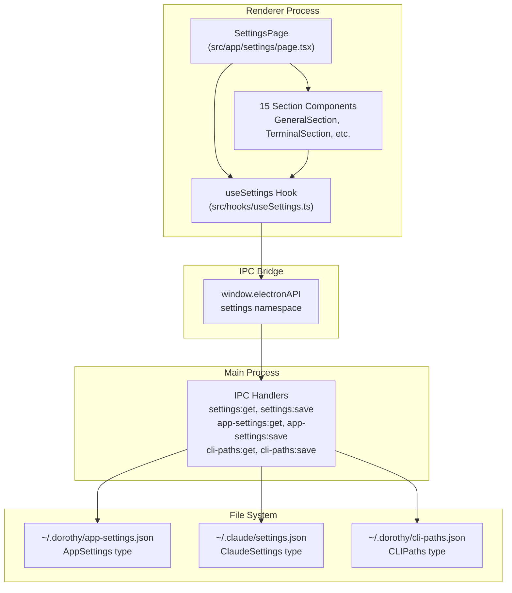
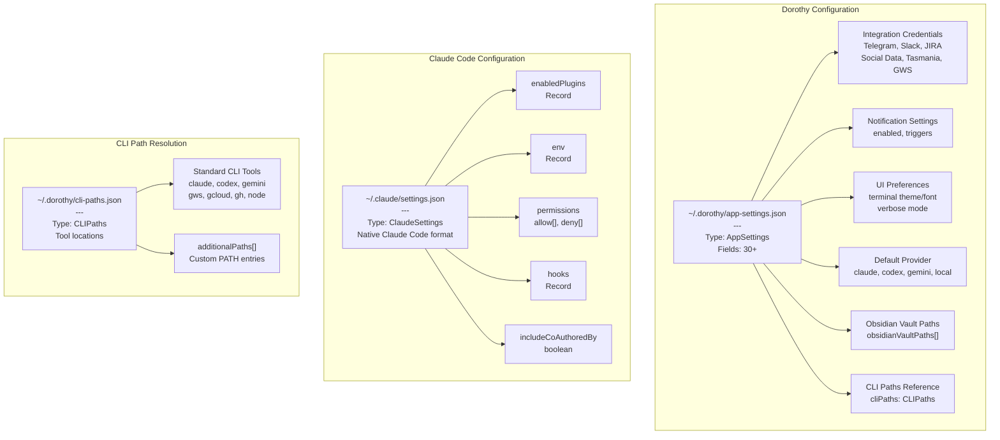
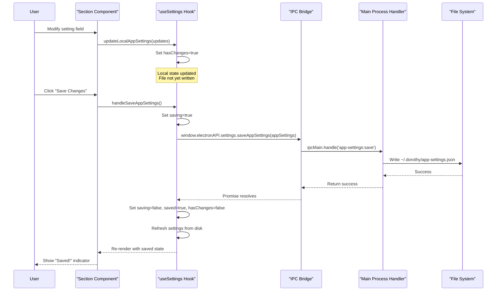

<!-- source: DeepWiki mcp.deepwiki.com · repo Charlie85270/Dorothy · page 5.3 Settings · fetched 2026-10-26 -->

# Settings

<details>
<summary>Relevant source files</summary>

The following files were used as context for generating this wiki page:

- [electron/types/index.ts](electron/types/index.ts)
- [src/app/settings/page.tsx](src/app/settings/page.tsx)
- [src/components/Settings/constants.ts](src/components/Settings/constants.ts)
- [src/components/Settings/types.ts](src/components/Settings/types.ts)

</details>


The Settings system in Dorothy provides a centralized configuration interface for all aspects of the application. It manages three distinct configuration files: `app-settings.json` for Dorothy-specific preferences, `settings.json` for Claude CLI configuration, and `cli-paths.json` for tool path resolution. The system is organized into 15 sections, each managing a specific domain of functionality.

For information about how settings are consumed by services at runtime, see [Technical Architecture](#11). For details on the automation-specific settings, see [Automations](#7).

---

## Settings Architecture

The settings system follows a layered architecture where the React UI communicates with the Electron main process via IPC to read and persist configuration across multiple files.

**Settings UI and State Management Flow**



Sources: [src/app/settings/page.tsx:1-261](), [src/components/Settings/constants.ts:19-35](), [electron/types/index.ts:46-84]()

---

## Settings Page Structure

The main settings page at [src/app/settings/page.tsx]() implements a sidebar navigation pattern with 15 sections. The page uses URL query parameters for deep-linking (e.g., `?section=telegram`) and tracks unsaved changes.

**Page Components and Layout**

| Component | Purpose | Location |
|-----------|---------|----------|
| `SettingsPageInner` | Main container, manages active section state | [src/app/settings/page.tsx:39-261]() |
| `SettingsSidebar` | Section navigation, displays all 15 sections | Imported from Settings components |
| `renderContent()` | Switch function returning active section component | [src/app/settings/page.tsx:70-157]() |
| `InstallTerminalModal` | Modal for running installation commands | Imported from Settings components |

**State Management via useSettings Hook**

The `useSettings` hook centralizes all settings operations:

```typescript
const {
  settings,           // ClaudeSettings from ~/.claude/settings.json
  appSettings,        // AppSettings from ~/.dorothy/app-settings.json
  info,               // ClaudeInfo system information
  skills,             // Skill[] available skills
  loading,            // Initial load state
  saving,             // Save operation in progress
  error,              // Error message string
  saved,              // Success indicator
  hasChanges,         // Unsaved changes flag
  fetchSettings,      // Reload all settings
  handleSave,         // Save ClaudeSettings
  handleSaveAppSettings,  // Save AppSettings
  updateSettings,     // Update ClaudeSettings locally
  updateLocalAppSettings  // Update AppSettings locally
} = useSettings();
```

Sources: [src/app/settings/page.tsx:53-68](), [src/hooks/useSettings.ts]()

---

## Settings Sections

The settings interface is divided into 15 distinct sections, each managing specific configuration domains.

**Section Registry**

```mermaid
graph LR
    subgraph "Core Settings"
        General["General<br/>icon: Settings"]
        Terminal["Terminal<br/>icon: Terminal"]
        System["System<br/>icon: Monitor"]
        Permissions["Permissions<br/>icon: Shield"]
        Skills["Skills & Plugins<br/>icon: Sparkles"]
        CLIPaths["CLI Paths<br/>icon: Terminal"]
    end
    
    subgraph "Integrations"
        Obsidian["Obsidian<br/>icon: ObsidianIcon"]
        Git["Git<br/>icon: GitCommit"]
        Telegram["Telegram<br/>icon: Send"]
        Slack["Slack<br/>icon: SlackIcon"]
        JIRA["JIRA<br/>icon: JiraIcon"]
        SocialData["X Twitter<br/>icon: Twitter"]
        Tasmania["Tasmania<br/>icon: TasmaniaIcon"]
        GWS["Google Workspace<br/>icon: Cloud"]
    end
    
    subgraph "Notifications"
        Notifications["Notifications<br/>icon: Bell"]
    end
    
    SECTIONS["SECTIONS constant<br/>(constants.ts:19-35)"] --> General
    SECTIONS --> Terminal
    SECTIONS --> Obsidian
    SECTIONS --> Git
    SECTIONS --> Notifications
    SECTIONS --> Telegram
    SECTIONS --> Slack
    SECTIONS --> JIRA
    SECTIONS --> SocialData
    SECTIONS --> Tasmania
    SECTIONS --> GWS
    SECTIONS --> Permissions
    SECTIONS --> Skills
    SECTIONS --> CLIPaths
    SECTIONS --> System
```

Sources: [src/components/Settings/constants.ts:19-35]()

### Section Configuration Surface

Each section exposes different configuration fields stored in different files:

| Section | Primary File | Key Fields | Type Reference |
|---------|--------------|------------|----------------|
| **General** | app-settings.json | `autoCheckUpdates`, `defaultProvider`, `verboseModeEnabled` | [AppSettings]() |
| **Terminal** | app-settings.json | `terminalFontSize`, `terminalTheme` | [AppSettings]() |
| **Obsidian** | app-settings.json | `obsidianVaultPaths` | [AppSettings]() |
| **Git** | settings.json | (Git worktree config in Claude settings) | [ClaudeSettings]() |
| **Notifications** | app-settings.json | `notificationsEnabled`, `notifyOnWaiting`, `notifyOnComplete`, `notifyOnError` | [AppSettings]() |
| **Telegram** | app-settings.json | `telegramEnabled`, `telegramBotToken`, `telegramAuthToken`, `telegramAuthorizedChatIds`, `telegramRequireMention` | [AppSettings]() |
| **Slack** | app-settings.json | `slackEnabled`, `slackBotToken`, `slackAppToken`, `slackSigningSecret`, `slackChannelId` | [AppSettings]() |
| **JIRA** | app-settings.json | `jiraEnabled`, `jiraDomain`, `jiraEmail`, `jiraApiToken` | [AppSettings]() |
| **Social Data** | app-settings.json | `socialDataEnabled`, `socialDataApiKey`, `xPostingEnabled`, `xApiKey`, `xApiSecret`, `xAccessToken`, `xAccessTokenSecret` | [AppSettings]() |
| **Tasmania** | app-settings.json | `tasmaniaEnabled`, `tasmaniaServerPath` | [AppSettings]() |
| **Google Workspace** | app-settings.json | `gwsEnabled`, `gwsSkillsInstalled` | [AppSettings]() |
| **Permissions** | settings.json | `permissions.allow`, `permissions.deny` | [ClaudeSettings]() |
| **Skills** | settings.json | `enabledPlugins` | [ClaudeSettings]() |
| **CLI Paths** | cli-paths.json | `claude`, `codex`, `gemini`, `gws`, `gcloud`, `gh`, `node`, `additionalPaths` | [CLIPaths]() |
| **System** | (read-only) | Platform info, versions, paths | [ClaudeInfo]() |

Sources: [electron/types/index.ts:46-84](), [src/components/Settings/types.ts:38-76]()

---

## Configuration Files

Dorothy uses three distinct configuration files, each with a specific purpose and structure.

**Configuration File Structure**



Sources: [electron/types/index.ts:35-84](), [src/components/Settings/types.ts:1-76]()

### AppSettings Default Values

The system defines comprehensive defaults for all settings:

```typescript
// From constants.ts:37-84
DEFAULT_APP_SETTINGS = {
  notificationsEnabled: true,
  notifyOnWaiting: true,
  notifyOnComplete: true,
  notifyOnError: true,
  telegramEnabled: false,
  telegramBotToken: '',
  telegramChatId: '',
  telegramAuthToken: '',
  telegramAuthorizedChatIds: [],
  telegramRequireMention: false,
  slackEnabled: false,
  slackBotToken: '',
  slackAppToken: '',
  slackSigningSecret: '',
  slackChannelId: '',
  jiraEnabled: false,
  jiraDomain: '',
  jiraEmail: '',
  jiraApiToken: '',
  socialDataEnabled: false,
  socialDataApiKey: '',
  xPostingEnabled: false,
  xApiKey: '',
  xApiSecret: '',
  xAccessToken: '',
  xAccessTokenSecret: '',
  tasmaniaEnabled: false,
  tasmaniaServerPath: '',
  gwsEnabled: false,
  gwsSkillsInstalled: false,
  verboseModeEnabled: false,
  autoCheckUpdates: true,
  defaultProvider: 'claude',
  obsidianVaultPaths: [],
  terminalFontSize: 11,
  terminalTheme: 'dark',
  cliPaths: {
    claude: '',
    codex: '',
    gemini: '',
    gws: '',
    gcloud: '',
    gh: '',
    node: '',
    additionalPaths: [],
  },
}
```

Sources: [src/components/Settings/constants.ts:37-84]()

---

## Settings Sections Detail

### General Section

Manages core Dorothy preferences including auto-updates, default AI provider, and verbose mode.

**Configuration Fields:**
- `autoCheckUpdates`: Enable automatic update checking (boolean)
- `defaultProvider`: Default AI provider (`'claude' | 'codex' | 'gemini' | 'local'`)
- `verboseModeEnabled`: Enable verbose logging (boolean)

The General section also displays the current version and provides an "Check for Updates" button that triggers the `electron-updater` flow.

Sources: [src/app/settings/page.tsx:73](), [electron/types/index.ts:8](), [src/components/Settings/types.ts:72]()

### Terminal Section

Configures terminal display preferences for agent output.

**Configuration Fields:**
- `terminalFontSize`: Font size in pixels (number, default: 11)
- `terminalTheme`: Color scheme (`'dark' | 'light'`, default: `'dark'`)

These settings affect the xterm.js instances used throughout Dorothy's agent terminals.

Sources: [src/app/settings/page.tsx:75](), [electron/types/index.ts:82-83]()

### Obsidian Section

Manages integration with Obsidian vaults for read-only reference material.

**Configuration Fields:**
- `obsidianVaultPaths`: Array of absolute paths to Obsidian vaults (string[])

These paths are mounted as read-only directories in agent execution contexts via the `--add-dir` flag, allowing agents to reference vault content without modification.

Sources: [src/app/settings/page.tsx:77](), [electron/types/index.ts:81]()

### Git Section

Configures Git worktree behavior for agents.

**Configuration Fields:**
Stored in `ClaudeSettings` (Claude Code native format), not in `AppSettings`.

Sources: [src/app/settings/page.tsx:79](), [electron/types/index.ts:1-4]()

### Notifications Section

Controls desktop notification triggers for agent state changes.

**Configuration Fields:**
- `notificationsEnabled`: Master toggle for notifications (boolean)
- `notifyOnWaiting`: Notify when agent enters waiting state (boolean)
- `notifyOnComplete`: Notify when agent completes successfully (boolean)
- `notifyOnError`: Notify when agent encounters error (boolean)

Sources: [src/app/settings/page.tsx:82-86](), [electron/types/index.ts:47-50]()

### Telegram Section

Configures Telegram bot integration for remote control. See [Telegram Bot](#9.1) for operational details.

**Configuration Fields:**
- `telegramEnabled`: Enable Telegram integration (boolean)
- `telegramBotToken`: Bot token from @BotFather (string)
- `telegramChatId`: Legacy field, kept for backwards compatibility (string)
- `telegramAuthToken`: Secret token for user authentication (string)
- `telegramAuthorizedChatIds`: List of authorized chat IDs (string[])
- `telegramRequireMention`: Only respond when bot is @mentioned in groups (boolean)

The authentication flow requires users to provide the `telegramAuthToken` before their chat ID is added to `telegramAuthorizedChatIds`.

Sources: [src/app/settings/page.tsx:88-94](), [electron/types/index.ts:51-56]()

### Slack Section

Configures Slack bot integration via Socket Mode. See [Slack Bot](#9.2) for operational details.

**Configuration Fields:**
- `slackEnabled`: Enable Slack integration (boolean)
- `slackBotToken`: Bot User OAuth Token (xoxb-...) (string)
- `slackAppToken`: App-Level Token (xapp-...) for Socket Mode (string)
- `slackSigningSecret`: Signing secret for request verification (string)
- `slackChannelId`: Default channel ID for notifications (string)

Sources: [src/app/settings/page.tsx:96-102](), [electron/types/index.ts:57-61]()

### JIRA Section

Configures JIRA integration for issue polling and automation. See [JIRA Automations](#7.3) for usage details.

**Configuration Fields:**
- `jiraEnabled`: Enable JIRA integration (boolean)
- `jiraDomain`: JIRA instance domain (e.g., `company.atlassian.net`) (string)
- `jiraEmail`: User email for authentication (string)
- `jiraApiToken`: API token from JIRA account settings (string)

Sources: [src/app/settings/page.tsx:104-110](), [electron/types/index.ts:62-65]()

### Social Data Section

Configures Social Data API and X (Twitter) posting capabilities.

**Configuration Fields:**
- `socialDataEnabled`: Enable Social Data API (boolean)
- `socialDataApiKey`: API key for Social Data service (string)
- `xPostingEnabled`: Enable X/Twitter posting (boolean)
- `xApiKey`: X API Key (Consumer Key) (string)
- `xApiSecret`: X API Secret (Consumer Secret) (string)
- `xAccessToken`: X Access Token (string)
- `xAccessTokenSecret`: X Access Token Secret (string)

The Social Data integration uses the `mcp-socialdata` server, while X posting uses separate OAuth 1.0a credentials.

Sources: [src/app/settings/page.tsx:112-118](), [electron/types/index.ts:66-72]()

### Tasmania Section

Configures Tasmania local AI server for running local models as a provider alternative.

**Configuration Fields:**
- `tasmaniaEnabled`: Enable Tasmania integration (boolean)
- `tasmaniaServerPath`: Absolute path to Tasmania server directory (string)

When enabled and `defaultProvider` is set to `'local'`, agents will use Tasmania instead of Claude API.

Sources: [src/app/settings/page.tsx:120-126](), [electron/types/index.ts:73-74]()

### Google Workspace Section

Configures Google Workspace CLI (`gws`) integration.

**Configuration Fields:**
- `gwsEnabled`: Enable GWS integration (boolean)
- `gwsSkillsInstalled`: Track whether GWS skills have been installed (boolean)

The section provides installation instructions and buttons to install GWS skills into agents.

Sources: [src/app/settings/page.tsx:128-134](), [electron/types/index.ts:75-76]()

### Permissions Section

Manages Claude Code permissions (`allow` and `deny` lists). Modifies `~/.claude/settings.json`.

**Configuration Fields:**
- `permissions.allow`: Array of allowed glob patterns (string[])
- `permissions.deny`: Array of denied glob patterns (string[])

This section directly edits Claude Code's native permission system.

Sources: [src/app/settings/page.tsx:136](), [src/components/Settings/types.ts:6]()

### Skills Section

Displays installed skills and plugins from three sources: project-level, user-level, and plugins.

**Display Information:**
- Skill name
- Source: `'project' | 'user' | 'plugin'`
- Absolute path
- Optional description
- Optional project name (for project-level skills)

This section is read-only; skills are managed through the Skills & Plugins marketplace interface elsewhere in Dorothy.

Sources: [src/app/settings/page.tsx:138](), [src/components/Settings/types.ts:19-25]()

### CLI Paths Section

Configures absolute paths to CLI tools required by Dorothy and agents.

**Configuration Fields (CLIPaths type):**
- `claude`: Path to `claude` CLI (string)
- `codex`: Path to `codex` CLI (string)
- `gemini`: Path to `gemini` CLI (string)
- `gws`: Path to `gws` CLI (string)
- `gcloud`: Path to `gcloud` CLI (string)
- `gh`: Path to GitHub CLI (string)
- `node`: Path to Node.js binary (string)
- `additionalPaths`: Custom PATH entries appended to agent environment (string[])

These paths are used for provider selection and tool availability checks. Empty strings indicate the tool should be resolved from system PATH.

Sources: [src/app/settings/page.tsx:140-145](), [electron/types/index.ts:35-44](), [src/components/Settings/types.ts:27-36]()

### System Section

Read-only display of system information and Dorothy configuration.

**Display Information (ClaudeInfo type):**
- `claudeVersion`: Installed Claude Code version (string)
- `configPath`: Path to Claude Code config directory (string)
- `settingsPath`: Path to Claude Code settings.json (string)
- `platform`: Operating system platform (string)
- `arch`: CPU architecture (string)
- `nodeVersion`: Node.js version (string)
- `electronVersion`: Electron version (string)

This section helps with troubleshooting and verifying installation paths.

Sources: [src/app/settings/page.tsx:147-153](), [src/components/Settings/types.ts:9-17]()

---

## Settings Persistence Flow

Settings changes follow a specific flow from UI interaction to disk persistence.

**Save Operations Sequence**



**Parallel Configuration Management**

The system maintains two save paths depending on which file is being modified:

| Save Function | Target File | Settings Type | IPC Handler |
|--------------|-------------|---------------|-------------|
| `handleSave()` | `~/.claude/settings.json` | ClaudeSettings | `settings:save` |
| `handleSaveAppSettings()` | `~/.dorothy/app-settings.json` | AppSettings | `app-settings:save` |

CLI paths are saved automatically with `AppSettings` as they are stored in `appSettings.cliPaths`.

Sources: [src/app/settings/page.tsx:64-68](), [src/hooks/useSettings.ts]()

---

## Settings Consumer Services

Various Dorothy services consume settings at runtime. Changes to settings typically require service restart or app restart to take effect.

**Settings Consumption Map**

| Service | Consumed Settings | Source File |
|---------|------------------|-------------|
| **Telegram Bot** | `telegramEnabled`, `telegramBotToken`, `telegramAuthToken`, `telegramAuthorizedChatIds`, `telegramRequireMention` | app-settings.json |
| **Slack Bot** | `slackEnabled`, `slackBotToken`, `slackAppToken`, `slackSigningSecret`, `slackChannelId` | app-settings.json |
| **Automation Service** | `jiraEnabled`, `jiraDomain`, `jiraEmail`, `jiraApiToken` | app-settings.json |
| **Agent Manager** | `defaultProvider`, `verboseModeEnabled`, `cliPaths`, `obsidianVaultPaths` | app-settings.json |
| **Notification Service** | `notificationsEnabled`, `notifyOnWaiting`, `notifyOnComplete`, `notifyOnError` | app-settings.json |
| **Claude CLI** | `permissions`, `enabledPlugins`, `env`, `hooks` | settings.json |
| **Provider System** | `cliPaths`, `defaultProvider`, `tasmaniaEnabled`, `tasmaniaServerPath` | app-settings.json |
| **Terminal Renderer** | `terminalFontSize`, `terminalTheme` | app-settings.json |

Sources: [electron/types/index.ts:46-84]()

---

## Type Definitions

The settings system uses several TypeScript interfaces to ensure type safety across the IPC boundary.

**Core Settings Types**

```typescript
// AppSettings - Dorothy-specific configuration
export interface AppSettings {
  notificationsEnabled: boolean;
  notifyOnWaiting: boolean;
  notifyOnComplete: boolean;
  notifyOnError: boolean;
  telegramEnabled: boolean;
  telegramBotToken: string;
  telegramChatId: string;
  telegramAuthToken: string;
  telegramAuthorizedChatIds: string[];
  telegramRequireMention: boolean;
  slackEnabled: boolean;
  slackBotToken: string;
  slackAppToken: string;
  slackSigningSecret: string;
  slackChannelId: string;
  jiraEnabled: boolean;
  jiraDomain: string;
  jiraEmail: string;
  jiraApiToken: string;
  socialDataEnabled: boolean;
  socialDataApiKey: string;
  xPostingEnabled: boolean;
  xApiKey: string;
  xApiSecret: string;
  xAccessToken: string;
  xAccessTokenSecret: string;
  tasmaniaEnabled: boolean;
  tasmaniaServerPath: string;
  gwsEnabled: boolean;
  gwsSkillsInstalled: boolean;
  verboseModeEnabled: boolean;
  autoCheckUpdates: boolean;
  cliPaths: CLIPaths;
  defaultProvider?: AgentProvider;
  obsidianVaultPaths?: string[];
  terminalFontSize?: number;
  terminalTheme?: 'dark' | 'light';
}

// ClaudeSettings - Native Claude Code format
export interface ClaudeSettings {
  enabledPlugins: Record<string, boolean>;
  env: Record<string, string>;
  hooks: Record<string, unknown>;
  includeCoAuthoredBy: boolean;
  permissions: { allow: string[]; deny: string[] };
}

// CLIPaths - Tool path resolution
export interface CLIPaths {
  claude: string;
  codex: string;
  gemini: string;
  gws: string;
  gcloud: string;
  gh: string;
  node: string;
  additionalPaths: string[];
}

// AgentProvider - Supported AI providers
export type AgentProvider = 'claude' | 'codex' | 'gemini' | 'local';

// SettingsSection - Section identifiers
export type SettingsSection = 
  | 'general' 
  | 'terminal' 
  | 'git' 
  | 'notifications' 
  | 'telegram' 
  | 'slack' 
  | 'jira' 
  | 'socialdata' 
  | 'tasmania' 
  | 'google-workspace' 
  | 'obsidian' 
  | 'permissions' 
  | 'skills' 
  | 'cli' 
  | 'system';
```

Sources: [electron/types/index.ts:1-84](), [src/components/Settings/types.ts:1-78]()

---

## URL Deep-Linking

The settings page supports deep-linking via URL query parameters, allowing direct navigation to specific sections.

**URL Format:**
```
/settings?section={sectionId}
```

**Examples:**
- `/settings?section=telegram` - Open Telegram settings
- `/settings?section=cli` - Open CLI Paths settings
- `/settings?section=general` - Open General settings

The deep-link is processed in [src/app/settings/page.tsx:45-49](), where the `section` query parameter is validated against the `SECTIONS` constant and used to set the initial active section.

Sources: [src/app/settings/page.tsx:40-49]()

---

