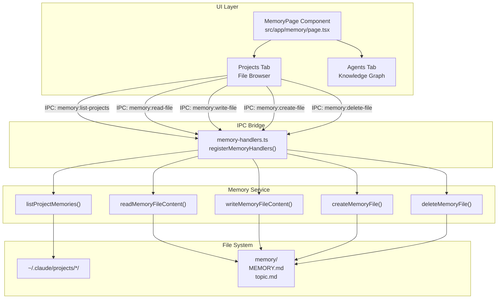
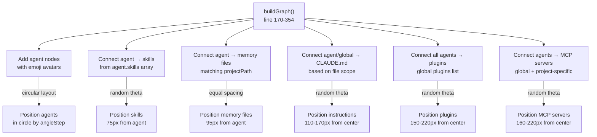
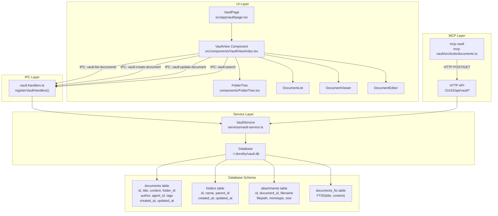
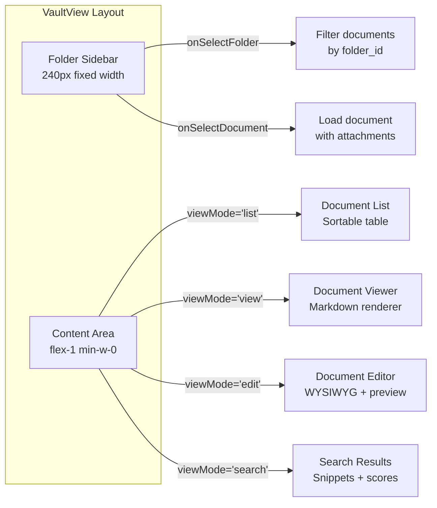

<!-- source: DeepWiki mcp.deepwiki.com · repo Charlie85270/Dorothy · page 6 Memory and Vault · fetched 2026-10-26 -->

# Memory and Vault

<details>
<summary>Relevant source files</summary>

The following files were used as context for generating this wiki page:

- [CLAUDE.md](CLAUDE.md)
- [bun.lock](bun.lock)
- [electron/handlers/memory-handlers.ts](electron/handlers/memory-handlers.ts)
- [mcp-vault/src/tools/documents.ts](mcp-vault/src/tools/documents.ts)
- [src/app/globals.css](src/app/globals.css)
- [src/app/memory/page.tsx](src/app/memory/page.tsx)
- [src/app/recurring-tasks/page.tsx](src/app/recurring-tasks/page.tsx)
- [src/app/vault/page.tsx](src/app/vault/page.tsx)
- [src/components/ClientLayout.tsx](src/components/ClientLayout.tsx)
- [src/components/Memory/AgentKnowledgeGraph.tsx](src/components/Memory/AgentKnowledgeGraph.tsx)
- [src/components/Sidebar.tsx](src/components/Sidebar.tsx)
- [src/components/VaultView/components/FolderTree.tsx](src/components/VaultView/components/FolderTree.tsx)
- [src/components/VaultView/index.tsx](src/components/VaultView/index.tsx)

</details>


This document describes Dorothy's two distinct knowledge management systems: the **Memory System** (integration with Claude Code's native project memory) and the **Vault System** (Dorothy's SQLite-backed document repository). Both systems provide UI access for users and programmatic access for agents via MCP tools.

For information about the MCP vault tools themselves, see [mcp-vault](#4.2). For the visual knowledge graph feature, details are covered in [Agent Knowledge Graph](#6.2).

---

## Memory System Overview

The Memory System exposes Claude Code's native memory functionality at `~/.claude/projects/*/memory/`. It does not create custom storage—it reads and writes the same memory files that Claude Code uses internally. Each project directory under `~/.claude/projects/` can have a `memory/` subdirectory containing:

- **MEMORY.md** – The entrypoint file, loaded first by Claude
- **Topic files** – e.g., `api-conventions.md`, `debugging.md` for specific knowledge areas

Dorothy provides a file browser UI and a visual knowledge graph that maps relationships between agents, skills, memory files, instruction files (CLAUDE.md), plugins, and MCP servers.

**Sources**: [src/app/memory/page.tsx:1-629](), [CLAUDE.md:1-12]()

---

## Memory System Architecture



**Memory System Data Flow**: User interactions in the MemoryPage component trigger IPC calls to memory handlers, which invoke service functions that perform file I/O operations on Claude Code's native memory directories.

**Sources**: [electron/handlers/memory-handlers.ts:1-36](), [src/app/memory/page.tsx:279-301]()

---

## Memory Page UI

The Memory Page (`src/app/memory/page.tsx`) renders two tabs:

| Tab | Purpose | Key Features |
|-----|---------|--------------|
| **Agents** | Visual knowledge graph | Force-directed graph showing connections between agents, skills, memory, instructions, plugins, MCP servers |
| **Projects** | File browser | Three-pane layout: project list, file list, content viewer/editor |

### Projects Tab Layout

The Projects tab uses a three-column layout:

1. **Left**: Project list with search, showing projects from `~/.claude/projects/`, filtered by search query
2. **Middle**: File list for selected project, showing all `.md` files in the `memory/` directory
3. **Right**: File viewer/editor with inline save/cancel controls

**Sources**: [src/app/memory/page.tsx:402-625]()

### Projects Tab State Management

```typescript
const {
  filteredProjects,      // Projects matching search
  agentCountByPath,      // Running agents per project
  selectedProject,       // Currently selected project
  selectedFile,          // Currently selected file
  loading,               // Initial load state
  saving,                // Save operation state
  error,                 // Error message
  searchQuery,           // Filter query
  selectProject,         // Select project callback
  selectFile,            // Select file callback
  saveFile,              // Save file callback
  createFile,            // Create new file callback
  deleteFile,            // Delete file callback
  refresh,               // Reload projects callback
} = useMemory();
```

**Sources**: [src/app/memory/page.tsx:280-300]()

---

## Agent Knowledge Graph

The knowledge graph (`src/components/Memory/AgentKnowledgeGraph.tsx`) visualizes the ecosystem around agents. It aggregates data from multiple sources:

| Data Source | Content | Path |
|-------------|---------|------|
| `agents.list()` | Active agents | IPC call |
| `claude.getData()` | Plugins, skills, settings | `~/.claude/settings.json` |
| `memory.listProjects()` | Project memory files | `~/.claude/projects/*/memory/` |
| Shell exec | CLAUDE.md instruction files | `~/.claude/CLAUDE.md`, `~/.dorothy/CLAUDE.md`, project-specific |
| Shell exec | MCP server configs | `~/.claude/mcp.json`, project `.mcp.json` |

**Sources**: [src/components/Memory/AgentKnowledgeGraph.tsx:542-670]()

### Graph Node Types

The graph uses six node types:

| Node Type | Shape | Radius | Color | Data Source |
|-----------|-------|--------|-------|-------------|
| `agent` | circle (emoji avatar) | 20px | `#8b5cf6` | Agent list |
| `skill` | circle | 10px | `#3b82f6` | Claude settings |
| `memory` | tag/pill | 9px | `#10b981` | Project memory files |
| `instructions` | tag/pill | 9px | `#0ea5e9` | CLAUDE.md files |
| `plugin` | circle | 10px | `#f59e0b` | Claude plugins |
| `mcp` | circle | 10px | `#ec4899` | MCP servers |

**Sources**: [src/components/Memory/AgentKnowledgeGraph.tsx:60-77]()

### Graph Building Algorithm



**Graph Construction**: The `buildGraph()` function creates nodes for each entity type and edges representing relationships. Agents are placed in a circular layout, with related entities positioned radially around them.

**Sources**: [src/components/Memory/AgentKnowledgeGraph.tsx:168-354]()

### Force Simulation

The graph uses a custom force-directed layout:

```typescript
const REPULSION   = 4500;  // Push nodes apart
const ATTRACTION  = 0.032; // Pull connected nodes together
const DAMPING     = 0.85;  // Slow down movement
const ITERATIONS  = 1;     // Steps per animation frame

function tickForce(nodes: GraphNode[], edges: GraphEdge[]) {
  // 1. Apply repulsion between all node pairs
  // 2. Apply spring attraction along edges
  // 3. Integrate velocity with damping
}
```

The simulation runs continuously via `requestAnimationFrame`, rendering with `drawGraph()` using Canvas 2D API with device pixel ratio scaling.

**Sources**: [src/components/Memory/AgentKnowledgeGraph.tsx:98-152](), [src/components/Memory/AgentKnowledgeGraph.tsx:357-511]()

### Interactive Panel

Clicking a node opens a side panel (`panelNode` state) displaying:

- **Memory/Instructions nodes**: Markdown content with preview/edit tabs
- **Skill nodes**: Skill documentation from `AGENTS.md`, `SKILL.md`, or `README.md`
- **Plugin nodes**: Plugin description
- **MCP nodes**: Command and args configuration

The panel supports inline editing for memory and instruction files with save/cancel controls.

**Sources**: [src/components/Memory/AgentKnowledgeGraph.tsx:817-943]()

---

## Vault System Overview

The Vault is Dorothy's dedicated document repository, separate from Claude's native memory. It uses SQLite with FTS5 (Full-Text Search 5) for structured storage and fast search. Key features:

- **Documents**: Title, content (Markdown), author, agent_id, tags, timestamps
- **Folders**: Hierarchical organization with parent_id relationships
- **Attachments**: File references linked to documents
- **Full-Text Search**: FTS5 index on title and content fields
- **Real-time UI updates**: IPC events for create/update/delete
- **MCP tool access**: Agents can programmatically manage documents

**Sources**: [src/components/VaultView/index.tsx:1-520](), [mcp-vault/src/tools/documents.ts:1-272]()

---

## Vault Data Architecture



**Vault System Architecture**: The vault operates through two access paths—UI via IPC and agents via MCP tools over HTTP API. Both paths converge on the VaultService which manages SQLite operations.

**Sources**: [src/components/VaultView/index.tsx:48-335](), [mcp-vault/src/tools/documents.ts:42-271]()

---

## Vault Document Management

### Document CRUD Operations

| Operation | IPC Handler | MCP Tool | Description |
|-----------|-------------|----------|-------------|
| Create | `vault:create-document` | `vault_create_document` | Create document with title, content, folder, tags |
| Read | `vault:get-document` | `vault_get_document` | Retrieve document by ID with attachments |
| Update | `vault:update-document` | `vault_update_document` | Modify title, content, tags, or folder |
| Delete | `vault:delete-document` | `vault_delete_document` | Remove document and attachments |
| List | `vault:list-documents` | `vault_list_documents` | Query documents with folder/tag filters |
| Search | `vault:search` | N/A | Full-text search using FTS5 |

**Sources**: [mcp-vault/src/tools/documents.ts:43-239]()

### MCP Tool: vault_create_document

The `vault_create_document` tool automatically resolves folder names:

```typescript
async function resolveFolder(folderName: string): Promise<string> {
  const result = await apiRequest("GET", "/api/vault/folders");
  const match = result.folders.find(
    f => f.name.toLowerCase() === folderName.toLowerCase()
  );
  if (match) return match.id;
  
  // No match — create new folder at root level
  const created = await apiRequest("POST", "/api/vault/folders", {
    name: folderName,
  });
  return created.folder.id;
}
```

Agents specify a folder name (not ID), and the tool finds or creates the folder. This simplifies agent workflows—they don't need to track folder IDs.

**Sources**: [mcp-vault/src/tools/documents.ts:25-40](), [mcp-vault/src/tools/documents.ts:44-86]()

---

## Vault Folder Organization

Folders support hierarchical nesting via `parent_id` relationships. The FolderTree component renders the hierarchy with:

- Expand/collapse controls
- Unread document badges (recursive count)
- Inline subfolder creation
- Drag-to-reorder (planned)

### Unread Badge Calculation

```typescript
function countUnreadInFolder(
  folderId: string,
  allFolders: VaultFolderElectron[],
  documents: VaultDocumentElectron[],
  readDocIds: Set<string>
): number {
  let count = documents.filter(d => 
    d.folder_id === folderId && !readDocIds.has(d.id)
  ).length;
  
  const children = allFolders.filter(f => f.parent_id === folderId);
  for (const child of children) {
    count += countUnreadInFolder(child.id, allFolders, documents, readDocIds);
  }
  return count;
}
```

Unread state is tracked in localStorage with key `vault-read-docs`. Documents created by agents trigger `onDocumentCreated` IPC events, incrementing the global unread count in the sidebar badge.

**Sources**: [src/components/VaultView/components/FolderTree.tsx:44-56](), [src/components/ClientLayout.tsx:49-172]()

---

## Vault Search System

The vault uses SQLite FTS5 for full-text search:

```sql
CREATE VIRTUAL TABLE documents_fts USING fts5(
  title,
  content,
  content=documents,
  content_rowid=id
);
```

Search queries use the `MATCH` operator for tokenized search:

```typescript
const results = db.prepare(`
  SELECT d.* FROM documents d
  JOIN documents_fts fts ON d.id = fts.rowid
  WHERE fts MATCH ?
  ORDER BY rank
`).all(query);
```

FTS5 provides ranked results based on term frequency and position. The UI displays search results with highlighted snippets and allows clicking to open the full document.

**Sources**: Referenced from architecture understanding (actual SQL not in provided files)

---

## Vault UI: Three-Pane Layout



**Vault Layout**: The sidebar contains the folder tree. The content area switches between four view modes: list, view, edit, and search.

**Sources**: [src/components/VaultView/index.tsx:334-520]()

### ViewMode State Machine

| ViewMode | Trigger | Display |
|----------|---------|---------|
| `list` | Default, close document | DocumentList showing filtered documents |
| `view` | Click document | DocumentViewer with MarkdownRenderer |
| `edit` | Click "Edit" or "New Document" | DocumentEditor with textarea + preview tabs |
| `search` | Enter search query | SearchResults with FTS5 matches |

**Sources**: [src/components/VaultView/index.tsx:59-60]()

---

## Document Editor Features

The DocumentEditor component (`DocumentEditor.tsx`) provides:

- **Title input**: Required field for document title
- **Content editor**: Textarea with syntax highlighting (planned)
- **Tags input**: Comma-separated tag list
- **Folder selector**: Dropdown to choose/create folder
- **Attachment picker**: File dialog to select files for attachment
- **Preview tab**: Live Markdown rendering with `SimpleMarkdown` component
- **Save/Cancel**: Updates via IPC, then reloads document

Pending attachments are stored in component state and uploaded after document save via `attachPendingFiles()`.

**Sources**: [src/components/VaultView/index.tsx:220-254]()

---

## Obsidian Integration

The Vault page includes an Obsidian tab (`src/app/vault/page.tsx`) for read-only access to user Obsidian vaults. Key differences:

| Feature | Dorothy Vault | Obsidian Vault |
|---------|---------------|----------------|
| **Write access** | Full CRUD | Read-only |
| **Storage** | `~/.dorothy/vault.db` | User-specified Obsidian vault paths |
| **Search** | FTS5 index | File name search only |
| **Folders** | Hierarchical with parent_id | File system directories |
| **Tags** | Stored in database | Parsed from frontmatter |

Users configure Obsidian vault paths in Settings > Obsidian. The ObsidianVaultView component lists vaults and allows browsing `.md` files.

**Sources**: [src/app/vault/page.tsx:1-60]()

---

## Storage Locations

| System | Path | Format | Purpose |
|--------|------|--------|---------|
| **Memory** | `~/.claude/projects/*/memory/` | Markdown files | Claude Code native memory |
| **Vault Database** | `~/.dorothy/vault.db` | SQLite + FTS5 | Dorothy document repository |
| **Obsidian** | User-configured | Markdown files | External vault integration |
| **Instruction Files** | `~/.claude/CLAUDE.md`<br/>`~/.dorothy/CLAUDE.md`<br/>`{project}/CLAUDE.md` | Markdown | Agent instructions |
| **MCP Config** | `~/.claude/mcp.json`<br/>`{project}/.mcp.json` | JSON | MCP server definitions |

**Sources**: [src/components/Memory/AgentKnowledgeGraph.tsx:570-649]()

---

## Real-Time Updates

Both systems emit IPC events for real-time UI synchronization:

### Memory Events

Memory operations don't emit events (file watching not implemented). Users must manually refresh using the refresh button.

### Vault Events

```typescript
// Emitted by VaultService after database operations
window.electronAPI.vault.onDocumentCreated((doc) => {
  setDocuments(prev => [doc, ...prev]);
  setAllDocuments(prev => [doc, ...prev]);
});

window.electronAPI.vault.onDocumentUpdated((doc) => {
  setDocuments(prev => prev.map(d => d.id === doc.id ? doc : d));
  setAllDocuments(prev => prev.map(d => d.id === doc.id ? doc : d));
});

window.electronAPI.vault.onDocumentDeleted(({ id }) => {
  setDocuments(prev => prev.filter(d => d.id !== id));
  setAllDocuments(prev => prev.filter(d => d.id !== id));
});
```

These events ensure that if an agent creates a document via MCP tools, the UI updates immediately without polling.

**Sources**: [src/components/VaultView/index.tsx:151-181]()

---

## Usage Patterns

### For Users

1. **Memory**: Browse project memory files, edit MEMORY.md, create topic files, visualize knowledge graph
2. **Vault**: Create reports, organize in folders, search across all documents, attach files

### For Agents (via MCP Tools)

1. **Create research report**: Call `vault_create_document` with folder name, title, content
2. **Update existing document**: Call `vault_update_document` with document ID
3. **Search knowledge base**: Call `vault_search` with query string
4. **Organize outputs**: Create folders via `vault_create_folder`, move documents via `vault_update_document` with new folder_id

**Sources**: [mcp-vault/src/tools/documents.ts:44-86]()

---

