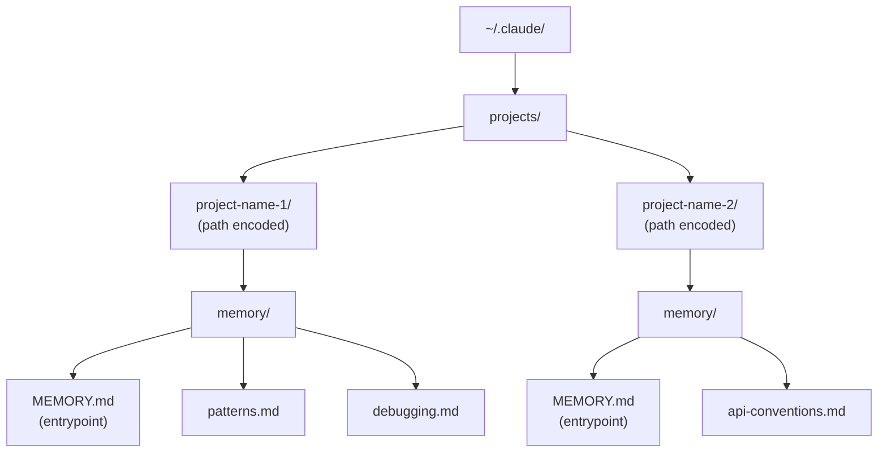
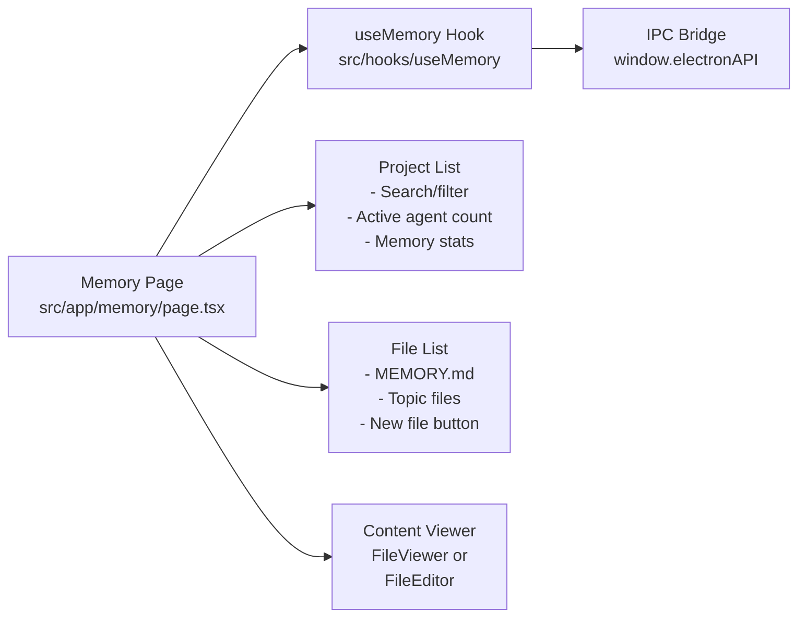
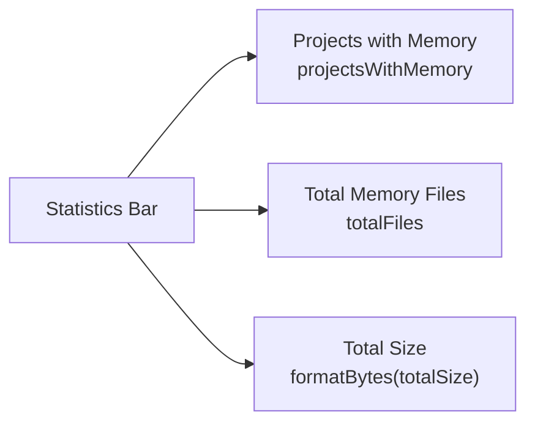
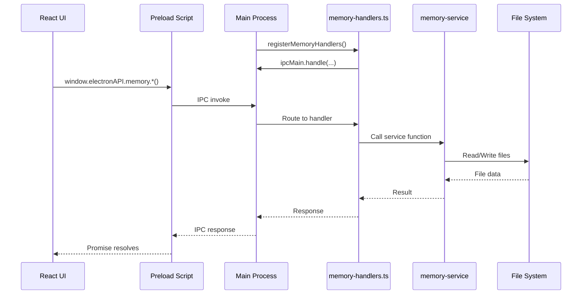
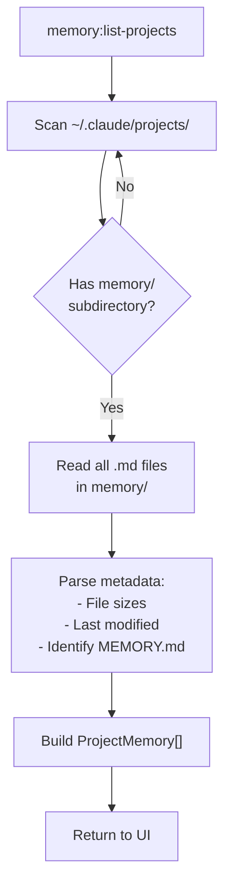
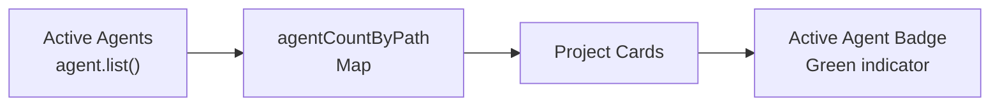
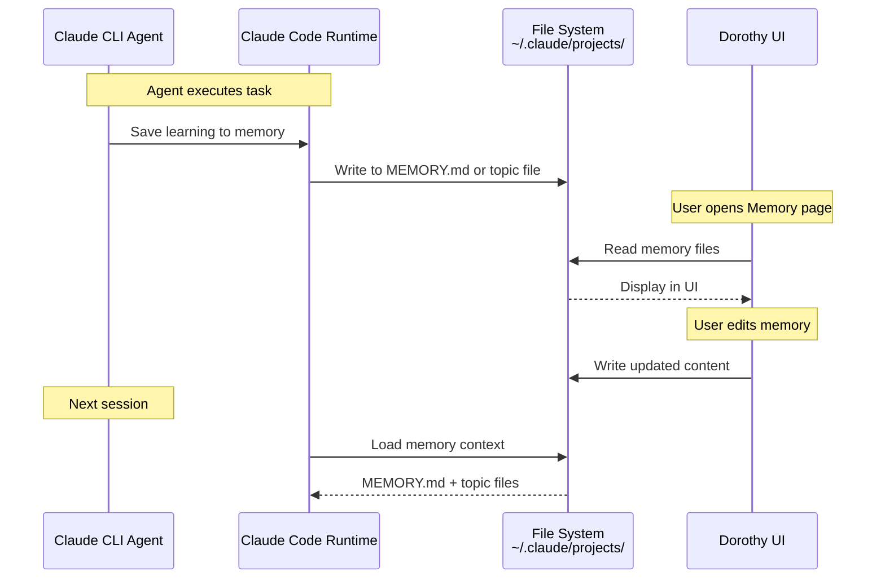
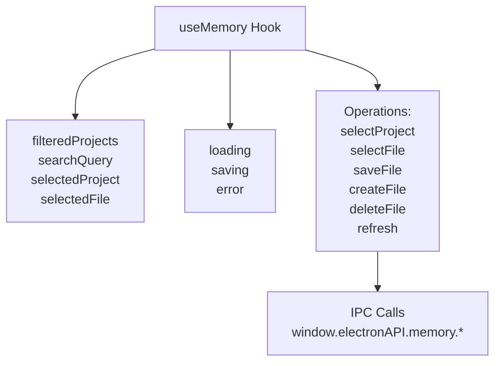

<!-- source: DeepWiki mcp.deepwiki.com · repo Charlie85270/Dorothy · page 6.1 Memory System · fetched 2026-10-26 -->

# Memory System

<details>
<summary>Relevant source files</summary>

The following files were used as context for generating this wiki page:

- [CLAUDE.md](CLAUDE.md)
- [bun.lock](bun.lock)
- [electron/handlers/memory-handlers.ts](electron/handlers/memory-handlers.ts)
- [src/app/memory/page.tsx](src/app/memory/page.tsx)
- [src/app/recurring-tasks/page.tsx](src/app/recurring-tasks/page.tsx)
- [src/components/Memory/AgentKnowledgeGraph.tsx](src/components/Memory/AgentKnowledgeGraph.tsx)

</details>


## Purpose and Scope

The Memory System provides access to **Claude Code's native memory** storage located at `~/.claude/projects/*/memory/`. This is not a Dorothy-specific storage mechanism; Dorothy exposes the existing memory files that Claude Code creates and uses across sessions. The system allows browsing, viewing, editing, and managing memory files through a dedicated UI interface.

For the visual knowledge graph showing relationships between agents and memory, see [Agent Knowledge Graph](#6.2). For Dorothy's own document storage system, see [Vault](#6.3). For integration with external Obsidian vaults, see [Obsidian Integration](#6.4).

---

## File System Structure

Claude Code stores project memory in a standardized directory structure under `~/.claude/projects/`. Each project has its own memory subdirectory containing markdown files that persist context across agent sessions.



**Sources:** [src/app/memory/page.tsx:1-630](), [CLAUDE.md:1-12]()

### Project Path Encoding

Project directory names use a path-as-folder-name encoding scheme where forward slashes in the original project path are converted to dashes. For example:

| Original Project Path | Encoded Directory Name |
|----------------------|----------------------|
| `/Users/dev/myproject` | `Users-dev-myproject` |
| `/home/user/work/app` | `home-user-work-app` |

This encoding allows Dorothy to map active agent project paths back to their corresponding memory directories.

**Sources:** [CLAUDE.md:3]()

---

## Memory File Organization

### MEMORY.md Entrypoint

Every project's memory system centers around `MEMORY.md`, which serves as the primary entrypoint file. This file is automatically created by Claude Code and contains:

- High-level architectural decisions
- Key file locations and project structure
- Important debugging insights
- Session-to-session continuity notes

The entrypoint file is designated as non-deletable in the UI and displays a special badge:

**Sources:** [src/app/memory/page.tsx:97-101](), [CLAUDE.md:6-11]()

### Topic Files

To keep `MEMORY.md` concise (recommended under 200 lines), detailed notes are organized into topic-specific markdown files such as:

- `patterns.md` - Design patterns and conventions
- `debugging.md` - Known issues and solutions
- `api-conventions.md` - API design rules
- `testing.md` - Test strategies and fixtures

Topic files are created and managed manually through the UI or automatically by Claude Code during agent execution.

**Sources:** [CLAUDE.md:9](), [src/app/memory/page.tsx:210-275]()

---

## UI Architecture

The Memory page provides a dual-interface system with two tabs: **Agents** (knowledge graph) and **Projects** (file browser).

### Projects Tab: Three-Pane Layout



**Sources:** [src/app/memory/page.tsx:279-629]()

### Component Breakdown

| Component | Purpose | Lines |
|-----------|---------|-------|
| `MemoryPage` | Main page container with tab switching | [src/app/memory/page.tsx:279-629]() |
| `ProjectCard` | Individual project list item with stats | [src/app/memory/page.tsx:141-207]() |
| `FileViewer` | Read-only file display with edit/delete actions | [src/app/memory/page.tsx:82-137]() |
| `FileEditor` | Inline editor with save/cancel | [src/app/memory/page.tsx:30-78]() |
| `NewFileModal` | Modal for creating new topic files | [src/app/memory/page.tsx:211-275]() |

**Sources:** [src/app/memory/page.tsx:1-630]()

### Statistics Bar

The UI displays aggregate statistics across all projects:



**Sources:** [src/app/memory/page.tsx:405-419]()

---

## IPC Communication

Memory operations flow from the UI through Electron's IPC bridge to backend handlers that interact with the file system.

### IPC Handler Registration



**Sources:** [electron/handlers/memory-handlers.ts:1-36]()

### Available IPC Channels

| Channel | Parameters | Return Value | Purpose |
|---------|-----------|--------------|---------|
| `memory:list-projects` | none | `{ projects: ProjectMemory[], error: string \| null }` | Lists all projects with memory |
| `memory:read-file` | `filePath: string` | `{ content: string, error: string \| null }` | Reads file content |
| `memory:write-file` | `filePath: string, content: string` | `{ success: boolean, error: string \| null }` | Writes file content |
| `memory:create-file` | `memoryDir: string, fileName: string, content: string` | `{ success: boolean, error: string \| null }` | Creates new topic file |
| `memory:delete-file` | `filePath: string` | `{ success: boolean, error: string \| null }` | Deletes topic file |

**Sources:** [electron/handlers/memory-handlers.ts:11-35]()

---

## File Operations

### Listing Projects

The `listProjectMemories` operation scans `~/.claude/projects/` to discover all projects with memory directories:



**Sources:** [electron/handlers/memory-handlers.ts:11-18](), [src/app/memory/page.tsx:280-300]()

### Reading Files

Reading memory file content is a direct file system operation:

**Sources:** [electron/handlers/memory-handlers.ts:20-22]()

### Writing Files

The write operation validates the file path, ensures it's within a memory directory, and persists content:

**Sources:** [electron/handlers/memory-handlers.ts:24-26]()

### Creating Topic Files

Creating a new topic file requires specifying the memory directory and file name. The `.md` extension is automatically appended:

**Sources:** [electron/handlers/memory-handlers.ts:28-30](), [src/app/memory/page.tsx:256]()

### Deleting Files

Files can be deleted except for `MEMORY.md` entrypoints, which are protected in the UI:

**Sources:** [electron/handlers/memory-handlers.ts:32-35](), [src/app/memory/page.tsx:113-121]()

---

## Integration with Agents

### Active Agent Tracking

The UI displays which agents are currently active per project by mapping agent `projectPath` values to memory directories:



**Sources:** [src/app/memory/page.tsx:174-183](), [src/app/memory/page.tsx:492]()

### Path Matching

Dorothy normalizes project paths (removing trailing slashes, lowercasing) to match agent paths against project memory directories:

**Sources:** [src/components/Memory/AgentKnowledgeGraph.tsx:236-241]()

### Memory Persistence Flow



**Sources:** [CLAUDE.md:6-11](), [src/app/memory/page.tsx:317-321]()

---

## Data Types

### ProjectMemory

The `ProjectMemory` type represents a single project's memory structure:

```typescript
interface ProjectMemory {
  id: string;                // Unique identifier
  projectName: string;       // Display name
  projectPath: string;       // Absolute path to project
  memoryDir: string;         // Path to memory/ subdirectory
  hasMemory: boolean;        // Whether memory/ exists
  files: MemoryFile[];       // All .md files
  lastModified: number;      // Most recent file timestamp
  totalSize: number;         // Sum of all file sizes
  provider?: string;         // Provider (claude/codex/gemini)
}
```

**Sources:** [src/app/memory/page.tsx:25]()

### MemoryFile

The `MemoryFile` type represents an individual markdown file:

```typescript
interface MemoryFile {
  name: string;              // Filename (e.g., "MEMORY.md")
  path: string;              // Absolute file path
  content: string;           // File content
  size: number;              // File size in bytes
  lastModified: number;      // Timestamp
  isEntrypoint: boolean;     // true for MEMORY.md
}
```

**Sources:** [src/app/memory/page.tsx:25]()

---

## UI State Management

The `useMemory` hook centralizes memory state and operations:



**Sources:** [src/app/memory/page.tsx:280-300]()

Key state values:

| State | Type | Purpose |
|-------|------|---------|
| `filteredProjects` | `ProjectMemory[]` | Projects matching search query |
| `agentCountByPath` | `Map<string, number>` | Active agents per project path |
| `selectedProject` | `ProjectMemory \| null` | Currently selected project |
| `selectedFile` | `MemoryFile \| null` | Currently selected file |
| `loading` | `boolean` | Initial load state |
| `saving` | `boolean` | Save operation in progress |

**Sources:** [src/app/memory/page.tsx:280-300]()

---

## Best Practices

### Memory Organization Strategy

As documented in `CLAUDE.md`, the recommended approach is:

1. Keep `MEMORY.md` under 200 lines as a high-level index
2. Create topic-specific files for detailed notes
3. Review `MEMORY.md` at session start for context
4. Update memory after corrections or discoveries

**Sources:** [CLAUDE.md:6-11]()

### File Naming Conventions

Topic files should use descriptive kebab-case names:

- `debugging.md` - not `debug.md` or `Debugging.md`
- `api-conventions.md` - not `API_conventions.md`
- `patterns.md` - not `design-patterns.md` (be concise)

**Sources:** [src/app/memory/page.tsx:250]()

---

## Error Handling

The system handles several error scenarios:

| Error Case | Handling |
|-----------|----------|
| Desktop app not available | Display "Memory is only available in the desktop app" | 
| Failed to list projects | Return `{ projects: [], error: message }` |
| File read/write failure | Display error banner with details |
| Invalid file path | Return error message from service |
| Empty search results | Show "No projects match your search" |

**Sources:** [src/app/memory/page.tsx:335-344](), [electron/handlers/memory-handlers.ts:13-17](), [src/app/memory/page.tsx:422-427]()

---

