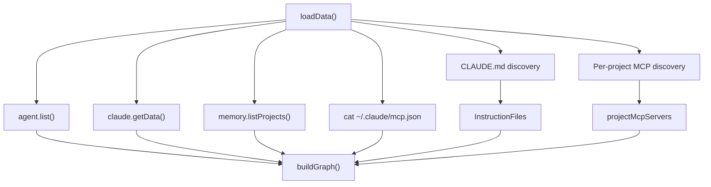
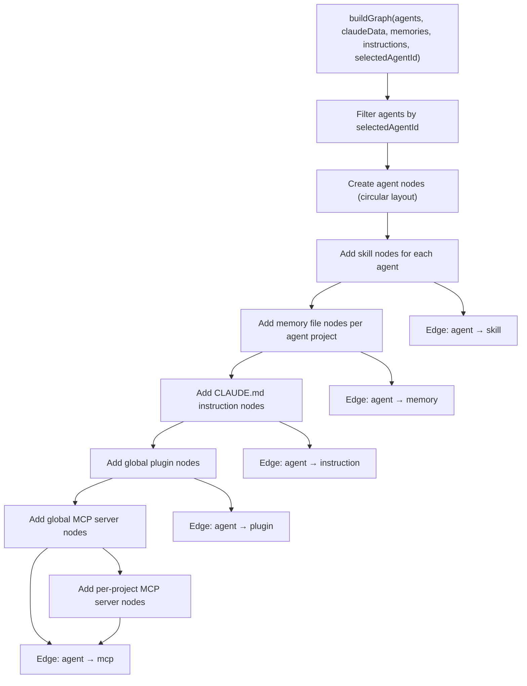
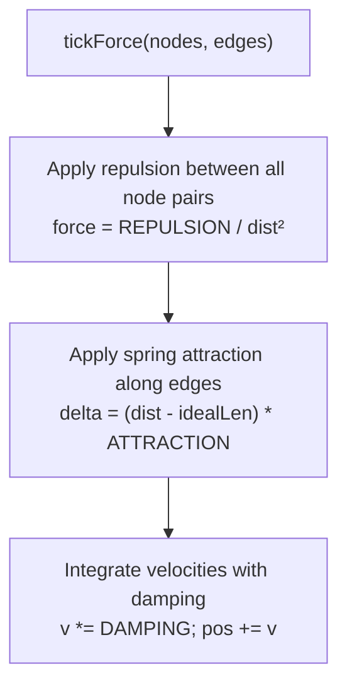
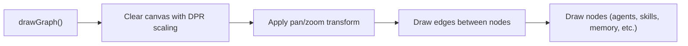
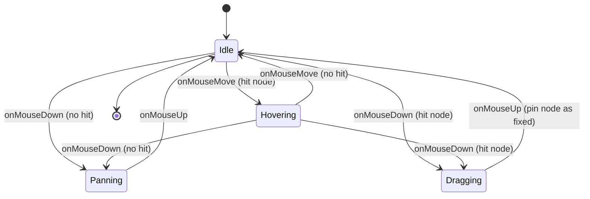
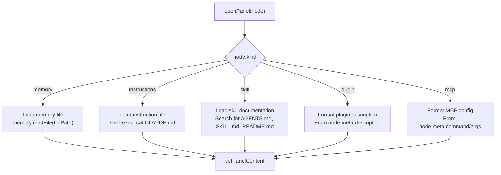

<!-- source: DeepWiki mcp.deepwiki.com · repo Charlie85270/Dorothy · page 6.2 Agent Knowledge Graph · fetched 2026-10-26 -->

# Agent Knowledge Graph

<details>
<summary>Relevant source files</summary>

The following files were used as context for generating this wiki page:

- [CLAUDE.md](CLAUDE.md)
- [bun.lock](bun.lock)
- [electron/handlers/memory-handlers.ts](electron/handlers/memory-handlers.ts)
- [src/app/memory/page.tsx](src/app/memory/page.tsx)
- [src/app/recurring-tasks/page.tsx](src/app/recurring-tasks/page.tsx)
- [src/components/Memory/AgentKnowledgeGraph.tsx](src/components/Memory/AgentKnowledgeGraph.tsx)

</details>


The Agent Knowledge Graph is a visual representation system that displays relationships between agents, their skills, memory files, Claude Code instructions, plugins, and MCP servers. This interactive graph helps users understand the capabilities and context available to each agent within the Dorothy system.

For information about managing memory files themselves, see [Memory System](#6.1). For general memory and vault concepts, see [Memory and Vault](#6).

---

## Overview

The Agent Knowledge Graph provides a force-directed network visualization accessible via the "Agents" tab on the Memory page. It aggregates data from multiple sources across the Dorothy ecosystem to create a comprehensive view of agent relationships and resources.

**Sources:** [src/app/memory/page.tsx:395-399](), [src/components/Memory/AgentKnowledgeGraph.tsx:1-1497]()

---

## Graph Data Sources

The graph construction aggregates information from five primary sources:

| Data Source | Description | Access Method |
|------------|-------------|---------------|
| **Agent Status** | Running and configured agents | `window.electronAPI.agent.list()` |
| **Claude Code Data** | Skills, plugins, settings from `~/.claude/` | `window.electronAPI.claude.getData()` |
| **Project Memory** | Memory files from `~/.claude/projects/*/memory/` | `window.electronAPI.memory.listProjects()` |
| **MCP Servers (Global)** | Global MCP config from `~/.claude/mcp.json` | Shell exec via `cat ~/.claude/mcp.json` |
| **MCP Servers (Project)** | Per-project MCP configs | Shell exec via `cat {projectPath}/.mcp.json` |
| **Instruction Files** | CLAUDE.md files (global and per-project) | Shell discovery and parsing |

The `loadData()` function orchestrates parallel fetching of all data sources:



**Sources:** [src/components/Memory/AgentKnowledgeGraph.tsx:543-670]()

---

## Node Types and Shapes

The graph renders six distinct node types, each with specific visual characteristics:

### Node Type Configuration

```typescript
type NodeKind = 'agent' | 'skill' | 'memory' | 'instructions' | 'plugin' | 'mcp';
type NodeShape = 'circle' | 'tag';
```

| Node Kind | Shape | Radius | Visual Style | Connection Logic |
|-----------|-------|--------|--------------|------------------|
| `agent` | circle | 20 | Emoji avatar in circle | Center of agent subgraph |
| `skill` | circle | 10 | Solid color circle | Connected to agents using that skill |
| `memory` | tag | 9 | Rounded rectangle pill | Connected to owning agent's project |
| `instructions` | tag | 9 | Rounded rectangle pill | Connected to relevant agents (global or scoped) |
| `plugin` | circle | 10 | Solid color circle | Connected to all agents (global) |
| `mcp` | circle | 10 | Solid color circle | Connected per global or project scope |

**Sources:** [src/components/Memory/AgentKnowledgeGraph.tsx:10-52](), [src/components/Memory/AgentKnowledgeGraph.tsx:60-78]()

---

## Graph Construction Algorithm

The `buildGraph()` function in [src/components/Memory/AgentKnowledgeGraph.tsx:170-355]() constructs the node and edge data structure through several passes:

### Construction Sequence



### Agent Node Placement

Agent nodes are positioned in a circular pattern around the canvas center. When a specific agent is selected, only that agent's subgraph is displayed:

```typescript
const relevantAgents = selectedAgentId
  ? agents.filter(a => a.id === selectedAgentId)
  : agents;

const count = Math.max(relevantAgents.length, 1);
const angleStep = (2 * Math.PI) / count;
const spread = Math.min(180, 60 + count * 28);
```

**Sources:** [src/components/Memory/AgentKnowledgeGraph.tsx:197-208]()

### Memory File Discovery

Memory files are matched to agents by comparing normalized project paths:

```typescript
const normalPath = (p: string) => p?.replace(/\/$/, '').toLowerCase();
const agentPath = normalPath(agent.projectPath ?? '');
const agentMemory = memories.find(m =>
  normalPath(m.projectPath) === agentPath ||
  normalPath(m.projectPath).endsWith('/' + agentPath.split('/').pop())
);
```

**Sources:** [src/components/Memory/AgentKnowledgeGraph.tsx:236-241]()

### Instruction File Scope

CLAUDE.md files are discovered via shell execution and categorized as either global (applying to all agents) or scoped (applying to specific agents):

```typescript
// Global: ~/.claude/ or ~/.dorothy/ files
const isGlobal = (fp.includes('/.claude/') && !fp.includes('/.claude/projects/'))
  || fp.includes('/.dorothy/');
if (isGlobal) {
  instrFiles[fp] = 'global';
} else {
  // Project-specific: match to agents whose projectPath contains this file
  const matchingIds = typedAgentsCast
    .filter(a => a.projectPath && fp.startsWith(a.projectPath + '/'))
    .map(a => a.id);
  instrFiles[fp] = matchingIds.length > 0 ? matchingIds : 'global';
}
```

**Sources:** [src/components/Memory/AgentKnowledgeGraph.tsx:600-612]()

---

## Force-Directed Layout Simulation

The graph uses a physics-based simulation to calculate node positions, implementing both repulsion between all nodes and spring attraction along edges.

### Simulation Parameters

```typescript
const REPULSION   = 4500;  // Force pushing nodes apart
const ATTRACTION  = 0.032; // Spring force pulling connected nodes together
const DAMPING     = 0.85;  // Velocity damping factor
const ITERATIONS  = 1;     // Force application iterations per frame
```

### Force Calculation



The `tickForce()` function runs continuously via `requestAnimationFrame`, updating node positions until equilibrium is reached:

**Sources:** [src/components/Memory/AgentKnowledgeGraph.tsx:98-152](), [src/components/Memory/AgentKnowledgeGraph.tsx:706-717]()

---

## Canvas Rendering

The graph renders to an HTML5 canvas with device pixel ratio (DPR) awareness for crisp display on high-resolution screens.

### Rendering Pipeline



### Node Rendering Styles

Each node type has distinct rendering logic:

| Node Kind | Rendering Approach |
|-----------|-------------------|
| **agent** | Emoji character rendered as text, clipped to circle with canvas clip path |
| **tag** (memory, instructions) | Rounded rectangle pill with text label, measured dynamically |
| **circle** (skill, plugin, mcp) | Solid circle with optional text label below |

Hover effects are implemented by detecting `hoveredId` and applying visual enhancements:

```typescript
const hovered = nd.id === hoveredId;
const r = nd.r * (hovered ? 1.3 : 1);  // Enlarge on hover
ctx.shadowBlur = hovered ? 16 : 8;     // Stronger glow on hover
```

**Sources:** [src/components/Memory/AgentKnowledgeGraph.tsx:357-511]()

---

## User Interactions

The graph supports multiple interaction modes: navigation (pan/zoom), selection (click), and manipulation (drag nodes).

### Interaction State Management

```typescript
const transformRef = useRef({ x: 0, y: 0, scale: 1 });  // Pan and zoom
const hoveredRef = useRef<string | null>(null);         // Hover state
const dragRef = useRef<{
  nodeId: string | null;                                 // Node being dragged
  panStart: { x: number; y: number } | null;            // Pan gesture start
}>({ nodeId: null, panStart: null });
```

### Pointer Event Handling



**Zoom:** Mouse wheel events adjust `scale` while maintaining the cursor position as the zoom center.

**Pan:** Click-and-drag without hitting a node translates the `x` and `y` offset.

**Drag Node:** Click-and-drag on a node updates its position directly and marks it as `fixed` upon release to prevent further force simulation movement.

**Sources:** [src/components/Memory/AgentKnowledgeGraph.tsx:757-815]()

### Hit Testing

The `hitTest()` function converts screen coordinates to world coordinates and checks node bounds:

```typescript
const hitTest = useCallback((ex: number, ey: number) => {
  const t = transformRef.current;
  const wx = (ex - t.x) / t.scale;  // World X
  const wy = (ey - t.y) / t.scale;  // World Y
  
  for (const nd of [...graphRef.current.nodes].reverse()) {
    if (nd.shape === 'tag') {
      // Check rectangular bounds for tags
    } else {
      // Check circular bounds
      const dx = wx - nd.x, dy = wy - nd.y;
      if (dx * dx + dy * dy <= (nd.r + 6) ** 2) return nd;
    }
  }
  return null;
}, []);
```

**Sources:** [src/components/Memory/AgentKnowledgeGraph.tsx:735-754]()

---

## Side Panel Content Viewer

Clicking on non-agent nodes opens a side panel that displays and allows editing of node content. The panel supports both preview and write modes for editable nodes.

### Content Loading by Node Type



### Edit and Save Flow

For memory and instruction files marked as `editable: true` in their `NodeMeta`, users can toggle between preview and write modes:

```typescript
const savePanel = useCallback(async () => {
  if (!panelNode?.meta?.filePath) return;
  const fp = panelNode.meta.filePath;
  if (panelNode.kind === 'memory') {
    await window.electronAPI?.memory?.writeFile(fp, panelDraft);
  } else {
    // For instruction files, use shell exec to write
    const safe = panelDraft.replace(/'/g, "'\\''");
    await window.electronAPI?.shell?.exec({ 
      command: `printf '%s' '${safe}' > '${fp}'` 
    });
  }
  setPanelContent(panelDraft);
}, [panelNode, panelDraft]);
```

**Sources:** [src/components/Memory/AgentKnowledgeGraph.tsx:817-877]()

---

## Agent Filtering

The knowledge graph supports filtering to display only a single agent and its immediate connections. This is controlled via a dropdown in the UI controls overlay:

```typescript
const handleAgentFilterChange = (agentId: string | null) => {
  setSelectedAgentId(agentId);
};
```

When `selectedAgentId` is set, the `buildGraph()` function filters agents before constructing the graph:

```typescript
const relevantAgents = selectedAgentId
  ? agents.filter(a => a.id === selectedAgentId)
  : agents;
```

This rebuilds the entire graph, updating `nodeCount` and `edgeCount`, and triggers a brief "warmup" period where forces apply without rendering to quickly stabilize the layout.

**Sources:** [src/components/Memory/AgentKnowledgeGraph.tsx:675-697]()

---

## Memory Handlers Integration

The knowledge graph relies on IPC handlers for memory file operations. These handlers are registered in the main process:

```typescript
// electron/handlers/memory-handlers.ts
ipcMain.handle('memory:list-projects', async () => { ... });
ipcMain.handle('memory:read-file', async (_event, filePath: string) => { ... });
ipcMain.handle('memory:write-file', async (_event, filePath: string, content: string) => { ... });
```

The renderer process accesses these via `window.electronAPI`:

```typescript
const res = await window.electronAPI?.memory?.readFile(node.meta.filePath);
await window.electronAPI?.memory?.writeFile(fp, panelDraft);
```

**Sources:** [electron/handlers/memory-handlers.ts:10-26](), [src/components/Memory/AgentKnowledgeGraph.tsx:824](), [src/components/Memory/AgentKnowledgeGraph.tsx:859]()

---

## Character Emoji Mapping

Agent nodes display character emojis based on the agent's `character` field. The mapping is defined as:

```typescript
const CHARACTER_EMOJIS: Record<string, string> = {
  robot:     '🤖',
  ninja:     '🥷',
  wizard:    '🧙',
  astronaut: '👨‍🚀',
  knight:    '⚔️',
  pirate:    '🏴‍☠️',
  alien:     '👽',
  viking:    '🪓',
  frog:      '🐸',
};
```

If an agent has no character or an unmapped character, it defaults to the robot emoji ('🤖').

**Sources:** [src/components/Memory/AgentKnowledgeGraph.tsx:37-47]()

---

## Performance Considerations

### Animation Loop Optimization

The render loop uses `requestAnimationFrame` and only redraws when the warmup period completes:

```typescript
const loop = () => {
  animRef.current = requestAnimationFrame(loop);
  const graph = graphRef.current;
  const t = transformRef.current;
  tickForce(graph.nodes, graph.edges);
  if (warmupRef.current > 0) { 
    warmupRef.current--; 
    return;  // Skip rendering during warmup
  }
  drawGraph(ctx, graph, hoveredRef.current, t);
};
```

The `warmupRef` counter is set to 150 iterations on initial load and 120 on subsequent rebuilds, allowing the graph to settle before rendering.

### Canvas DPR Scaling

The canvas dimensions are scaled by `devicePixelRatio` to ensure crisp rendering on high-DPI displays:

```typescript
const resize = () => {
  const dpr = window.devicePixelRatio || 1;
  canvas.width  = canvas.offsetWidth  * dpr;
  canvas.height = canvas.offsetHeight * dpr;
};
```

Drawing operations then account for DPR by setting the transform before clearing:

```typescript
ctx.setTransform(dpr, 0, 0, dpr, 0, 0);
ctx.clearRect(0, 0, w, h);
```

**Sources:** [src/components/Memory/AgentKnowledgeGraph.tsx:706-732]()

---

## Summary

The Agent Knowledge Graph provides a comprehensive visualization of the Dorothy agent ecosystem by:

1. **Aggregating** data from multiple sources (agents, Claude data, memory, MCP config)
2. **Constructing** a node-edge graph with six entity types
3. **Simulating** force-directed layout for automatic positioning
4. **Rendering** on a DPR-aware canvas with distinct visual styles per node type
5. **Supporting** interactive exploration via zoom, pan, drag, and content viewing
6. **Enabling** editing of memory and instruction files directly from the graph

This unified view helps users understand agent capabilities, resource dependencies, and contextual relationships at a glance.

**Sources:** [src/app/memory/page.tsx:279-629](), [src/components/Memory/AgentKnowledgeGraph.tsx:1-1497]()

---

