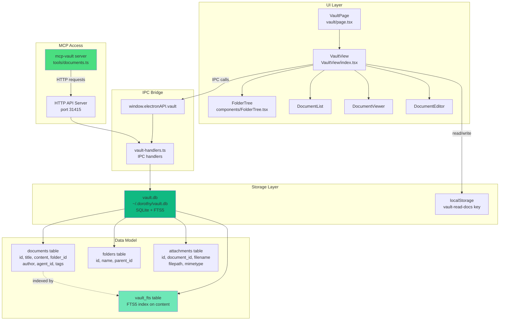
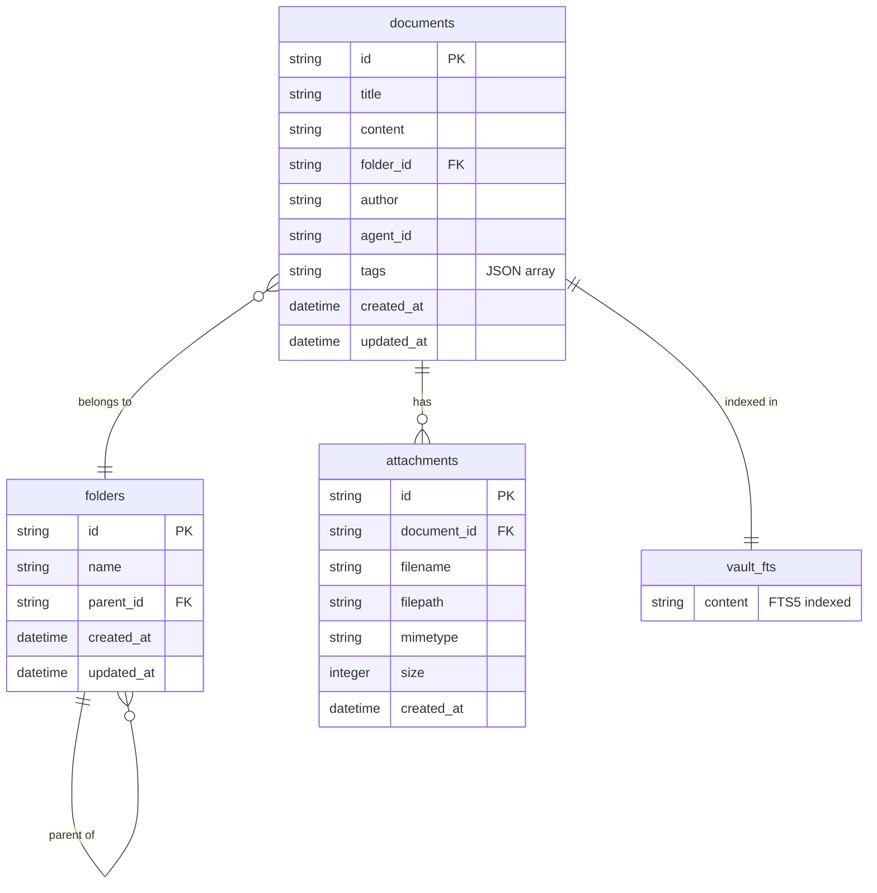
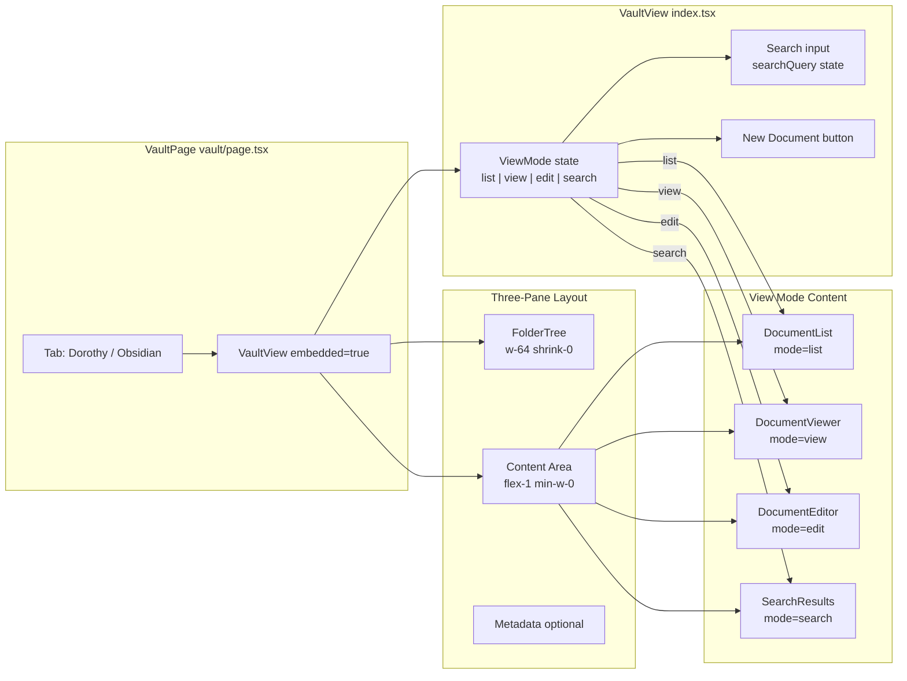
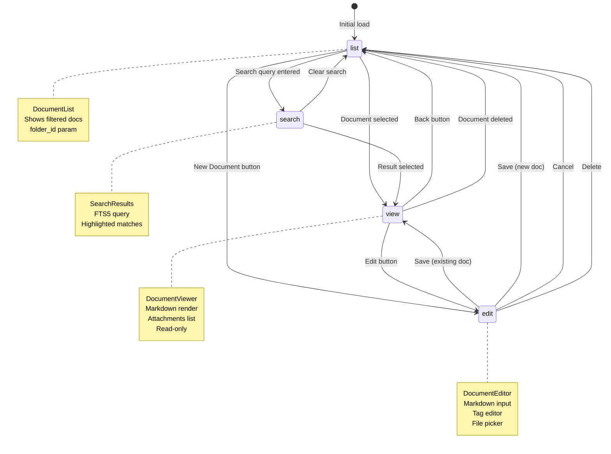
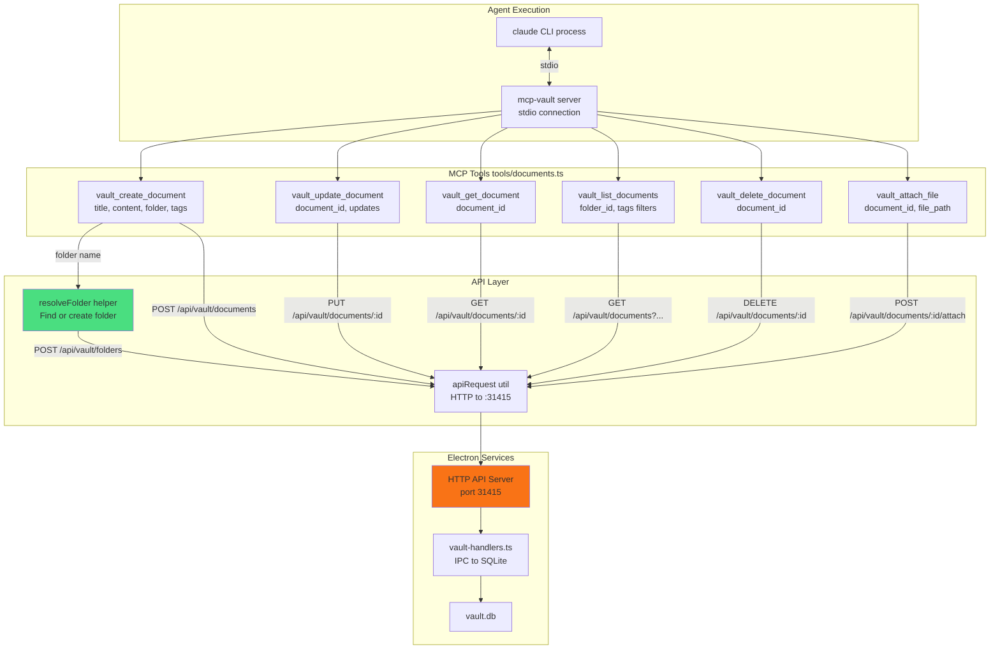
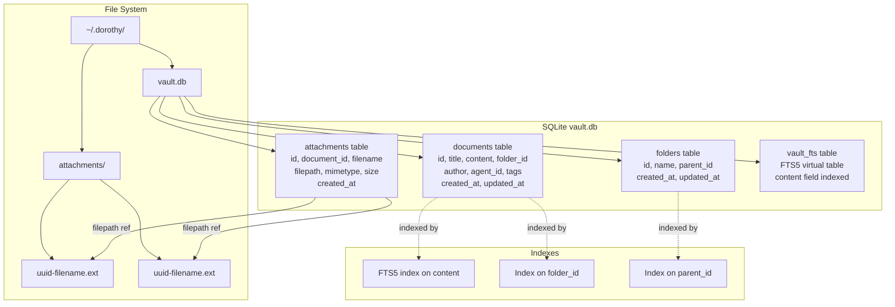
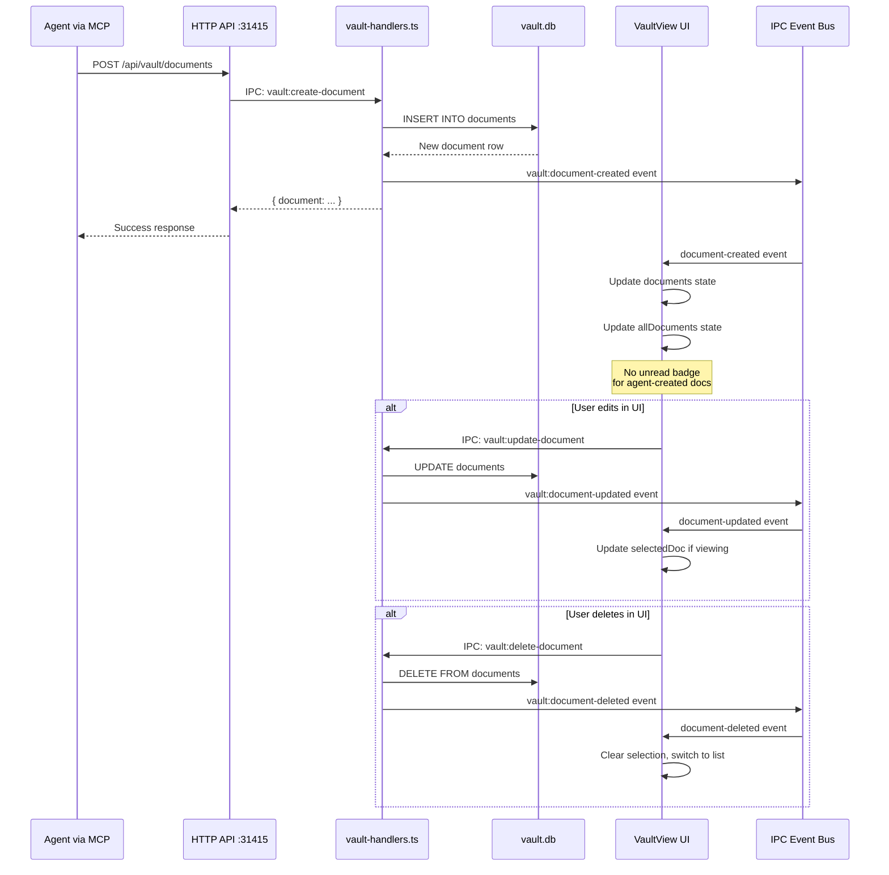
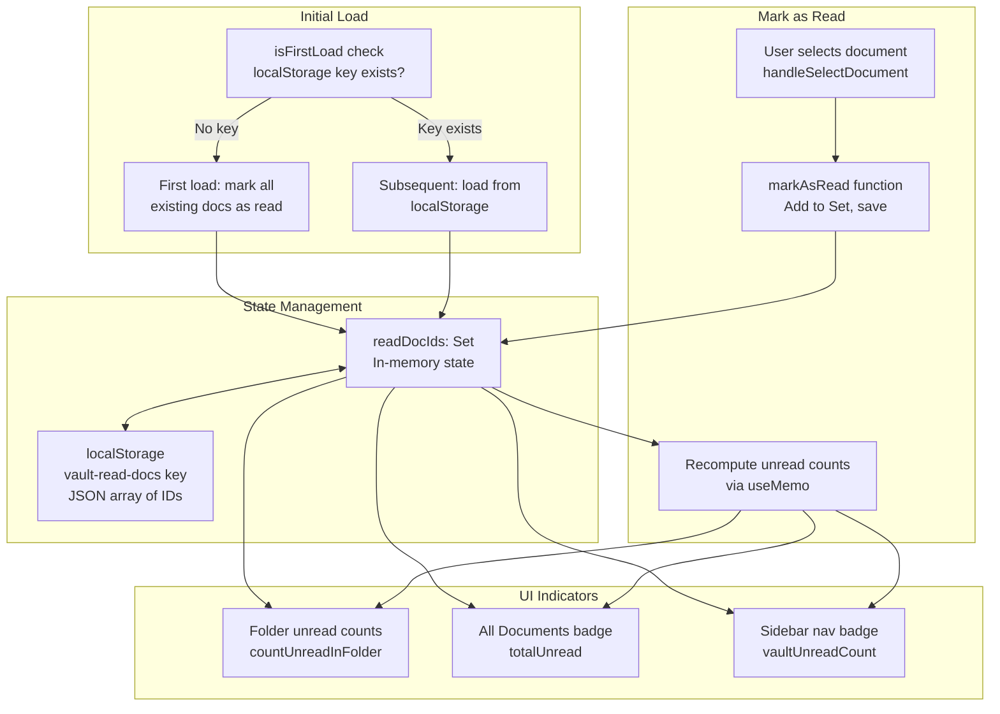
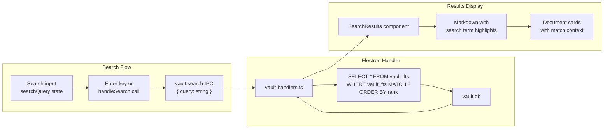
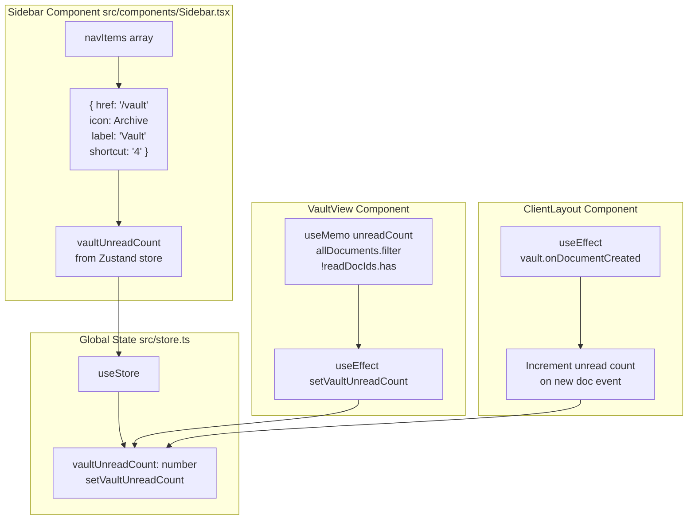

<!-- source: DeepWiki mcp.deepwiki.com · repo Charlie85270/Dorothy · page 6.3 Vault · fetched 2026-10-26 -->

# Vault

<details>
<summary>Relevant source files</summary>

The following files were used as context for generating this wiki page:

- [CLAUDE.md](CLAUDE.md)
- [bun.lock](bun.lock)
- [electron/handlers/memory-handlers.ts](electron/handlers/memory-handlers.ts)
- [mcp-vault/src/tools/documents.ts](mcp-vault/src/tools/documents.ts)
- [src/app/globals.css](src/app/globals.css)
- [src/app/memory/page.tsx](src/app/memory/page.tsx)
- [src/app/recurring-tasks/page.tsx](src/app/recurring-tasks/page.tsx)
- [src/app/vault/page.tsx](src/app/vault/page.tsx)
- [src/components/ClientLayout.tsx](src/components/ClientLayout.tsx)
- [src/components/Memory/AgentKnowledgeGraph.tsx](src/components/Memory/AgentKnowledgeGraph.tsx)
- [src/components/Sidebar.tsx](src/components/Sidebar.tsx)
- [src/components/VaultView/components/FolderTree.tsx](src/components/VaultView/components/FolderTree.tsx)
- [src/components/VaultView/index.tsx](src/components/VaultView/index.tsx)

</details>


The Vault is Dorothy's SQLite-based document management system with full-text search, hierarchical folder organization, and file attachments. It serves as a persistent knowledge base where agents can programmatically create reports, analyses, and research findings. The Vault provides both a UI for human users and a suite of MCP tools for agent access.

For information about Claude Code's native memory system, see [Memory System](#6.1). For the visual knowledge graph of agents and their relationships, see [Agent Knowledge Graph](#6.2). For read-only integration with Obsidian vaults, see [Obsidian Integration](#6.4). For the MCP server that exposes vault tools to agents, see [mcp-vault](#4.2).

---

## Architecture Overview

The Vault system consists of three primary layers: the React UI, Electron IPC handlers, and the SQLite database with FTS5 full-text search. Agents access the Vault through MCP tools that communicate via the HTTP API server.



**Sources:** [src/components/VaultView/index.tsx](), [src/app/vault/page.tsx](), [mcp-vault/src/tools/documents.ts]()

---

## Data Model

The Vault database schema consists of three core tables plus an FTS5 virtual table for full-text search. Documents can be organized into a hierarchical folder structure and can have multiple file attachments.



**Key Fields:**

| Table | Field | Purpose |
|-------|-------|---------|
| `documents` | `id` | UUID primary key |
| `documents` | `title` | Document title |
| `documents` | `content` | Markdown content |
| `documents` | `folder_id` | Optional folder ID (null = root) |
| `documents` | `author` | Human-readable author name |
| `documents` | `agent_id` | Agent UUID if created by agent |
| `documents` | `tags` | JSON array of tag strings |
| `folders` | `parent_id` | Optional parent folder (null = root) |
| `attachments` | `filepath` | Absolute path to file on disk |
| `vault_fts` | N/A | FTS5 virtual table for full-text search |

**Sources:** [src/types/electron.ts](), [mcp-vault/src/tools/documents.ts:5-23]()

---

## UI Components

The Vault UI is organized into a three-pane layout: folder tree (left), document list or viewer (center), and optional metadata panel (right). The interface supports multiple view modes for different operations.



**Component Responsibilities:**

| Component | File | Responsibility |
|-----------|------|----------------|
| `VaultPage` | [src/app/vault/page.tsx]() | Tab switcher between Dorothy Vault and Obsidian Vault |
| `VaultView` | [src/components/VaultView/index.tsx]() | Main container, state management, view mode routing |
| `FolderTree` | [src/components/VaultView/components/FolderTree.tsx]() | Hierarchical folder navigation with unread counts |
| `DocumentList` | [src/components/VaultView/components/DocumentList.tsx]() | Grid or list of documents with filters |
| `DocumentViewer` | [src/components/VaultView/components/DocumentViewer.tsx]() | Read-only Markdown renderer with attachment list |
| `DocumentEditor` | [src/components/VaultView/components/DocumentEditor.tsx]() | Markdown editor with tag input and file picker |
| `SearchResults` | [src/components/VaultView/components/SearchResults.tsx]() | FTS5 search results with highlighted snippets |

**Sources:** [src/app/vault/page.tsx:1-60](), [src/components/VaultView/index.tsx:48-334](), [src/components/VaultView/components/FolderTree.tsx:1-371]()

---

## View Modes and State Management

The Vault UI operates in four distinct view modes, each rendering different content in the center panel. The mode is controlled by the `viewMode` state variable in `VaultView`.



**State Variables:**

| Variable | Type | Purpose | File |
|----------|------|---------|------|
| `viewMode` | `'list' \| 'view' \| 'edit' \| 'search'` | Current UI mode | [src/components/VaultView/index.tsx:59]() |
| `selectedDoc` | `VaultDocumentElectron \| null` | Currently selected document | [src/components/VaultView/index.tsx:53]() |
| `selectedFolderId` | `string \| null` | Active folder filter | [src/components/VaultView/index.tsx:60]() |
| `searchQuery` | `string` | Search input text | [src/components/VaultView/index.tsx:61]() |
| `documents` | `VaultDocumentElectron[]` | Filtered document list | [src/components/VaultView/index.tsx:50]() |
| `allDocuments` | `VaultDocumentElectron[]` | Full document set for unread counts | [src/components/VaultView/index.tsx:51]() |

**Sources:** [src/components/VaultView/index.tsx:48-64]()

---

## MCP Tools for Agent Access

Agents access the Vault through six MCP tools exposed by the `mcp-vault` server. These tools communicate with Electron via the HTTP API server on port 31415. The tools enforce a folder-based organization: every document must be placed in a folder, and folders are automatically created if they don't exist.



**Tool Signatures:**

| Tool | Parameters | Returns |
|------|------------|---------|
| `vault_create_document` | `title`, `content`, `folder` (required), `tags[]` | Document ID and metadata |
| `vault_update_document` | `document_id`, `title?`, `content?`, `tags[]?`, `folder_id?` | Updated document metadata |
| `vault_get_document` | `document_id` | Full document with content and attachments |
| `vault_list_documents` | `folder_id?`, `tags[]?` | Array of document summaries |
| `vault_delete_document` | `document_id` | Success confirmation |
| `vault_attach_file` | `document_id`, `file_path` (absolute) | Attachment metadata |

**Folder Resolution:** The `vault_create_document` tool requires a `folder` parameter (string folder name). The `resolveFolder` helper performs a case-insensitive lookup and creates the folder at root level if it doesn't exist. This ensures agents can organize documents without managing folder IDs explicitly.

**Sources:** [mcp-vault/src/tools/documents.ts:42-86](), [mcp-vault/src/tools/documents.ts:28-40]()

---

## Storage and Persistence

The Vault database is located at `~/.dorothy/vault.db` and uses SQLite with the FTS5 extension for full-text search. Attachments are stored as files on disk with references in the database.



**Database Location:** `~/.dorothy/vault.db`

**FTS5 Configuration:** The full-text search index is configured with tokenizer `unicode61` and covers the `content` field of documents. Search queries use the MATCH operator for fast retrieval.

**Attachment Storage:** Files are copied to `~/.dorothy/attachments/` with UUID-based filenames to avoid collisions. The original filename is preserved in the `attachments` table.

**Sources:** Configuration implied from [mcp-vault/src/tools/documents.ts](), database schema from TypeScript types in [src/types/electron.ts]()

---

## Real-Time Updates

The Vault implements real-time synchronization between UI and database through Electron IPC events. When a document is created, updated, or deleted (either via UI or MCP tool), all connected clients receive event notifications.



**Event Handlers:**

| Event | Payload | Handler | File |
|-------|---------|---------|------|
| `vault:document-created` | `VaultDocumentElectron` | Prepend to `documents` and `allDocuments` arrays | [src/components/VaultView/index.tsx:154-157]() |
| `vault:document-updated` | `VaultDocumentElectron` | Replace in arrays, update `selectedDoc` if viewing | [src/components/VaultView/index.tsx:159-165]() |
| `vault:document-deleted` | `{ id: string }` | Remove from arrays, clear selection | [src/components/VaultView/index.tsx:167-174]() |

**Event Registration:**

```typescript
const unsubCreated = window.electronAPI!.vault!.onDocumentCreated((doc) => {
  setDocuments(prev => [doc, ...prev]);
  setAllDocuments(prev => [doc, ...prev]);
});
```

**Sources:** [src/components/VaultView/index.tsx:151-180]()

---

## Unread Tracking

The Vault implements client-side unread tracking using localStorage to persist which documents a user has viewed. This provides visual indicators (unread badges) in the folder tree and sidebar without requiring server-side state.



**Unread Count Calculation:**

The `countUnreadInFolder` function recursively counts unread documents in a folder and all its descendants:

```typescript
function countUnreadInFolder(
  folderId: string,
  allFolders: VaultFolderElectron[],
  documents: VaultDocumentElectron[],
  readDocIds: Set<string>
): number {
  let count = documents.filter(d => d.folder_id === folderId && !readDocIds.has(d.id)).length;
  const children = allFolders.filter(f => f.parent_id === folderId);
  for (const child of children) {
    count += countUnreadInFolder(child.id, allFolders, documents, readDocIds);
  }
  return count;
}
```

**First Load Behavior:** On the very first load (when `localStorage.getItem('vault-read-docs')` returns `null`), all existing documents are automatically marked as read. This prevents showing large unread counts for documents that existed before the user started using Dorothy.

**Global Unread Count:** The total unread count is synchronized to Zustand store via `setVaultUnreadCount`, which updates the sidebar badge. This ensures the badge is visible even when not on the Vault page.

**Sources:** [src/components/VaultView/index.tsx:28-46](), [src/components/VaultView/components/FolderTree.tsx:43-56](), [src/components/VaultView/index.tsx:71-83](), [src/components/ClientLayout.tsx:146-172]()

---

## Search Implementation

The Vault search is powered by SQLite's FTS5 (Full-Text Search) extension, which provides fast, ranked search results with snippet extraction and match highlighting.



**Search Handler:**

```typescript
const handleSearch = async (query: string) => {
  if (!isElectron() || !query.trim()) {
    setViewMode('list');
    setSearchResults([]);
    return;
  }

  setIsSearching(true);
  try {
    const result = await window.electronAPI!.vault!.search({ query: query.trim() });
    setSearchResults(result.results || []);
    setViewMode('search');
  } catch (err) {
    console.error('Search failed:', err);
  } finally {
    setIsSearching(false);
  }
};
```

**FTS5 Features:**
- **Tokenization:** Uses `unicode61` tokenizer for international text support
- **Ranking:** Results ordered by FTS5's built-in `rank` column (relevance score)
- **Match Highlighting:** Search terms can be highlighted in result snippets
- **Phrase Search:** Supports quoted phrases for exact matches
- **Boolean Operators:** Supports AND, OR, NOT for complex queries

**Escape Key:** Pressing Escape in the search input clears the query and returns to list view.

**Sources:** [src/components/VaultView/index.tsx:200-217](), FTS5 implementation implied from search IPC handler

---

## Integration with Sidebar Navigation

The Vault page is accessible from the main sidebar navigation with an unread badge that displays the count of documents the user hasn't viewed yet. The badge appears both in collapsed (icon-only) and expanded sidebar states.



**Sidebar Badge Rendering:**

The badge appears in two contexts depending on sidebar state:

| Sidebar State | Badge Location | Code |
|---------------|----------------|------|
| Collapsed | Inside icon div, absolute positioned | [src/components/Sidebar.tsx:110-114]() |
| Expanded | After label text, flex layout | [src/components/Sidebar.tsx:121-125]() |

**Badge Styling:**
- Minimum width: 14px (collapsed) or 20px (expanded)
- Height: 14px (collapsed) or 20px (expanded)
- Background: `bg-primary`
- Text: `text-primary-foreground`
- Font: Bold, 8px (collapsed) or 10px (expanded)
- Shape: Fully rounded (`rounded-full`)

**Global Listener:** The `ClientLayout` component also listens for `vault:document-created` events to increment the unread count even when the Vault page isn't mounted. This ensures the badge updates in real-time as agents create documents.

**Sources:** [src/components/Sidebar.tsx:34-35](), [src/components/Sidebar.tsx:110-125](), [src/components/ClientLayout.tsx:146-172](), [src/components/VaultView/index.tsx:66-73]()

---

