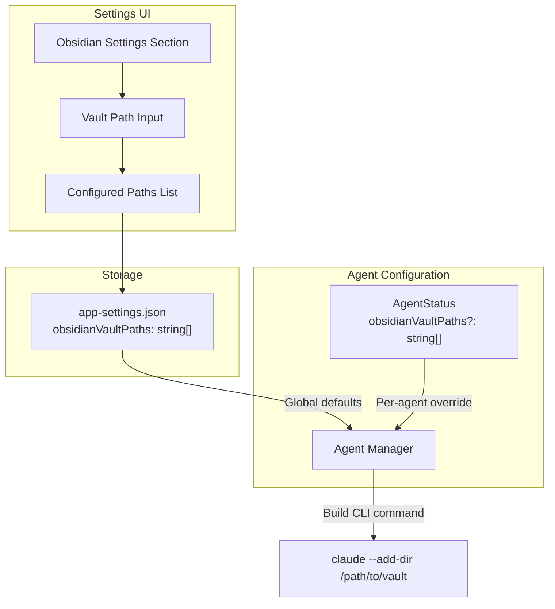
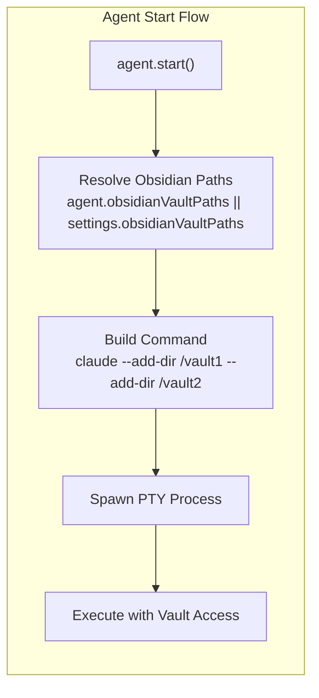
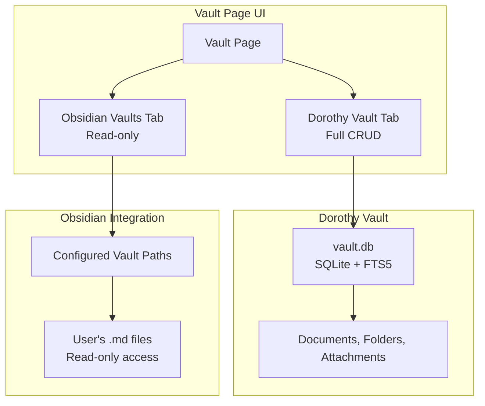
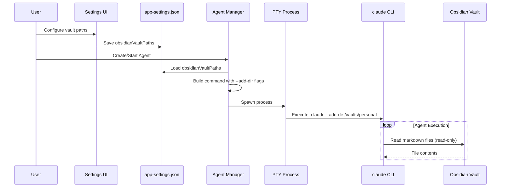

<!-- source: DeepWiki mcp.deepwiki.com · repo Charlie85270/Dorothy · page 6.4 Obsidian Integration · fetched 2026-10-26 -->

# Obsidian Integration

<details>
<summary>Relevant source files</summary>

The following files were used as context for generating this wiki page:

- [CLAUDE.md](CLAUDE.md)
- [bun.lock](bun.lock)
- [electron/handlers/memory-handlers.ts](electron/handlers/memory-handlers.ts)
- [electron/types/index.ts](electron/types/index.ts)
- [src/app/memory/page.tsx](src/app/memory/page.tsx)
- [src/app/recurring-tasks/page.tsx](src/app/recurring-tasks/page.tsx)
- [src/components/Memory/AgentKnowledgeGraph.tsx](src/components/Memory/AgentKnowledgeGraph.tsx)
- [src/components/Settings/constants.ts](src/components/Settings/constants.ts)
- [src/components/Settings/types.ts](src/components/Settings/types.ts)

</details>


Dorothy provides read-only integration with Obsidian vaults, allowing agents to access existing Obsidian markdown files as reference material without modifying them. This integration mounts configured vault directories as read-only file systems accessible to Claude CLI agents during execution.

For information about Dorothy's writable document vault system, see [Vault](#6.3). For native Claude Code memory integration, see [Memory System](#6.1).

---

## Overview

The Obsidian integration enables agents to:
- Access existing Obsidian vault markdown files during task execution
- Reference knowledge bases without risk of modification
- Leverage user's existing note-taking infrastructure
- Browse Obsidian vaults through Dorothy's UI

Obsidian vaults are mounted as read-only directories using the `--add-dir` CLI flag when spawning agent processes, ensuring agents cannot modify vault contents.

**Sources:** [electron/types/index.ts:32](), [src/components/Settings/constants.ts:22]()

---

## Configuration Architecture

### Settings Storage



The `obsidianVaultPaths` array can be configured at two levels:
1. **Global settings** in `~/.dorothy/app-settings.json` - applies to all agents by default
2. **Per-agent settings** in `AgentStatus.obsidianVaultPaths` - overrides global settings for specific agents

**Sources:** [electron/types/index.ts:32-33](), [electron/types/index.ts:81](), [src/components/Settings/types.ts:73]()

---

## Agent Integration

### CLI Command Construction

When starting an agent, the Agent Manager constructs the Claude CLI command with `--add-dir` flags for each configured Obsidian vault path:



The mounted directories are accessible to the agent's Claude CLI process but are **read-only** - agents can read files but cannot create, modify, or delete them.

**Sources:** [electron/types/index.ts:32](), [electron/types/index.ts:10-33]()

---

## Settings Interface

### Obsidian Settings Section

The Obsidian settings section is one of 15 settings categories in Dorothy:

| Setting Section | Purpose |
|---|---|
| General | Default provider, updates |
| Terminal | Font, theme |
| **Obsidian** | **Vault path configuration** |
| Git | Worktree settings |
| Notifications | Alert preferences |
| ... | ... |

**Sources:** [src/components/Settings/constants.ts:19-35](), [src/components/Settings/types.ts:78]()

### Data Model

```typescript
interface AppSettings {
  // ... other settings
  obsidianVaultPaths?: string[];  // Array of absolute paths to Obsidian vaults
  // ... other settings
}

interface AgentStatus {
  // ... other properties
  obsidianVaultPaths?: string[];  // Per-agent override for vault paths
  // ... other properties
}
```

**Sources:** [electron/types/index.ts:81](), [electron/types/index.ts:32](), [src/components/Settings/types.ts:73]()

---

## UI Integration

### Vault View Integration

Obsidian vaults appear in the Vault page interface alongside Dorothy's native vault:



The Obsidian tab provides:
- File browser for configured vault directories
- Markdown rendering for viewing notes
- Search across vault contents
- **No editing capabilities** - purely read-only

**Sources:** [src/app/memory/page.tsx:1-630]()

---

## Data Flow

### Complete Integration Flow



**Sources:** [electron/types/index.ts:32-33](), [electron/types/index.ts:81]()

---

## Configuration Workflow

### Setting Up Obsidian Vaults

1. **Navigate to Settings**: Open Settings page and select "Obsidian" section
2. **Add Vault Paths**: Enter absolute paths to Obsidian vault directories
3. **Apply to Agents**: 
   - Paths configured globally apply to all new agents
   - Can be overridden per-agent in `AgentStatus.obsidianVaultPaths`
4. **Verify Access**: Check Vault UI to browse configured vaults

### Path Resolution

| Configuration Level | Priority | Scope |
|---|---|---|
| Per-agent `obsidianVaultPaths` | High | Single agent only |
| Global `settings.obsidianVaultPaths` | Low | All agents by default |

**Sources:** [electron/types/index.ts:32](), [electron/types/index.ts:81]()

---

## Technical Details

### Read-Only Enforcement

Read-only access is enforced at the **CLI level** through the `--add-dir` flag mechanism:

- The `--add-dir` flag mounts directories as read-only file systems
- Agents can list files and read contents
- Write operations (create, modify, delete) are **blocked by the CLI**
- No special permission handling required in Dorothy

This differs from Dorothy's Vault (SQLite-based, full CRUD) and Memory system (native Claude Code memory files).

**Sources:** [electron/types/index.ts:32]()

---

## Settings Section Identifier

The Obsidian settings section is registered with identifier `'obsidian'` in the settings navigation:

```typescript
{ id: 'obsidian', label: 'Obsidian', icon: ObsidianIcon }
```

This section type is defined in the `SettingsSection` union type:

```typescript
type SettingsSection = 'general' | 'terminal' | 'git' | 'notifications' | 
  'telegram' | 'slack' | 'jira' | 'socialdata' | 'tasmania' | 
  'google-workspace' | 'obsidian' | 'permissions' | 'skills' | 'cli' | 'system';
```

**Sources:** [src/components/Settings/constants.ts:22](), [src/components/Settings/types.ts:78]()

---

## Use Cases

### Common Integration Patterns

1. **Knowledge Base Access**: Mount personal notes for agent reference during tasks
2. **Project Documentation**: Provide agents with project-specific Obsidian vaults
3. **Shared Team Knowledge**: Access team wikis stored in Obsidian
4. **Research Notes**: Give agents access to research materials without edit risk

### Example Agent Configuration

An agent with both default and custom vault paths:

```json
{
  "id": "agent-123",
  "name": "Research Assistant",
  "obsidianVaultPaths": [
    "/Users/username/Documents/ObsidianVaults/Research",
    "/Users/username/Documents/ObsidianVaults/Papers"
  ]
}
```

**Sources:** [electron/types/index.ts:10-33]()

---

## Comparison with Other Knowledge Systems

| System | Storage | Access | UI Capabilities | MCP Tools |
|---|---|---|---|---|
| **Memory** | `~/.claude/projects/*/memory/` | Read/Write | File browser, editor | None (native CLI) |
| **Vault** | `~/.dorothy/vault.db` | Full CRUD | Document manager, FTS | `mcp-vault` (10 tools) |
| **Obsidian** | User's vault directories | Read-only | File browser, viewer | None (CLI --add-dir) |

The Obsidian integration complements Dorothy's other knowledge management systems by providing safe, read-only access to existing user content.

**Sources:** [electron/types/index.ts:32](), [CLAUDE.md:1-12]()

---

