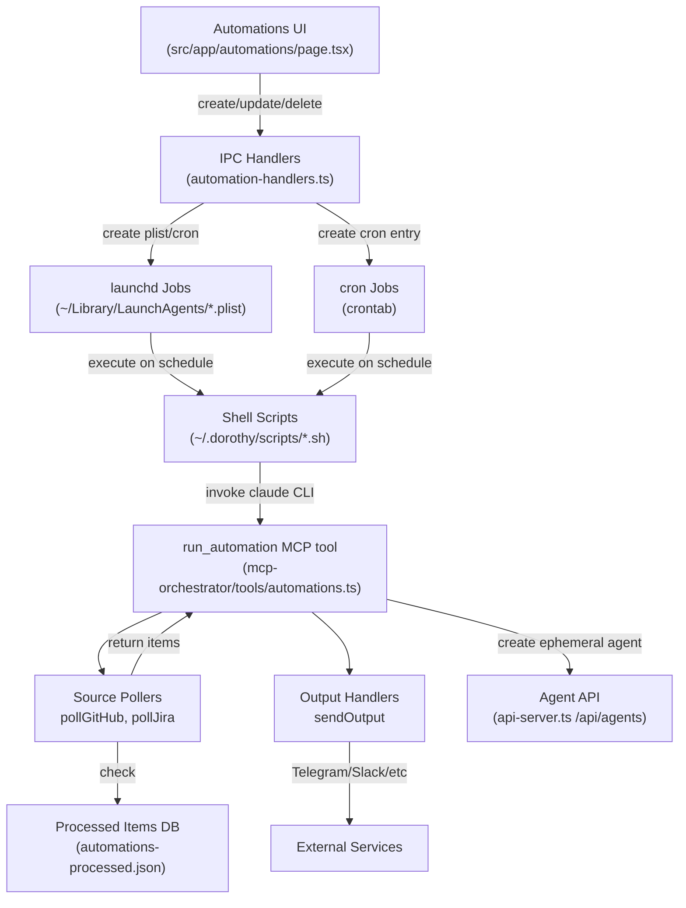
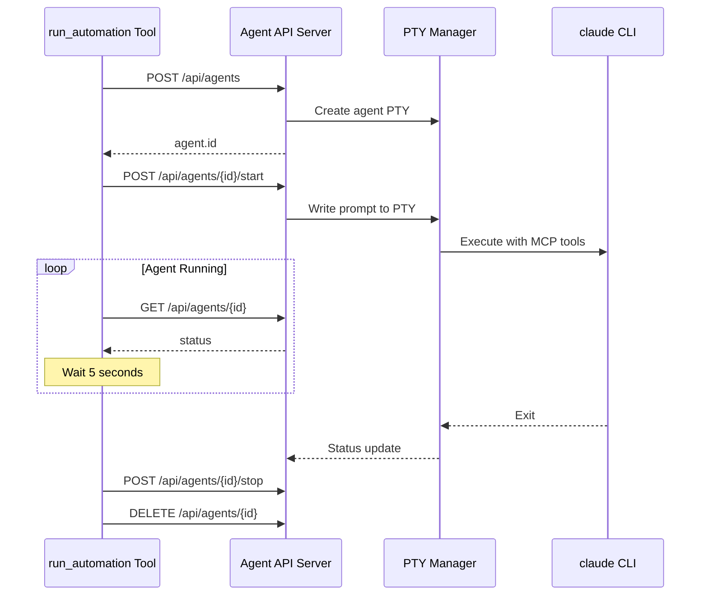
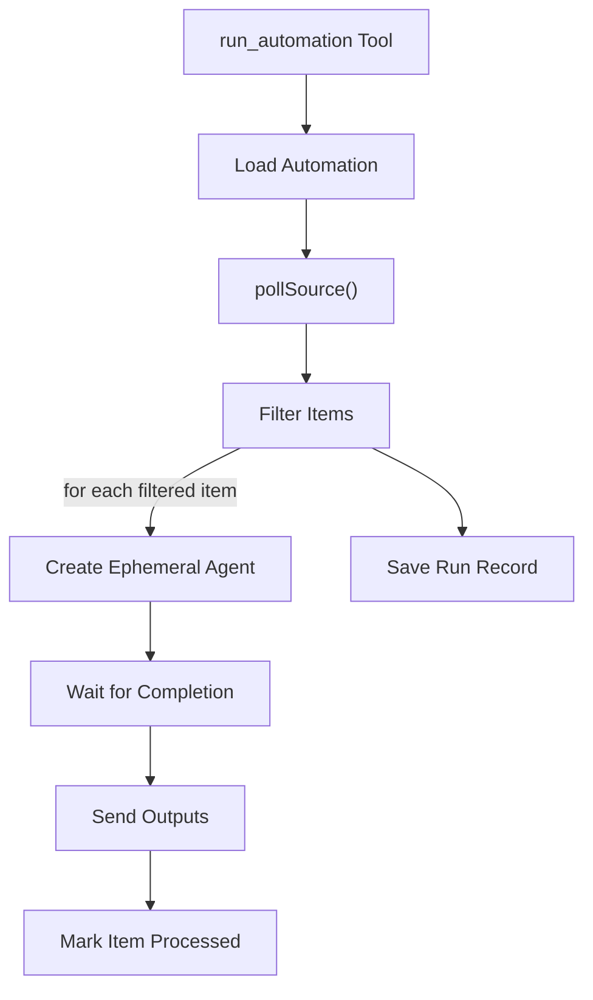
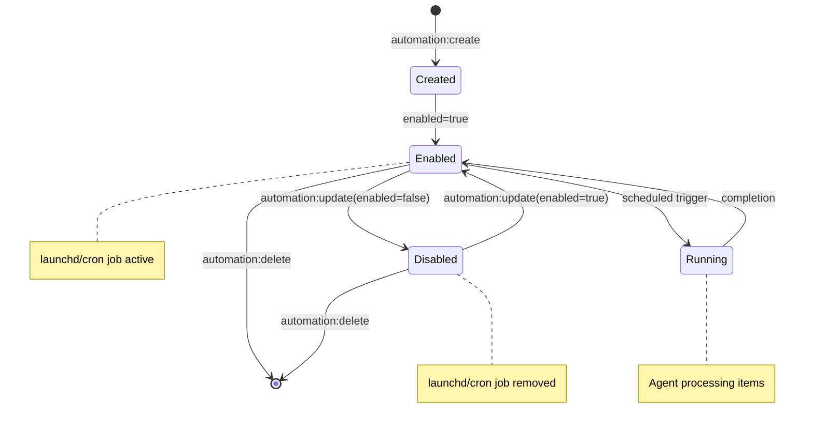

<!-- source: DeepWiki mcp.deepwiki.com · repo Charlie85270/Dorothy · page 7 Automations · fetched 2026-10-26 -->

# Automations

<details>
<summary>Relevant source files</summary>

The following files were used as context for generating this wiki page:

- [electron/handlers/automation-handlers.ts](electron/handlers/automation-handlers.ts)
- [electron/handlers/scheduler-handlers.ts](electron/handlers/scheduler-handlers.ts)
- [electron/services/api-server.ts](electron/services/api-server.ts)
- [mcp-orchestrator/src/tools/automations.ts](mcp-orchestrator/src/tools/automations.ts)
- [mcp-orchestrator/src/tools/index.ts](mcp-orchestrator/src/tools/index.ts)
- [mcp-orchestrator/src/utils/api.ts](mcp-orchestrator/src/utils/api.ts)
- [mcp-orchestrator/src/utils/automations.ts](mcp-orchestrator/src/utils/automations.ts)
- [mcp-orchestrator/src/utils/index.ts](mcp-orchestrator/src/utils/index.ts)
- [mcp-orchestrator/src/utils/scheduler.ts](mcp-orchestrator/src/utils/scheduler.ts)
- [src/app/automations/page.tsx](src/app/automations/page.tsx)
- [src/components/AgentWorld/AgentCharacter.tsx](src/components/AgentWorld/AgentCharacter.tsx)
- [src/components/SchedulerCalendar.tsx](src/components/SchedulerCalendar.tsx)

</details>


Automations enable Dorothy to continuously poll external data sources (GitHub, JIRA, etc.), detect new or updated items, and trigger Claude agents to process them autonomously. Each automation defines a source, trigger conditions, agent configuration, and output destinations. Automations run on configurable schedules using native OS schedulers (launchd on macOS, cron on Linux).

For recurring tasks not tied to external sources, see [Scheduler](#8). For agent creation and lifecycle management, see [Agents](#3). For MCP tool integration, see [mcp-orchestrator](#4.1).

---

## System Architecture

The automation system implements a polling-based workflow with three primary components: the Electron IPC layer for UI interaction, the MCP tool layer for execution, and native OS schedulers for timing.

### High-Level Data Flow



**Sources:** [electron/handlers/automation-handlers.ts:1-626](), [mcp-orchestrator/src/tools/automations.ts:1-850](), Diagram 5 from high-level overview

---

## Core Data Structures

### Automation Type

The `Automation` interface defines the complete configuration for an automation:

```typescript
interface Automation {
  id: string;
  name: string;
  description?: string;
  enabled: boolean;
  createdAt: string;
  updatedAt: string;
  schedule: {
    type: 'cron' | 'interval';
    cron?: string;
    intervalMinutes?: number;
  };
  source: {
    type: string; // 'github', 'jira', 'pipedrive', 'twitter', 'rss', 'custom'
    config: Record<string, unknown>;
  };
  trigger: {
    eventTypes: string[];
    onNewItem: boolean;
    onUpdatedItem?: boolean;
  };
  agent: {
    enabled: boolean;
    projectPath?: string;
    prompt: string;
    model?: string;
    provider?: AgentProvider;
  };
  outputs: Array<{
    type: string;
    enabled: boolean;
    template?: string;
  }>;
}
```

**Sources:** [electron/handlers/automation-handlers.ts:19-52](), [mcp-orchestrator/src/utils/automations.ts:73-113]()

### Storage Files

Automations persist state to three JSON files in `~/.dorothy/`:

| File | Purpose | Max Size |
|------|---------|----------|
| `automations.json` | Automation definitions | Unlimited |
| `automations-processed.json` | Item deduplication tracking | Unlimited |
| `automations-runs.json` | Execution history | Last 1000 runs |

**Sources:** [electron/handlers/automation-handlers.ts:14-16](), [mcp-orchestrator/src/utils/automations.ts:147-150]()

---

## Creating Automations

### UI Workflow

The automations page (`src/app/automations/page.tsx`) provides a form-based interface for creating automations. Users configure:

1. **Name and description** - Basic metadata
2. **Source type** - GitHub, JIRA, or others
3. **Source configuration** - Repos, project keys, JQL, etc.
4. **Schedule** - Interval (minutes) or cron expression
5. **Agent settings** - Enable/disable, project path, prompt
6. **Outputs** - Telegram, Slack, GitHub/JIRA comments, transitions

```mermaid
graph LR
    Form["Automation Form"]
    Validate["Validate Config"]
    IPC["automation:create IPC"]
    CreatePlist["Create launchd Plist"]
    CreateScript["Generate Shell Script"]
    Register["Register with launchd"]
    SaveJSON["Save to automations.json"]
    
    Form --> Validate
    Validate --> IPC
    IPC --> CreateScript
    CreateScript --> CreatePlist
    CreatePlist --> Register
    Register --> SaveJSON
```



**Sources:** [src/app/automations/page.tsx:198-273](), [electron/handlers/automation-handlers.ts:381-472]()

### IPC Handler: `automation:create`

The create handler builds the automation object, persists it, and creates the OS scheduler job:

**Key Steps:**
1. Parse and validate source config JSON
2. Build schedule object (cron or interval)
3. Build outputs array based on enabled output types
4. Generate unique ID and timestamps
5. Save to `automations.json`
6. Create launchd job (macOS) via `createAutomationLaunchdJob()`

**Sources:** [electron/handlers/automation-handlers.ts:381-472]()

---

## Source Pollers

### GitHub Poller

The GitHub poller uses the `gh` CLI to fetch pull requests, issues, and releases:

**Poll Types:**
- `pull_requests` - Open PRs with `gh pr list --state open`
- `issues` - Open issues with `gh issue list --state open`
- `releases` - Recent releases with `gh release list`

**Implementation:**
```typescript
async function pollGitHub(config: GitHubSourceConfig, automation: Automation): Promise<PollResult>
```

Each item is hashed using `headRefOid` (PRs) or `updatedAt` (issues) to detect changes. Items include:
- `id` - Composite ID: `github:owner/repo:pr:123`
- `type` - `pr`, `issue`, or `release`
- `title`, `url`, `author`, `body`, `labels`
- `hash` - Content hash for change detection
- `raw` - Full API response

**Sources:** [mcp-orchestrator/src/tools/automations.ts:170-254]()

### JIRA Poller

The JIRA poller uses the REST API with JQL queries:

**Configuration:**
- `domain` - JIRA instance subdomain (e.g., `mycompany`)
- `projectKeys` - Array of project keys (e.g., `["PROJ", "ENG"]`)
- `jql` - Custom JQL query (optional, defaults to project filter)
- `email`, `apiToken` - Credentials (loaded from app settings if not provided)

**API Endpoint:**
```
POST https://{domain}.atlassian.net/rest/api/3/search/jql
```

**Returned Fields:**
`summary`, `description`, `status`, `issuetype`, `reporter`, `assignee`, `priority`, `updated`, `created`, `labels`

**Kanban Integration:**
JIRA items automatically create Kanban tasks via `createKanbanTaskFromJiraItem()`. Tasks include:
- Title: `[JIRA-123] Issue Summary`
- Description: JIRA metadata + URL + description
- Labels: `jira:JIRA-123`, `jira`, issue type
- Priority: Mapped from JIRA priority
- Column: `backlog`

**Sources:** [mcp-orchestrator/src/tools/automations.ts:377-453](), [mcp-orchestrator/src/tools/automations.ts:263-337]()

### Custom Pollers

The architecture supports additional source types (`pipedrive`, `twitter`, `rss`, `custom`) but they return `"not yet implemented"` errors. The `custom` type would execute a shell command that outputs JSON.

**Sources:** [mcp-orchestrator/src/tools/automations.ts:455-472]()

---

## Trigger Filtering

### Deduplication

Items are deduplicated using the `ProcessedItem` tracking system:

```typescript
interface ProcessedItem {
  id: string; // Composite ID from createItemId()
  sourceType: SourceType;
  itemType: string;
  itemId: string;
  lastProcessedAt: string;
  lastHash?: string; // Content hash for update detection
  metadata?: Record<string, unknown>;
}
```

**Deduplication Logic:**
1. Check if item ID exists in `automations-processed.json`
2. If `onNewItem` only: skip if processed
3. If `onUpdatedItem`: check if hash changed
4. If hash unchanged: skip (no update detected)

**Sources:** [mcp-orchestrator/src/tools/automations.ts:602-616](), [mcp-orchestrator/src/utils/automations.ts:221-252]()

### Filter Rules

Automations support field-based filters with operators:

```typescript
interface FilterRule {
  field: string;
  operator: "equals" | "contains" | "not_contains" | "starts_with" | "ends_with" | "regex";
  value: string;
}
```

Filters are applied to `item.raw` fields. Example: Filter PRs where `labels` contains `"urgent"`.

**Sources:** [mcp-orchestrator/src/utils/automations.ts:57-61](), [mcp-orchestrator/src/tools/automations.ts:618-643]()

### Event Type Filtering

The `eventTypes` array filters by item type (e.g., `["pr", "issue"]`). If empty, all types match.

**Sources:** [mcp-orchestrator/src/tools/automations.ts:645-651]()

---

## Agent Integration

### Ephemeral Agent Creation

When `agent.enabled` is true, the automation creates a temporary agent for each filtered item:



**Agent Configuration:**
- `projectPath` - Working directory for the agent
- `prompt` - Task prompt (interpolated with item variables)
- `model` - Model selection (sonnet, opus, haiku)
- `timeout` - Max execution time (default 300s)
- `skipPermissions` - Set to true for autonomous operation

**Sources:** [mcp-orchestrator/src/tools/automations.ts:724-762]()

### Prompt Interpolation

The agent prompt is interpolated with item variables using `interpolateTemplate()`:

**Available Variables:**
- GitHub: `{{number}}`, `{{title}}`, `{{url}}`, `{{author}}`, `{{body}}`, `{{repo}}`, `{{labels}}`
- JIRA: `{{key}}`, `{{summary}}`, `{{status}}`, `{{issueType}}`, `{{priority}}`, `{{assignee}}`, `{{reporter}}`, `{{domain}}`

**Example Prompt:**
```
Review pull request #{{number}} in {{repo}}.
Title: {{title}}
Author: {{author}}
URL: {{url}}

Provide a code review focusing on security and performance.
Post your review as a comment on the PR.
```

**Sources:** [mcp-orchestrator/src/tools/automations.ts:658-683](), [mcp-orchestrator/src/utils/automations.ts:307-320]()

### Output Instructions

The automation system automatically appends output instructions to the agent prompt based on configured outputs:

**GitHub Comment:**
```
Post your result as a comment on GitHub PR #{{number}} in {{repo}} using:
gh pr comment {{number}} --repo {{repo}} --body "YOUR_CONTENT"
```

**JIRA Comment:**
```
When done, update the JIRA issue {{key}} by calling the update_jira_issue MCP tool
with a comment containing your results
```

**JIRA Transition:**
```
Transition JIRA issue {{key}} to "Done" by calling the update_jira_issue MCP tool
with transitionName: "Done"
```

**Sources:** [mcp-orchestrator/src/tools/automations.ts:691-714]()

---

## Output Handlers

### Output Types

| Type | Implementation | Configuration |
|------|---------------|---------------|
| `telegram` | `send_telegram` MCP tool via API | `template` (optional) |
| `slack` | `send_slack` MCP tool via API | `template` (optional) |
| `github_comment` | `gh pr comment` / `gh issue comment` CLI | `template` (optional) |
| `jira_comment` | JIRA REST API comment endpoint | `template` (optional) |
| `jira_transition` | JIRA REST API transition endpoint | `template` = target status |
| `webhook` | HTTP POST with JSON body | `webhookUrl`, `template` |

**Sources:** [mcp-orchestrator/src/tools/automations.ts:478-576]()

### Output Execution

Outputs are sent via `sendOutput()` after agent completion or directly if agent is disabled:

**Template Interpolation:**
If `template` is provided, it's interpolated with item variables. Otherwise, the agent's output is used.

**GitHub Comment Safety:**
Repository names and issue numbers are validated with regex to prevent command injection:
- Repo: `/^[a-zA-Z0-9._-]+\/[a-zA-Z0-9._-]+$/`
- Number: Must be positive integer

**JIRA Comment Format:**
Comments use Atlassian Document Format (ADF):
```json
{
  "body": {
    "type": "doc",
    "version": 1,
    "content": [{
      "type": "paragraph",
      "content": [{ "type": "text", "text": "message" }]
    }]
  }
}
```

**Webhook Security:**
Webhooks must use HTTPS and cannot target private networks (SSRF protection via `isAllowedWebhookUrl()`).

**Sources:** [mcp-orchestrator/src/tools/automations.ts:478-576]()

---

## Scheduling and Execution

### Schedule Types

Automations support two schedule types:

**Interval:**
```typescript
{ type: 'interval', intervalMinutes: 30 }
```
Runs every N minutes. On macOS, uses `StartInterval` in plist. On Linux, converted to cron.

**Cron:**
```typescript
{ type: 'cron', cron: '0 9 * * 1-5' }
```
Standard 5-field cron expression: `minute hour dayOfMonth month dayOfWeek`

**Sources:** [electron/handlers/automation-handlers.ts:26-30]()

### macOS: launchd Jobs

Each automation creates a launchd plist in `~/Library/LaunchAgents/`:

**Plist Structure:**
```xml
<?xml version="1.0" encoding="UTF-8"?>
<plist version="1.0">
<dict>
  <key>Label</key>
  <string>com.dorothy.automation.{id}</string>
  <key>ProgramArguments</key>
  <array>
    <string>/bin/bash</string>
    <string>~/.dorothy/scripts/automation-{id}.sh</string>
  </array>
  <key>StartInterval</key> <!-- for interval -->
  <integer>1800</integer>
  <!-- OR -->
  <key>StartCalendarInterval</key> <!-- for cron -->
  <dict>
    <key>Minute</key><integer>0</integer>
    <key>Hour</key><integer>9</integer>
  </dict>
  <key>StandardOutPath</key>
  <string>~/.dorothy/logs/automation-{id}.log</string>
  <key>StandardErrorPath</key>
  <string>~/.dorothy/logs/automation-{id}.error.log</string>
</dict>
</plist>
```

**Registration:**
```bash
launchctl bootstrap gui/{uid} ~/Library/LaunchAgents/com.dorothy.automation.{id}.plist
```

**Sources:** [electron/handlers/automation-handlers.ts:226-338]()

### Linux: cron Jobs

On Linux, automations add cron entries:

```bash
{cron} ~/.dorothy/scripts/automation-{id}.sh # dorothy-{id}
```

Example: `*/30 * * * * ~/.dorothy/scripts/automation-abc123.sh # dorothy-abc123`

**Sources:** [electron/handlers/automation-handlers.ts:430-445]() (not shown in files but referenced)

### Shell Script Generation

Each automation generates a shell script that:
1. Sources shell profiles for PATH (nvm, homebrew)
2. Changes to project directory
3. Executes `claude` CLI with MCP config
4. Calls `run_automation` tool with automation ID
5. Logs start/completion timestamps

**Script Structure:**
```bash
#!/bin/bash
export HOME="/Users/username"
source "$HOME/.nvm/nvm.sh" 2>/dev/null || true
export PATH="{claudeDir}:$PATH"
cd "{projectPath}"
echo "=== Automation started at $(date) ===" >> "{logPath}"
"{claudePath}" --dangerously-skip-permissions --mcp-config "{mcpConfig}" \
  -p 'Use the run_automation MCP tool to run automation with id "{id}". Report the results briefly.' \
  >> "{logPath}" 2>&1
echo "=== Automation completed at $(date) ===" >> "{logPath}"
```

**Provider Abstraction:**
Scripts are generated via the provider system (`getProvider().buildScheduledScript()`), allowing different CLI binaries (claude, codex, gemini).

**Sources:** [electron/handlers/automation-handlers.ts:256-275]()

---

## MCP Tool: `run_automation`

### Tool Definition

```typescript
server.tool(
  "run_automation",
  "Run an automation by ID",
  {
    automation_id: z.string().describe("The automation ID to run")
  },
  async (args) => { ... }
);
```

**Sources:** [mcp-orchestrator/src/tools/automations.ts:775-850]()

### Execution Flow



**Key Steps:**
1. Load automation from `automations.json`
2. Poll source (GitHub, JIRA, etc.)
3. Filter items (deduplication + triggers)
4. For each filtered item:
   - Interpolate prompt template
   - Create ephemeral agent via API
   - Wait for completion (polling status every 5s)
   - Send configured outputs
   - Mark item as processed
5. Update run record with stats

**Error Handling:**
- Errors in agent execution are caught and stored in run record
- Agent is always stopped and deleted, even on error
- Individual item failures don't stop processing of remaining items

**Sources:** [mcp-orchestrator/src/tools/automations.ts:775-850]()

---

## Manual Execution

### IPC Handler: `automation:run`

Users can manually trigger automations from the UI:

```typescript
ipcMain.handle('automation:run', async (_event, id: string) => {
  const scriptPath = path.join(os.homedir(), '.dorothy', 'scripts', `automation-${id}.sh`);
  spawn('bash', [scriptPath], { detached: true, stdio: 'ignore' }).unref();
  return { success: true, message: 'Automation triggered' };
});
```

This executes the shell script immediately in a detached process.

**Sources:** [electron/handlers/automation-handlers.ts:541-564]()

---

## State Management

### Automation Lifecycle



**Enable/Disable:**
Toggling `enabled` creates or removes the launchd/cron job while preserving the automation definition.

**Sources:** [electron/handlers/automation-handlers.ts:475-514]()

### Run History

Each execution creates an `AutomationRun` record:

```typescript
interface AutomationRun {
  id: string;
  automationId: string;
  startedAt: string;
  completedAt?: string;
  status: 'running' | 'completed' | 'error';
  itemsFound: number;
  itemsProcessed: number;
  error?: string;
}
```

Records are stored in `automations-runs.json`, capped at 1000 total entries.

**Sources:** [electron/handlers/automation-handlers.ts:54-63](), [mcp-orchestrator/src/utils/automations.ts:125-135]()

---

## Logs and Monitoring

### Log Files

Each automation writes to a dedicated log file:

**Path:** `~/.dorothy/logs/automation-{id}.log`

**Format:**
```
=== Automation started at Wed Jan 15 10:30:00 PST 2025 ===
[claude CLI output]
[MCP tool calls]
[Agent output]
=== Automation completed at Wed Jan 15 10:35:00 PST 2025 ===
```

**Sources:** [electron/handlers/automation-handlers.ts:242-243]()

### IPC Handler: `automation:getLogs`

The UI fetches logs and parses them into individual run segments:

```typescript
interface LogRun {
  id: string;
  startedAt: string;
  completedAt?: string;
  content: string;
  status: 'completed' | 'error' | 'running';
}
```

**Parsing Logic:**
1. Split log file by `=== Automation started at ... ===` markers
2. Extract start/completion timestamps
3. Determine status from content (presence of "error" keywords)
4. Return last 10 runs, most recent first

**Sources:** [electron/handlers/automation-handlers.ts:567-626]()

### UI Display

The logs modal shows:
- Run selector (last 10 runs)
- Start/completion timestamps
- Status badge (completed/error/running)
- Full log content with syntax highlighting
- Per-run navigation

**Sources:** [src/app/automations/page.tsx:331-344]()

---

## Advanced Features

### Provider Support

Automations support multiple AI providers via the provider abstraction:

- `claude` - Claude Code CLI (default)
- `codex` - Codex CLI
- `gemini` - Gemini CLI
- `local` - Tasmania local model

The provider is stored in `automation.agent.provider` and used to:
1. Resolve CLI binary path via `getCLIPath(provider)`
2. Generate provider-specific shell scripts via `provider.buildScheduledScript()`

**Sources:** [electron/handlers/automation-handlers.ts:228-229](), [electron/handlers/automation-handlers.ts:263-275]()

### CLI Path Resolution

CLI paths are resolved in priority order:
1. User-configured path in `app-settings.json` → `cliPaths.{binaryName}`
2. Shell resolution via `/bin/bash -l -c "which {binaryName}"`
3. Common paths: `/usr/local/bin`, `/opt/homebrew/bin`, `~/.local/bin`
4. NVM node version directories

**Sources:** [electron/handlers/automation-handlers.ts:149-219]()

### Interval to Cron Conversion

Interval schedules are converted to cron for Linux compatibility:

| Interval | Cron Expression |
|----------|----------------|
| < 60 min | `*/{minutes} * * * *` |
| 60 min | `0 * * * *` |
| < 1440 min | `0 */{hours} * * *` |
| ≥ 1440 min | `0 0 * * *` |

**Sources:** [electron/handlers/automation-handlers.ts:131-146]()

---

## Security Considerations

### Command Injection Prevention

**GitHub Operations:**
- Repository names validated: `/^[a-zA-Z0-9._-]+\/[a-zA-Z0-9._-]+$/`
- Issue/PR numbers validated: positive integers only
- Shell escaping for comment bodies: single quotes escaped as `'\\''`

**Sources:** [mcp-orchestrator/src/tools/automations.ts:493-503]()

### Webhook SSRF Protection

Webhooks must pass `isAllowedWebhookUrl()` checks:
- Protocol must be HTTPS
- Hostname cannot be localhost or loopback
- IP addresses blocked: 127.x.x.x, 10.x.x.x, 172.16-31.x.x, 192.168.x.x, 169.254.x.x

**Sources:** [mcp-orchestrator/src/tools/automations.ts:48-74]()

### Bash Escaping

Shell scripts use `escapeForBashDoubleQuotes()` for all user-provided content:
- Backslash: `\` → `\\`
- Double quote: `"` → `\"`
- Dollar: `$` → `\$`
- Backtick: `` ` `` → `` \` ``
- Exclamation: `!` → `\!`

**Sources:** [electron/handlers/automation-handlers.ts:121-128]()

---

## File Structure Reference

### Automation Data Directory

```
~/.dorothy/
├── automations.json              # Automation definitions
├── automations-processed.json    # Deduplication tracking
├── automations-runs.json         # Execution history (last 1000)
├── scripts/
│   └── automation-{id}.sh        # Generated shell scripts
└── logs/
    ├── automation-{id}.log       # Standard output
    └── automation-{id}.error.log # Standard error

~/Library/LaunchAgents/ (macOS)
└── com.dorothy.automation.{id}.plist
```

**Sources:** [electron/handlers/automation-handlers.ts:14-16](), [electron/handlers/automation-handlers.ts:242-254]()

---

## Related Systems

- **Scheduler** [#8] - For recurring tasks not tied to external sources
- **Agent Management** [#3] - Agent creation, lifecycle, and execution model
- **MCP Orchestrator** [#4.1] - MCP tool implementation and API integration
- **Remote Control** [#9] - Telegram/Slack integration for notifications
- **Kanban** [#4.3] - Automatic task creation from JIRA items

---

