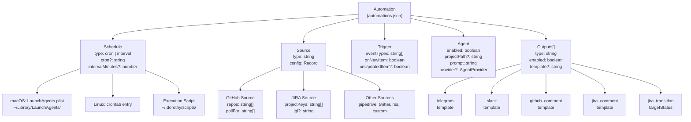
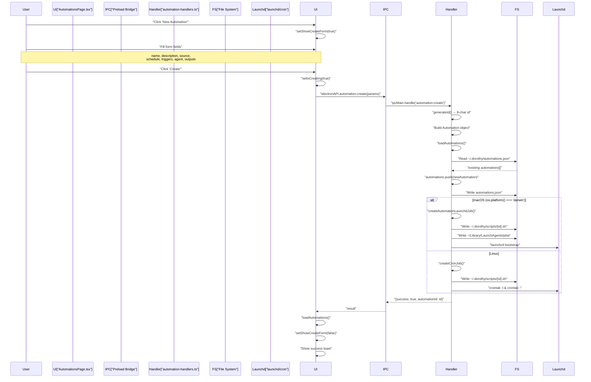
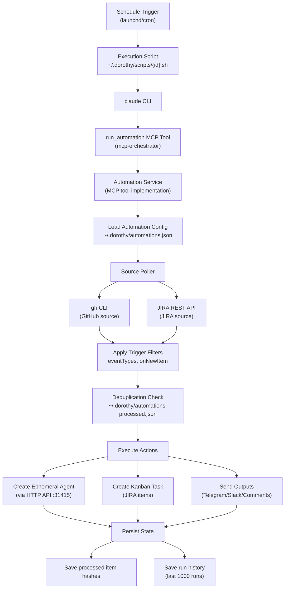
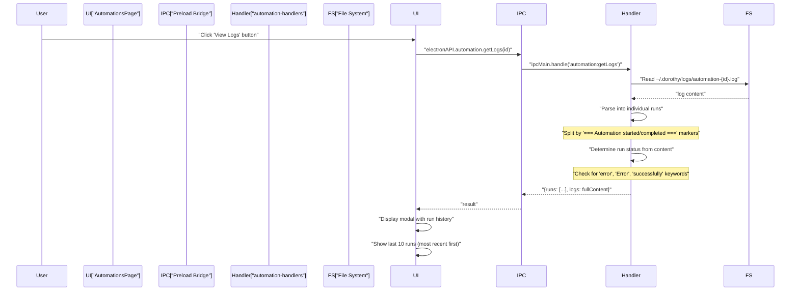

<!-- source: DeepWiki mcp.deepwiki.com · repo Charlie85270/Dorothy · page 7.1 Creating Automations · fetched 2026-10-26 -->

# Creating Automations

<details>
<summary>Relevant source files</summary>

The following files were used as context for generating this wiki page:

- [electron/handlers/automation-handlers.ts](electron/handlers/automation-handlers.ts)
- [electron/handlers/scheduler-handlers.ts](electron/handlers/scheduler-handlers.ts)
- [mcp-orchestrator/src/utils/scheduler.ts](mcp-orchestrator/src/utils/scheduler.ts)
- [src/app/automations/page.tsx](src/app/automations/page.tsx)
- [src/components/AgentWorld/AgentCharacter.tsx](src/components/AgentWorld/AgentCharacter.tsx)
- [src/components/SchedulerCalendar.tsx](src/components/SchedulerCalendar.tsx)

</details>


This page provides a comprehensive guide to creating and configuring automations in Dorothy. Automations enable polling of external sources (GitHub, JIRA, etc.) on a schedule, applying filters, and triggering actions such as creating ephemeral agents, sending notifications, or updating issues.

For information about scheduled tasks that execute prompts directly without polling external sources, see [Creating Scheduled Tasks](#8.1). For details on automation outputs and integrations, see [Automation Outputs](#7.4).

---

## Overview

Automations in Dorothy implement a polling-based workflow that periodically checks external data sources, filters items based on configured triggers, deduplicates results, and executes actions. The system is designed to bridge external tools (like GitHub pull requests or JIRA tickets) with Dorothy's agent orchestration capabilities.

**Key Use Cases:**
- Monitor GitHub repositories for new pull requests and create agent tasks to review them
- Poll JIRA for tickets matching specific criteria and automatically create Kanban tasks
- Track external events and send notifications to Telegram or Slack
- Automatically transition JIRA issues through workflow states based on agent processing

Sources: [electron/handlers/automation-handlers.ts:1-627]()

---

## Automation Data Model

An automation consists of five core components that define its behavior:



Sources: [electron/handlers/automation-handlers.ts:19-52](), [src/app/automations/page.tsx:48-80]()

### Automation Interface Fields

| Field | Type | Purpose |
|-------|------|---------|
| `id` | `string` | Unique identifier (8-character random string) |
| `name` | `string` | Human-readable name displayed in UI |
| `description` | `string?` | Optional description of automation's purpose |
| `enabled` | `boolean` | Controls whether automation runs on schedule |
| `createdAt` | `string` | ISO timestamp of creation |
| `updatedAt` | `string` | ISO timestamp of last modification |
| `schedule` | `object` | Defines when automation runs (see below) |
| `source` | `object` | Configures external data source (see below) |
| `trigger` | `object` | Filters which items to process (see below) |
| `agent` | `object` | Controls ephemeral agent creation (see below) |
| `outputs` | `array` | Defines where results are sent (see below) |

Sources: [electron/handlers/automation-handlers.ts:19-52]()

---

## Schedule Configuration

Automations support two scheduling modes: **interval-based** (simple periodic execution) and **cron-based** (complex time patterns).

### Interval Schedules

Interval schedules run the automation every N minutes. The system converts intervals to cron expressions internally:

```typescript
// Examples from source code
{ type: 'interval', intervalMinutes: 30 }  // Every 30 minutes
{ type: 'interval', intervalMinutes: 60 }  // Hourly
{ type: 'interval', intervalMinutes: 1440 } // Daily
```

**Conversion Logic:**
- `< 60 minutes`: `*/{minutes} * * * *` (e.g., `*/30 * * * *`)
- `60 minutes`: `0 * * * *` (hourly)
- `< 1440 minutes`: `0 */{hours} * * *` (e.g., `0 */2 * * *` for 2 hours)
- `>= 1440 minutes`: `0 0 * * *` (daily)

Sources: [electron/handlers/automation-handlers.ts:130-146]()

### Cron Schedules

For complex scheduling patterns, use standard cron expressions:

```typescript
// Examples
{ type: 'cron', cron: '0 9 * * 1-5' }    // Weekdays at 9am
{ type: 'cron', cron: '*/15 * * * *' }   // Every 15 minutes
{ type: 'cron', cron: '0 0 1 * *' }      // First of each month
```

**Cron Format:** `minute hour dayOfMonth month dayOfWeek`

Sources: [electron/handlers/automation-handlers.ts:232-240]()

### UI Schedule Presets

The automation creation UI provides convenient presets:

| Preset | Minutes | Cron Equivalent |
|--------|---------|-----------------|
| Every 1 minute | 1 | `*/1 * * * *` |
| Every 5 minutes | 5 | `*/5 * * * *` |
| Every 15 minutes | 15 | `*/15 * * * *` |
| Every 30 minutes | 30 | `*/30 * * * *` |
| Every hour | 60 | `0 * * * *` |
| Every 2 hours | 120 | `0 */2 * * *` |
| Every 6 hours | 360 | `0 */6 * * *` |
| Daily | 1440 | `0 0 * * *` |

Sources: [src/app/automations/page.tsx:107-116]()

---

## Source Configuration

The `source` object defines which external system to poll and how to query it.

### GitHub Source

Polls GitHub repositories using the `gh` CLI:

```typescript
{
  type: 'github',
  config: {
    repos: ['owner/repo1', 'owner/repo2'],
    pollFor: ['pull_requests', 'issues', 'releases']
  }
}
```

**Configuration Options:**
- `repos`: Array of repository identifiers in `owner/repo` format
- `pollFor`: Array specifying what to monitor:
  - `'pull_requests'`: Open pull requests
  - `'issues'`: Open issues
  - `'releases'`: Published releases

Sources: [src/app/automations/page.tsx:204-214](), [electron/handlers/automation-handlers.ts:442-445]()

### JIRA Source

Queries JIRA using the REST API:

```typescript
{
  type: 'jira',
  config: {
    projectKeys: ['PROJ1', 'PROJ2'],
    jql: 'status = "In Progress" AND assignee = currentUser()'
  }
}
```

**Configuration Options:**
- `projectKeys`: Array of JIRA project keys to monitor
- `jql`: Optional JQL (JIRA Query Language) expression for advanced filtering

When JIRA items are detected, the automation can automatically create Kanban tasks in Dorothy's task management system.

Sources: [src/app/automations/page.tsx:204-214](), [electron/handlers/automation-handlers.ts:442-445]()

### Other Source Types

Dorothy supports additional source types for extensibility:
- `pipedrive`: CRM integration
- `twitter`: Twitter API monitoring
- `rss`: RSS feed polling
- `custom`: User-defined sources

Sources: [src/app/automations/page.tsx:95-105]()

---

## Trigger Configuration

Triggers filter which items from the source should trigger actions:

```typescript
{
  eventTypes: ['pr', 'issue'],      // GitHub-specific event types
  onNewItem: true,                  // Trigger on newly discovered items
  onUpdatedItem: false              // Trigger on item updates (optional)
}
```

**GitHub Event Types:**
- `'pr'`: Pull request events
- `'issue'`: Issue events
- `'release'`: Release events

**Deduplication:** The automation service maintains a processed items cache at `~/.dorothy/automations-processed.json` using content hashing to prevent duplicate processing of the same items.

Sources: [electron/handlers/automation-handlers.ts:35-39](), [electron/handlers/automation-handlers.ts:446-449]()

---

## Agent Processing Configuration

The `agent` object controls whether ephemeral agents are created to process discovered items:

```typescript
{
  enabled: true,
  projectPath: '/path/to/project',
  prompt: 'Review this PR and provide feedback: {{item.url}}',
  provider: 'claude'  // Defaults to system default provider
}
```

### Ephemeral Agent Lifecycle

When agent processing is enabled:

1. **Creation**: An ephemeral agent is created via the HTTP API server (port 31415)
2. **Execution**: The agent runs autonomously in its project context
3. **Context**: Item details are injected into the prompt using template variables
4. **Cleanup**: Agent is automatically cleaned up after task completion

**Template Variables Available:**
- `{{item.url}}`: URL to the GitHub PR/issue or JIRA ticket
- `{{item.title}}`: Title of the item
- `{{item.body}}`: Description or body content
- Additional source-specific fields

Sources: [electron/handlers/automation-handlers.ts:40-46](), [electron/handlers/automation-handlers.ts:450-456]()

### Provider Selection

The automation uses the configured provider or falls back to the system default. Supported providers:
- `'claude'`: Anthropic Claude
- `'codex'`: OpenAI Codex
- `'gemini'`: Google Gemini
- `'tasmania'`: Local Tasmania server

Sources: [electron/handlers/automation-handlers.ts:106-118](), [electron/handlers/automation-handlers.ts:228-229]()

---

## Output Configuration

Outputs define where automation results are sent. Multiple outputs can be enabled simultaneously:

```typescript
outputs: [
  { type: 'telegram', enabled: true, template: '🤖 New PR: {{item.title}}' },
  { type: 'slack', enabled: true, template: 'PR ready for review: {{item.url}}' },
  { type: 'github_comment', enabled: true, template: 'Automated review complete.' },
  { type: 'jira_comment', enabled: true, template: 'Agent processed this ticket.' },
  { type: 'jira_transition', enabled: true, template: 'Done' }
]
```

### Output Types

| Type | Purpose | Template Usage |
|------|---------|----------------|
| `telegram` | Send message to configured Telegram bot | Message text with variables |
| `slack` | Post to configured Slack channel | Message text with variables |
| `github_comment` | Add comment to PR/issue | Comment body with variables |
| `jira_comment` | Add comment to JIRA ticket | Comment body with variables |
| `jira_transition` | Transition JIRA ticket to status | Target status name (e.g., "Done") |

**Note:** For JIRA transitions, the `template` field specifies the target status name rather than a text template.

Sources: [electron/handlers/automation-handlers.ts:47-51](), [electron/handlers/automation-handlers.ts:417-432](), [src/app/automations/page.tsx:151-159]()

---

## Creating an Automation via UI



Sources: [src/app/automations/page.tsx:197-273](), [electron/handlers/automation-handlers.ts:380-472]()

### Step-by-Step Process

1. **Open Creation Form**: Click "New Automation" button on the Automations page
2. **Name and Description**: Provide a descriptive name (required) and optional description
3. **Select Source**:
   - Choose from dropdown: GitHub, JIRA, Pipedrive, Twitter, RSS, or Custom
   - For GitHub: Enter comma-separated repositories (`owner/repo1, owner/repo2`)
   - For JIRA: Enter comma-separated project keys and optional JQL query
4. **Configure Schedule**: Select a preset or enter custom cron expression
5. **Set Triggers**:
   - For GitHub: Check which event types to monitor (PRs, Issues, Releases)
   - Enable "Only new items" to avoid processing already-seen items
6. **Agent Processing** (optional):
   - Toggle "Enable Agent"
   - Specify project path where agent should run
   - Write prompt template with `{{item.*}}` variables
7. **Configure Outputs**:
   - Toggle desired output channels (Telegram, Slack, etc.)
   - For transitions: specify target status name
   - Write output template with variables (except for transitions)
8. **Create**: Submit the form

Sources: [src/app/automations/page.tsx:756-1050]()

---

## Automation Execution Flow



Sources: [electron/handlers/automation-handlers.ts:226-338](), [electron/handlers/automation-handlers.ts:540-564]()

### Execution Script Structure

Each automation generates a platform-specific shell script that:

1. **Sources shell profiles** to load PATH (nvm, homebrew, etc.)
2. **Changes to project directory** (if agent processing enabled)
3. **Logs start timestamp** to `~/.dorothy/logs/automation-{id}.log`
4. **Invokes claude CLI** with MCP config to call `run_automation` tool
5. **Logs completion timestamp**

**Example Script** (generated at `~/.dorothy/scripts/automation-{id}.sh`):

```bash
#!/bin/bash
export HOME="/Users/username"
# Source nvm and shell profiles...
export PATH="/usr/local/bin:$PATH"
cd "/project/path"
echo "=== Automation started at $(date) ===" >> "/path/to/log"
/usr/local/bin/claude --dangerously-skip-permissions \
  --mcp-config "/Users/username/.claude/mcp.json" \
  -p 'Use the run_automation MCP tool to run automation with id "abc123"...' \
  >> "/path/to/log" 2>&1
echo "=== Automation completed at $(date) ===" >> "/path/to/log"
```

Sources: [electron/handlers/automation-handlers.ts:256-275]()

---

## Platform-Specific Scheduling

### macOS: launchd

On macOS, automations use launchd agents for scheduling:

**Plist File Location:** `~/Library/LaunchAgents/com.dorothy.automation.{id}.plist`

**Key Features:**
- `StartCalendarInterval` for cron-like scheduling (single dict for specific times)
- `StartInterval` for simple interval scheduling (seconds-based)
- `StandardOutPath` for log capture
- `RunAtLoad: false` to prevent immediate execution on login

**Interval Schedule Example:**
```xml
<key>StartInterval</key>
<integer>1800</integer>  <!-- 30 minutes in seconds -->
```

**Calendar Schedule Example:**
```xml
<key>StartCalendarInterval</key>
<dict>
  <key>Minute</key>
  <integer>0</integer>
  <key>Hour</key>
  <integer>9</integer>
  <key>Weekday</key>
  <integer>1</integer>  <!-- Monday -->
</dict>
```

**Registration:** The system uses `launchctl bootstrap gui/{uid} {plist-path}` to register the job.

Sources: [electron/handlers/automation-handlers.ts:226-338](), [electron/handlers/automation-handlers.ts:280-337]()

### Linux: cron

On Linux, automations add entries to the user's crontab:

**Cron Entry Format:**
```
*/30 * * * * /path/to/.dorothy/scripts/automation-{id}.sh # dorothy-{id}
```

The `# dorothy-{id}` comment is used for identification during deletion.

**Registration Process:**
1. Read existing crontab with `crontab -l`
2. Append new cron line
3. Write back with `crontab -` (stdin)

Sources: [electron/handlers/automation-handlers.ts:430-504]()

---

## Storage and State Management

### Primary Files

| File Path | Purpose | Content |
|-----------|---------|---------|
| `~/.dorothy/automations.json` | Automation definitions | Array of Automation objects |
| `~/.dorothy/automations-processed.json` | Deduplication cache | Item content hashes |
| `~/.dorothy/automations-runs.json` | Execution history | Last 1000 run records (capped) |
| `~/.dorothy/logs/automation-{id}.log` | Standard output | Execution logs per automation |
| `~/.dorothy/logs/automation-{id}.error.log` | Error output | Error logs per automation |
| `~/.dorothy/scripts/automation-{id}.sh` | Execution script | Generated shell script |

Sources: [electron/handlers/automation-handlers.ts:14-16](), [electron/handlers/automation-handlers.ts:242-247]()

### Run History Structure

```typescript
interface AutomationRun {
  id: string;              // Unique run identifier
  automationId: string;    // Parent automation ID
  startedAt: string;       // ISO timestamp
  completedAt?: string;    // ISO timestamp (if completed)
  status: 'running' | 'completed' | 'error';
  itemsFound: number;      // Items returned by poller
  itemsProcessed: number;  // Items that passed filters
  error?: string;          // Error message if failed
}
```

**Capping:** The runs array is automatically sliced to the last 1000 entries during load to prevent unbounded growth.

Sources: [electron/handlers/automation-handlers.ts:54-63](), [electron/handlers/automation-handlers.ts:89-100]()

---

## Monitoring and Logs

### Log Viewing

The UI provides log access through the "View Logs" button on each automation card:



Sources: [src/app/automations/page.tsx:330-344](), [electron/handlers/automation-handlers.ts:567-625]()

### Log Structure

Each execution appends to the log file with clear delimiters:

```
=== Automation started at Wed Dec 20 2023 14:30:00 GMT-0800 ===
[Claude CLI output...]
[MCP tool execution output...]
[Automation service results...]
=== Automation completed at Wed Dec 20 2023 14:30:45 GMT-0800 ===
```

**Run Status Detection:**
- `'error'`: Log contains "error", "Error", or "command not found"
- `'running'`: No completion marker present
- `'completed'`: Has completion marker without error indicators
- `'success'`: Completed with "successfully" keyword present

Sources: [electron/handlers/automation-handlers.ts:589-615]()

### Manual Execution

Automations can be run manually outside of their schedule:

**Process:**
1. Click "Run Now" button (Play icon) on automation card
2. System executes the shell script in detached mode (`spawn` with `detached: true, stdio: 'ignore'`)
3. Log file is updated with execution results
4. UI shows toast notification with results

Sources: [src/app/automations/page.tsx:308-328](), [electron/handlers/automation-handlers.ts:540-564]()

---

## IPC Communication Interface

### Handler Registration

All automation IPC handlers are registered via `registerAutomationHandlers()`:

```typescript
// electron/handlers/automation-handlers.ts
export function registerAutomationHandlers(): void {
  ipcMain.handle('automation:list', async () => { ... });
  ipcMain.handle('automation:create', async (_event, params) => { ... });
  ipcMain.handle('automation:update', async (_event, id, params) => { ... });
  ipcMain.handle('automation:delete', async (_event, id) => { ... });
  ipcMain.handle('automation:run', async (_event, id) => { ... });
  ipcMain.handle('automation:getLogs', async (_event, id) => { ... });
}
```

Sources: [electron/handlers/automation-handlers.ts:368-626]()

### API Surface

| IPC Channel | Parameters | Returns | Purpose |
|-------------|------------|---------|---------|
| `automation:list` | none | `{ automations: Automation[] }` | Load all automations |
| `automation:create` | `CreateParams` | `{ success: boolean, automationId?: string, error?: string }` | Create new automation |
| `automation:update` | `id, { enabled?, name? }` | `{ success: boolean, error?: string }` | Update automation properties |
| `automation:delete` | `id` | `{ success: boolean, error?: string }` | Delete automation and cleanup |
| `automation:run` | `id` | `{ success: boolean, message?: string, error?: string }` | Trigger manual execution |
| `automation:getLogs` | `id` | `{ runs: Run[], logs: string, error?: string }` | Retrieve execution logs |

Sources: [electron/handlers/automation-handlers.ts:368-626]()

### Create Parameters

```typescript
interface CreateParams {
  name: string;
  description?: string;
  sourceType: string;
  sourceConfig: string;           // JSON-encoded config
  scheduleMinutes?: number;       // For interval schedules
  scheduleCron?: string;          // For cron schedules
  eventTypes?: string[];
  onNewItem?: boolean;
  agentEnabled?: boolean;
  agentPrompt?: string;
  agentProjectPath?: string;
  outputTelegram?: boolean;
  outputSlack?: boolean;
  outputGitHubComment?: boolean;
  outputJiraComment?: boolean;
  outputJiraTransition?: string;  // Target status name
  outputTemplate?: string;
}
```

Sources: [electron/handlers/automation-handlers.ts:381-399]()

---

## Advanced Configuration

### CLI Path Resolution

The system attempts multiple methods to locate CLI binaries for provider commands:

1. **User-configured path** from `~/.dorothy/app-settings.json` under `cliPaths.{binaryName}`
2. **Shell detection** via `which {binaryName}` executed in login shell (`/bin/bash -l -c`)
3. **Common paths**: `/usr/local/bin`, `/opt/homebrew/bin`, `~/.local/bin`
4. **nvm directories**: Scans `~/.nvm/versions/node/*` for node-based CLIs

This ensures automations can locate `claude`, `codex`, `gemini`, and other provider binaries regardless of installation method.

Sources: [electron/handlers/automation-handlers.ts:149-219]()

### Provider-Specific Script Generation

Each provider generates slightly different shell scripts via its `buildScheduledScript()` method:

```typescript
const cliProvider = getProvider(automationProvider);
const scriptContent = cliProvider.buildScheduledScript({
  binaryPath: claudePath,
  binaryDir: claudeDir,
  projectPath,
  prompt: escapedPrompt,
  autonomous: true,
  mcpConfigPath,
  logPath,
  homeDir,
});
```

This abstraction allows different providers to customize:
- Command-line flags (e.g., `--dangerously-skip-permissions` for autonomous mode)
- Environment variable requirements
- PATH modifications
- MCP configuration loading

Sources: [electron/handlers/automation-handlers.ts:264-274]()

### Escape Handling for Bash

Prompts and strings are carefully escaped for safe shell interpolation:

```typescript
function escapeForBashDoubleQuotes(str: string): string {
  return str
    .replace(/\\/g, '\\\\')
    .replace(/"/g, '\\"')
    .replace(/\$/g, '\\$')
    .replace(/`/g, '\\`')
    .replace(/!/g, '\\!');
}
```

This prevents injection attacks and ensures special characters in automation prompts are properly handled.

Sources: [electron/handlers/automation-handlers.ts:121-128]()

---

