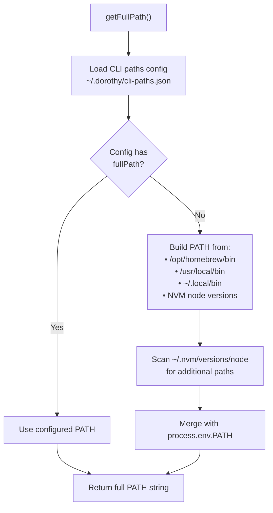
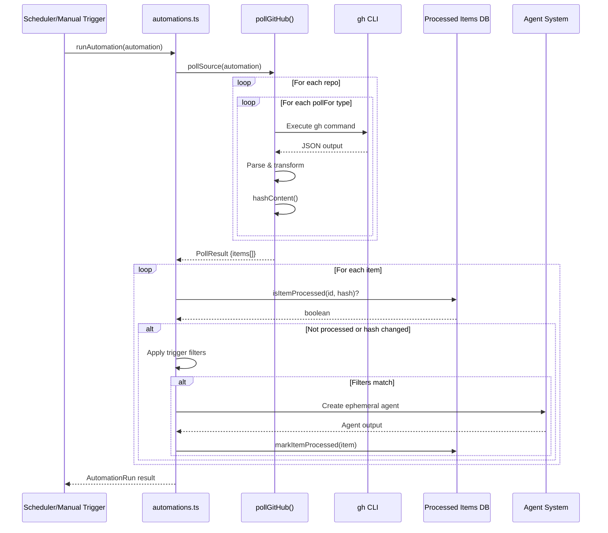
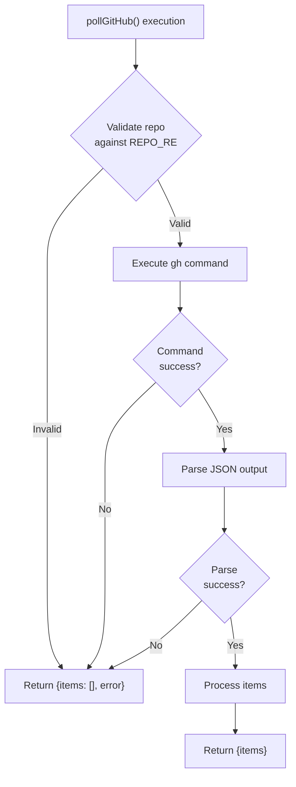
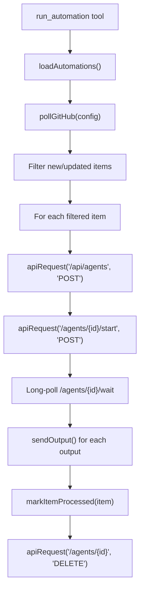
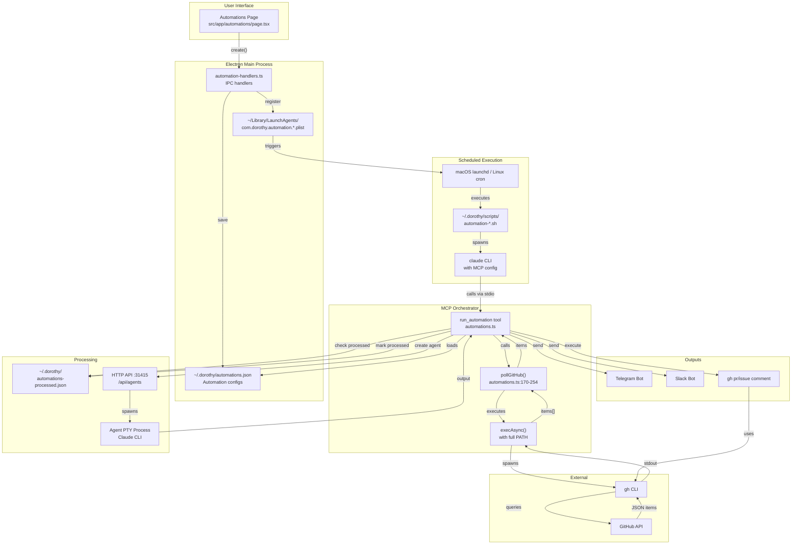

<!-- source: DeepWiki mcp.deepwiki.com · repo Charlie85270/Dorothy · page 7.2 GitHub Automations · fetched 2026-10-26 -->

# GitHub Automations

<details>
<summary>Relevant source files</summary>

The following files were used as context for generating this wiki page:

- [electron/handlers/automation-handlers.ts](electron/handlers/automation-handlers.ts)
- [electron/handlers/scheduler-handlers.ts](electron/handlers/scheduler-handlers.ts)
- [electron/services/api-server.ts](electron/services/api-server.ts)
- [mcp-orchestrator/src/tools/automations.ts](mcp-orchestrator/src/tools/automations.ts)
- [mcp-orchestrator/src/tools/index.ts](mcp-orchestrator/src/tools/index.ts)
- [mcp-orchestrator/src/utils/api.ts](mcp-orchestrator/src/utils/api.ts)
- [mcp-orchestrator/src/utils/automations.ts](mcp-orchestrator/src/utils/automations.ts)
- [mcp-orchestrator/src/utils/index.ts](mcp-orchestrator/src/utils/index.ts)
- [mcp-orchestrator/src/utils/scheduler.ts](mcp-orchestrator/src/utils/scheduler.ts)
- [src/app/automations/page.tsx](src/app/automations/page.tsx)
- [src/components/AgentWorld/AgentCharacter.tsx](src/components/AgentWorld/AgentCharacter.tsx)
- [src/components/SchedulerCalendar.tsx](src/components/SchedulerCalendar.tsx)

</details>


## Purpose and Scope

This page documents Dorothy's GitHub automation capabilities, specifically how the system polls GitHub repositories for pull requests, issues, and releases using the `gh` CLI tool. For general automation concepts and creating automations, see [Creating Automations](#7.1). For JIRA-specific polling, see [JIRA Automations](#7.3). For configuring automation outputs (Telegram, Slack, etc.), see [Automation Outputs](#7.4).

GitHub automations enable Dorothy to monitor repositories and automatically trigger Claude agents when new items are detected or existing items are updated. The system uses the GitHub CLI (`gh`) to fetch data, avoiding the need for API tokens while respecting GitHub's authentication mechanisms.

---

## Configuration Structure

GitHub automations are configured through the `GitHubSourceConfig` interface, which specifies which repositories to monitor and what types of items to poll.

```typescript
interface GitHubSourceConfig {
  repos: string[];  // Array of "owner/repo" strings
  pollFor: ("pull_requests" | "issues" | "releases")[];
  token?: string;  // Optional, uses gh CLI auth by default
}
```

**Key Fields:**

| Field | Type | Description |
|-------|------|-------------|
| `repos` | `string[]` | Repository names in `owner/repo` format (e.g., `["Charlie85270/Dorothy"]`) |
| `pollFor` | `string[]` | Item types to monitor: `pull_requests`, `issues`, or `releases` |
| `token` | `string?` | Optional personal access token; defaults to `gh` CLI authentication |

The configuration is stored in the automation's `source.config` field within `~/.dorothy/automations.json`.

**Sources:** [mcp-orchestrator/src/utils/automations.ts:16-20](), [mcp-orchestrator/src/tools/automations.ts:170-254]()

---

## Polling Mechanism

### CLI Path Resolution

Dorothy resolves the `gh` CLI path through a multi-step process:



**Sources:** [mcp-orchestrator/src/tools/automations.ts:76-146]()

### Repository Name Validation

Before executing any `gh` commands, repository names are validated against a strict regex pattern to prevent command injection:

```javascript
const REPO_RE = /^[a-zA-Z0-9._-]+\/[a-zA-Z0-9._-]+$/;
```

Invalid repository names cause the polling operation to fail immediately with an error message.

**Sources:** [mcp-orchestrator/src/tools/automations.ts:173-178]()

### Polling Execution

```mermaid
flowchart LR
    pollGitHub["pollGitHub(config, automation)"]
    ValidateRepo["Validate repo name<br/>against REPO_RE"]
    LoopRepos["For each repo in config.repos"]
    LoopTypes["For each type in config.pollFor"]
    ExecGH["execAsync()<br/>gh CLI command"]
    ParseJSON["JSON.parse(stdout)"]
    Transform["Transform to PollResult items"]
    Hash["hashContent()<br/>for change detection"]
    Return["Return {items, error?}"]
    
    pollGitHub --> LoopRepos
    LoopRepos --> ValidateRepo
    ValidateRepo --> LoopTypes
    LoopTypes --> ExecGH
    ExecGH --> ParseJSON
    ParseJSON --> Transform
    Transform --> Hash
    Hash --> Return
```



**Sources:** [mcp-orchestrator/src/tools/automations.ts:170-254]()

---

## Item Types

### Pull Requests

**Command:**
```bash
gh pr list --repo <owner/repo> --state open \
  --json number,title,url,author,body,labels,createdAt,updatedAt,headRefOid \
  --limit 20
```

**Fields Extracted:**

| Field | Usage |
|-------|-------|
| `number` | PR number for identification |
| `title` | PR title for display and filtering |
| `url` | GitHub URL for linking |
| `author.login` | PR author for template variables |
| `body` | Description for agent context |
| `labels` | Array of label names for filtering |
| `createdAt` | Timestamp for sorting |
| `updatedAt` | Timestamp for sorting and change detection |
| `headRefOid` | Git SHA for content hashing |

**Change Detection:**

Pull requests use a composite hash of the head commit SHA and `updatedAt` timestamp to detect updates:

```javascript
const hash = hashContent(JSON.stringify({ 
  sha: pr.headRefOid, 
  updatedAt: pr.updatedAt 
}));
```

This ensures the automation triggers when new commits are pushed or metadata changes.

**Sources:** [mcp-orchestrator/src/tools/automations.ts:181-201]()

### Issues

**Command:**
```bash
gh issue list --repo <owner/repo> --state open \
  --json number,title,url,author,body,labels,createdAt,updatedAt \
  --limit 20
```

**Fields Extracted:**

Similar to pull requests, but without `headRefOid` (issues don't have associated commits).

**Change Detection:**

Issues use a simpler hash based only on `updatedAt`:

```javascript
const hash = hashContent(JSON.stringify({ updatedAt: issue.updatedAt }));
```

**Sources:** [mcp-orchestrator/src/tools/automations.ts:204-224]()

### Releases

**Command:**
```bash
gh release list --repo <owner/repo> \
  --json tagName,name,url,author,body,createdAt,publishedAt \
  --limit 10
```

**Fields Extracted:**

| Field | Usage |
|-------|-------|
| `tagName` | Unique identifier (e.g., "v1.2.3") |
| `name` | Release title (falls back to tagName) |
| `url` | GitHub release URL |
| `author.login` | Release creator |
| `body` | Release notes |
| `createdAt` / `publishedAt` | Timestamps |

**Change Detection:**

Releases are identified by their `tagName`, which is immutable. Once processed, a release with the same tag won't trigger again:

```javascript
const hash = hashContent(release.tagName);
```

**Sources:** [mcp-orchestrator/src/tools/automations.ts:227-245]()

---

## Item Processing Flow



**Sources:** [mcp-orchestrator/src/tools/automations.ts:582-774]()

---

## Item Identification and Deduplication

Each item receives a unique identifier following the pattern:

```
github:<owner/repo>:<type>:<id>
```

**Examples:**
- `github:Charlie85270/Dorothy:pr:42`
- `github:octocat/Hello-World:issue:123`
- `github:rails/rails:release:v7.1.0`

The `createItemId()` function generates these identifiers:

```typescript
createItemId("github", repo, "pr", String(pr.number))
```

Processed items are stored in `~/.dorothy/automations-processed.json` with their IDs as keys and include:
- `lastProcessedAt` timestamp
- `lastHash` for change detection
- `metadata` for additional context

**Sources:** [mcp-orchestrator/src/utils/automations.ts:351-353](), [mcp-orchestrator/src/tools/automations.ts:605-653]()

---

## Trigger Matching

GitHub items support event type filtering through the automation's `trigger.eventTypes` array. Currently implemented:

| Event Type | Matches |
|------------|---------|
| `"pr"` | All pull requests |
| `"pr.opened"` | Pull requests (simplified) |
| `"issue"` | All issues |
| `"release"` | All releases |

The matching logic in `runAutomation()` checks:

```javascript
if (automation.trigger.eventTypes.length > 0) {
  const eventType = `${item.type}.opened`; // Simplified
  if (!automation.trigger.eventTypes.some(et => 
    et === eventType || et === item.type
  )) {
    return false; // Skip this item
  }
}
```

**Note:** Current implementation simplifies all items to `<type>.opened`. Full event type support (e.g., `pr.closed`, `issue.labeled`) is not yet implemented.

**Sources:** [mcp-orchestrator/src/tools/automations.ts:645-651]()

---

## Template Variables

When an item triggers an automation, these variables are available for prompt templates and output messages:

| Variable | Description | Example |
|----------|-------------|---------|
| `{{title}}` | Item title | "Fix memory leak in agent manager" |
| `{{url}}` | GitHub URL | "https://github.com/owner/repo/pull/42" |
| `{{author}}` | Username | "Charlie85270" |
| `{{body}}` | Item description | Full PR/issue body text |
| `{{type}}` | Item type | "pr", "issue", "release" |
| `{{repo}}` | Repository | "Charlie85270/Dorothy" |
| `{{number}}` | PR/issue number | 42 |
| `{{labels}}` | Comma-separated labels | "bug, high-priority" |

Example prompt template:
```
Review pull request "{{title}}" by {{author}}.
URL: {{url}}
Labels: {{labels}}

{{body}}
```

**Sources:** [mcp-orchestrator/src/tools/automations.ts:658-668]()

---

## GitHub-Specific Outputs

When GitHub items trigger agents, specific output types are available:

### GitHub Comment Output

For pull requests and issues, agents can post comments directly using the `gh` CLI:

```javascript
case "github_comment": {
  const { repo, number, type } = variables;
  const cmd = type === "issue"
    ? `gh issue comment ${number} --repo ${repo} --body '...'`
    : `gh pr comment ${number} --repo ${repo} --body '...'`;
  await execAsync(cmd);
  break;
}
```

The agent prompt includes instructions like:
```
Post your result as a comment on GitHub PR #42 in owner/repo using:
gh pr comment 42 --repo owner/repo --body "YOUR_CONTENT"
```

**Security:** Repository names and PR numbers are validated before command execution:
- Repo: Must match `REPO_RE` pattern
- Number: Must be a positive integer

**Sources:** [mcp-orchestrator/src/tools/automations.ts:490-505](), [mcp-orchestrator/src/tools/automations.ts:697-701]()

---

## Error Handling



**Common Error Scenarios:**

| Error | Cause | Resolution |
|-------|-------|-----------|
| `Invalid repository name` | Repo doesn't match `REPO_RE` | Fix repo format to `owner/name` |
| `Failed to poll ... from ...` | `gh` CLI execution failed | Check `gh auth status`, ensure CLI installed |
| Empty items array | No open PRs/issues/releases | Normal operation, no action needed |
| JSON parse error | Malformed `gh` CLI output | Check `gh` CLI version, network connectivity |

**Sources:** [mcp-orchestrator/src/tools/automations.ts:176-249]()

---

## Storage and Persistence

### Automation Definition

GitHub automation configurations are stored in `~/.dorothy/automations.json`:

```json
{
  "id": "abc123",
  "name": "Review Dorothy PRs",
  "source": {
    "type": "github",
    "config": {
      "repos": ["Charlie85270/Dorothy"],
      "pollFor": ["pull_requests"]
    }
  },
  "schedule": {
    "type": "interval",
    "intervalMinutes": 30
  },
  "trigger": {
    "eventTypes": ["pr"],
    "onNewItem": true
  },
  "agent": {
    "enabled": true,
    "prompt": "Review this PR: {{title}}"
  }
}
```

### Processed Items

Processed GitHub items are tracked in `~/.dorothy/automations-processed.json`:

```json
{
  "github:Charlie85270/Dorothy:pr:42": {
    "id": "github:Charlie85270/Dorothy:pr:42",
    "sourceType": "github",
    "itemType": "pr",
    "itemId": "42",
    "lastProcessedAt": "2024-01-15T10:30:00Z",
    "lastHash": "a1b2c3",
    "metadata": {
      "repo": "Charlie85270/Dorothy",
      "title": "Add GitHub automation docs"
    }
  }
}
```

**Sources:** [mcp-orchestrator/src/utils/automations.ts:145-243](), [electron/handlers/automation-handlers.ts:14-16]()

---

## Scheduling and Execution

GitHub automations run on the configured schedule (interval or cron) through platform-specific schedulers:

**macOS:** launchd jobs with shell scripts
- Plist file: `~/Library/LaunchAgents/com.dorothy.automation.<id>.plist`
- Script: `~/.dorothy/scripts/automation-<id>.sh`

**Linux:** crontab entries
- Cron line: `<schedule> <script-path> # dorothy-<id>`

The generated script:
1. Sources shell profile for proper PATH
2. Executes Claude CLI with MCP orchestrator
3. Calls `run_automation` MCP tool with automation ID
4. Logs output to `~/.dorothy/logs/automation-<id>.log`

**Sources:** [electron/handlers/automation-handlers.ts:226-338]()

---

## Integration with MCP Orchestrator

GitHub automations are executed through the `run_automation` MCP tool, which:

1. **Loads automation config** from `~/.dorothy/automations.json`
2. **Calls `pollGitHub()`** to fetch items
3. **Filters items** based on processed status and hash
4. **Creates ephemeral agents** for matching items
5. **Waits for completion** via long-polling
6. **Marks items processed** with updated hash
7. **Sends outputs** to configured channels



**Sources:** [mcp-orchestrator/src/tools/automations.ts:582-774]()

---

## UI Integration

The Automations page provides a visual interface for managing GitHub automations:

**Key Components:**

| Component | Path | Purpose |
|-----------|------|---------|
| Automations list | `/app/automations/page.tsx` | Display and manage automations |
| Create form | `showCreateForm` state | Configure new GitHub automation |
| GitHub-specific fields | Form section | Select repos and poll types |

**GitHub Configuration UI:**

```typescript
// Repo input (comma-separated)
<input
  value={formData.repos}
  onChange={e => setFormData({...formData, repos: e.target.value})}
  placeholder="owner/repo1, owner/repo2"
/>

// Poll type checkboxes
<input type="checkbox" 
  checked={formData.pollFor.includes('pull_requests')}
  onChange={...}
/>
```

The form validates and constructs the `GitHubSourceConfig` before sending to the IPC handler:

```typescript
const sourceConfig = {
  repos: formData.repos.split(',').map(r => r.trim()).filter(Boolean),
  pollFor: formData.pollFor
};

await window.electronAPI?.automation?.create({
  sourceType: 'github',
  sourceConfig: JSON.stringify(sourceConfig),
  ...
});
```

**Sources:** [src/app/automations/page.tsx:198-273]()

---

## Diagram: Complete GitHub Automation Flow



**Sources:** All files referenced in this document

---

