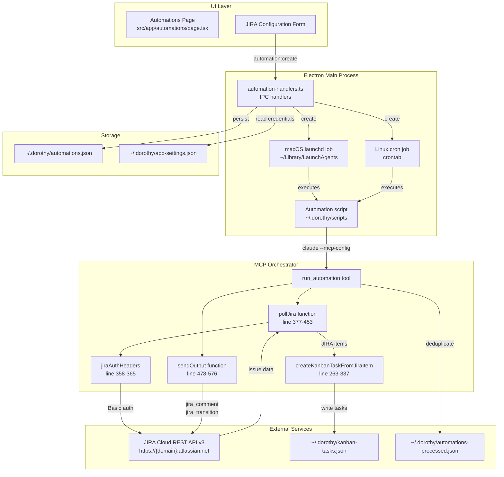
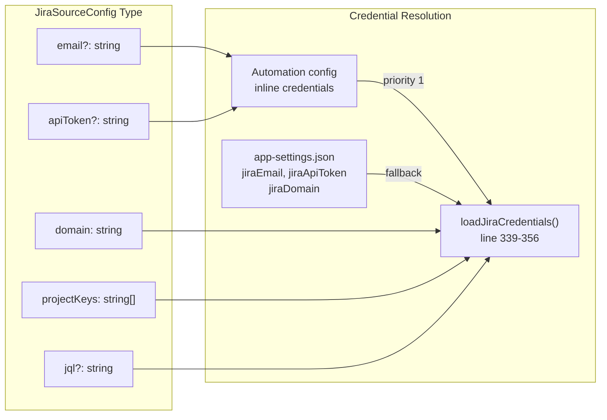
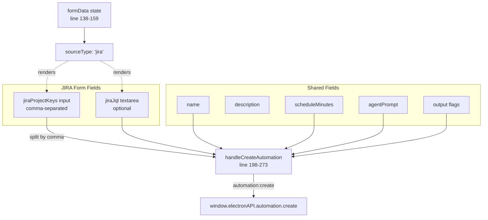
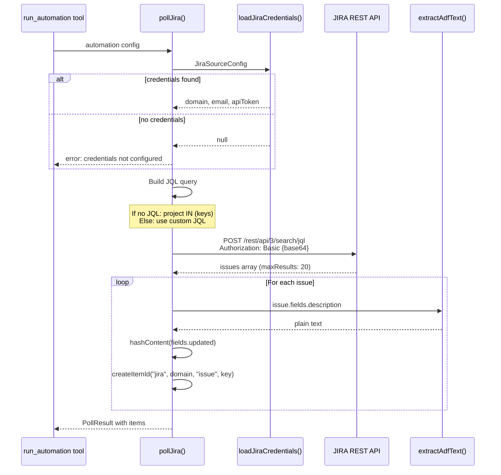
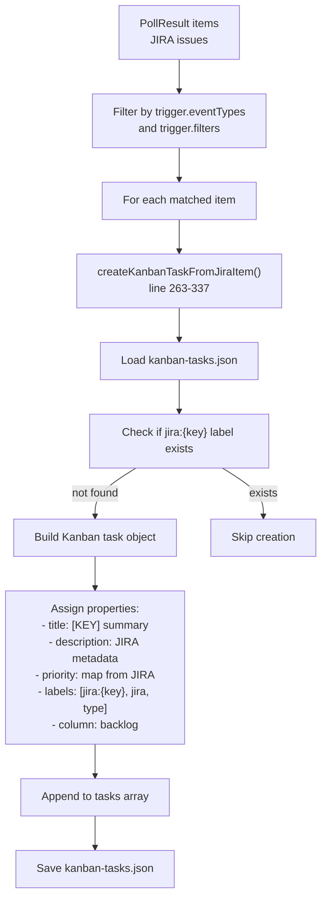
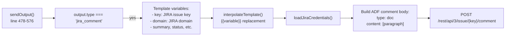
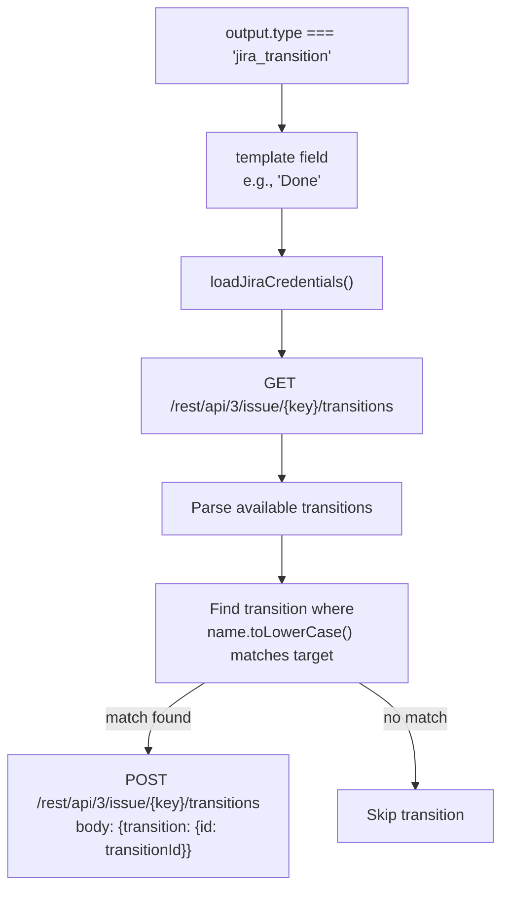
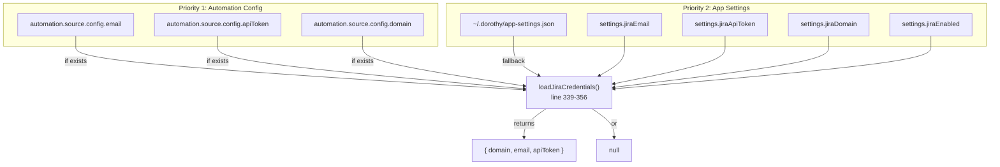
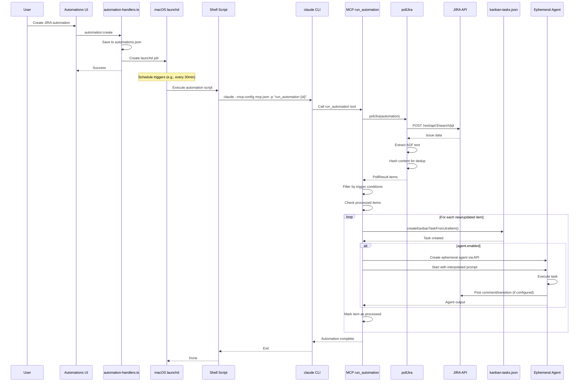

<!-- source: DeepWiki mcp.deepwiki.com · repo Charlie85270/Dorothy · page 7.3 JIRA Automations · fetched 2026-10-26 -->

# JIRA Automations

<details>
<summary>Relevant source files</summary>

The following files were used as context for generating this wiki page:

- [electron/handlers/automation-handlers.ts](electron/handlers/automation-handlers.ts)
- [electron/handlers/scheduler-handlers.ts](electron/handlers/scheduler-handlers.ts)
- [electron/services/api-server.ts](electron/services/api-server.ts)
- [mcp-orchestrator/src/tools/automations.ts](mcp-orchestrator/src/tools/automations.ts)
- [mcp-orchestrator/src/tools/index.ts](mcp-orchestrator/src/tools/index.ts)
- [mcp-orchestrator/src/utils/api.ts](mcp-orchestrator/src/utils/api.ts)
- [mcp-orchestrator/src/utils/automations.ts](mcp-orchestrator/src/utils/automations.ts)
- [mcp-orchestrator/src/utils/index.ts](mcp-orchestrator/src/utils/index.ts)
- [mcp-orchestrator/src/utils/scheduler.ts](mcp-orchestrator/src/utils/scheduler.ts)
- [src/app/automations/page.tsx](src/app/automations/page.tsx)
- [src/components/AgentWorld/AgentCharacter.tsx](src/components/AgentWorld/AgentCharacter.tsx)
- [src/components/SchedulerCalendar.tsx](src/components/SchedulerCalendar.tsx)

</details>


## Purpose and Scope

This document details Dorothy's JIRA automation capabilities, which enable polling JIRA Cloud instances for issues and triggering agent-based workflows. JIRA automations are a specialized type of automation source that communicates with Atlassian JIRA REST API v3 to fetch issues, create Kanban tasks, post comments, and transition issue statuses.

For general automation concepts and GitHub integration, see [Automations](#7), [Creating Automations](#7.1), and [GitHub Automations](#7.2). For output configuration across all automation types, see [Automation Outputs](#7.4).

---

## JIRA Integration Architecture

Dorothy integrates with JIRA through a multi-layered architecture that spans the Electron main process, MCP server tools, and the UI layer.



**Sources:** [electron/handlers/automation-handlers.ts:1-627](), [mcp-orchestrator/src/tools/automations.ts:377-453](), [src/app/automations/page.tsx:1-1518]()

---

## JIRA Source Configuration

### Configuration Structure

JIRA automations are configured through the `JiraSourceConfig` interface, which specifies project keys, JQL queries, and authentication details.



**Sources:** [mcp-orchestrator/src/utils/automations.ts:22-28](), [mcp-orchestrator/src/tools/automations.ts:339-356]()

### Configuration Fields

| Field | Type | Required | Description |
|-------|------|----------|-------------|
| `domain` | `string` | Yes | JIRA Cloud domain (without `.atlassian.net`) |
| `projectKeys` | `string[]` | Yes | Array of project keys to poll (e.g., `["PROJ", "DEV"]`) |
| `jql` | `string` | No | Custom JQL query. If omitted, defaults to `project IN (...) ORDER BY updated DESC` |
| `email` | `string` | No | JIRA account email for API authentication |
| `apiToken` | `string` | No | JIRA API token (generated from Atlassian account settings) |

**Sources:** [mcp-orchestrator/src/utils/automations.ts:22-28]()

### Creating a JIRA Automation via UI

The automation creation form in the UI provides JIRA-specific fields when `sourceType` is set to `"jira"`:



**Sources:** [src/app/automations/page.tsx:138-273]()

---

## Polling and Item Detection

### Poll Mechanism

The `pollJira` function executes the polling workflow, fetching issues from JIRA and transforming them into a standardized item format.



**Sources:** [mcp-orchestrator/src/tools/automations.ts:377-453]()

### JQL Query Construction

If no custom JQL is provided, Dorothy constructs a default query:

| Condition | Generated JQL |
|-----------|---------------|
| Project keys provided | `project IN ("KEY1", "KEY2") ORDER BY updated DESC` |
| No project keys | `ORDER BY updated DESC` |
| Custom JQL provided | Uses custom JQL as-is |

**Sources:** [mcp-orchestrator/src/tools/automations.ts:388-397]()

### ADF Description Extraction

JIRA stores issue descriptions in Atlassian Document Format (ADF). The `extractAdfText` function recursively extracts plain text from the ADF JSON structure.

```typescript
// Extracts plain text from ADF nodes
function extractAdfText(node: unknown): string {
  if (!node || typeof node !== "object") return "";
  const n = node as Record<string, unknown>;
  if (n.type === "text" && typeof n.text === "string") return n.text;
  if (Array.isArray(n.content)) {
    return n.content.map(extractAdfText).join("");
  }
  return "";
}
```

**Sources:** [mcp-orchestrator/src/tools/automations.ts:367-375]()

### Item Deduplication

Each JIRA issue is assigned a unique ID using `createItemId` and content-hashed using `hashContent`:

```typescript
const itemId = createItemId("jira", domain, "issue", issue.key);
const hash = hashContent(fields.updated || "");
```

The automation system checks `~/.dorothy/automations-processed.json` to determine if an item has already been processed. If `trigger.onUpdatedItem` is enabled, the hash is compared to detect changes.

**Sources:** [mcp-orchestrator/src/tools/automations.ts:420-422](), [mcp-orchestrator/src/tools/automations.ts:605-617]()

---

## Automatic Kanban Task Creation

A unique feature of JIRA automations is automatic Kanban task creation. When a JIRA issue matches the trigger conditions, Dorothy creates a corresponding task in the Kanban board.

### Task Creation Flow



**Sources:** [mcp-orchestrator/src/tools/automations.ts:263-337](), [mcp-orchestrator/src/tools/automations.ts:681-682]()

### Priority Mapping

JIRA priority values are mapped to Kanban priority levels:

| JIRA Priority | Kanban Priority |
|---------------|-----------------|
| High, Critical, Blocker | `high` |
| Low, Trivial | `low` |
| All others | `medium` |

**Sources:** [mcp-orchestrator/src/tools/automations.ts:291-297]()

### Task Structure

Each created Kanban task includes:

```typescript
{
  id: generateId() + generateId(), // Double ID for uuid-like format
  title: `[${jiraKey}] ${item.title}`,
  description: `**JIRA Issue:** ${item.url}\n**Project Key:** ${key}\n...`,
  column: "backlog",
  projectId: jiraKey,
  projectPath: automation.agent.projectPath,
  priority: "high" | "medium" | "low",
  labels: [`jira:${jiraKey}`, "jira", item.type],
  createdAt: new Date().toISOString(),
  order: maxOrder + 1,
  // ... other fields
}
```

**Sources:** [mcp-orchestrator/src/tools/automations.ts:307-324]()

---

## JIRA-Specific Outputs

JIRA automations support two specialized output types that interact directly with JIRA issues.

### Output Types

| Output Type | Description | Configuration |
|-------------|-------------|---------------|
| `jira_comment` | Posts a comment to the JIRA issue | `template`: comment text with variable interpolation |
| `jira_transition` | Transitions the issue to a new status | `template`: target status name (e.g., "Done", "In Progress") |

**Sources:** [mcp-orchestrator/src/tools/automations.ts:507-558]()

### JIRA Comment Output



**Sources:** [mcp-orchestrator/src/tools/automations.ts:507-530]()

The comment is sent as an ADF document:

```json
{
  "body": {
    "type": "doc",
    "version": 1,
    "content": [{
      "type": "paragraph",
      "content": [{ "type": "text", "text": "Agent output message" }]
    }]
  }
}
```

**Sources:** [mcp-orchestrator/src/tools/automations.ts:518-525]()

### JIRA Transition Output



**Sources:** [mcp-orchestrator/src/tools/automations.ts:532-558]()

---

## Authentication and Credentials

### Credential Storage

JIRA credentials can be stored in two locations with different precedence:



**Sources:** [mcp-orchestrator/src/tools/automations.ts:339-356](), [mcp-orchestrator/src/tools/automations.ts:260]()

### Authentication Header Construction

JIRA uses Basic Authentication with Base64-encoded email:token:

```typescript
function jiraAuthHeaders(email: string, apiToken: string): Record<string, string> {
  const auth = Buffer.from(`${email}:${apiToken}`).toString("base64");
  return {
    "Authorization": `Basic ${auth}`,
    "Content-Type": "application/json",
    "Accept": "application/json",
  };
}
```

**Sources:** [mcp-orchestrator/src/tools/automations.ts:358-365]()

### Obtaining a JIRA API Token

1. Log in to https://id.atlassian.com
2. Navigate to Security → API tokens
3. Create an API token
4. Copy the token and store it in Dorothy settings

**Sources:** [mcp-orchestrator/src/tools/automations.ts:339-356]()

---

## Execution Flow

### Complete Automation Lifecycle



**Sources:** [electron/handlers/automation-handlers.ts:226-339](), [mcp-orchestrator/src/tools/automations.ts:582-768](), [mcp-orchestrator/src/tools/automations.ts:377-453]()

### Agent Prompt Interpolation

When `agent.enabled` is true, the agent prompt can use template variables from the JIRA issue:

```typescript
// Available variables for JIRA items
variables.key = item.raw.key;           // e.g., "PROJ-123"
variables.summary = item.raw.summary;   // Issue title
variables.status = item.raw.status;     // Current status
variables.issueType = item.raw.issueType; // "Bug", "Task", etc.
variables.priority = item.raw.priority; // "High", "Medium", etc.
variables.assignee = item.raw.assignee; // Assignee display name
variables.reporter = item.raw.reporter; // Reporter display name
variables.domain = item.raw.domain;     // JIRA domain
variables.url = item.url;               // Full issue URL
variables.body = item.body;             // Description text
variables.labels = item.labels?.join(", ");
```

Example prompt:
```
Analyze JIRA issue {{key}}: {{summary}}

Current status: {{status}}
Priority: {{priority}}
Assignee: {{assignee}}

Description:
{{body}}

Provide a code review or suggested fix.
```

**Sources:** [mcp-orchestrator/src/tools/automations.ts:670-680](), [mcp-orchestrator/src/tools/automations.ts:28-30]()

### Log File Format

Automation runs are logged to `~/.dorothy/logs/automation-{id}.log` with timestamped markers:

```
=== Automation started at 2024-01-15T10:30:00.000Z ===
Polling JIRA...
Found 3 new issues
Creating Kanban tasks...
Running agent for PROJ-123...
Agent completed successfully
=== Automation completed at 2024-01-15T10:32:15.000Z ===
```

**Sources:** [electron/handlers/automation-handlers.ts:242-243](), [electron/handlers/automation-handlers.ts:567-625]()

---

## Configuration Reference

### Complete Example

Here is a complete JIRA automation configuration stored in `~/.dorothy/automations.json`:

```json
{
  "id": "abc123",
  "name": "Review High Priority Bugs",
  "description": "Automatically review and comment on high priority bugs",
  "enabled": true,
  "createdAt": "2024-01-15T10:00:00.000Z",
  "updatedAt": "2024-01-15T10:00:00.000Z",
  "schedule": {
    "type": "interval",
    "intervalMinutes": 30
  },
  "source": {
    "type": "jira",
    "config": {
      "domain": "mycompany",
      "projectKeys": ["PROJ", "DEV"],
      "jql": "project IN (PROJ, DEV) AND priority = High AND status = 'To Do' ORDER BY created DESC"
    }
  },
  "trigger": {
    "eventTypes": [],
    "onNewItem": true,
    "onUpdatedItem": false
  },
  "agent": {
    "enabled": true,
    "projectPath": "/Users/me/code/myproject",
    "prompt": "Review JIRA issue {{key}}: {{summary}}\n\nProvide technical analysis and post your findings as a comment.",
    "provider": "claude"
  },
  "outputs": [
    {
      "type": "jira_comment",
      "enabled": true,
      "template": "Automated analysis by Dorothy"
    },
    {
      "type": "telegram",
      "enabled": true,
      "template": "New high priority bug: {{key}} - {{summary}}"
    }
  ]
}
```

**Sources:** [electron/handlers/automation-handlers.ts:19-52](), [mcp-orchestrator/src/utils/automations.ts:73-113]()

---

## Troubleshooting

### Common Issues

| Issue | Cause | Solution |
|-------|-------|----------|
| "JIRA credentials not configured" | Missing credentials in settings | Configure JIRA settings in Settings > JIRA or add inline credentials |
| "JIRA API error (401)" | Invalid API token or email | Regenerate API token from Atlassian account |
| "JIRA API error (400): JQL syntax error" | Invalid JQL query | Test JQL in JIRA web UI before using in automation |
| No items found | JQL returns no results | Verify project keys and query filters |
| Duplicate Kanban tasks | Task already exists | Dorothy checks for `jira:{key}` label to prevent duplicates |

**Sources:** [mcp-orchestrator/src/tools/automations.ts:380](), [mcp-orchestrator/src/tools/automations.ts:411-412](), [mcp-orchestrator/src/tools/automations.ts:276-281]()

### Viewing Logs

To view automation logs:

1. In the Automations UI, click the file icon next to the automation
2. Logs are parsed into individual runs with status indicators
3. Raw logs are stored in `~/.dorothy/logs/automation-{id}.log`

**Sources:** [electron/handlers/automation-handlers.ts:567-625](), [src/app/automations/page.tsx:331-344]()

---

