<!-- source: DeepWiki mcp.deepwiki.com · repo Charlie85270/Dorothy · page 7.4 Automation Outputs · fetched 2026-10-26 -->

# Automation Outputs

<details>
<summary>Relevant source files</summary>

The following files were used as context for generating this wiki page:

- [electron/handlers/automation-handlers.ts](electron/handlers/automation-handlers.ts)
- [electron/handlers/scheduler-handlers.ts](electron/handlers/scheduler-handlers.ts)
- [electron/services/api-server.ts](electron/services/api-server.ts)
- [mcp-orchestrator/src/tools/automations.ts](mcp-orchestrator/src/tools/automations.ts)
- [mcp-orchestrator/src/tools/index.ts](mcp-orchestrator/src/tools/index.ts)
- [mcp-orchestrator/src/utils/api.ts](mcp-orchestrator/src/utils/api.ts)
- [mcp-orchestrator/src/utils/automations.ts](mcp-orchestrator/src/utils/automations.ts)
- [mcp-orchestrator/src/utils/index.ts](mcp-orchestrator/src/utils/index.ts)
- [mcp-orchestrator/src/utils/scheduler.ts](mcp-orchestrator/src/utils/scheduler.ts)
- [src/app/automations/page.tsx](src/app/automations/page.tsx)
- [src/components/AgentWorld/AgentCharacter.tsx](src/components/AgentWorld/AgentCharacter.tsx)
- [src/components/SchedulerCalendar.tsx](src/components/SchedulerCalendar.tsx)

</details>


## Purpose and Scope

This page documents the output mechanisms available for Dorothy automations. Outputs determine how automation results are delivered after processing items from external sources like GitHub or JIRA. For information about creating automations and configuring sources, see [Creating Automations](#7.1). For source-specific configuration, see [GitHub Automations](#7.2) and [JIRA Automations](#7.3).

Automation outputs can send notifications, post comments, transition issues, or trigger webhooks. Multiple outputs can be enabled simultaneously, and each output type supports template interpolation with variables extracted from the source items.

---

## Output Types Overview

Dorothy supports six output types, each designed for specific integration scenarios:

| Output Type | Purpose | Template Support | Authentication Required |
|-------------|---------|------------------|------------------------|
| `telegram` | Send messages via Telegram bot | Yes | Telegram bot token |
| `slack` | Send messages via Slack bot | Yes | Slack app token |
| `github_comment` | Post comments on PRs/issues | Yes | `gh` CLI auth |
| `jira_comment` | Add comments to JIRA issues | Yes | JIRA credentials |
| `jira_transition` | Change JIRA issue status | Target status only | JIRA credentials |
| `webhook` | POST to external URLs | Yes (in body) | None (HTTPS required) |

**Sources:**
- [mcp-orchestrator/src/utils/automations.ts:14]()
- [mcp-orchestrator/src/utils/automations.ts:63-71]()
- [electron/handlers/automation-handlers.ts:47-51]()

---

## Output Configuration Structure

Each automation contains an `outputs` array where multiple output types can be enabled:

```typescript
interface OutputConfig {
  type: OutputType;
  enabled: boolean;
  template?: string;        // Message template with {{variables}}
  channel?: string;         // For Slack
  webhookUrl?: string;      // For webhook output
  email?: string;           // Reserved for future use
}
```

The `template` field supports variable interpolation using double-brace syntax: `{{variableName}}`. Variables are derived from the source item (e.g., `{{title}}`, `{{url}}`, `{{author}}`).

**Sources:**
- [mcp-orchestrator/src/utils/automations.ts:63-71]()

---

## Output Execution Flow

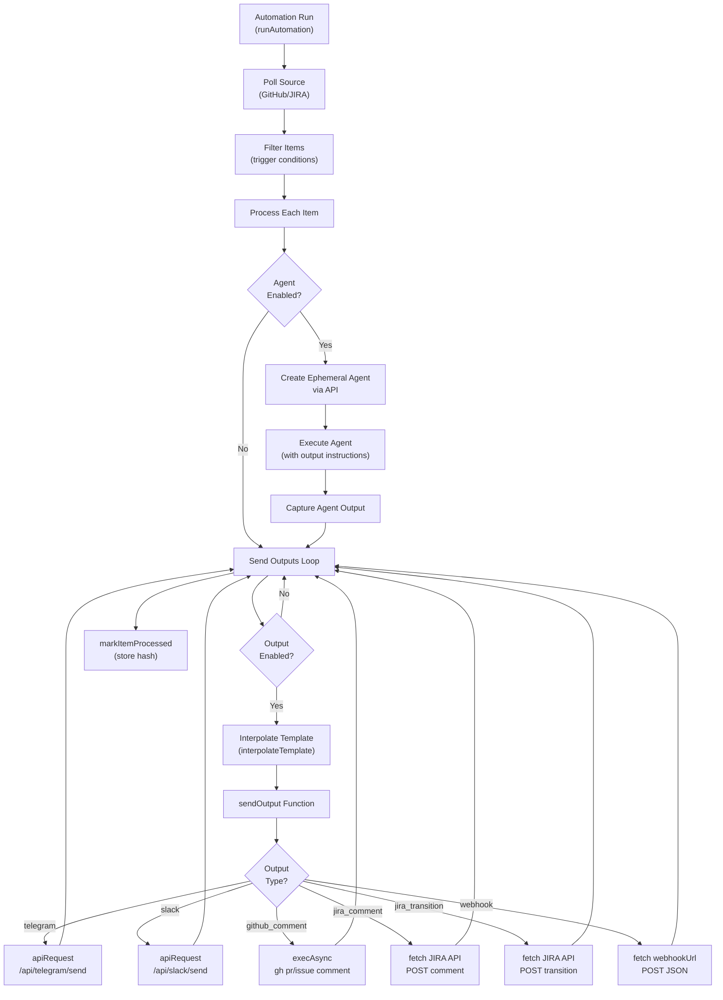

**Execution Flow: Automation Output Processing**

The automation executor processes outputs after optionally running an agent. Outputs loop through all enabled configurations, interpolate templates with item variables, and dispatch to the appropriate handler.

**Sources:**
- [mcp-orchestrator/src/tools/automations.ts:582-762]()
- [mcp-orchestrator/src/tools/automations.ts:478-576]()

---

## Telegram Output

Sends messages to Telegram via the configured Telegram bot. Messages are delivered to the default chat configured in Settings > Telegram.

### Configuration

```typescript
{
  type: "telegram",
  enabled: true,
  template: "🔔 New PR: {{title}}\n{{url}}\nAuthor: {{author}}"
}
```

### Implementation

The Telegram output uses the internal API server to route messages through the Telegram bot service:

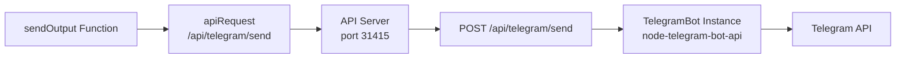

**Template Variables (GitHub):**
- `{{title}}` - PR/issue title
- `{{url}}` - GitHub URL
- `{{author}}` - GitHub username
- `{{body}}` - Description text
- `{{labels}}` - Comma-separated labels
- `{{number}}` - PR/issue number
- `{{repo}}` - Repository name

**Template Variables (JIRA):**
- `{{key}}` - Issue key (e.g., "PROJ-123")
- `{{summary}}` - Issue summary
- `{{status}}` - Current status
- `{{priority}}` - Priority level
- `{{assignee}}` - Assignee name
- `{{url}}` - JIRA issue URL

**Sources:**
- [mcp-orchestrator/src/tools/automations.ts:484-486]()
- [mcp-orchestrator/src/utils/api.ts:21-61]()

---

## Slack Output

Sends messages to Slack via the configured Slack bot. Messages are posted to the default channel configured in Settings > Slack.

### Configuration

```typescript
{
  type: "slack",
  enabled: true,
  template: "📋 New Issue: {{title}}\n<{{url}}|View Issue>\nReporter: {{author}}"
}
```

### Implementation

Similar to Telegram, Slack output routes through the API server:

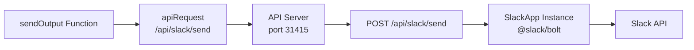

### Slack Formatting

Slack uses mrkdwn syntax for formatting:
- `*bold*` - Bold text
- `_italic_` - Italic text
- `<url|text>` - Hyperlinks
- `\`code\`` - Inline code
- `\`\`\`code block\`\`\`` - Code blocks

**Sources:**
- [mcp-orchestrator/src/tools/automations.ts:487-489]()

---

## GitHub Comment Output

Posts comments on GitHub pull requests or issues using the `gh` CLI. The comment is posted to the specific PR/issue that triggered the automation.

### Configuration

```typescript
{
  type: "github_comment",
  enabled: true,
  template: "✅ Automated review complete\n\n{{agentOutput}}"
}
```

### Implementation

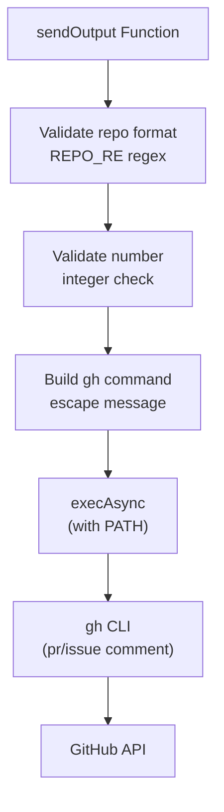

### Security

GitHub comment output includes validation to prevent command injection:
- Repository name must match: `/^[a-zA-Z0-9._-]+\/[a-zA-Z0-9._-]+$/`
- Number must be a positive integer
- Message is escaped with single-quote wrapping: `'${message.replace(/'/g, "'\\''")}'`

### Command Construction

For pull requests:
```bash
gh pr comment ${number} --repo ${repo} --body '${escapedMessage}'
```

For issues:
```bash
gh issue comment ${number} --repo ${repo} --body '${escapedMessage}'
```

**Sources:**
- [mcp-orchestrator/src/tools/automations.ts:490-505]()
- [mcp-orchestrator/src/tools/automations.ts:173-174]()

---

## JIRA Comment Output

Adds comments to JIRA issues using the JIRA REST API. Comments are posted in Atlassian Document Format (ADF).

### Configuration

```typescript
{
  type: "jira_comment",
  enabled: true,
  template: "Agent completed: {{agentOutput}}\n\nStatus: {{status}}"
}
```

### Implementation

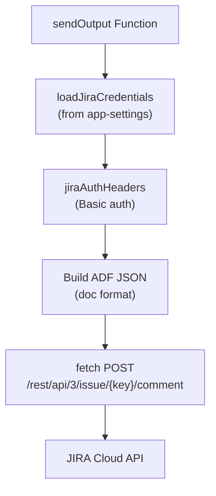

### ADF Format

JIRA comments use Atlassian Document Format:

```json
{
  "body": {
    "type": "doc",
    "version": 1,
    "content": [{
      "type": "paragraph",
      "content": [
        { "type": "text", "text": "Comment message here" }
      ]
    }]
  }
}
```

### Authentication

JIRA credentials are loaded from:
1. Automation source config (if specified)
2. App settings file: `~/.dorothy/app-settings.json`

Credentials include:
- `jiraDomain` - Subdomain (e.g., "mycompany")
- `jiraEmail` - User email
- `jiraApiToken` - API token from JIRA settings

Authorization header format:
```
Authorization: Basic <base64(email:apiToken)>
```

**Sources:**
- [mcp-orchestrator/src/tools/automations.ts:507-530]()
- [mcp-orchestrator/src/tools/automations.ts:339-365]()

---

## JIRA Transition Output

Changes the status of a JIRA issue by triggering a workflow transition. The `template` field specifies the target status name (e.g., "Done", "In Progress").

### Configuration

```typescript
{
  type: "jira_transition",
  enabled: true,
  template: "Done"  // Target status name
}
```

### Implementation

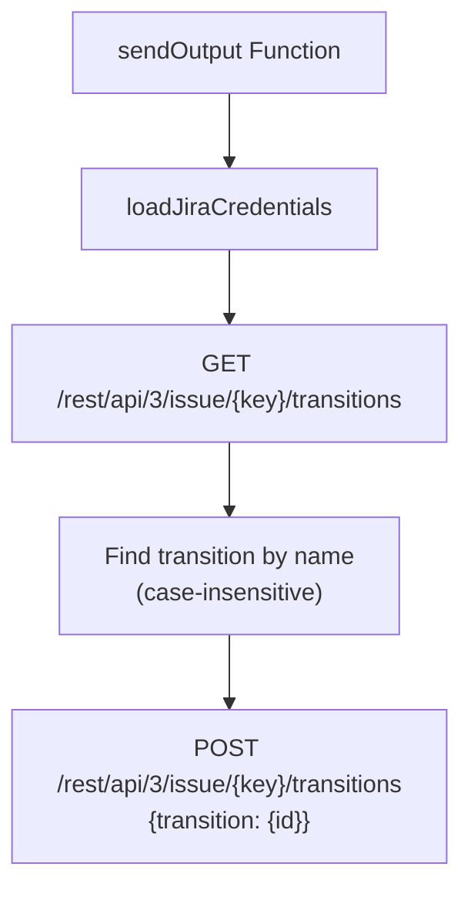

### Workflow Transition Lookup

JIRA transitions are workflow-specific. The system:
1. Fetches available transitions for the issue
2. Matches by name (case-insensitive)
3. Uses the transition ID to perform the status change

Example transitions response:
```json
{
  "transitions": [
    { "id": "21", "name": "Done" },
    { "id": "31", "name": "In Progress" }
  ]
}
```

### Use Cases

Automatically transition issues based on conditions:
- Close issues when PRs are merged
- Move to "In Review" when agent completes
- Set to "Done" when tests pass

**Sources:**
- [mcp-orchestrator/src/tools/automations.ts:532-558]()

---

## Webhook Output

Sends HTTP POST requests to external URLs with automation data. Useful for integrating with custom services or triggering external workflows.

### Configuration

```typescript
{
  type: "webhook",
  enabled: true,
  webhookUrl: "https://example.com/webhook",
  template: "Automation triggered for {{title}}"
}
```

### Security: SSRF Protection

Webhooks implement strict validation to prevent Server-Side Request Forgery (SSRF) attacks:

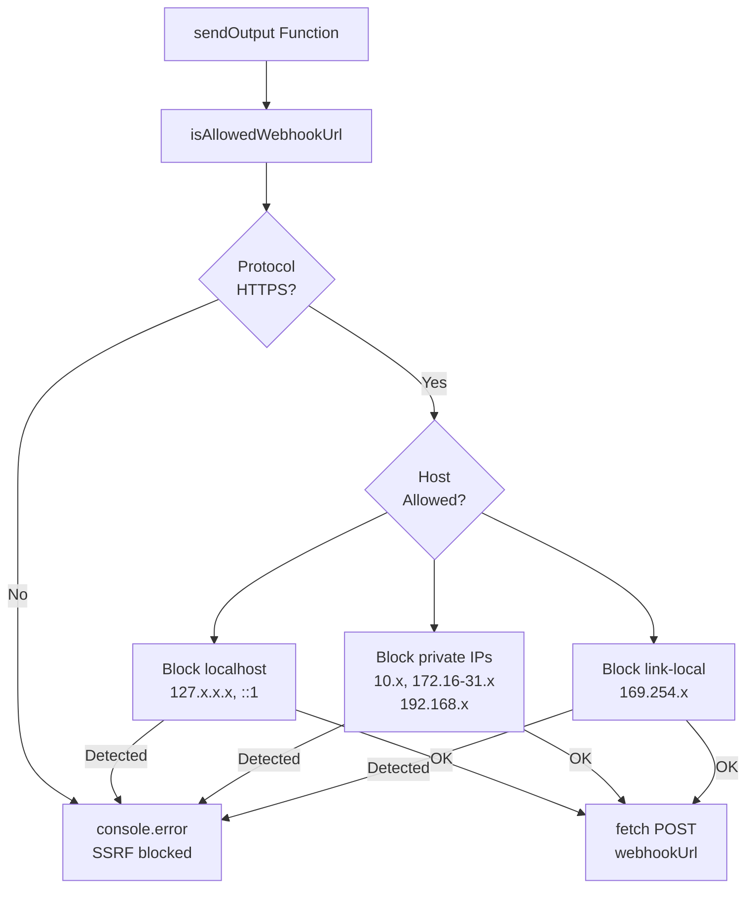

### Request Format

POST body includes interpolated message and all item variables:

```json
{
  "message": "Interpolated message text",
  "title": "PR title",
  "url": "https://...",
  "author": "username",
  ...
}
```

### Blocked Addresses

The following are blocked for security:
- `localhost`, `[::1]`
- `127.x.x.x` (loopback)
- `10.x.x.x` (private class A)
- `172.16.x.x` - `172.31.x.x` (private class B)
- `192.168.x.x` (private class C)
- `169.254.x.x` (link-local)
- `0.x.x.x` (reserved)

**Sources:**
- [mcp-orchestrator/src/tools/automations.ts:560-575]()
- [mcp-orchestrator/src/tools/automations.ts:44-74]()

---

## Template Interpolation

All output types (except `jira_transition` which uses template for status name) support template strings with variable substitution.

### Interpolation Function

```typescript
function interpolateTemplate(
  template: string, 
  variables: Record<string, unknown>
): string
```

The function replaces `{{variableName}}` patterns with values from the variables object. Nested paths are supported: `{{metadata.priority}}`.

### Variable Sources by Source Type

**GitHub Pull Requests:**

| Variable | Description | Example |
|----------|-------------|---------|
| `{{number}}` | PR number | `42` |
| `{{title}}` | PR title | `"Fix critical bug"` |
| `{{url}}` | PR URL | `"https://github.com/..."` |
| `{{author}}` | GitHub username | `"octocat"` |
| `{{body}}` | PR description | `"This PR fixes..."` |
| `{{labels}}` | Comma-separated | `"bug, urgent"` |
| `{{repo}}` | Repository | `"owner/repo"` |
| `{{type}}` | Item type | `"pr"` |

**JIRA Issues:**

| Variable | Description | Example |
|----------|-------------|---------|
| `{{key}}` | Issue key | `"PROJ-123"` |
| `{{summary}}` | Issue summary | `"Add new feature"` |
| `{{status}}` | Current status | `"In Progress"` |
| `{{issueType}}` | Issue type | `"Story"` |
| `{{priority}}` | Priority | `"High"` |
| `{{assignee}}` | Assignee name | `"John Doe"` |
| `{{reporter}}` | Reporter name | `"Jane Smith"` |
| `{{url}}` | JIRA URL | `"https://company.atlassian.net/..."` |
| `{{domain}}` | JIRA domain | `"company"` |

### Template Examples

**Telegram with rich formatting:**
```
🚀 New Release: {{title}}
📦 Version: {{tagName}}
👤 Published by: {{author}}
🔗 {{url}}
```

**Slack with Markdown:**
```
*New PR Opened*
<{{url}}|PR #{{number}}: {{title}}>
_Author:_ {{author}}
_Labels:_ {{labels}}
```

**GitHub comment with agent output:**
```
## Automated Review

{{agentOutput}}

---
_Reviewed by Dorothy agent at {{timestamp}}_
```

**Sources:**
- [mcp-orchestrator/src/utils/automations.ts:307-320]()
- [mcp-orchestrator/src/tools/automations.ts:658-683]()

---

## Agent Output Integration

When agent processing is enabled, automations can include agent output in templates using the `{{agentOutput}}` variable.

### Agent Output Workflow

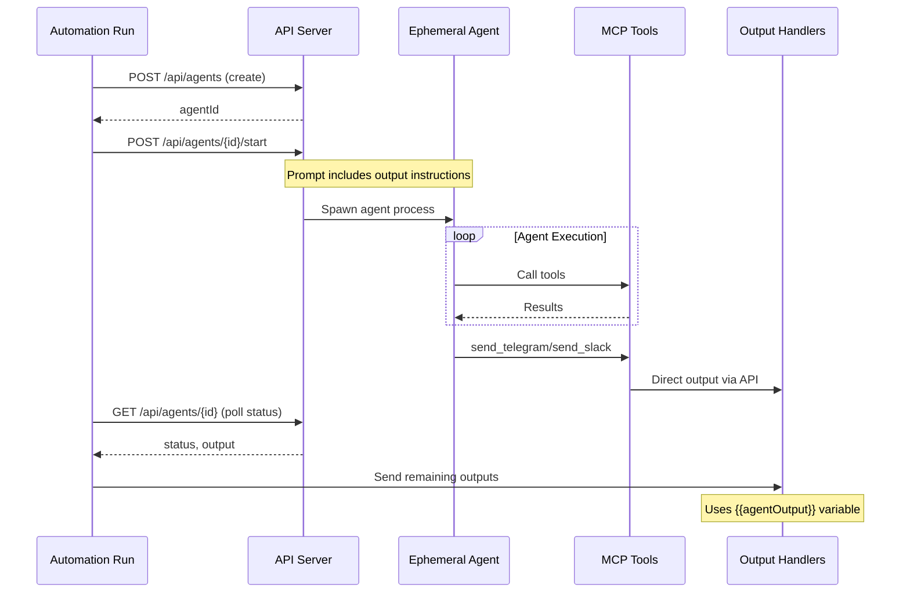

### Output Instructions Injection

When outputs are configured, the automation executor appends instructions to the agent prompt:

```typescript
const outputInstructions: string[] = [];
for (const output of automation.outputs) {
  if (output.type === "telegram") {
    outputInstructions.push(
      "- Use the send_telegram MCP tool to send your final result to Telegram"
    );
  }
  if (output.type === "github_comment") {
    outputInstructions.push(
      `- Post your result as a comment on GitHub PR #${number} in ${repo}`
    );
  }
  // ... other output types
}

const prompt = `${basePrompt}

IMPORTANT INSTRUCTIONS:
- Work autonomously without asking for user feedback
- Generate your content and then send it using the tools below
${outputInstructions.join("\n")}
- Do NOT output explanations or multiple options - just create and send the final content`;
```

This allows agents to directly send outputs using MCP tools during execution, which is more efficient than capturing output and sending it afterward.

**Sources:**
- [mcp-orchestrator/src/tools/automations.ts:688-722]()
- [mcp-orchestrator/src/tools/automations.ts:724-751]()

---

## Configuration in UI

The Automations UI provides checkboxes and text inputs for configuring outputs during automation creation.

### Output Section

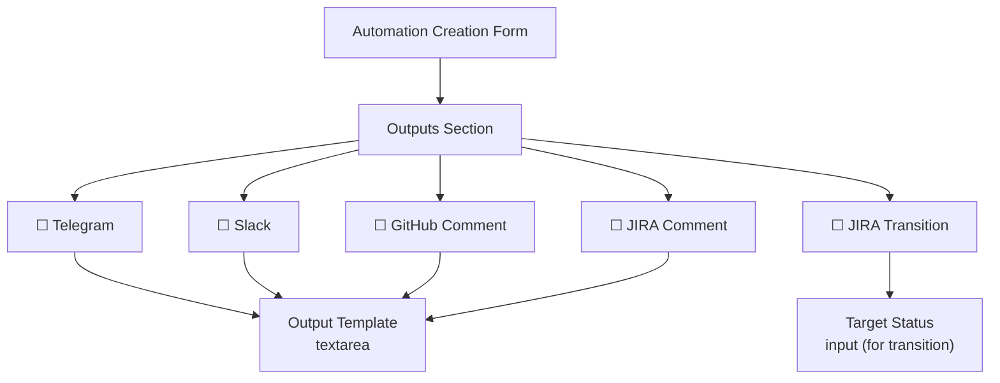

### Form State

The form maintains output state:

```typescript
const [formData, setFormData] = useState({
  // ... other fields
  outputTelegram: false,
  outputSlack: false,
  outputGitHubComment: false,
  outputJiraComment: false,
  outputJiraTransition: false,
  jiraTransitionTarget: 'Done',
  outputTemplate: '',
});
```

### Output Array Construction

On form submission, enabled outputs are assembled into the `outputs` array:

```typescript
const outputs: Automation['outputs'] = [];
if (params.outputTelegram) {
  outputs.push({ 
    type: 'telegram', 
    enabled: true, 
    template: params.outputTemplate 
  });
}
if (params.outputSlack) {
  outputs.push({ 
    type: 'slack', 
    enabled: true, 
    template: params.outputTemplate 
  });
}
// ... other output types
if (params.outputJiraTransition) {
  outputs.push({ 
    type: 'jira_transition', 
    enabled: true, 
    template: params.jiraTransitionTarget 
  });
}
```

**Sources:**
- [src/app/automations/page.tsx:152-159]()
- [src/app/automations/page.tsx:416-433]()
- [electron/handlers/automation-handlers.ts:416-432]()

---

## Output Status Display

The Automations page displays enabled outputs with icons for each automation:

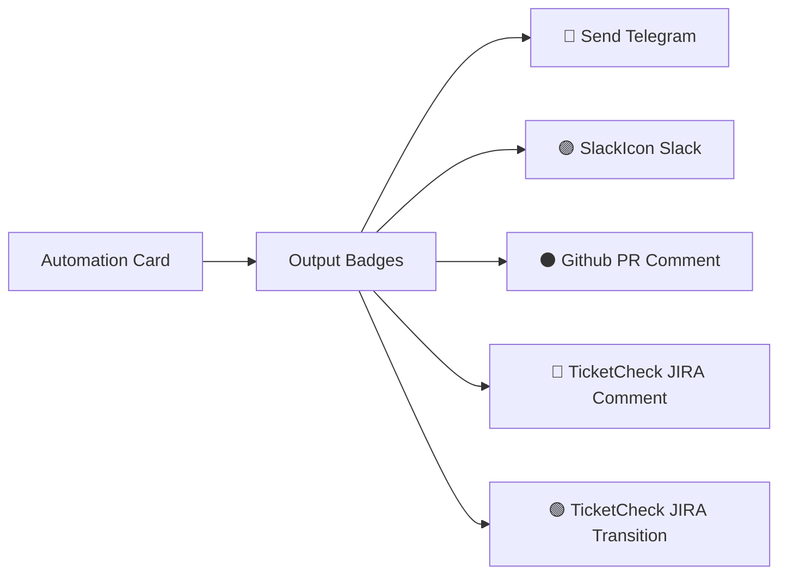

Each badge shows:
- Icon (component or emoji)
- Output type name
- Color coding (blue for Telegram, purple for Slack, etc.)

**Sources:**
- [src/app/automations/page.tsx:533-566]()

---

## Error Handling

Output errors are caught and logged but do not stop the automation run. If one output fails, other outputs still execute.

### Error Scenarios

| Output Type | Error Condition | Handling |
|-------------|----------------|----------|
| `telegram` | Bot not configured | Log error, continue |
| `slack` | App not configured | Log error, continue |
| `github_comment` | Invalid repo format | Throw error, skip output |
| `github_comment` | `gh` CLI not found | Shell error, continue |
| `jira_comment` | Invalid credentials | Log error, continue |
| `jira_transition` | Transition not found | No action, continue |
| `webhook` | SSRF violation | Log block, continue |
| `webhook` | Network error | Fetch error, continue |

### Logging

Errors are logged to:
1. Automation run logs: `~/.dorothy/logs/automation-{id}.log`
2. Console output (for debugging)

**Sources:**
- [mcp-orchestrator/src/tools/automations.ts:574-575]()
- [mcp-orchestrator/src/tools/automations.ts:495-499]()

---

## Output Testing

Outputs can be tested by manually running an automation from the UI using the "Run now" button. This triggers immediate execution and output delivery.

### Manual Run Flow

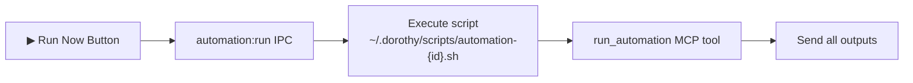

The automation script spawns detached to run asynchronously:

```typescript
spawn('bash', [scriptPath], {
  detached: true,
  stdio: 'ignore',
}).unref();
```

**Sources:**
- [electron/handlers/automation-handlers.ts:540-563]()
- [src/app/automations/page.tsx:308-328]()

---

