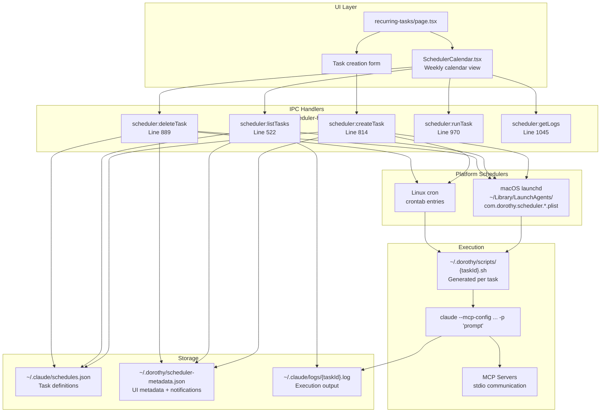
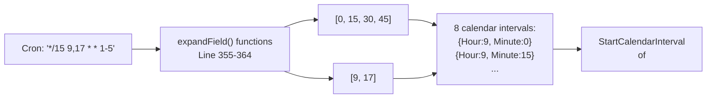
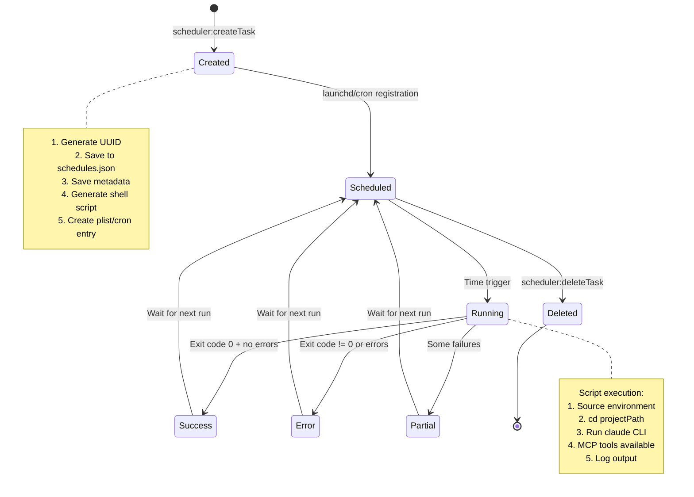
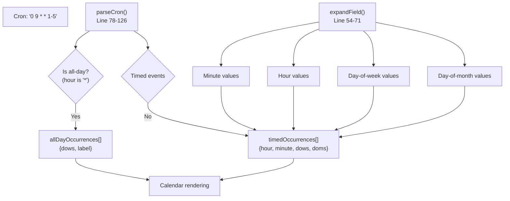

<!-- source: DeepWiki mcp.deepwiki.com · repo Charlie85270/Dorothy · page 8 Scheduler · fetched 2026-10-26 -->

# Scheduler

<details>
<summary>Relevant source files</summary>

The following files were used as context for generating this wiki page:

- [electron/handlers/automation-handlers.ts](electron/handlers/automation-handlers.ts)
- [electron/handlers/scheduler-handlers.ts](electron/handlers/scheduler-handlers.ts)
- [mcp-orchestrator/src/utils/scheduler.ts](mcp-orchestrator/src/utils/scheduler.ts)
- [src/app/automations/page.tsx](src/app/automations/page.tsx)
- [src/components/AgentWorld/AgentCharacter.tsx](src/components/AgentWorld/AgentCharacter.tsx)
- [src/components/SchedulerCalendar.tsx](src/components/SchedulerCalendar.tsx)

</details>


The Scheduler system provides cron-based recurring task execution for automated agent workflows. It enables users to schedule Claude CLI sessions to run at specific times or intervals, with full MCP tool access. The scheduler uses platform-native scheduling mechanisms: macOS launchd for Darwin systems and cron for Linux.

For one-time or ephemeral agent executions, see [Agents](#3). For polling-based automations that trigger on external events, see [Automations](#7).

---

## Task Model

A scheduled task (`ScheduledTask`) represents a recurring Claude CLI execution with the following properties:

| Property | Type | Description |
|----------|------|-------------|
| `id` | `string` | Unique identifier (UUID v4) |
| `title` | `string` (optional) | Human-readable task name |
| `prompt` | `string` | Instruction passed to Claude CLI via `-p` flag |
| `schedule` | `string` | Cron expression (5 fields: `minute hour day month weekday`) |
| `scheduleHuman` | `string` | Human-readable schedule (e.g., "Daily at 9:00 AM") |
| `projectPath` | `string` | Working directory for task execution |
| `autonomous` | `boolean` | Whether to use `--dangerously-skip-permissions` flag |
| `agentId` | `string` (optional) | Link to agent for provider resolution |
| `agentName` | `string` (optional) | Agent name for display |
| `notifications` | `object` | Telegram/Slack notification settings |
| `lastRun` | `string` (optional) | ISO timestamp of last execution |
| `lastRunStatus` | `'success' \| 'error' \| 'running' \| 'partial'` | Execution outcome |
| `nextRun` | `string` (optional) | Calculated next execution time |

Tasks inject a status-reporting instruction into the prompt, instructing Claude to call the `update_scheduled_task_status` MCP tool to report progress.

**Sources:** [electron/handlers/scheduler-handlers.ts:59-72](), [electron/handlers/scheduler-handlers.ts:524-540]()

---

## Architecture Overview



**Sources:** [electron/handlers/scheduler-handlers.ts:509-1127](), [src/components/SchedulerCalendar.tsx:1-704]()

---

## Platform Implementation

### macOS: launchd Jobs

On macOS, the scheduler creates launchd property list files in `~/Library/LaunchAgents/` with the label format `com.dorothy.scheduler.{taskId}.plist`. The launchd job specifies:

- **ProgramArguments:** Executes `/bin/bash` with the generated script path
- **StartCalendarInterval:** Dictionary with `Minute`, `Hour`, `Day`, `Weekday` keys for scheduling
- **StandardOutPath / StandardErrorPath:** Log file destinations
- **RunAtLoad:** Set to `false` to prevent immediate execution

The `createLaunchdJob()` function handles complex cron expressions by expanding step patterns (`*/3`) and comma-separated values into multiple calendar interval entries:



Jobs are registered with `launchctl bootstrap gui/{uid} {plistPath}` and unregistered with `launchctl bootout gui/{uid}/{label}`.

**Sources:** [electron/handlers/scheduler-handlers.ts:304-428](), [electron/handlers/scheduler-handlers.ts:354-389]()

### Linux: cron Jobs

On Linux, the scheduler appends cron entries to the user's crontab with the format:

```
{minute} {hour} {day} {month} {weekday} {scriptPath} # dorothy-{taskId}
```

The `createCronJob()` function reads the existing crontab, appends the new entry, and writes it back using `crontab -`:

**Sources:** [electron/handlers/scheduler-handlers.ts:430-504](), [mcp-orchestrator/src/utils/scheduler.ts:262-351]()

---

## Script Generation and Execution

### Shell Script Structure

Each task generates a dedicated shell script at `~/.dorothy/scripts/{taskId}.sh`:

1. **Environment Setup:**
   - Sources nvm if present (`~/.nvm/nvm.sh`)
   - Sources shell profile (`.bashrc`, `.bash_profile`, or `.zshrc`)
   - Sets `PATH` to include the directory containing the provider binary

2. **Execution:**
   - Changes to `projectPath`
   - Echoes start marker with timestamp
   - Runs Claude CLI with:
     - `--dangerously-skip-permissions` (if autonomous)
     - `--mcp-config ~/.claude/mcp.json`
     - `-p '{prompt with status instructions}'`
   - Echoes completion marker with timestamp

3. **Logging:** All stdout/stderr redirects to `~/.claude/logs/{taskId}.log`

The script generation is provider-aware, using the provider's `buildScheduledScript()` method to handle provider-specific CLI invocations.

**Sources:** [electron/handlers/scheduler-handlers.ts:326-352](), [electron/handlers/scheduler-handlers.ts:332-334]()

### Provider Resolution

Tasks can specify an `agentId` to inherit the agent's provider. The resolution order is:

1. Agent's provider (if `agentId` is set and agent exists)
2. Default provider from `app-settings.json`
3. Fallback to `'claude'`

The resolved provider determines which CLI binary to execute and how to construct the command.

**Sources:** [electron/handlers/scheduler-handlers.ts:859-860](), [electron/handlers/scheduler-handlers.ts:20-23]()

---

## Storage and Metadata

### Schedule Definitions: `~/.claude/schedules.json`

Stores the core task configuration as an array of objects with fields: `id`, `prompt`, `schedule`, `projectPath`, `autonomous`, `worktree`. This file is shared with the `claude-code-scheduler` plugin for compatibility.

**Sources:** [electron/handlers/scheduler-handlers.ts:546-549](), [electron/handlers/scheduler-handlers.ts:831-856]()

### UI Metadata: `~/.dorothy/scheduler-metadata.json`

Stores Dorothy-specific metadata indexed by task ID:

```typescript
{
  [taskId: string]: {
    title?: string;
    agentId?: string;
    agentName?: string;
    provider?: AgentProvider;
    notifications: {
      telegram: boolean;
      slack: boolean;
    };
    createdAt: string;
    lastRunStatus?: 'success' | 'error' | 'running' | 'partial';
    lastRun?: string;
    lastRunSummary?: string;
  }
}
```

The `lastRunStatus` is updated when Claude calls the `update_scheduled_task_status` MCP tool during execution.

**Sources:** [electron/handlers/scheduler-handlers.ts:59-72](), [electron/handlers/scheduler-handlers.ts:74-122]()

### Legacy Task Discovery

The `scheduler:listTasks` handler aggregates tasks from multiple sources:

1. Global `~/.claude/schedules.json`
2. Project-level `~/.claude/projects/*/schedules.json`
3. Direct launchd plist scanning (`~/Library/LaunchAgents/com.claude.schedule.*.plist` and `com.dorothy.scheduler.*.plist`)

This ensures tasks created by the legacy `claude-code-scheduler` plugin are visible in Dorothy.

**Sources:** [electron/handlers/scheduler-handlers.ts:522-811](), [electron/handlers/scheduler-handlers.ts:660-804]()

---

## Execution Logging and Status

### Log File Format

Execution logs use markers to segment individual runs:

```
=== Task started at 2024-01-15T09:00:00.123Z ===
[Claude CLI output]
=== Task completed at 2024-01-15T09:02:30.456Z ===
```

The `getLastRunStatus()` function parses logs to determine success/error by:

1. Finding the last `=== Task started at` marker
2. Examining content after that marker for error indicators
3. Returning `'error'` if "error" or "Error" strings are present, otherwise `'success'`

This ensures old run failures don't pollute the current status.

**Sources:** [electron/handlers/scheduler-handlers.ts:90-110](), [electron/handlers/scheduler-handlers.ts:96-104]()

### Real-time Log Streaming

The `scheduler:getLogs` handler supports real-time streaming by maintaining `logWatchers` (a Map of FSWatcher instances). When a client subscribes, it:

1. Reads the current log content from `offset` position
2. Watches the file for changes
3. Emits new content via IPC events

**Sources:** [electron/handlers/scheduler-handlers.ts:27-28](), [electron/handlers/scheduler-handlers.ts:1045-1127]()

---

## Task Lifecycle



**Sources:** [electron/handlers/scheduler-handlers.ts:814-886](), [electron/handlers/scheduler-handlers.ts:889-969]()

### Manual Execution

The `scheduler:runTask` handler allows immediate execution by spawning the task's shell script in a detached process:

```typescript
spawn('bash', [scriptPath], {
  detached: true,
  stdio: 'ignore',
}).unref();
```

This bypasses the scheduler and runs the task immediately without waiting for the next cron trigger.

**Sources:** [electron/handlers/scheduler-handlers.ts:970-1043](), [electron/handlers/scheduler-handlers.ts:1008-1013]()

---

## Calendar UI

### Cron Expression Parsing

`SchedulerCalendar.tsx` implements a full cron parser that expands expressions into individual time occurrences for visual rendering:



The parser handles:
- **Wildcard (`*`)**: All values in range
- **Step values (`*/3`)**: Every nth value
- **Comma-separated (`1,3,5`)**: Specific values
- **Range (`1-5`)**: Inclusive range
- **Day-of-month specific**: Events that run on specific dates (e.g., monthly on 15th)
- **Day-of-week specific**: Events that run on specific weekdays

**Sources:** [src/components/SchedulerCalendar.tsx:54-126](), [src/components/SchedulerCalendar.tsx:78-126]()

### Event Rendering

The calendar displays events in a weekly grid with:

1. **All-day/Hourly events:** Compact row above the time grid for frequent tasks
2. **Timed events:** Positioned by hour/minute with visual duration bars
3. **Overlap handling:** `layoutEvents()` uses a greedy lane assignment algorithm to prevent overlapping events

**Sources:** [src/components/SchedulerCalendar.tsx:157-200](), [src/components/SchedulerCalendar.tsx:282-315]()

### Task Duration Estimation

The calendar loads task execution logs to calculate average run durations for visual sizing:

1. Fetches last 10 runs via `scheduler:getLogs`
2. Filters for completed runs with both `startedAt` and `completedAt`
3. Computes average duration in minutes
4. Falls back to 30 minutes if no data available

**Sources:** [src/components/SchedulerCalendar.tsx:244-272]()

### Interactive Tooltip

Clicking an event opens a floating tooltip positioned near the clicked element, containing:

- Task title and schedule
- Human-readable schedule and estimated duration
- Last run status badge
- Task prompt (truncated)
- Action buttons: Run Now, View Logs, Edit, Delete

The tooltip uses React portals to render outside the calendar container for proper z-index stacking.

**Sources:** [src/components/SchedulerCalendar.tsx:609-700](), [src/components/SchedulerCalendar.tsx:371-382]()

---

## CLI Path Resolution

The scheduler must locate the correct CLI binary for each provider. The resolution strategy (used by `getCLIPath()`) is:

1. **User-configured path:** Check `app-settings.json` `cliPaths[binaryName]`
2. **Shell `which` command:** Spawn `/bin/bash -l -c "which {binaryName}"` to get PATH-resolved location
3. **nvm detection:** Scan `~/.nvm/versions/node/*/bin/` for Node.js-based CLIs
4. **Common paths:** Check `/usr/local/bin/`, `/opt/homebrew/bin/`, `~/.local/bin/`
5. **Fallback:** `/usr/local/bin/{binaryName}`

This ensures compatibility with version managers (nvm, Homebrew) and custom installations.

**Sources:** [electron/handlers/scheduler-handlers.ts:226-259](), [electron/handlers/scheduler-handlers.ts:245-258]()

---

## Cron Expression Utilities

### Human Conversion: `cronToHuman()`

Converts standard 5-field cron expressions to readable strings:

| Cron | Output |
|------|--------|
| `* * * * *` | "Every minute" |
| `0 * * * *` | "Every hour" |
| `30 9 * * *` | "Daily at 9:30 AM" |
| `0 9 * * 1-5` | "Weekdays at 9:00 AM" |
| `0 9 * * 1` | "Mondays at 9:00 AM" |
| `0 9 15 * *` | "Monthly on the 15th at 9:00 AM" |

**Sources:** [electron/handlers/scheduler-handlers.ts:124-180](), [mcp-orchestrator/src/utils/scheduler.ts:62-102]()

### Next Run Calculation: `getNextRunTime()`

Computes the next execution timestamp by:

1. Parsing cron fields (minute, hour, day-of-month, day-of-week)
2. Setting the time on a Date object based on specified fields
3. Advancing to the next matching day if constraints aren't met
4. Returning ISO timestamp

This powers the `nextRun` field displayed in the calendar.

**Sources:** [electron/handlers/scheduler-handlers.ts:182-223](), [mcp-orchestrator/src/utils/scheduler.ts:107-143]()

---

## Integration with Automations

While the scheduler is a general-purpose task runner, automations leverage the same infrastructure for periodic polling. When an automation is created via `automation:create`, it:

1. Converts the schedule (interval or cron) into a standard cron expression
2. Generates a shell script that runs Claude with the `run_automation` MCP tool
3. Creates a launchd/cron job identical to scheduled tasks

This architecture allows automations to be scheduled using the same reliable platform mechanisms.

**Sources:** [electron/handlers/automation-handlers.ts:226-278](), [electron/handlers/automation-handlers.ts:256-274]()

---

