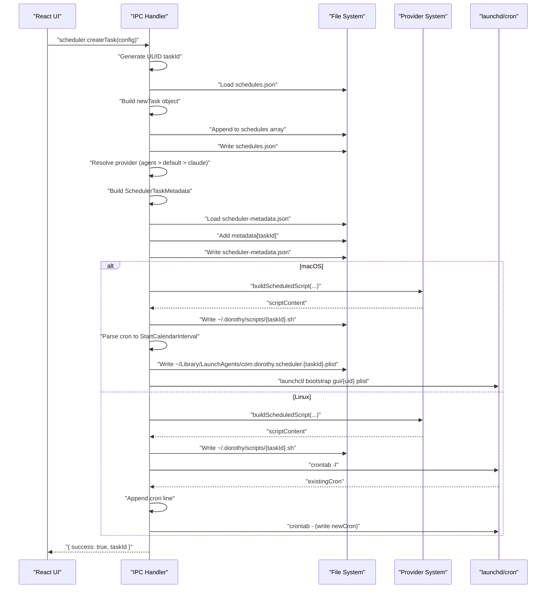
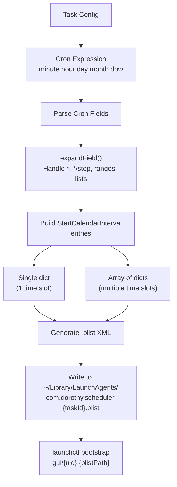
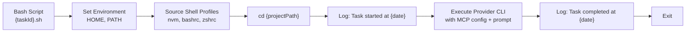
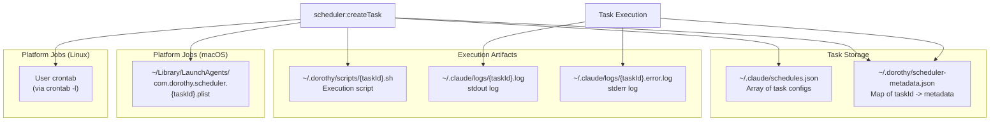

<!-- source: DeepWiki mcp.deepwiki.com · repo Charlie85270/Dorothy · page 8.1 Creating Scheduled Tasks · fetched 2026-10-26 -->

# Creating Scheduled Tasks

<details>
<summary>Relevant source files</summary>

The following files were used as context for generating this wiki page:

- [electron/handlers/automation-handlers.ts](electron/handlers/automation-handlers.ts)
- [electron/handlers/scheduler-handlers.ts](electron/handlers/scheduler-handlers.ts)
- [mcp-orchestrator/src/utils/scheduler.ts](mcp-orchestrator/src/utils/scheduler.ts)
- [src/app/automations/page.tsx](src/app/automations/page.tsx)
- [src/components/AgentWorld/AgentCharacter.tsx](src/components/AgentWorld/AgentCharacter.tsx)
- [src/components/SchedulerCalendar.tsx](src/components/SchedulerCalendar.tsx)

</details>


This page explains how to create scheduled tasks in Dorothy's scheduler system. Scheduled tasks are recurring jobs that execute AI agents at specified intervals using cron expressions. Tasks run autonomously in the background via platform-specific scheduling mechanisms (launchd on macOS, cron on Linux).

For information about viewing and managing scheduled tasks in the calendar UI, see [Scheduler Calendar](#8.2). For general automation workflows that poll external sources, see [Automations](#7).

---

## Overview

Scheduled tasks enable recurring execution of AI agents at predetermined times. Each task consists of:

- **Schedule**: A cron expression defining when the task runs
- **Prompt**: The instruction given to the AI agent
- **Project Path**: The working directory for execution
- **Provider**: The AI CLI provider (`claude`, `codex`, `gemini`, or `tasmania`)
- **Metadata**: Optional title, agent association, and notification settings

Tasks are created through the `scheduler:createTask` IPC handler and persist across system restarts using platform-native scheduling.

**Sources**: [electron/handlers/scheduler-handlers.ts:814-886]()

---

## Task Configuration Object

The `scheduler:createTask` handler accepts a configuration object with the following fields:

| Field | Type | Required | Description |
|-------|------|----------|-------------|
| `title` | string | No | Human-readable task name (displayed in UI) |
| `prompt` | string | Yes | The instruction/prompt given to the AI agent |
| `schedule` | string | Yes | Cron expression (5 fields: `minute hour day month dow`) |
| `projectPath` | string | Yes | Working directory for task execution |
| `agentId` | string | No | ID of associated agent (for tracking/UI purposes) |
| `agentName` | string | No | Name of associated agent |
| `autonomous` | boolean | No | Whether to run with `--dangerously-skip-permissions` flag (default: `true`) |
| `worktree` | object | No | Git worktree configuration: `{ enabled: boolean, branchPrefix?: string }` |
| `notifications` | object | No | Notification channels: `{ telegram: boolean, slack: boolean }` |

**Sources**: [electron/handlers/scheduler-handlers.ts:814-824]()

---

## Cron Expression Format

Schedules use standard 5-field cron syntax:

```
minute hour day-of-month month day-of-week
*      *    *            *     *
```

### Field Values

| Field | Range | Special Characters |
|-------|-------|-------------------|
| Minute | 0-59 | `*` `,` `-` `/` |
| Hour | 0-23 | `*` `,` `-` `/` |
| Day of Month | 1-31 | `*` `,` `-` `/` |
| Month | 1-12 | `*` `,` `-` `/` |
| Day of Week | 0-7 (0 and 7 = Sunday) | `*` `,` `-` `/` |

### Common Examples

```bash
# Every 15 minutes
*/15 * * * *

# Daily at 9:00 AM
0 9 * * *

# Weekdays at 6:00 PM
0 18 * * 1-5

# Every Monday at 10:30 AM
30 10 * * 1

# Multiple times: 9 AM, 12 PM, 3 PM daily
0 9,12,15 * * *

# Every 3 hours
0 */3 * * *

# Monthly on the 1st at midnight
0 0 1 * *
```

The system converts these expressions to human-readable labels using `cronToHuman()` for display in the UI.

**Sources**: [electron/handlers/scheduler-handlers.ts:124-180](), [mcp-orchestrator/src/utils/scheduler.ts:62-102]()

---

## Task Creation Flow



**Sources**: [electron/handlers/scheduler-handlers.ts:814-886]()

### Step-by-Step Process

1. **Generate Task ID**: A unique UUID is created using `uuidv4()` [electron/handlers/scheduler-handlers.ts:826]()

2. **Persist to schedules.json**: The task is appended to the global schedules array at `~/.dorothy/.claude/schedules.json` [electron/handlers/scheduler-handlers.ts:831-856]()

3. **Resolve Provider**: Determines which AI CLI to use:
   - If `agentId` provided, uses that agent's provider
   - Otherwise uses `defaultProvider` from app settings
   - Falls back to `'claude'` [electron/handlers/scheduler-handlers.ts:859-860]()

4. **Save Metadata**: Stores task metadata in `~/.dorothy/scheduler-metadata.json` including title, agent association, provider, and notification settings [electron/handlers/scheduler-handlers.ts:863-872]()

5. **Create Platform Job**: Branches based on OS platform:
   - **macOS**: Creates launchd plist and registers with `launchctl` [electron/handlers/scheduler-handlers.ts:876]()
   - **Linux**: Adds entry to user's crontab [electron/handlers/scheduler-handlers.ts:878]()

**Sources**: [electron/handlers/scheduler-handlers.ts:814-886]()

---

## Platform-Specific Implementation

### macOS: launchd Jobs

On macOS, tasks are registered as user-level LaunchAgents using property list (plist) files.

#### Plist Generation



**Sources**: [electron/handlers/scheduler-handlers.ts:304-428]()

#### Cron to StartCalendarInterval Conversion

The system parses cron expressions and converts them to launchd's `StartCalendarInterval` format, which supports:

- **Single time slots**: Rendered as a `<dict>` with `Minute`, `Hour`, `Day`, `Weekday` keys
- **Multiple time slots**: Rendered as an `<array>` of `<dict>` entries for complex schedules like `0 9,12,15 * * *` (9am, 12pm, 3pm daily)
- **Step expressions**: `*/3` expands to all matching values (e.g., `*/3` for hours becomes `[0,3,6,9,12,15,18,21]`)

The `expandField()` function handles this expansion [electron/handlers/scheduler-handlers.ts:355-364]():

```typescript
const expandField = (field: string, max: number): (number | undefined)[] => {
  if (field === '*') return [undefined];
  if (field.startsWith('*/')) {
    const step = parseInt(field.slice(2), 10);
    return Array.from({ length: Math.ceil(max / step) }, (_, i) => i * step);
  }
  return field.split(',').map(v => parseInt(v.trim(), 10)).filter(v => !isNaN(v));
};
```

**Sources**: [electron/handlers/scheduler-handlers.ts:354-389]()

#### Plist Structure

The generated plist includes:

| Key | Description |
|-----|-------------|
| `Label` | Unique identifier: `com.dorothy.scheduler.{taskId}` |
| `ProgramArguments` | Array: `["/bin/bash", "{scriptPath}"]` |
| `StartCalendarInterval` | Dict or array of dicts with time specifications |
| `StandardOutPath` | Log file: `~/.claude/logs/{taskId}.log` |
| `StandardErrorPath` | Error log: `~/.claude/logs/{taskId}.error.log` |
| `RunAtLoad` | `false` (don't run on boot) |

**Sources**: [electron/handlers/scheduler-handlers.ts:397-417]()

### Linux: Cron Jobs

On Linux, tasks are added to the user's crontab with a special comment marker for identification.

#### Crontab Entry Format

```bash
{schedule} {scriptPath} # dorothy-{taskId}
```

Example:
```bash
0 */3 * * * /Users/username/.dorothy/scripts/abc123.sh # dorothy-abc123
```

The `# dorothy-{taskId}` comment allows the system to identify and remove specific tasks later.

**Sources**: [electron/handlers/scheduler-handlers.ts:430-504]()

#### Crontab Modification Process

1. Run `crontab -l` to read existing entries [electron/handlers/scheduler-handlers.ts:479]()
2. Append new cron line with marker comment [electron/handlers/scheduler-handlers.ts:483]()
3. Write updated crontab via `crontab -` (stdin) [electron/handlers/scheduler-handlers.ts:484]()

If no crontab exists (first task), the error handler creates one from scratch [electron/handlers/scheduler-handlers.ts:493-502]().

**Sources**: [electron/handlers/scheduler-handlers.ts:430-504]()

---

## Execution Script Generation

Each task generates a bash script at `~/.dorothy/scripts/{taskId}.sh` that handles the actual execution.

### Script Responsibilities



**Sources**: [electron/handlers/scheduler-handlers.ts:332-350](), [electron/handlers/scheduler-handlers.ts:454-471]()

### Provider-Specific Generation

Scripts are generated using the provider system's `buildScheduledScript()` method, which returns provider-specific commands:

```typescript
const cliProvider = getProvider(provider);
const scriptContent = cliProvider.buildScheduledScript({
  binaryPath: claudePath,
  binaryDir: claudeDir,
  projectPath,
  prompt: escapedPrompt,
  autonomous,
  mcpConfigPath,
  logPath,
  homeDir,
});
```

The provider system handles:
- Locating the CLI binary (claude, codex, gemini, etc.)
- Building the appropriate command-line flags
- Handling autonomous mode (`--dangerously-skip-permissions`)
- Configuring MCP server access

**Sources**: [electron/handlers/scheduler-handlers.ts:339-349](), [electron/handlers/scheduler-handlers.ts:461-470]()

### Script Template Structure

```bash
#!/bin/bash

# Source shell profile for proper PATH (nvm, homebrew, etc.)
export HOME="{homeDir}"

if [ -s "{homeDir}/.nvm/nvm.sh" ]; then
  source "{homeDir}/.nvm/nvm.sh" 2>/dev/null || true
fi

if [ -f "{homeDir}/.bashrc" ]; then
  source "{homeDir}/.bashrc" 2>/dev/null || true
elif [ -f "{homeDir}/.bash_profile" ]; then
  source "{homeDir}/.bash_profile" 2>/dev/null || true
elif [ -f "{homeDir}/.zshrc" ]; then
  source "{homeDir}/.zshrc" 2>/dev/null || true
fi

export PATH="{claudeDir}:$PATH"
cd "{projectPath}"
echo "=== Task started at $(date) ===" >> "{logPath}"
"{claudePath}" {flags} --mcp-config "{mcpConfigPath}" -p '{prompt}' >> "{logPath}" 2>&1
echo "=== Task completed at $(date) ===" >> "{logPath}"
```

The script file is made executable with `chmod 755` [electron/handlers/scheduler-handlers.ts:352]().

**Sources**: [mcp-orchestrator/src/utils/scheduler.ts:183-205]()

### Status Reporting Instructions

The system automatically appends status reporting instructions to the prompt:

```typescript
const statusInstruction = `\n\n[IMPORTANT] Use the update_scheduled_task_status MCP tool to report your progress:
1. At the START of your work, call it with task_id="${taskId}" and status="running"
2. When FINISHED successfully, call it with status="success" and a brief summary
3. If ERRORS occurred, use status="error" (total failure) or "partial" (some parts succeeded)`;
```

This enables the agent to report its status via the `update_scheduled_task_status` MCP tool, which updates the metadata file for UI display.

**Sources**: [electron/handlers/scheduler-handlers.ts:332-334](), [electron/handlers/scheduler-handlers.ts:454-456]()

---

## Data Storage Locations



**Sources**: [electron/handlers/scheduler-handlers.ts:25](), [electron/handlers/scheduler-handlers.ts:831-856](), [electron/handlers/scheduler-handlers.ts:863-872]()

---

## Monitoring and Status

### Log File Format

Task logs use marker comments to delineate individual runs:

```
=== Task started at Mon Jan 15 2024 09:00:00 GMT-0800 ===
[Agent output here...]
=== Task completed at Mon Jan 15 2024 09:05:23 GMT-0800 ===
```

The `getLastRunStatus()` function parses these markers to extract the most recent run's status [electron/handlers/scheduler-handlers.ts:90-110]():

```typescript
function getLastRunStatus(logPath: string): { 
  lastRun: string | undefined; 
  lastRunStatus: 'success' | 'error' | undefined 
} {
  // Finds last "=== Task started ===" marker
  // Reads content from that point forward
  // Checks for 'error' or 'Error' keywords
}
```

This ensures old run failures don't pollute the current status.

**Sources**: [electron/handlers/scheduler-handlers.ts:86-110]()

### Status Metadata

The `SchedulerTaskMetadata` interface tracks execution state [electron/handlers/scheduler-handlers.ts:59-72]():

```typescript
interface SchedulerTaskMetadata {
  title?: string;
  agentId?: string;
  agentName?: string;
  provider?: AgentProvider;
  notifications: {
    telegram: boolean;
    slack: boolean;
  };
  createdAt: string;
  lastRunStatus?: 'success' | 'error' | 'running' | 'partial';
  lastRun?: string;
  lastRunSummary?: string;
}
```

Tasks can update their status via the `update_scheduled_task_status` MCP tool, which writes to this metadata file.

**Sources**: [electron/handlers/scheduler-handlers.ts:59-72](), [electron/handlers/scheduler-handlers.ts:74-122]()

---

## Provider Support

### Multi-Provider Execution

Tasks can execute using any configured AI provider:

| Provider | Binary | Default Location |
|----------|--------|------------------|
| `claude` | `claude` | `/usr/local/bin/claude` |
| `codex` | `codex` | `/usr/local/bin/codex` |
| `gemini` | `gemini` | `/usr/local/bin/gemini` |
| `tasmania` | `tasmania` | `/usr/local/bin/tasmania` |

The system resolves the provider in this order:

1. If `agentId` is provided and that agent exists, use the agent's `provider` field
2. Otherwise, use `defaultProvider` from `~/.dorothy/app-settings.json`
3. Fall back to `'claude'`

**Sources**: [electron/handlers/scheduler-handlers.ts:859-860](), [electron/handlers/scheduler-handlers.ts:20-23]()

### CLI Path Resolution

The `getCLIPath()` function locates the provider's binary [electron/handlers/scheduler-handlers.ts:226-259]():

1. **User-configured path**: Checks `cliPaths.{binaryName}` in `~/.dorothy/app-settings.json`
2. **Shell detection**: Runs `which {binaryName}` via bash login shell to respect PATH modifications from nvm, homebrew, etc.
3. **Common paths**: Checks `/usr/local/bin/`, `/opt/homebrew/bin/`, `~/.local/bin/`
4. **nvm detection**: Scans `~/.nvm/versions/node/*/bin/` for Node-based CLIs
5. **Fallback**: Returns `/usr/local/bin/{binaryName}`

This ensures tasks can find CLIs installed via package managers or nvm.

**Sources**: [electron/handlers/scheduler-handlers.ts:226-259]()

---

## Example: Creating a Daily Code Review Task

```typescript
// Create task via IPC
const result = await window.electronAPI.scheduler.createTask({
  title: "Daily Code Review",
  prompt: "Review all pull requests opened in the last 24 hours. For each PR, check for code quality issues, suggest improvements, and add comments on the PR using the github_comment tool.",
  schedule: "0 9 * * 1-5", // 9 AM weekdays
  projectPath: "/Users/dev/projects/myapp",
  agentId: "code-reviewer-123",
  agentName: "CodeReviewer",
  autonomous: true,
  notifications: {
    telegram: true,
    slack: false
  }
});

// Result: { success: true, taskId: "a7b3c9d2" }
```

This creates:
- Script at `~/.dorothy/scripts/a7b3c9d2.sh`
- Launchd plist at `~/Library/LaunchAgents/com.dorothy.scheduler.a7b3c9d2.plist`
- Metadata entry in `~/.dorothy/scheduler-metadata.json`
- Schedule entry in `~/.claude/schedules.json`
- Log files at `~/.claude/logs/a7b3c9d2.log` and `~/.claude/logs/a7b3c9d2.error.log`

The task runs at 9 AM on weekdays, executes the code review prompt, and sends Telegram notifications if configured.

**Sources**: [electron/handlers/scheduler-handlers.ts:814-886]()

---

