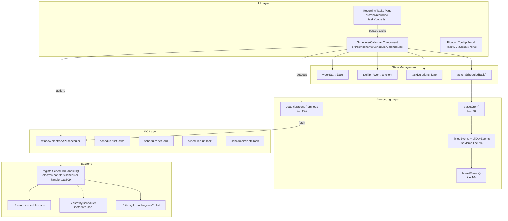
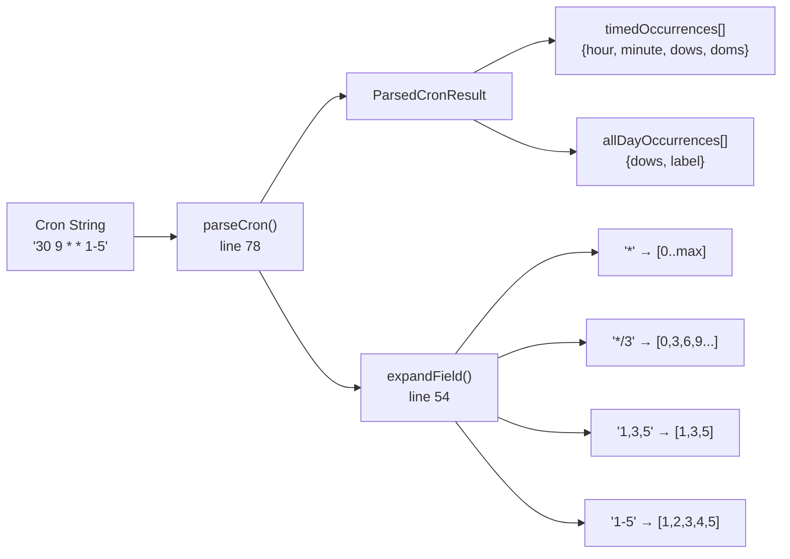
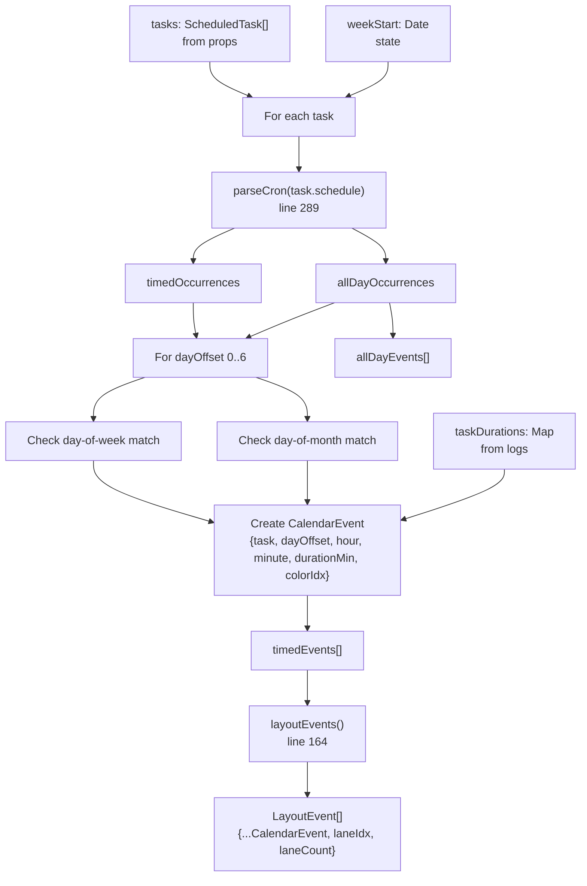
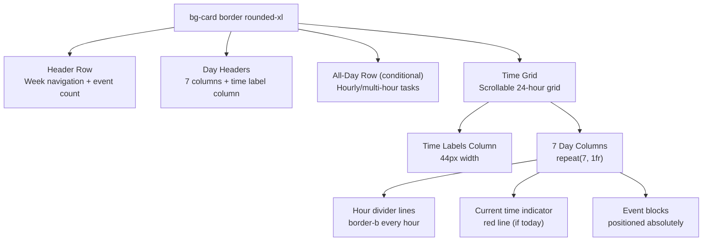
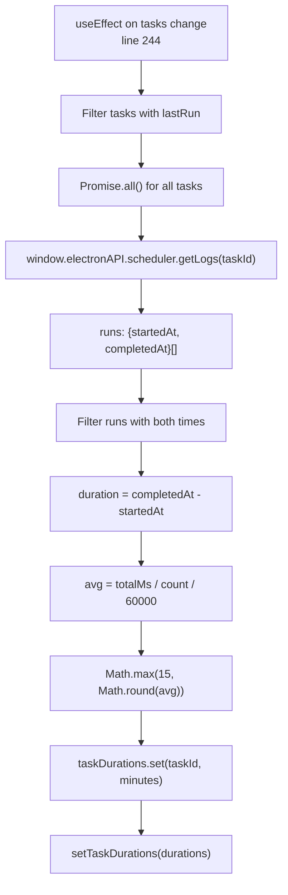
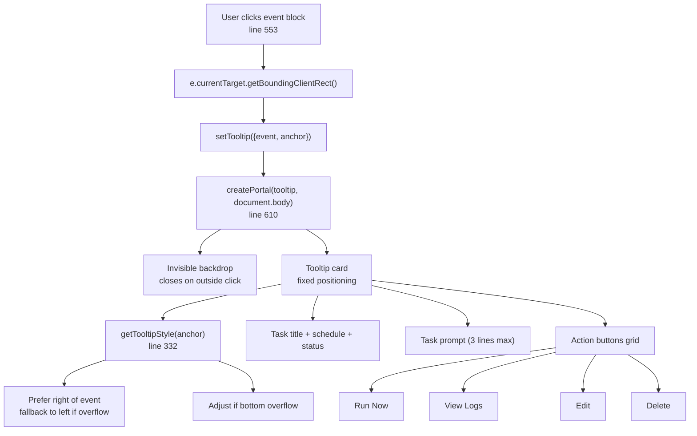
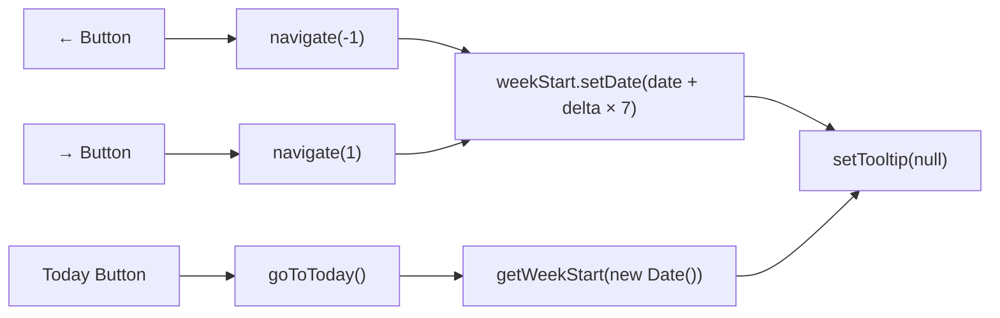
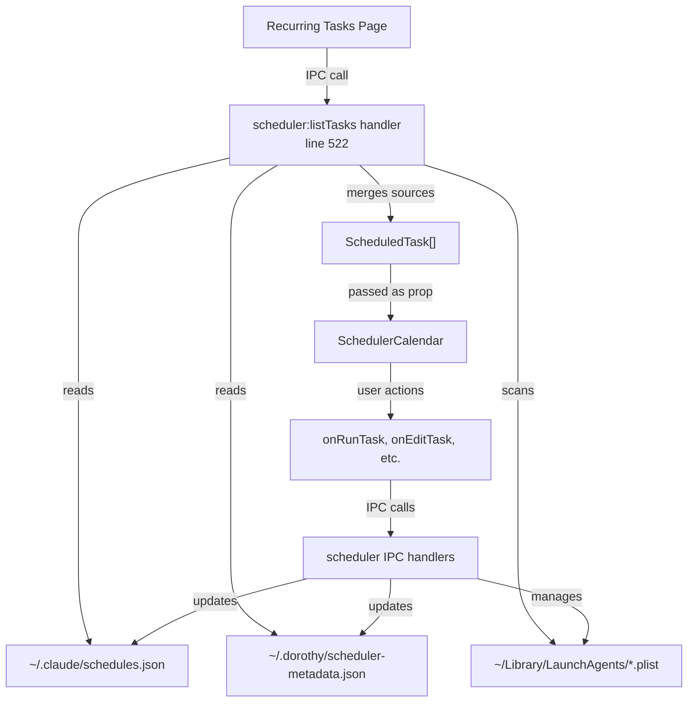

<!-- source: DeepWiki mcp.deepwiki.com · repo Charlie85270/Dorothy · page 8.2 Scheduler Calendar · fetched 2026-10-26 -->

# Scheduler Calendar

<details>
<summary>Relevant source files</summary>

The following files were used as context for generating this wiki page:

- [electron/handlers/automation-handlers.ts](electron/handlers/automation-handlers.ts)
- [electron/handlers/scheduler-handlers.ts](electron/handlers/scheduler-handlers.ts)
- [mcp-orchestrator/src/utils/scheduler.ts](mcp-orchestrator/src/utils/scheduler.ts)
- [src/app/automations/page.tsx](src/app/automations/page.tsx)
- [src/components/AgentWorld/AgentCharacter.tsx](src/components/AgentWorld/AgentCharacter.tsx)
- [src/components/SchedulerCalendar.tsx](src/components/SchedulerCalendar.tsx)

</details>


The Scheduler Calendar provides a visual weekly calendar interface for viewing and managing scheduled tasks. It displays recurring tasks created via the scheduler system as timed events on a week grid, parsing cron expressions to show when tasks will run and allowing users to view logs, edit, delete, or manually trigger tasks.

For information about creating and managing scheduled tasks themselves, see [Creating Scheduled Tasks](#8.1). For broader automation workflows that integrate GitHub/JIRA polling, see [Automations](#7).

---

## Purpose and Scope

The `SchedulerCalendar` component ([src/components/SchedulerCalendar.tsx]()) renders scheduled tasks as visual events on a week-based calendar. It handles:

- **Cron expression parsing** into specific occurrence times
- **Week navigation** with today highlighting
- **Event layout** with overlap detection and lane assignment
- **Interactive tooltips** for task actions (run, edit, delete, view logs)
- **Duration estimation** from historical log data
- **Real-time indicators** for currently running tasks and current time

The calendar is consumed by the recurring tasks page ([src/app/recurring-tasks/page.tsx]()) which provides task management controls and integrates with the scheduler IPC handlers.

---

## Architecture Overview



**Sources**: [src/components/SchedulerCalendar.tsx:1-704](), [electron/handlers/scheduler-handlers.ts:509-886]()

---

## Cron Expression Parsing

The calendar interprets standard 5-field cron expressions to determine when tasks occur within the displayed week.

### Parse Flow



**Sources**: [src/components/SchedulerCalendar.tsx:54-126]()

### Field Expansion Logic

| Cron Field | Example | Expanded Result | Notes |
|------------|---------|-----------------|-------|
| `*` | `* * * * *` | All values | Every minute/hour/day |
| `*/N` | `*/15 * * * *` | `[0, 15, 30, 45]` | Step pattern |
| `N` | `30 9 * * *` | `[30]`, `[9]` | Single value |
| `N,M` | `30 9,17 * * *` | `[9, 17]` | Multiple values |
| `N-M` | `* * * * 1-5` | `[1,2,3,4,5]` | Range of values |

**Sources**: [src/components/SchedulerCalendar.tsx:54-71]()

### All-Day vs Timed Events

Events are classified based on the hour field:

- **All-day events**: `hourStr === '*'` or `hourStr.startsWith('*/')` — displayed in a compact row above the time grid with labels like "Hourly" or "Every 3h"
- **Timed events**: Specific hours/minutes — displayed as blocks in the time grid

**Sources**: [src/components/SchedulerCalendar.tsx:97-125]()

---

## Event Generation and Layout

### Event Generation Pipeline



**Sources**: [src/components/SchedulerCalendar.tsx:282-315]()

### Overlap Detection and Lane Assignment

The calendar uses a greedy lane assignment algorithm to prevent overlapping events from obscuring each other:

1. **Sort events** by start time (hour × 60 + minute)
2. **Track lane end times**: Each lane tracks when the last event in that lane ends
3. **Assign to first free lane**: Find the first lane whose last event has ended before this event starts
4. **Create new lane if needed**: If all lanes are occupied, create a new lane
5. **Calculate max overlap**: For each event, determine the maximum lane index of all overlapping events to set `laneCount`

Each event is then positioned with:
- `left: calc({laneIdx / laneCount * 100}% + {GAP}px)`
- `width: calc({100 / laneCount}% - {GAP * 2}px)`

**Sources**: [src/components/SchedulerCalendar.tsx:164-200]()

---

## Calendar Rendering

### Grid Structure



**Sources**: [src/components/SchedulerCalendar.tsx:388-606]()

### Grid Dimensions

| Component | Dimension | Variable |
|-----------|-----------|----------|
| Time label column | `44px` | Fixed width |
| Day columns | `1fr` each | Equal distribution |
| Hour height | `52px` | `HOUR_HEIGHT` constant |
| Total grid height | `24 × 52px = 1248px` | |
| Visible height | `480px` | Scrollable viewport |
| Gap between events | `2px` | `GAP` constant |

**Sources**: [src/components/SchedulerCalendar.tsx:13-15]()

### Event Block Rendering

Events are positioned absolutely within their day column:

```typescript
style={{
  top: `${(hour * 60 + minute) / 60 * HOUR_HEIGHT}px`,
  height: `${Math.max(22, (durationMin / 60) * HOUR_HEIGHT)}px`,
  left: `calc(${laneIdx * 100 / laneCount}% + ${GAP}px)`,
  width: `calc(${100 / laneCount}% - ${GAP * 2}px)`,
}}
```

**Single-line compact layout** (height < 38px):
- Dot indicator + title + time in one line
- Used for short duration tasks

**Two-line layout** (height ≥ 38px):
- Time on first line with dot indicator
- Title/prompt on second line
- Provides better readability for longer tasks

**Sources**: [src/components/SchedulerCalendar.tsx:550-599]()

---

## Task Duration Estimation

The calendar estimates task execution duration by analyzing historical log data:

### Duration Loading Process



**Sources**: [src/components/SchedulerCalendar.tsx:244-272]()

### Duration Display

- Minimum duration: **15 minutes**
- Default (no history): **30 minutes** (`DEFAULT_DURATION_MIN`)
- Displayed in tooltip: `~{duration}min`
- Used for event block height calculation

**Sources**: [src/components/SchedulerCalendar.tsx:15, 262]()

---

## Interactive Tooltips

### Tooltip Architecture

The calendar uses React portals to render floating tooltips outside the scrollable grid, ensuring they're never clipped:



**Sources**: [src/components/SchedulerCalendar.tsx:371-382, 609-701]()

### Tooltip Positioning Logic

The tooltip intelligently positions itself to remain visible:

1. **Default**: `left = anchor.right + 10` (10px to the right of clicked event)
2. **Overflow check**: If `left + TOOLTIP_WIDTH > viewport.width - 12`, position to the left: `left = anchor.left - TOOLTIP_WIDTH - 10`
3. **Vertical adjustment**: If `top + TOOLTIP_HEIGHT > viewport.height - 12`, move up to fit
4. **Minimum padding**: Ensure at least 8px from all edges

**Width**: `288px` (`TOOLTIP_WIDTH` constant)  
**Estimated height**: `220px`

**Sources**: [src/components/SchedulerCalendar.tsx:10, 332-342]()

### Action Handlers

| Button | Handler | IPC Call |
|--------|---------|----------|
| Run Now | `onRunTask(taskId)` | `scheduler:runTask` |
| View Logs | `onViewLogs(taskId)` | `scheduler:getLogs` |
| Edit | `onEditTask(task)` | Opens edit modal in parent |
| Delete | `onDeleteTask(taskId)` | `scheduler:deleteTask` |

All actions close the tooltip after invocation.

**Sources**: [src/components/SchedulerCalendar.tsx:668-695]()

---

## State Management

### Component State

| State | Type | Purpose |
|-------|------|---------|
| `weekStart` | `Date` | First day of displayed week (Sunday at 00:00:00) |
| `taskDurations` | `Map<string, number>` | Estimated duration in minutes per task ID |
| `tooltip` | `{event, anchor} \| null` | Active tooltip data and anchor rect |
| `now` | `Date` | Current time, updated every minute |
| `mounted` | `boolean` | Client-side hydration flag |

**Sources**: [src/components/SchedulerCalendar.tsx:212-217]()

### Week Navigation



Week start is calculated using `getWeekStart()` which sets the date to the previous Sunday at midnight.

**Sources**: [src/components/SchedulerCalendar.tsx:130-135, 318-329]()

### Real-Time Updates

Two intervals maintain live UI state:

1. **Current time line**: Updates `now` every 60 seconds to keep the red time indicator accurate
2. **Scroll on mount**: Auto-scrolls to current time (or 8am) when calendar first renders

**Sources**: [src/components/SchedulerCalendar.tsx:230-241]()

---

## Color Scheme and Visual States

### Task Colors

Each task is assigned a color from a palette of 7 schemes based on its index in the task list:

| Color | Background | Border | Text | Dot |
|-------|-----------|--------|------|-----|
| Blue | `bg-blue-500/15` | `border-blue-500/40` | `text-blue-400` | `bg-blue-500` |
| Violet | `bg-violet-500/15` | `border-violet-500/40` | `text-violet-400` | `bg-violet-500` |
| Emerald | `bg-emerald-500/15` | `border-emerald-500/40` | `text-emerald-400` | `bg-emerald-500` |
| Amber | `bg-amber-500/15` | `border-amber-500/40` | `text-amber-400` | `bg-amber-500` |
| Rose | `bg-rose-500/15` | `border-rose-500/40` | `text-rose-400` | `bg-rose-500` |
| Cyan | `bg-cyan-500/15` | `border-cyan-500/40` | `text-cyan-400` | `bg-cyan-500` |
| Pink | `bg-pink-500/15` | `border-pink-500/40` | `text-pink-400` | `bg-pink-500` |

Color assignment: `colorIdx = taskIndex % 7`

**Sources**: [src/components/SchedulerCalendar.tsx:17-26, 275-279]()

### Running Task Indicators

Tasks currently executing are indicated by:

- **Animated dot**: Pulsing ring effect using `animate-ping` on the color dot
- **Double dot**: Static inner dot + animated outer ring

```tsx
<div className="relative shrink-0 w-1.5 h-1.5">
  <div className={`absolute inset-0 rounded-full ${color.dot} animate-ping opacity-75`} />
  <div className={`relative rounded-full w-1.5 h-1.5 ${color.dot}`} />
</div>
```

The `runningTasks` prop is a `Set<string>` of task IDs currently executing, passed from parent.

**Sources**: [src/components/SchedulerCalendar.tsx:474-481, 565-570]()

### Today Highlighting

The current day column receives visual emphasis:

- **Day header**: Number displayed in circle with `bg-primary text-primary-foreground`
- **Column background**: Subtle `bg-primary/[0.03]` tint
- **All-day row**: Matching `bg-primary/5` background

**Sources**: [src/components/SchedulerCalendar.tsx:429-447, 462, 517]()

---

## Integration with Scheduler System

### Data Flow



**Sources**: [electron/handlers/scheduler-handlers.ts:522-811]()

### Task Data Structure

```typescript
interface ScheduledTask {
  id: string;
  title?: string;
  prompt: string;
  schedule: string;              // Cron expression
  scheduleHuman: string;         // Human-readable format
  projectPath: string;
  agentId?: string;
  agentName?: string;
  autonomous: boolean;
  notifications: {
    telegram: boolean;
    slack: boolean;
  };
  createdAt: string;
  lastRun?: string;              // ISO timestamp
  lastRunStatus?: 'success' | 'error' | 'running' | 'partial';
  nextRun?: string;              // ISO timestamp
}
```

**Sources**: [src/app/recurring-tasks/types.ts](), [src/components/SchedulerCalendar.tsx:6-8]()

### Task Metadata Enhancement

The scheduler handlers merge data from multiple sources to build the complete task list:

1. **schedules.json**: Base schedule definitions (prompt, cron, projectPath)
2. **scheduler-metadata.json**: UI metadata (title, agentId, notifications, lastRunStatus)
3. **launchd plist files**: Legacy tasks created by claude-code-scheduler plugin
4. **Log files**: Runtime status (lastRun timestamp from mtime)

Priority: Metadata `lastRunStatus` > Log file analysis

**Sources**: [electron/handlers/scheduler-handlers.ts:546-811]()

---

