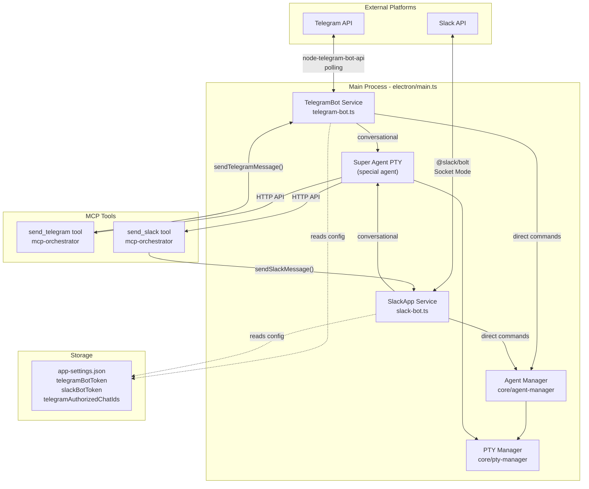
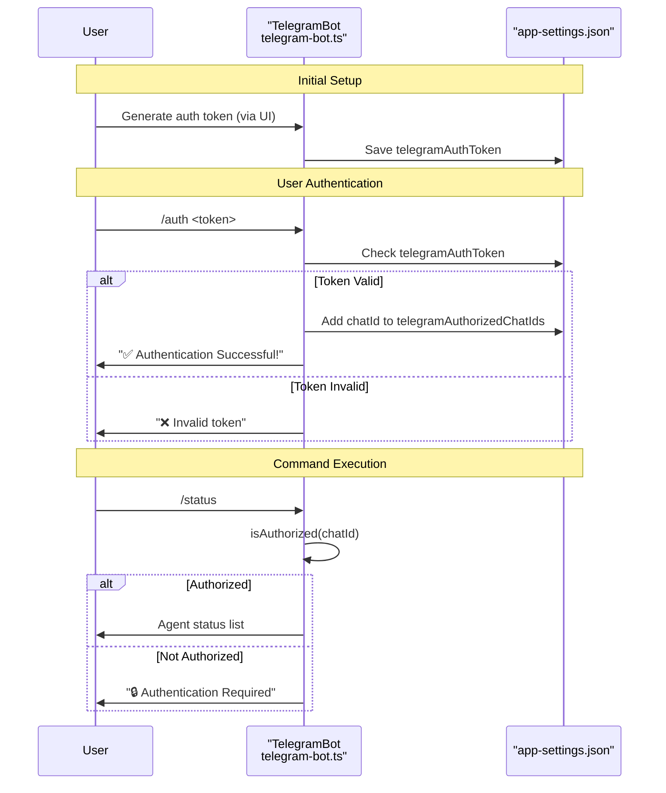
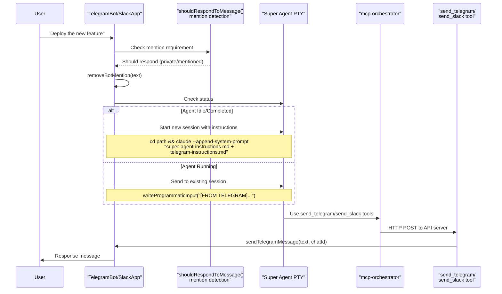
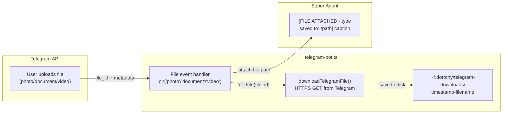
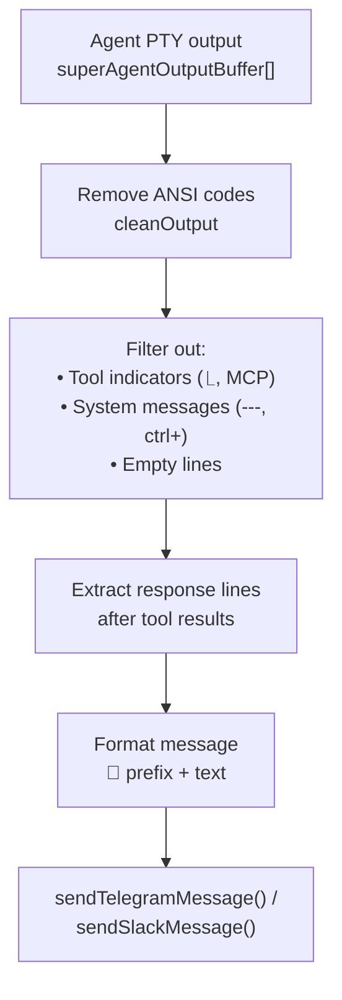
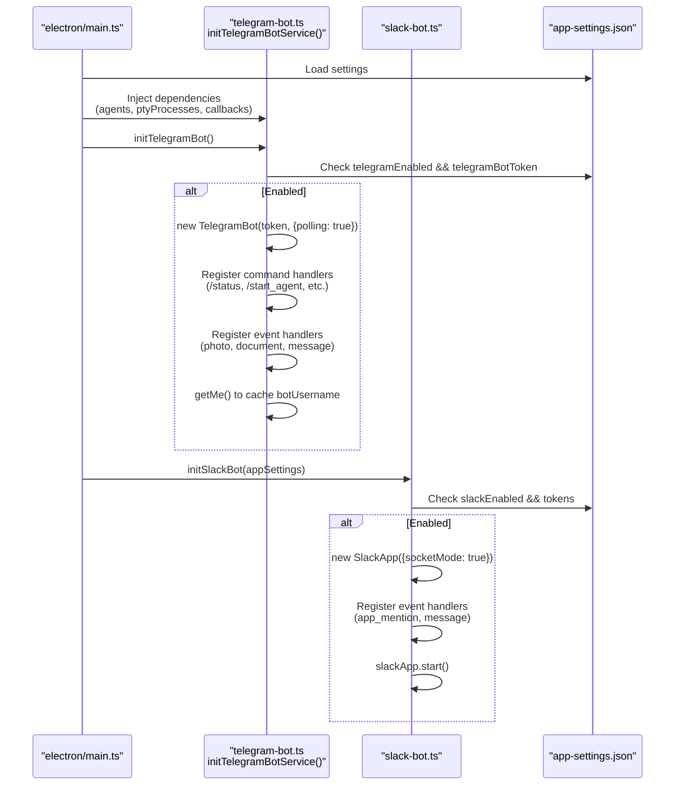

<!-- source: DeepWiki mcp.deepwiki.com · repo Charlie85270/Dorothy · page 9 Remote Control · fetched 2026-10-26 -->

# Remote Control

<details>
<summary>Relevant source files</summary>

The following files were used as context for generating this wiki page:

- [electron/resources/telegram-instructions.md](electron/resources/telegram-instructions.md)
- [electron/services/slack-bot.ts](electron/services/slack-bot.ts)
- [electron/services/telegram-bot.ts](electron/services/telegram-bot.ts)
- [electron/utils/index.ts](electron/utils/index.ts)
- [src/components/Settings/TelegramSection.tsx](src/components/Settings/TelegramSection.tsx)
- [src/components/Settings/Toggle.tsx](src/components/Settings/Toggle.tsx)

</details>


This document covers Dorothy's remote control capabilities, which allow users to manage and interact with agents from anywhere using Telegram or Slack. Remote control provides both direct command execution (`/status`, `/start_agent`, etc.) and conversational interaction through the Super Agent.

For detailed setup and configuration of each platform, see [Telegram Bot](#9.1) and [Slack Bot](#9.2). For information about the Super Agent's orchestration role, see [Super Agent](#9.3).

---

## Overview

Dorothy's remote control system enables two primary interaction modes:

| Mode | Description | Examples |
|------|-------------|----------|
| **Direct Commands** | Structured commands for specific operations | `/status`, `/start_agent <name> <task>`, `/stop_agent <name>`, `/usage` |
| **Conversational** | Natural language messages routed to Super Agent | "Deploy the new feature", "Check the test results for auth module" |

Both Telegram and Slack bots provide identical command sets and behavior. The bots integrate directly with Dorothy's core services, sharing the same `AgentManager`, `ptyProcesses`, and settings infrastructure.

**Sources:** [electron/services/telegram-bot.ts:1-100](), [electron/services/slack-bot.ts:1-100]()

---

## Architecture

### System Integration

Remote control bots operate as services within the Electron main process, with direct access to agent management and PTY infrastructure:



**Sources:** [electron/services/telegram-bot.ts:13-56](), [electron/services/slack-bot.ts:12-59](), [electron/main.ts]()

---

### Authentication Flow (Telegram)

Telegram implements a token-based authentication system to secure bot access:



The authentication system uses:
- **`telegramAuthToken`**: Secret token generated in Dorothy settings, shared with trusted users
- **`telegramAuthorizedChatIds`**: Array of authorized chat IDs maintained in `app-settings.json`
- **`isAuthorized(chatId)`**: Function that checks if a chat ID is in the authorized list

**Sources:** [electron/services/telegram-bot.ts:204-290](), [electron/services/telegram-bot.ts:408-455](), [src/components/Settings/TelegramSection.tsx:59-93]()

---

## Command Handlers

### Direct Command Execution

Both bots implement identical command handlers for agent management:

| Command | Handler | Implementation |
|---------|---------|----------------|
| `/status` | Display agent states grouped by status | [telegram-bot.ts:554-626](), [slack-bot.ts:229-272]() |
| `/agents` | List all agents with details | [telegram-bot.ts:629-648](), [slack-bot.ts:274-288]() |
| `/projects` | Group agents by project path | [telegram-bot.ts:513-551](), [slack-bot.ts:290-330]() |
| `/start_agent <name> <task>` | Initialize PTY and start agent with task | [telegram-bot.ts:651-730](), [slack-bot.ts:417-476]() |
| `/stop_agent <name>` | Send Ctrl+C to agent PTY | [telegram-bot.ts:733-769](), [slack-bot.ts:478-507]() |
| `/usage` | Calculate token costs using model pricing | [telegram-bot.ts:772-905](), [slack-bot.ts:332-414]() |

Command handlers access shared infrastructure:
- **`agents`**: Map of `AgentStatus` objects from `core/agent-manager`
- **`ptyProcesses`**: Map of `IPty` instances from `core/pty-manager`
- **`initAgentPty()`**: Creates PTY with login shell for agent
- **`writeProgrammaticInput()`**: Writes command to PTY stdin

**Sources:** [electron/services/telegram-bot.ts:554-905](), [electron/services/slack-bot.ts:204-511]()

---

### Conversational Interaction Flow

Messages that aren't recognized as commands are routed to the Super Agent:



Key implementation details:

1. **Mention Detection** (Telegram groups):
   - `shouldRespondToMessage()` checks `telegramRequireMention` setting
   - If enabled, searches for `@botUsername` in message text and entities
   - Private messages always respond regardless of setting

2. **Super Agent Initialization**:
   - Loads `super-agent-instructions.md` with orchestration guidelines
   - Loads `telegram-instructions.md` or equivalent for platform-specific rules
   - Instructions emphasize using `send_telegram`/`send_slack` for all responses

3. **Response Mechanism**:
   - Super Agent uses MCP tools (`send_telegram`, `send_slack`) to respond
   - Tools call back to bot service via HTTP API server on port 31415
   - Bot service maintains `currentResponseChatId` for routing responses

**Sources:** [electron/services/telegram-bot.ts:216-278](), [electron/services/telegram-bot.ts:907-1039](), [electron/services/slack-bot.ts:514-610](), [electron/resources/telegram-instructions.md:1-73]()

---

## File Upload Support (Telegram)

Telegram bot supports receiving files with automatic download and local storage:



Supported file types:
- **Photos**: `.jpg`, `.jpeg`, `.png`, `.gif`, `.webp`, `.bmp`
- **Videos**: `.mp4`, `.mov`, `.avi`, `.webm`, `.mkv`
- **Documents**: PDF, Office files, archives, code files
- **Audio**: `.mp3`, `.wav`, `.ogg`, `.m4a`, `.flac`

File handling implementation:
- `downloadTelegramFile()` downloads from Telegram API to `~/.dorothy/telegram-downloads/`
- Filenames prefixed with timestamp for uniqueness
- `getFileTypeDescription()` provides human-readable file type
- File path included in prompt sent to Super Agent

**Sources:** [electron/services/telegram-bot.ts:294-374](), [electron/services/telegram-bot.ts:920-1039](), [electron/constants.ts]()

---

## Response Extraction

When a task completes, bots extract meaningful responses from agent output:

### Super Agent Output Parsing



The extraction logic in `sendSuperAgentResponseToTelegram()` and similar functions:

1. **ANSI Cleanup**: Removes escape codes (`\x1b\[[0-9;]*m`, `\x1b\[\?[0-9]*[hl]`)
2. **Tool Result Detection**: Looks for `⎿` or `(MCP)` markers indicating tool output
3. **Response Collection**: Gathers text after tool results, skipping system indicators
4. **Fallback**: If no structured response found, sends last meaningful text lines

**Sources:** [electron/services/telegram-bot.ts:113-200](), [electron/services/slack-bot.ts:77-99]()

---

## Configuration Reference

### Telegram Settings

| Setting | Type | Description | Location |
|---------|------|-------------|----------|
| `telegramEnabled` | boolean | Master enable/disable toggle | `app-settings.json` |
| `telegramBotToken` | string | Bot token from @BotFather | `app-settings.json` |
| `telegramAuthToken` | string | Secret token for user authentication | `app-settings.json` |
| `telegramAuthorizedChatIds` | string[] | List of authorized chat IDs | `app-settings.json` |
| `telegramChatId` | string | Default chat for notifications | `app-settings.json` |
| `telegramRequireMention` | boolean | Require @mention in groups | `app-settings.json` |

### Slack Settings

| Setting | Type | Description | Location |
|---------|------|-------------|----------|
| `slackEnabled` | boolean | Master enable/disable toggle | `app-settings.json` |
| `slackBotToken` | string | Bot OAuth token (xoxb-...) | `app-settings.json` |
| `slackAppToken` | string | App-level token for Socket Mode (xapp-...) | `app-settings.json` |
| `slackChannelId` | string | Default channel for messages | `app-settings.json` |

**Sources:** [src/components/Settings/TelegramSection.tsx:1-373](), [electron/types.ts]()

---

## State Management

### Bot Service State

Both bot services maintain state variables to track active tasks:

**Telegram (`telegram-bot.ts`)**:
- `telegramBot`: TelegramBot instance or null
- `superAgentTelegramTask`: Boolean flag for active Telegram task
- `superAgentOutputBuffer`: Array of output lines for response extraction
- `botUsername`: Cached bot username for mention detection
- `currentResponseChatId`: Target chat for MCP tool responses

**Slack (`slack-bot.ts`)**:
- `slackApp`: SlackApp instance or null
- `slackResponseChannel`: Target channel for responses
- `slackResponseThreadTs`: Thread timestamp for threading replies
- `superAgentSlackTask`: Boolean flag for active Slack task
- `superAgentSlackBuffer`: Array of output lines for response extraction

These state variables are module-level and persist across function calls, enabling stateful interactions with the Super Agent.

**Sources:** [electron/services/telegram-bot.ts:13-31](), [electron/services/slack-bot.ts:12-62]()

---

## Initialization Sequence

Bot services are initialized during Electron app startup:



**Dependency Injection**: The Telegram service uses `initTelegramBotService()` to inject references to:
- `agents` and `ptyProcesses` maps
- `getSuperAgent()`, `saveAgents()`, `initAgentPty()` functions
- `getClaudeStats()` for usage reporting
- Main window for settings updates

This pattern avoids circular dependencies and enables testing.

**Sources:** [electron/services/telegram-bot.ts:36-56](), [electron/services/telegram-bot.ts:379-407](), [electron/services/slack-bot.ts:102-201]()

---

## Security Considerations

### Telegram Authentication

The Telegram bot requires authentication before any commands are accepted:

1. **No default access**: Bot rejects all commands from unauthorized chats
2. **Token-based auth**: Users must send `/auth <token>` with the secret token
3. **Per-chat authorization**: Each chat ID must authenticate separately
4. **Token generation**: Cryptographically secure random token generated in settings UI
5. **Persistent authorization**: Authorized chat IDs saved to `app-settings.json`

The `/auth` command is the only command accessible without prior authorization.

### Slack Security

Slack uses OAuth-based security:

1. **App-level token**: Required for Socket Mode connection
2. **Bot token**: OAuth token with specific scopes for the workspace
3. **Channel-based**: Messages only processed from configured channels
4. **No additional auth**: Slack's OAuth handles authentication

**Sources:** [electron/services/telegram-bot.ts:204-290](), [electron/services/telegram-bot.ts:408-455]()

---

## Error Handling

Both bots implement robust error handling:

### Message Sending

```typescript
// From telegram-bot.ts:98-111
function sendToChat(chatId, truncated, parseMode, originalText) {
  try {
    telegramBot.sendMessage(chatId, truncated, { parse_mode: parseMode });
  } catch (err) {
    // Fallback: try without markdown if formatting fails
    try {
      telegramBot.sendMessage(chatId, originalText.replace(/[*_`\[\]]/g, ''));
    } catch {
      // Give up silently
    }
  }
}
```

### Bot Initialization

If bot tokens are invalid or network fails:
- Initialization fails silently with console error
- Bot set to `null`, preventing command processing
- App continues running without remote control
- Settings UI shows connection status

**Sources:** [electron/services/telegram-bot.ts:98-111](), [electron/services/telegram-bot.ts:379-407](), [electron/services/slack-bot.ts:188-201]()

---

