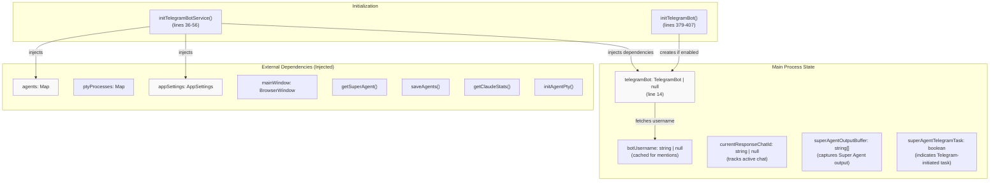
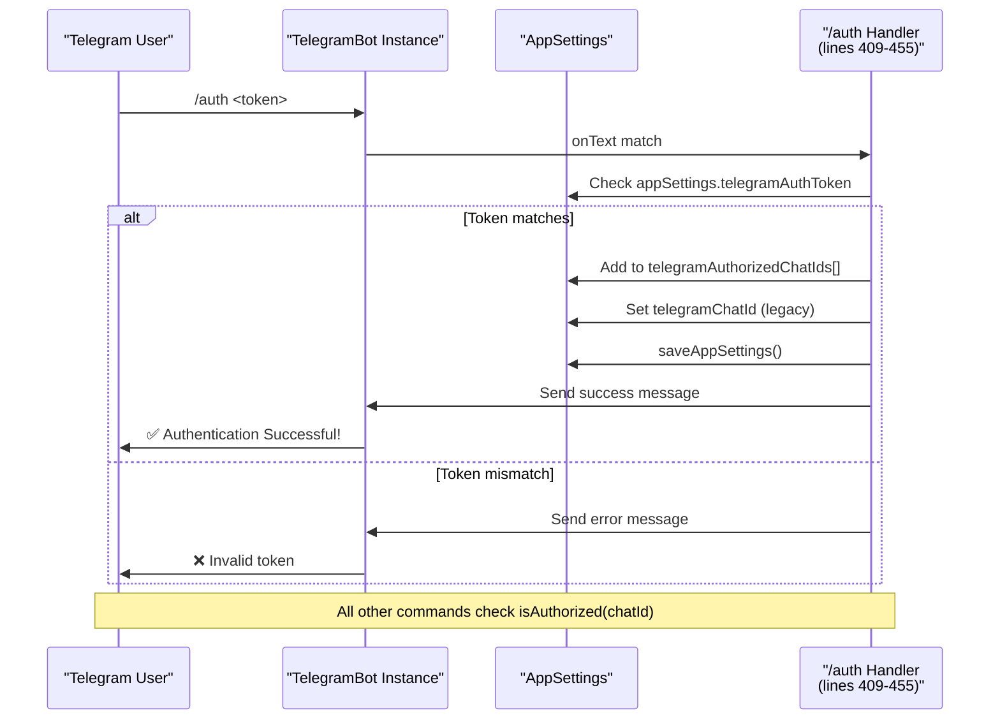
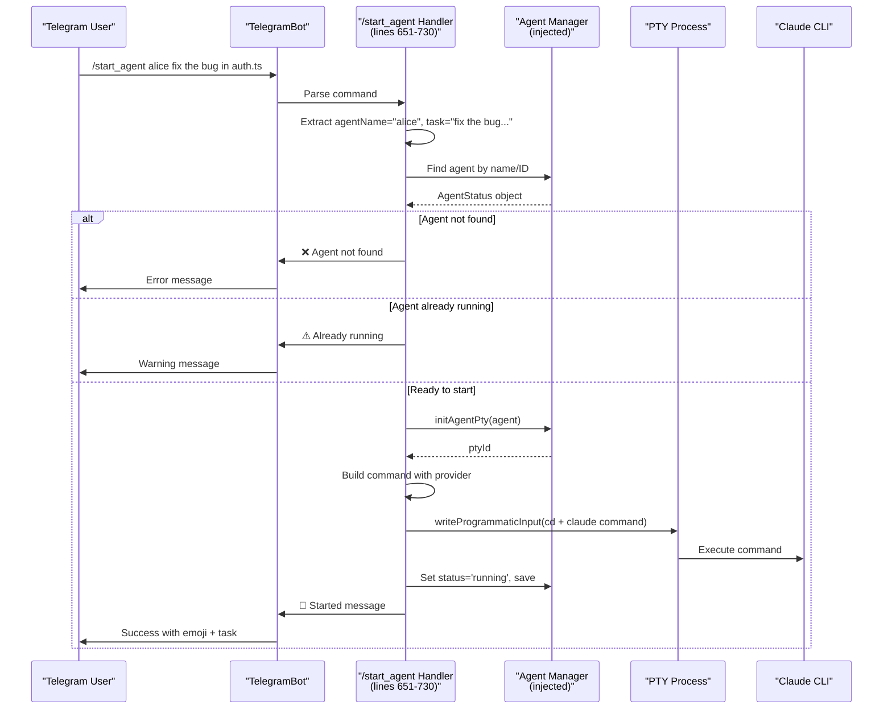
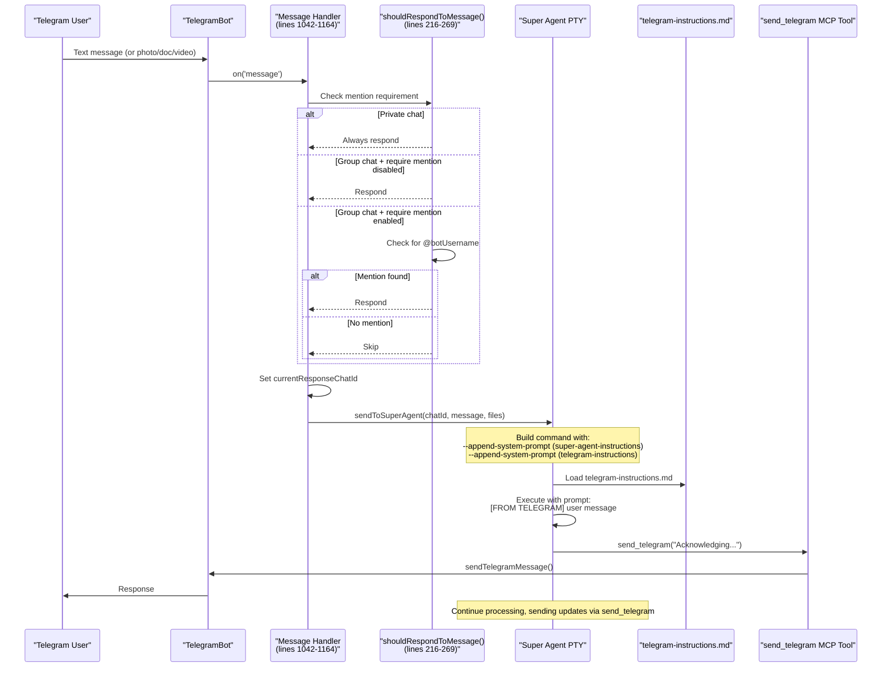
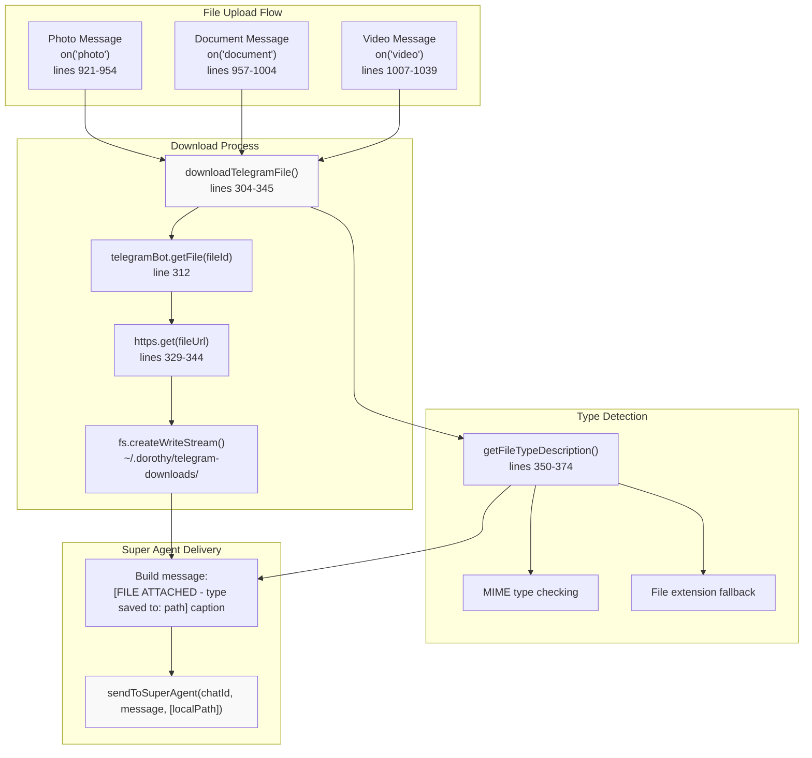
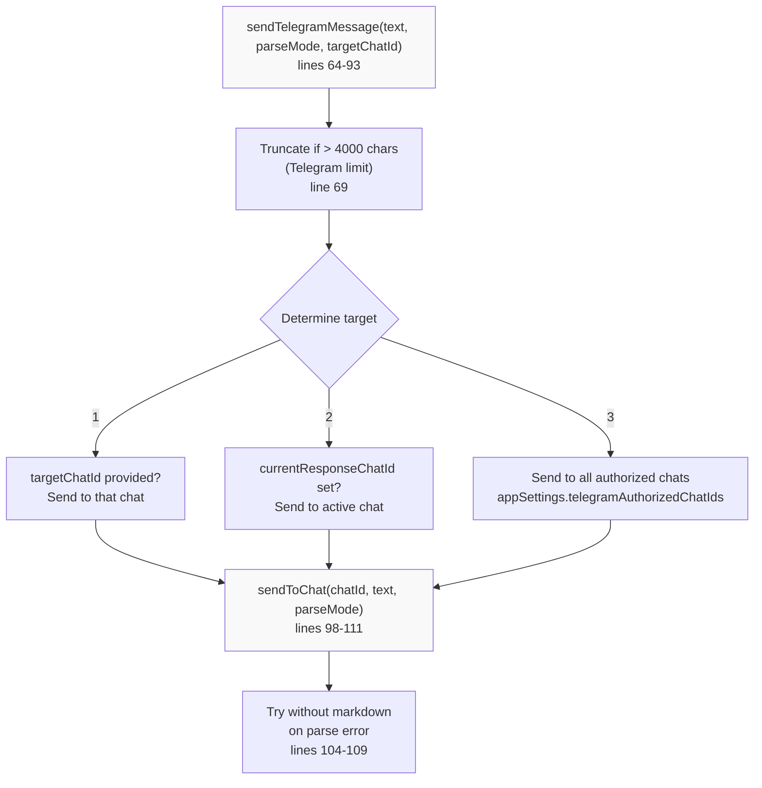
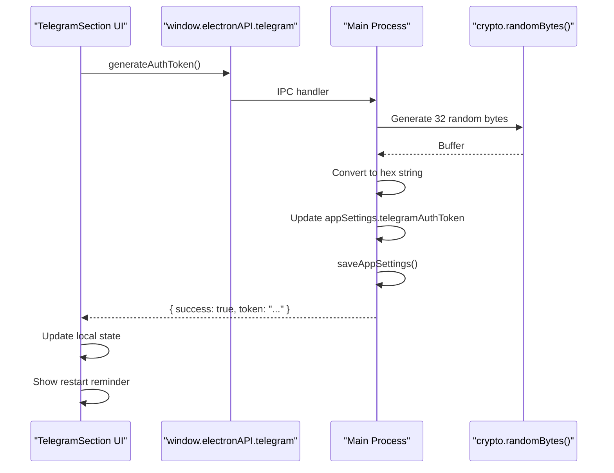

<!-- source: DeepWiki mcp.deepwiki.com · repo Charlie85270/Dorothy · page 9.1 Telegram Bot · fetched 2026-10-26 -->

# Telegram Bot

<details>
<summary>Relevant source files</summary>

The following files were used as context for generating this wiki page:

- [electron/resources/telegram-instructions.md](electron/resources/telegram-instructions.md)
- [electron/services/slack-bot.ts](electron/services/slack-bot.ts)
- [electron/services/telegram-bot.ts](electron/services/telegram-bot.ts)
- [electron/utils/index.ts](electron/utils/index.ts)
- [src/components/Settings/TelegramSection.tsx](src/components/Settings/TelegramSection.tsx)
- [src/components/Settings/Toggle.tsx](src/components/Settings/Toggle.tsx)

</details>


The Telegram bot provides remote control capabilities for Dorothy agents through Telegram messaging. Users can execute commands, start and stop agents, monitor status, and have conversational interactions with the Super Agent, all from their Telegram client. The bot supports both direct messages and group chats, includes token-based authentication, and can handle file uploads (photos, documents, videos).

For Slack integration, see [Slack Bot](#9.2). For details on the Super Agent's orchestration capabilities, see [Super Agent](#9.3).

---

## Overview

The Telegram bot is implemented as a long-polling service in the main process using the `node-telegram-bot-api` library. It provides two interaction modes:

1. **Direct Commands**: Slash commands (`/status`, `/start_agent`, etc.) that interact directly with the Agent Manager
2. **Conversational Mode**: Free-text messages that route to the Super Agent for processing

All interactions require authentication via a secret token, with support for multiple authorized chat IDs. The bot can operate in both private chats and groups, with optional @mention requirement for group messages.

**Sources**: [electron/services/telegram-bot.ts:1-50](), [electron/services/telegram-bot.ts:379-407]()

---

## Architecture and State Management

### Telegram Bot State Flow



**Sources**: [electron/services/telegram-bot.ts:13-56]()

The bot maintains minimal state, relying primarily on injected references to the agent system. The `currentResponseChatId` tracks which chat should receive responses from automated notifications or Super Agent completions. The `superAgentOutputBuffer` captures output during Telegram-initiated tasks for intelligent response extraction.

---

## Authentication System

### Authentication Flow



**Sources**: [electron/services/telegram-bot.ts:409-455](), [electron/services/telegram-bot.ts:205-207]()

### Authorization Check

The `isAuthorized()` function [electron/services/telegram-bot.ts:205-207]() validates chat IDs against `appSettings.telegramAuthorizedChatIds`. The `/auth` command is the only handler accessible without prior authorization, enabling the initial authentication flow.

**Token Generation**: Users generate a secret token in the Settings UI [src/components/Settings/TelegramSection.tsx:59-73]() which creates a cryptographically random token via `window.electronAPI.telegram.generateAuthToken()`.

---

## Command Handlers

### Command Registration and Routing

```mermaid
graph TB
    subgraph "Command Handlers (lines 409-1164)"
        authCmd["/auth <token><br/>Lines 409-455<br/>ALWAYS accessible"]
        startCmd["/start<br/>Lines 458-482<br/>Show welcome"]
        helpCmd["/help<br/>Lines 485-510<br/>List commands"]
        projectsCmd["/projects<br/>Lines 513-551<br/>Group agents by path"]
        statusCmd["/status<br/>Lines 554-626<br/>Show all agent status"]
        agentsCmd["/agents<br/>Lines 629-648<br/>Detailed agent list"]
        startAgentCmd["/start_agent <name> <task><br/>Lines 651-730<br/>Start specific agent"]
        stopAgentCmd["/stop_agent <name><br/>Lines 733-769<br/>Stop agent"]
        usageCmd["/usage<br/>Lines 772-905<br/>Cost statistics"]
        askCmd["/ask <message><br/>Lines 908-918<br/>Send to Super Agent"]
    end
    
    subgraph "File Handlers"
        photoHandler["on('photo')<br/>Lines 921-954<br/>Download + send to Super Agent"]
        docHandler["on('document')<br/>Lines 957-1004<br/>Download + send to Super Agent"]
        videoHandler["on('video')<br/>Lines 1007-1039<br/>Download + send to Super Agent"]
    end
    
    subgraph "Message Handler"
        textHandler["on('message')<br/>Lines 1042-1164<br/>Forward to Super Agent"]
    end
    
    authCmd -->|always| Auth[isAuthorized() bypass]
    startCmd -->|check| AuthCheck{isAuthorized?}
    helpCmd -->|check| AuthCheck
    projectsCmd -->|check| AuthCheck
    statusCmd -->|check| AuthCheck
    agentsCmd -->|check| AuthCheck
    startAgentCmd -->|check| AuthCheck
    stopAgentCmd -->|check| AuthCheck
    usageCmd -->|check| AuthCheck
    askCmd -->|check| AuthCheck
    photoHandler -->|check| AuthCheck
    docHandler -->|check| AuthCheck
    videoHandler -->|check| AuthCheck
    textHandler -->|check| AuthCheck
    
    AuthCheck -->|yes| Process[Process Command]
    AuthCheck -->|no| Deny[sendUnauthorizedMessage]
    
    style authCmd fill:#f9f9f9
    style textHandler fill:#f9f9f9
```

**Sources**: [electron/services/telegram-bot.ts:409-1164]()

### Status Command Implementation

The `/status` command [electron/services/telegram-bot.ts:554-626]() demonstrates the pattern:

1. Check authorization via `isAuthorized(chatId)`
2. Retrieve all agents from injected `agents` Map
3. Categorize by status: running, waiting, error, idle
4. Format using `TG_CHARACTER_FACES` emoji mapping
5. Sort to place Super Agent first using `isSuperAgent()`
6. Send formatted message via `telegramBot.sendMessage()`

**Sources**: [electron/services/telegram-bot.ts:554-626]()

---

## Agent Control

### Starting an Agent from Telegram



**Sources**: [electron/services/telegram-bot.ts:651-730]()

### Command Construction

The command is built using the agent's provider [electron/services/telegram-bot.ts:705-713]():

```typescript
const cliProvider = getProvider(agent.provider);
const binaryName = cliProvider.binaryName; // e.g., "claude", "codex"
let command = binaryName;
if (agent.skipPermissions) command += ' --dangerously-skip-permissions';
if (agent.secondaryProjectPath) command += ` --add-dir '${secondaryProjectPath}'`;
command += ` --add-dir '${homedir}/.dorothy'`;
command += ` '${task}'`;
```

**Sources**: [electron/services/telegram-bot.ts:705-713]()

---

## Super Agent Integration

### Conversational Message Flow



**Sources**: [electron/services/telegram-bot.ts:1042-1164](), [electron/services/telegram-bot.ts:216-269]()

### Super Agent Instructions

When a message is routed to the Super Agent, two instruction files are loaded via `--append-system-prompt`:

1. **super-agent-instructions.md** [electron/utils/index.ts:245-256](): General orchestration instructions
2. **telegram-instructions.md** [electron/resources/telegram-instructions.md:1-73](): Telegram-specific workflow

The Telegram instructions enforce a critical pattern [electron/resources/telegram-instructions.md:9-16]():

> **Golden Rule: Narrate Everything**
> 
> The user is on their phone. They see NOTHING unless you send a message via `send_telegram`. Silence = broken. **Before every blocking operation, tell the user what you're about to do.**

Required workflow:
```
send_telegram → blocking_call → send_telegram with result
```

**Sources**: [electron/resources/telegram-instructions.md:1-73](), [electron/utils/index.ts:245-256]()

### Response Extraction

After the Super Agent completes a Telegram-initiated task, `sendSuperAgentResponseToTelegram()` [electron/services/telegram-bot.ts:116-200]() extracts meaningful output:

1. Capture output in `superAgentOutputBuffer` during task execution
2. Remove ANSI escape codes and control characters
3. Filter out tool indicators (MCP, ⎿, ●, ⏺)
4. Extract text after tool results
5. Send formatted response with 👑 emoji prefix

**Sources**: [electron/services/telegram-bot.ts:116-200]()

---

## File Upload Support

### File Download and Processing



**Sources**: [electron/services/telegram-bot.ts:304-345](), [electron/services/telegram-bot.ts:350-374](), [electron/services/telegram-bot.ts:921-1039]()

### File Type Detection

The `getFileTypeDescription()` function [electron/services/telegram-bot.ts:350-374]() determines file type by:

1. **MIME Type Priority**: Check `mimeType` field (e.g., `image/jpeg`, `application/pdf`)
2. **Extension Fallback**: Parse file extension if MIME unavailable
3. **Categorization**: Map to user-friendly types:
   - Images: `.jpg`, `.png`, `.gif`, `.webp`
   - Videos: `.mp4`, `.mov`, `.webm`
   - Documents: `.pdf`, `.doc`, `.docx`
   - Code: `.js`, `.ts`, `.py`, `.java`
   - Archives: `.zip`, `.tar`, `.gz`

Files are downloaded to `~/.dorothy/telegram-downloads/` with timestamped filenames to prevent collisions.

**Sources**: [electron/services/telegram-bot.ts:350-374](), [electron/constants.ts]()

---

## Message Sending

### sendTelegramMessage Function



**Sources**: [electron/services/telegram-bot.ts:64-111]()

The function implements a three-tier routing system:

1. **Specific Target**: If `targetChatId` provided, send only there
2. **Current Response**: If `currentResponseChatId` set (from active conversation), send there
3. **Broadcast**: Send to all authorized chats (for notifications)

This enables both targeted responses (user-initiated) and broadcast notifications (automation-initiated).

**Sources**: [electron/services/telegram-bot.ts:64-93]()

---

## Group Chat Behavior

### Mention Detection

```mermaid
graph TB
    shouldRespond["shouldRespondToMessage(msg)<br/>lines 216-269"]
    
    chatType{"msg.chat.type"}
    
    private["'private'<br/>Always respond<br/>line 222"]
    
    requireMention{"appSettings.telegramRequireMention"}
    
    respondAll["Return true<br/>(respond to all)<br/>line 229"]
    
    checkUsername{"botUsername loaded?"}
    
    skip["Return false<br/>(skip, username not ready)<br/>line 239"]
    
    textMention{"@botUsername in text?<br/>(case insensitive)<br/>lines 243-247"]
    
    entityMention{"entity.type === 'mention'?<br/>lines 251-259"}
    
    textBotMention{"entity.type === 'text_mention'<br/>and user.is_bot?<br/>lines 261-264"]
    
    found["Return true"]
    notFound["Return false<br/>line 268"]
    
    shouldRespond --> chatType
    
    chatType -->|private| private
    chatType -->|group/supergroup| requireMention
    
    requireMention -->|false| respondAll
    requireMention -->|true| checkUsername
    
    checkUsername -->|null| skip
    checkUsername -->|string| textMention
    
    textMention -->|yes| found
    textMention -->|no| entityMention
    
    entityMention -->|yes| found
    entityMention -->|no| textBotMention
    
    textBotMention -->|yes| found
    textBotMention -->|no| notFound
    
    private --> found
    respondAll --> found
    
    style shouldRespond fill:#f9f9f9
```

**Sources**: [electron/services/telegram-bot.ts:216-269]()

The bot username is cached on initialization [electron/services/telegram-bot.ts:401-406]() via `telegramBot.getMe()`. This enables efficient mention detection without API calls for every message.

Mentions are removed from the message text before processing via `removeBotMention()` [electron/services/telegram-bot.ts:274-277]() to provide clean prompts to the Super Agent.

**Sources**: [electron/services/telegram-bot.ts:401-406](), [electron/services/telegram-bot.ts:274-277]()

---

## Usage Statistics

### Cost Calculation

The `/usage` command [electron/services/telegram-bot.ts:772-905]() provides detailed cost analytics:

1. **Fetch Stats**: Call injected `getClaudeStats()` function
2. **Model Pricing**: Lookup pricing per million tokens from `MODEL_PRICING` table [electron/services/telegram-bot.ts:788-803]()
3. **Cost Calculation**: For each model's usage [electron/services/telegram-bot.ts:832-838]():
   ```
   cost = (input / 1M) * inputPerMTok +
          (output / 1M) * outputPerMTok +
          (cacheRead / 1M) * cacheHitsPerMTok +
          (cacheWrite / 1M) * cache5mWritePerMTok
   ```
4. **Aggregation**: Sum across all models, format breakdown
5. **Display**: Show total cost, token counts, per-model breakdown

**Pricing Table** (as of implementation):

| Model | Input ($/MTok) | Output ($/MTok) | Cache Read ($/MTok) | Cache Write ($/MTok) |
|-------|----------------|-----------------|---------------------|----------------------|
| Opus 4.5 | $5 | $25 | $0.50 | $6.25 |
| Opus 4.1 | $15 | $75 | $1.50 | $18.75 |
| Sonnet 4.5 | $3 | $15 | $0.30 | $3.75 |
| Haiku 4.5 | $1 | $5 | $0.10 | $1.25 |

**Sources**: [electron/services/telegram-bot.ts:772-905](), [electron/services/telegram-bot.ts:788-803]()

---

## Configuration UI

### Settings Interface

The Telegram settings UI [src/components/Settings/TelegramSection.tsx]() provides:

| Section | Controls | Lines |
|---------|----------|-------|
| **Enable Bot** | Toggle (requires auth token) | 102-121 |
| **Bot Token** | Password input, visibility toggle | 123-157 |
| **Test Buttons** | Test Token, Send Test | 160-181 |
| **Auth Token** | Generate, copy, view | 206-265 |
| **Authorized Chats** | List with default marking, remove | 268-328 |
| **Group Behavior** | Require @mention toggle | 332-357 |
| **Setup Guide** | Step-by-step instructions | 360-370 |

**Sources**: [src/components/Settings/TelegramSection.tsx:1-373]()

### Token Generation



**Sources**: [src/components/Settings/TelegramSection.tsx:59-73]()

The token is a 64-character hexadecimal string (32 bytes of randomness), providing sufficient entropy for secure authentication.

---

## Integration Points

### Dependency Injection

The bot service follows a dependency injection pattern [electron/services/telegram-bot.ts:36-56]() to avoid circular dependencies:

```typescript
export function initTelegramBotService(
  agentsMap: Map<string, AgentStatus>,
  ptyMap: Map<string, pty.IPty>,
  settings: AppSettings,
  window: any,
  getSuperAgentFn: () => AgentStatus | undefined,
  saveAgentsFn: () => void,
  getClaudeStatsFn: () => Promise<any>,
  initAgentPtyFn: (agent: AgentStatus) => Promise<string>,
  saveAppSettingsFn: (settings: AppSettings) => void
)
```

This allows the bot to interact with:
- **Agent Manager**: Query and control agents
- **PTY Manager**: Send commands to terminals
- **Settings**: Access configuration, update authorized chats
- **Stats**: Retrieve usage data for `/usage` command
- **Main Window**: Trigger UI updates on setting changes

**Sources**: [electron/services/telegram-bot.ts:36-56]()

### MCP Tool Integration

The Super Agent uses the `send_telegram` MCP tool (provided by mcp-orchestrator) to respond. The bot's `sendTelegramMessage()` function is callable from MCP tools via the HTTP API server, enabling bi-directional communication.

**Sources**: [electron/services/telegram-bot.ts:64-93]()

---

## Error Handling

### Common Error Scenarios

| Error | Handler | Recovery |
|-------|---------|----------|
| **Invalid bot token** | initTelegramBot() fails | Bot remains null, user sees error in settings |
| **Message parse error** | sendToChat() catch | Retry without markdown formatting |
| **File download failure** | downloadTelegramFile() reject | Clean up partial file, send error to user |
| **Agent not found** | /start_agent handler | Send "not found" message |
| **PTY init failure** | initAgentPty() error | Send "failed to initialize" message |
| **No Super Agent** | sendToSuperAgent() check | Inform user to create Super Agent |

**Sources**: [electron/services/telegram-bot.ts:98-111](), [electron/services/telegram-bot.ts:304-345](), [electron/services/telegram-bot.ts:651-730]()

---

## Security Considerations

### Authentication Requirements

1. **Token-Based Auth**: The bot will not start without `telegramAuthToken` configured [electron/services/telegram-bot.ts:391-394]()
2. **Multi-User Support**: `telegramAuthorizedChatIds` array allows multiple authenticated users
3. **No Default Access**: All commands (except `/auth`) require authorization check
4. **Token Regeneration**: Users can regenerate tokens, invalidating previous authentications

### File Download Safety

- **Isolated Directory**: Files download to `~/.dorothy/telegram-downloads/` [electron/constants.ts]()
- **Timestamped Names**: Prevents filename collisions and overwrites
- **Type Detection**: Files are categorized and labeled before being sent to Super Agent
- **Path Disclosure**: File paths are included in Super Agent prompts for transparency

**Sources**: [electron/services/telegram-bot.ts:391-394](), [electron/services/telegram-bot.ts:205-207](), [electron/services/telegram-bot.ts:294-299]()

---

