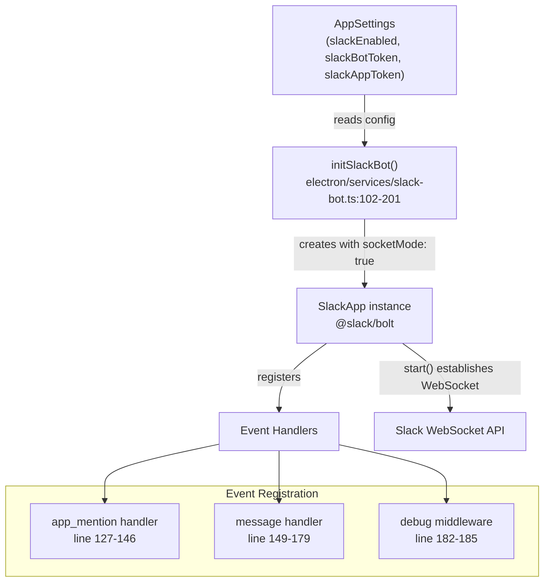
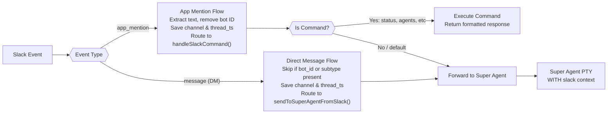
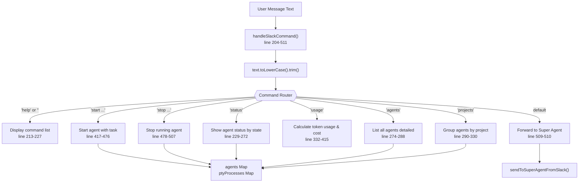
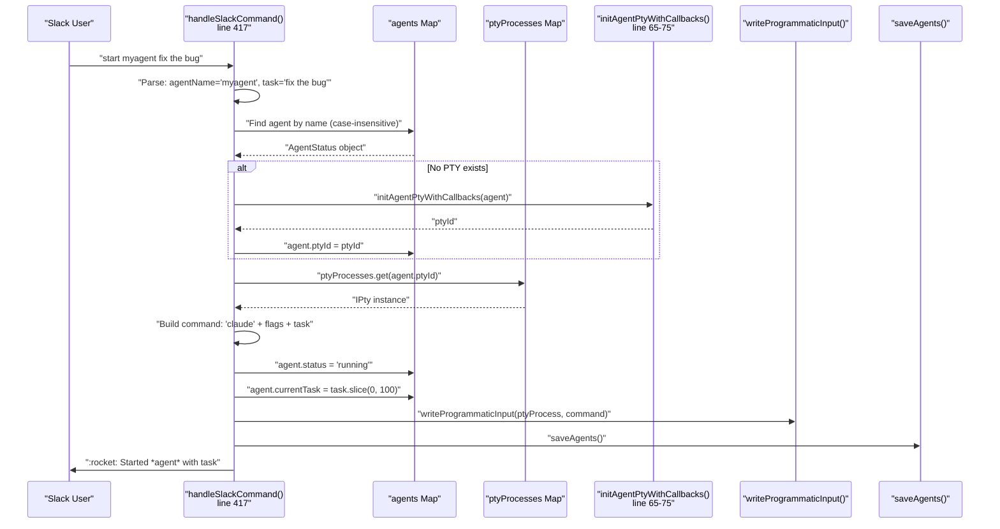
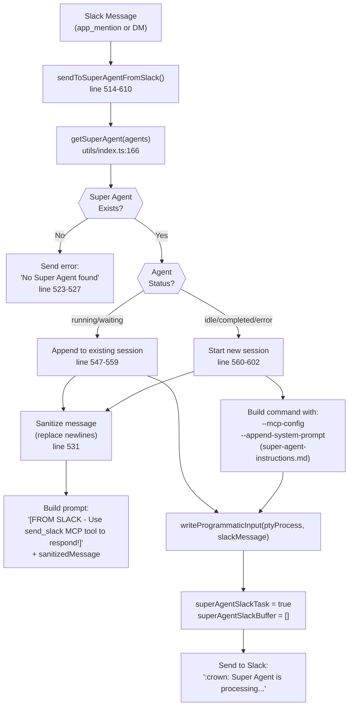
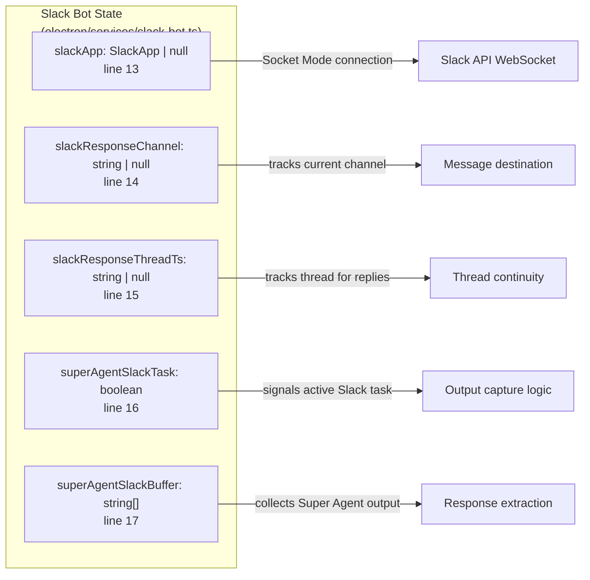
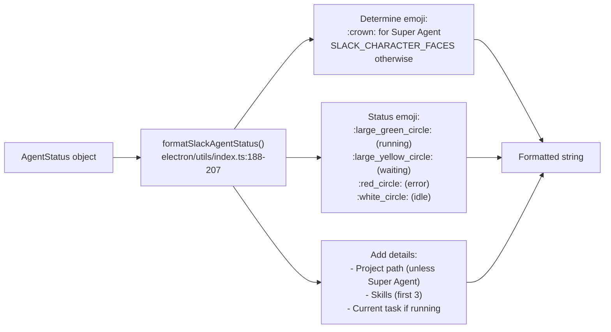
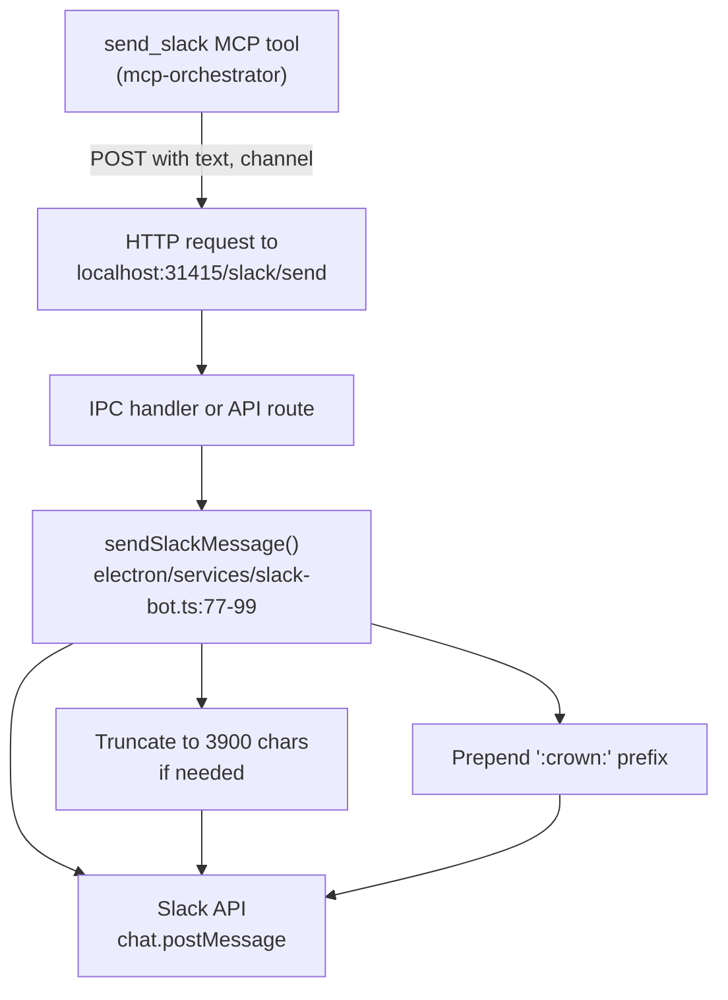

<!-- source: DeepWiki mcp.deepwiki.com · repo Charlie85270/Dorothy · page 9.2 Slack Bot · fetched 2026-10-26 -->

# Slack Bot

<details>
<summary>Relevant source files</summary>

The following files were used as context for generating this wiki page:

- [electron/resources/telegram-instructions.md](electron/resources/telegram-instructions.md)
- [electron/services/slack-bot.ts](electron/services/slack-bot.ts)
- [electron/services/telegram-bot.ts](electron/services/telegram-bot.ts)
- [electron/utils/index.ts](electron/utils/index.ts)
- [src/components/Settings/TelegramSection.tsx](src/components/Settings/TelegramSection.tsx)
- [src/components/Settings/Toggle.tsx](src/components/Settings/Toggle.tsx)

</details>


This page documents Dorothy's Slack bot integration, which provides remote control of agents via Slack workspace. The bot operates in Socket Mode, eliminating the need for webhook configuration, and supports both direct messages and app mentions. For the similar Telegram integration, see [Telegram Bot](#9.1). For Super Agent orchestration capabilities, see [Super Agent](#9.3).

---

## Overview

The Slack bot enables remote agent management through a Slack workspace using the `@slack/bolt` framework. Unlike traditional webhook-based bots, Dorothy's Slack integration uses Socket Mode, which establishes a WebSocket connection to Slack's servers. This approach requires two tokens: a bot token (OAuth) and an app token (Socket Mode), but eliminates the need for public URL exposure or webhook configuration.

The bot provides direct command execution (`status`, `start`, `stop`, etc.) and forwards conversational messages to the Super Agent, which uses MCP tools to respond via the `send_slack` tool from `mcp-orchestrator`.

**Sources:** [electron/services/slack-bot.ts:1-200]()

---

## Architecture and Initialization

### Socket Mode Configuration



**Initialization Sequence**

1. Check required settings (`slackEnabled`, `slackBotToken`, `slackAppToken`)
2. Stop existing bot instance if present via `slackApp.stop()`
3. Create new `SlackApp` with tokens and `socketMode: true`
4. Register event handlers: `app_mention`, `message`, and debug middleware
5. Call `slackApp.start()` to establish WebSocket connection
6. Log success or handle connection errors

**Sources:** [electron/services/slack-bot.ts:102-201]()

---

## Event Handling System

### Event Types and Routing



**App Mention Handler** (`app_mention` event)

The `app_mention` handler processes messages where the bot is @mentioned in channels or threads:

1. Remove bot mention from text using regex: `/<@[A-Z0-9]+>/gi`
2. Extract `channel` and `thread_ts` (for threading replies)
3. Save `channel` to settings if different from current `slackChannelId`
4. Route to `handleSlackCommand()` for processing

**Sources:** [electron/services/slack-bot.ts:127-146]()

**Message Handler** (direct messages)

The `message` handler processes direct messages to the bot:

1. Filter out bot messages (`msg.bot_id`)
2. Filter out message subtypes (edits, deletions)
3. Extract `channel` and `thread_ts`
4. Save channel to settings
5. Route to `sendToSuperAgentFromSlack()` (bypasses command parsing)

**Sources:** [electron/services/slack-bot.ts:149-179]()

---

## Command System

### Command Routing and Execution



**Sources:** [electron/services/slack-bot.ts:204-511]()

### Command Implementations

| Command | Format | Function | Key Operations |
|---------|--------|----------|----------------|
| `help` | `help` or empty | Show available commands | Returns formatted command list |
| `status` | `status` | Agent status overview | Groups agents by status (running, waiting, idle, error), uses `formatSlackAgentStatus()` |
| `agents` | `agents` | Detailed agent list | Iterates all agents with full details |
| `projects` | `projects` | Project-based grouping | Groups agents by `projectPath`, excludes Super Agent |
| `usage` | `usage` | Token usage and cost | Reads Claude stats, applies pricing model, calculates total cost |
| `start` | `start <agent> <task>` | Start agent with task | Finds agent by name, initializes PTY, writes command, updates status |
| `stop` | `stop <agent>` | Stop running agent | Finds agent, writes `\x03` (Ctrl+C) to PTY, sets status to idle |

**Sources:** [electron/services/slack-bot.ts:213-507]()

---

## Agent Control Integration

### Starting an Agent from Slack



**Command Construction**

The `start` command builds a Claude CLI command string:

1. Base: `claude`
2. Add `--dangerously-skip-permissions` if `agent.skipPermissions`
3. Add `--add-dir 'secondary-path'` if `agent.secondaryProjectPath` exists
4. Add `--add-dir '~/.dorothy'` for Dorothy integration
5. Append task prompt wrapped in single quotes with escape handling

**Sources:** [electron/services/slack-bot.ts:417-476]()

---

## Super Agent Integration

### Message Flow to Super Agent



**Sources:** [electron/services/slack-bot.ts:514-610]()

### System Prompt Integration

When starting a new Super Agent session from Slack, the bot injects system instructions:

1. Read `super-agent-instructions.md` via `getSuperAgentInstructions()` from [electron/utils/index.ts:245-256]()
2. Escape quotes and newlines for shell compatibility
3. Pass via `--append-system-prompt` flag to Claude CLI
4. Prefix user message with `[FROM SLACK - Use send_slack MCP tool to respond!]`

This ensures the Super Agent knows to use the `send_slack` MCP tool for responses rather than outputting to terminal.

**Sources:** [electron/services/slack-bot.ts:574-590]()

---

## State Management

### Global State Variables



**State Variables:**

| Variable | Type | Purpose |
|----------|------|---------|
| `slackApp` | `SlackApp \| null` | Active Slack Bolt app instance |
| `slackResponseChannel` | `string \| null` | Current channel for responses (set on each incoming message) |
| `slackResponseThreadTs` | `string \| null` | Thread timestamp for threaded replies |
| `superAgentSlackTask` | `boolean` | Flag indicating Super Agent is handling Slack request |
| `superAgentSlackBuffer` | `string[]` | Output buffer for capturing Super Agent responses |

**Sources:** [electron/services/slack-bot.ts:13-17]()

### Getter/Setter Functions

The module exports getter/setter functions for external access to state (e.g., from MCP orchestrator tools):

- `getSlackApp()`, `setSlackApp()` - Manage app instance
- `getSlackResponseChannel()`, `setSlackResponseChannel()` - Manage response channel
- `getSlackResponseThreadTs()`, `setSlackResponseThreadTs()` - Manage thread tracking
- `getSuperAgentSlackTask()`, `setSuperAgentSlackTask()` - Manage task flag
- `getSuperAgentSlackBuffer()`, `setSuperAgentSlackBuffer()`, `clearSuperAgentSlackBuffer()` - Manage output buffer

**Sources:** [electron/services/slack-bot.ts:20-62]()

---

## Message Formatting

### Agent Status Formatting

The `formatSlackAgentStatus()` function from utilities formats agent information for Slack's markdown:



**Format Example:**

```
:robot_face: *my-agent* :large_green_circle:
    :file_folder: `my-project`
    :wrench: github, jira, notifications
    :speech_balloon: _fix authentication bug..._
```

**Sources:** [electron/utils/index.ts:188-207]()

---

## Settings Integration

### Configuration Requirements

Dorothy's Slack bot requires configuration in the Settings → Slack section:

| Setting | Field Name | Required | Purpose |
|---------|------------|----------|---------|
| Enable Toggle | `slackEnabled` | Yes | Master switch for bot functionality |
| Bot Token | `slackBotToken` | Yes | OAuth token for bot user (starts with `xoxb-`) |
| App Token | `slackAppToken` | Yes | App-level token for Socket Mode (starts with `xapp-`) |
| Channel ID | `slackChannelId` | No | Default channel (auto-saved on first message) |

**Auto-Configuration:**

When the bot receives its first message, it automatically saves the channel ID to settings:

```typescript
if (appSettings.slackChannelId !== event.channel) {
  appSettings.slackChannelId = event.channel;
  onSettingsChanged(appSettings);
  mainWindow?.webContents.send('settings:updated', appSettings);
}
```

**Sources:** [electron/services/slack-bot.ts:139-143](), [electron/services/slack-bot.ts:172-176]()

---

## Token Setup Process

### Slack App Configuration

1. **Create Slack App:**
   - Visit https://api.slack.com/apps
   - Click "Create New App" → "From scratch"
   - Name the app and select workspace

2. **Configure Bot Token Scopes:**
   - Navigate to "OAuth & Permissions"
   - Add Bot Token Scopes:
     - `app_mentions:read` - Read mentions
     - `chat:write` - Send messages
     - `im:history` - Read DM history
     - `im:read` - Access DMs
     - `channels:history` - Read channel messages
     - `groups:history` - Read private channel messages
   - Install app to workspace
   - Copy Bot User OAuth Token (`xoxb-...`)

3. **Enable Socket Mode:**
   - Navigate to "Socket Mode"
   - Enable Socket Mode
   - Create App-Level Token with `connections:write` scope
   - Copy App-Level Token (`xapp-...`)

4. **Configure Event Subscriptions:**
   - Navigate to "Event Subscriptions"
   - Subscribe to bot events:
     - `app_mention` - Bot is mentioned
     - `message.im` - Direct messages

**Sources:** Configuration knowledge based on Slack API requirements

---

## Error Handling and Debugging

### Debug Middleware

The bot includes debug middleware that logs all incoming event types:

```typescript
slackApp.use(async ({ next, payload }) => {
  console.log('Slack event payload type:', payload?.type || 'unknown');
  await next();
});
```

**Sources:** [electron/services/slack-bot.ts:182-185]()

### Common Issues

| Issue | Symptom | Solution |
|-------|---------|----------|
| Bot not responding | Messages ignored | Verify bot is mentioned in channels, or check DM access |
| Socket connection fails | Error on `start()` | Verify App Token is valid and Socket Mode is enabled |
| Missing permissions | API errors | Review Bot Token Scopes in Slack App settings |
| Commands not working | "Unknown command" | Check command syntax (lowercase, proper spacing) |
| Super Agent unresponsive | No response after command | Verify Super Agent exists and is not in error state |

---

## Integration with MCP Tools

### send_slack Tool

The `send_slack` MCP tool in `mcp-orchestrator` uses the Slack bot's exported functions to send messages:



**Character Limit:**

Slack has a 4000-character limit per message. The `sendSlackMessage()` function enforces a 3900-character limit with truncation:

```typescript
const maxLen = 3900;
const truncated = text.length > maxLen 
  ? text.slice(0, maxLen) + '\n\n_(truncated)_' 
  : text;
```

**Sources:** [electron/services/slack-bot.ts:77-99]()

---

## Comparison with Telegram Bot

| Feature | Slack Bot | Telegram Bot |
|---------|-----------|--------------|
| Connection Method | Socket Mode (WebSocket) | Polling |
| Token Requirements | Bot Token + App Token | Single Bot Token |
| Authentication | Workspace-based | Token-based (`/auth` command) |
| Group Behavior | Always responds to mentions | Configurable mention requirement |
| Thread Support | Yes (via `thread_ts`) | Yes (via `reply_to_message_id`) |
| File Uploads | Not implemented | Yes (photos, documents, video, audio) |
| Character Limit | 4000 | 4096 |

**Sources:** [electron/services/slack-bot.ts:1-675](), [electron/services/telegram-bot.ts:1-1500]()

---

## Bot Shutdown

The `stopSlackBot()` function handles graceful shutdown:

```typescript
export function stopSlackBot(): void {
  if (slackApp) {
    slackApp.stop().catch(err => console.error('Error stopping Slack app:', err));
    slackApp = null;
    console.log('Slack bot stopped');
  }
}
```

Called when:
- Settings change (bot disabled)
- Application shutdown
- Bot reinitialization (after token update)

**Sources:** [electron/services/slack-bot.ts:613-619]()

---

