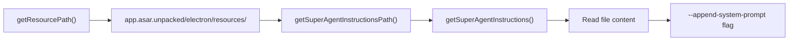
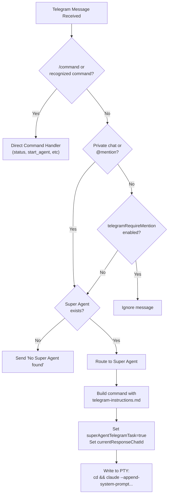
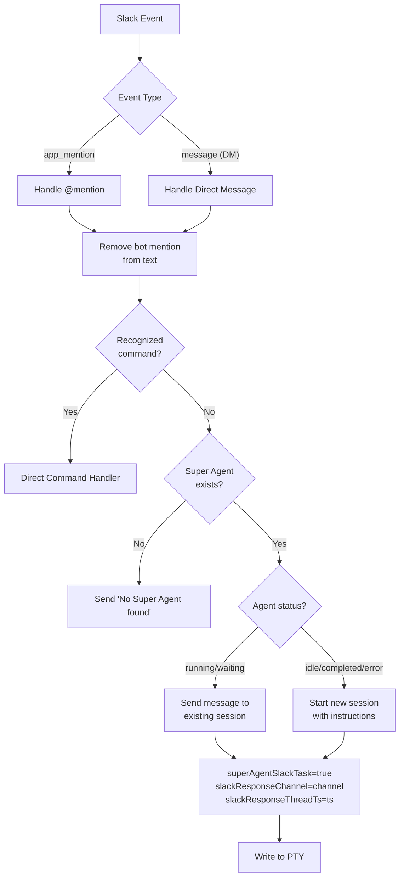
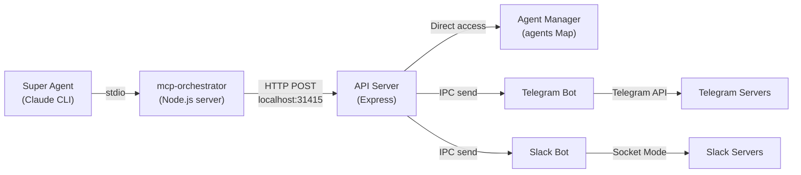
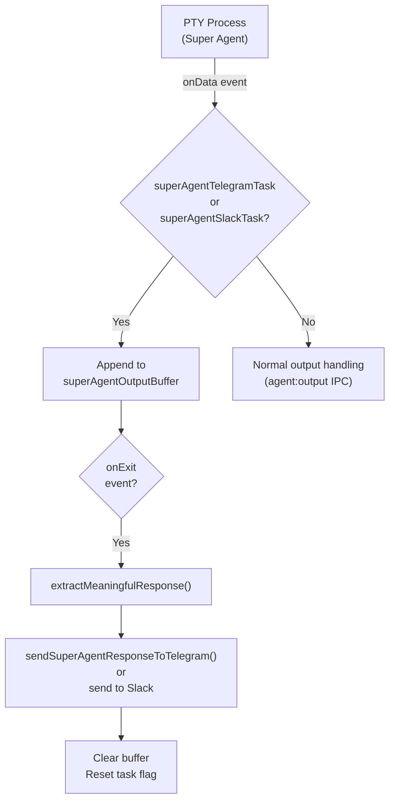
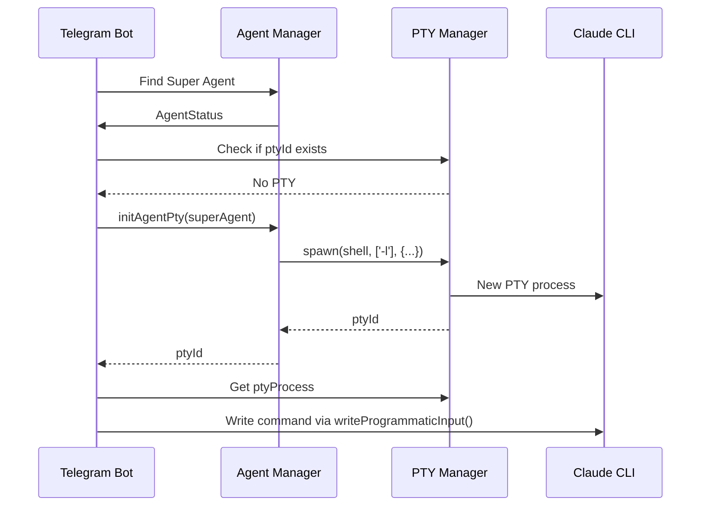
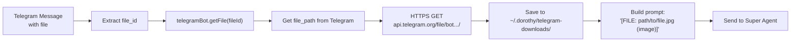
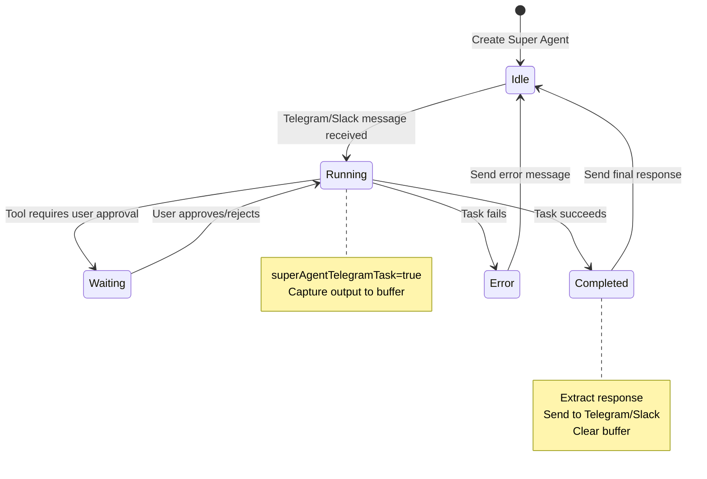

<!-- source: DeepWiki mcp.deepwiki.com · repo Charlie85270/Dorothy · page 9.3 Super Agent · fetched 2026-10-26 -->

# Super Agent

<details>
<summary>Relevant source files</summary>

The following files were used as context for generating this wiki page:

- [electron/main.ts](electron/main.ts)
- [electron/resources/telegram-instructions.md](electron/resources/telegram-instructions.md)
- [electron/services/slack-bot.ts](electron/services/slack-bot.ts)
- [electron/services/telegram-bot.ts](electron/services/telegram-bot.ts)
- [electron/utils/index.ts](electron/utils/index.ts)
- [src/components/Settings/TelegramSection.tsx](src/components/Settings/TelegramSection.tsx)
- [src/components/Settings/Toggle.tsx](src/components/Settings/Toggle.tsx)

</details>


This page documents the Super Agent, a special orchestration agent in Dorothy designed for remote control and conversational interfaces. The Super Agent coordinates other agents and provides a natural language interface for managing Dorothy through Telegram and Slack.

For information about creating and managing regular agents, see [Agents](#3). For details on Telegram bot setup and configuration, see [Telegram Bot](#9.1). For Slack integration, see [Slack Bot](#9.2).

---

## Overview

The Super Agent is a specialized agent that serves as Dorothy's conversational orchestrator for remote control. Unlike regular project-based agents, the Super Agent has access to MCP orchestrator tools that allow it to manage other agents, send messages to Telegram/Slack, and coordinate multi-agent workflows.

**Key Distinguishing Features:**

| Feature | Regular Agent | Super Agent |
|---------|--------------|-------------|
| **Purpose** | Execute tasks in a specific project | Orchestrate other agents and respond to chat messages |
| **MCP Tools** | Project-specific tools only | Agent management + messaging tools from mcp-orchestrator |
| **Invocation** | Manual start with task prompt | Automatic invocation from Telegram/Slack messages |
| **Instructions** | Standard CLAUDE.md | Special instruction files loaded via `--append-system-prompt` |
| **Output Handling** | Standard terminal output | Response extraction and forwarding to chat platforms |
| **Permissions** | Configurable | Always runs with `--dangerously-skip-permissions` |

Sources: [electron/services/telegram-bot.ts:514-600](), [electron/services/slack-bot.ts:514-610](), [electron/utils/index.ts:161-168]()

---

## Identification

Dorothy identifies the Super Agent using a simple name-based heuristic. Any agent whose name contains "super agent" or "orchestrator" (case-insensitive) is considered the Super Agent.

```typescript
// electron/utils/index.ts:161-164
export function isSuperAgent(agent: AgentStatus): boolean {
  const name = agent.name?.toLowerCase() || '';
  return name.includes('super agent') || name.includes('orchestrator');
}
```

**Finding the Super Agent:**

```typescript
// electron/utils/index.ts:166-168
export function getSuperAgent(agents: Map<string, AgentStatus>): AgentStatus | undefined {
  return Array.from(agents.values()).find(a => isSuperAgent(a));
}
```

When Telegram or Slack receives a conversational message (not a direct command like `/status`), Dorothy automatically routes it to the Super Agent if one exists.

Sources: [electron/utils/index.ts:161-168](), [electron/services/telegram-bot.ts:520-528](), [electron/services/slack-bot.ts:521-528]()

---

## Instruction Files

The Super Agent loads special markdown instruction files that define its behavior and workflow patterns. These files are located in `electron/resources/` and are unpacked to disk during build to allow external process access (Claude CLI cannot read inside `.asar` archives).

### super-agent-instructions.md

This file contains the base instructions for agent orchestration, including:
- How to use MCP tools for agent management
- When to use `send_telegram` and `send_slack` tools
- General orchestration patterns

**Loading Mechanism:**



Sources: [electron/utils/index.ts:214-256]()

### telegram-instructions.md

This file contains Telegram-specific workflow instructions that enforce a strict narration pattern. The core principle is:

**"The user sees NOTHING unless you send a message via `send_telegram`. Silence = broken."**

The instructions mandate a specific workflow pattern:

```
send_telegram → blocking_call → send_telegram with result
```

**Key Workflow Steps:**

1. **Acknowledge Receipt** - Immediate `send_telegram("Got it! Looking into this...")`
2. **Narrate Before Acting** - Before each blocking operation, explain what's about to happen
3. **Report Results** - After getting results, send concrete details
4. **Final Confirmation** - Never consider a task complete without a final message

**Example Workflow from Instructions:**

```markdown
User: "Run the tests for the auth module"

1. send_telegram("On it! Let me find the right agent for this.")
2. list_agents → find test-agent
3. send_telegram("Found the test agent. Running auth module tests now... This may take a minute.")
4. delegate_task(id="test-agent", prompt="Run tests for auth module") → wait
5. send_telegram("Tests completed! Results: 15 passed, 0 failed. All auth tests passing. ✅")
```

Sources: [electron/resources/telegram-instructions.md:1-73](), [electron/utils/index.ts:236-271]()

---

## Remote Control Integration

### Telegram Message Routing

The Telegram bot routes messages to the Super Agent based on message type and settings:

**Message Routing Decision Tree:**



**State Management:**

The Telegram bot maintains special state for Super Agent tasks:

| State Variable | Purpose | Scope |
|----------------|---------|-------|
| `superAgentTelegramTask` | Indicates Super Agent is handling a Telegram task | Global boolean |
| `superAgentOutputBuffer` | Captures output for response extraction | String array |
| `currentResponseChatId` | Tracks which chat to send responses to | String or null |

Sources: [electron/services/telegram-bot.ts:14-18](), [electron/services/telegram-bot.ts:209-269]()

### Slack Message Routing

Slack integration follows a similar pattern with Socket Mode for real-time messaging:



Sources: [electron/services/slack-bot.ts:127-179](), [electron/services/slack-bot.ts:514-610]()

---

## MCP Tool Access

The Super Agent has access to all tools from the `mcp-orchestrator` server, which provides agent management and messaging capabilities not available to regular agents.

### Agent Management Tools

| Tool | Purpose | Example Usage |
|------|---------|---------------|
| `list_agents` | Query all agents and their status | Check which agents are available before delegating |
| `create_agent` | Spawn a new ephemeral agent | Create temporary agent for one-time tasks |
| `start_agent` | Start an existing agent with a task | Delegate work to a specialized agent |
| `stop_agent` | Stop a running agent | Interrupt long-running tasks |
| `get_agent_output` | Retrieve agent's terminal output | Check progress or results |
| `wait_for_agent` | Block until agent completes | Synchronous delegation workflow |
| `delegate_task` | Start agent and wait for completion | Combined start + wait operation |
| `delete_agent` | Remove an agent permanently | Clean up ephemeral agents |

### Messaging Tools

| Tool | Purpose | Integration |
|------|---------|-------------|
| `send_telegram` | Send message to Telegram chat | Uses `currentResponseChatId` or authorized chats |
| `send_slack` | Send message to Slack channel | Uses `slackResponseChannel` and `slackResponseThreadTs` |

**API Server Bridge:**

The MCP orchestrator tools communicate with Dorothy's Electron main process via HTTP API on port 31415:



Sources: [electron/services/api-server.ts:1-300]() (referenced but not included in files), [electron/services/mcp-orchestrator.ts:1-100]() (referenced)

---

## Workflow Patterns

The Super Agent follows specific workflow patterns enforced by the `telegram-instructions.md` file. These patterns ensure users on mobile devices receive real-time updates since they cannot see terminal output.

### The Golden Rule

**"Narrate Everything Before Blocking Operations"**

Every blocking tool call (`delegate_task`, `wait_for_agent`, `start_agent`) MUST be preceded by a `send_telegram` or `send_slack` message telling the user what's happening.

### Required Pattern

```
send_telegram/send_slack → blocking_operation → send_telegram/send_slack with result
```

**Never call two blocking tools in a row without a message between them.**

### Step-by-Step Workflow

**Step 1: Acknowledge Receipt (Immediate)**

```
send_telegram("Got it! Looking into this...")
```

This must happen FIRST, before any other tool call, to confirm the message was received.

**Step 2: Narrate Before Acting**

Before each blocking operation:

| Before... | Send message like... |
|-----------|---------------------|
| `list_agents` | "Checking which agents are available..." |
| `delegate_task` | "Asking [agent name] to handle this. I'll let you know when they're done..." |
| `wait_for_agent` | "Waiting on [agent name] to finish..." |
| `start_agent` | "Starting [agent name] on [task]..." |

**Step 3: Report Results**

After getting results:
- Success: `send_telegram("Here's what I found: [concrete details]")`
- Errors: `send_telegram("Something went wrong: [error]. Trying [alternative]...")`
- Timeout: `send_telegram("[Agent] is still working. I'll keep waiting...")`

**Step 4: Final Confirmation (Critical)**

Never consider a task complete without sending a final message with:
- Specific details about what was done (not just "Done")
- Relevant output, errors, or next steps
- Concrete results or outcomes

### Multi-Agent Workflow Example

From `telegram-instructions.md`:

```markdown
User: "Deploy the new feature and update the docs"

1. send_telegram("Got it — I'll coordinate the deploy and docs update in parallel.")
2. list_agents → find deploy-agent and docs-agent
3. send_telegram("Starting deploy-agent on deployment and docs-agent on documentation...")
4. start_agent on both
5. send_telegram("Both agents are working. Waiting for deploy to finish first...")
6. wait_for_agent(id="deploy-agent") → done
7. send_telegram("Deploy finished successfully! Now waiting on docs...")
8. wait_for_agent(id="docs-agent") → done
9. send_telegram("All done! Deploy completed and docs are updated. Here's the summary: [details]")
```

Sources: [electron/resources/telegram-instructions.md:1-73]()

---

## Response Handling

The Super Agent's output requires special handling to extract meaningful responses from terminal output and forward them to chat platforms.

### Output Buffer Capture

When the Super Agent handles a Telegram or Slack task, Dorothy captures its output in a buffer:



**Buffer State Variables:**

| Variable | Type | Purpose |
|----------|------|---------|
| `superAgentOutputBuffer` | `string[]` | Accumulates raw terminal output |
| `superAgentTelegramTask` | `boolean` | Indicates Telegram task in progress |
| `superAgentSlackTask` | `boolean` | Indicates Slack task in progress |

Sources: [electron/services/telegram-bot.ts:14-18](), [electron/services/slack-bot.ts:16-18]()

### Response Extraction Algorithm

The response extraction logic removes ANSI escape codes, system messages, and tool indicators to find the actual response text:

```typescript
// Simplified from electron/services/telegram-bot.ts:116-200
function extractResponse(rawOutput: string[]) {
  // 1. Join buffer and remove ANSI escape codes
  const cleanOutput = rawOutput.join('')
    .replace(/\x1b\[[0-9;]*m/g, '')          // Color codes
    .replace(/\x1b\[\?[0-9]*[hl]/g, '')      // Cursor visibility
    .replace(/\x1b\][^\x07]*\x07/g, '')      // OSC sequences
    .replace(/[\x00-\x09\x0B-\x1F]/g, '');   // Control chars
  
  // 2. Split into lines
  const lines = cleanOutput.split('\n');
  
  // 3. Track when tool results appear
  let foundToolResult = false;
  const responseLines: string[] = [];
  
  // 4. Filter out system indicators and collect response text
  for (const line of lines) {
    const trimmed = line.trim();
    
    // Skip empty lines
    if (!trimmed) continue;
    
    // Detect tool result markers
    if (trimmed.includes('⎿') || trimmed.includes('(MCP)')) {
      foundToolResult = true;
      continue;
    }
    
    // Skip system indicators
    if (trimmed.startsWith('●') || trimmed.startsWith('⏺') ||
        trimmed.includes('ctrl+') || trimmed.startsWith('---') ||
        trimmed.includes('│')) {
      continue;
    }
    
    // After tool results, collect meaningful text
    if (foundToolResult && trimmed.length > 3) {
      responseLines.push(trimmed);
    }
  }
  
  // 5. Take last 40 lines (most relevant)
  return responseLines.slice(-40).join('\n').trim();
}
```

**Fallback Behavior:**

If no response lines are found after filtering:
- Telegram: `sendTelegramMessage("✅ Super Agent completed the task.")`
- Slack: Similar default completion message

Sources: [electron/services/telegram-bot.ts:116-200]()

---

## Technical Implementation

### PTY Initialization

The Super Agent uses the same PTY infrastructure as regular agents but with different command construction:



### Command Construction

The Super Agent command differs from regular agents by including instruction files and MCP config:

**For Telegram Tasks:**

```typescript
// Simplified from electron/services/telegram-bot.ts:600-750
function buildSuperAgentCommand(message: string) {
  let command = 'claude';
  
  // 1. Add MCP config
  const mcpConfigPath = '~/.claude/mcp.json';
  command += ` --mcp-config '${mcpConfigPath}'`;
  
  // 2. Add super agent instructions via system prompt
  const instructions = getSuperAgentInstructions();
  const escapedInstructions = instructions.replace(/'/g, "'\\''");
  command += ` --append-system-prompt "${escapedInstructions}"`;
  
  // 3. Add Telegram-specific instructions
  const telegramInstructions = getTelegramInstructions();
  const escapedTg = telegramInstructions.replace(/'/g, "'\\''");
  command += ` --append-system-prompt "${escapedTg}"`;
  
  // 4. Always skip permissions
  command += ' --dangerously-skip-permissions';
  
  // 5. Add Dorothy directory for agent management
  command += ` --add-dir '${homedir}/.dorothy'`;
  
  // 6. Build user prompt with context
  const userPrompt = `[FROM TELEGRAM - Use send_telegram MCP tool to respond!] ${message}`;
  command += ` '${userPrompt.replace(/'/g, "'\\''")}'`;
  
  return command;
}
```

**For Slack Tasks:**

Similar to Telegram but with `[FROM SLACK - Use send_slack MCP tool to respond!]` prefix.

Sources: [electron/services/telegram-bot.ts:651-730](), [electron/services/slack-bot.ts:560-605]()

### File Downloads (Telegram Only)

The Telegram integration supports file downloads (photos, videos, documents) that are passed to the Super Agent:



**File Type Detection:**

The system detects file types based on MIME type and extension:

| File Type | Extensions | MIME Type Prefix |
|-----------|-----------|------------------|
| Image | `.jpg`, `.png`, `.gif`, `.webp` | `image/*` |
| Video | `.mp4`, `.mov`, `.avi`, `.webm` | `video/*` |
| Audio | `.mp3`, `.wav`, `.ogg`, `.m4a` | `audio/*` |
| Document | `.doc`, `.docx`, `.pdf`, `.odt` | `application/pdf`, `*document*` |
| Code | `.js`, `.py`, `.java`, `.cpp` | - |

Sources: [electron/services/telegram-bot.ts:302-374]()

---

## State Management

The Super Agent's state is managed through several interconnected systems:

**Agent State (Standard):**

```typescript
interface AgentStatus {
  id: string;
  name: string;              // Must include "super agent" or "orchestrator"
  status: 'idle' | 'running' | 'waiting' | 'completed' | 'error';
  projectPath: string;       // Usually ~/.dorothy
  skills: string[];
  output: string[];
  currentTask?: string;
  ptyId?: string;
  skipPermissions: boolean;  // Always true for Super Agent
  // ... other fields
}
```

**Remote Control State:**

| Context | State Variables | Purpose |
|---------|----------------|---------|
| **Telegram** | `superAgentTelegramTask: boolean` | Active Telegram task flag |
| | `superAgentOutputBuffer: string[]` | Output capture for response |
| | `currentResponseChatId: string \| null` | Target chat for responses |
| **Slack** | `superAgentSlackTask: boolean` | Active Slack task flag |
| | `superAgentSlackBuffer: string[]` | Output capture for response |
| | `slackResponseChannel: string \| null` | Target channel for responses |
| | `slackResponseThreadTs: string \| null` | Thread timestamp for replies |

**State Transitions:**



Sources: [electron/services/telegram-bot.ts:14-18](), [electron/services/slack-bot.ts:12-62](), [electron/core/agent-manager.ts:1-100]() (referenced)

---

