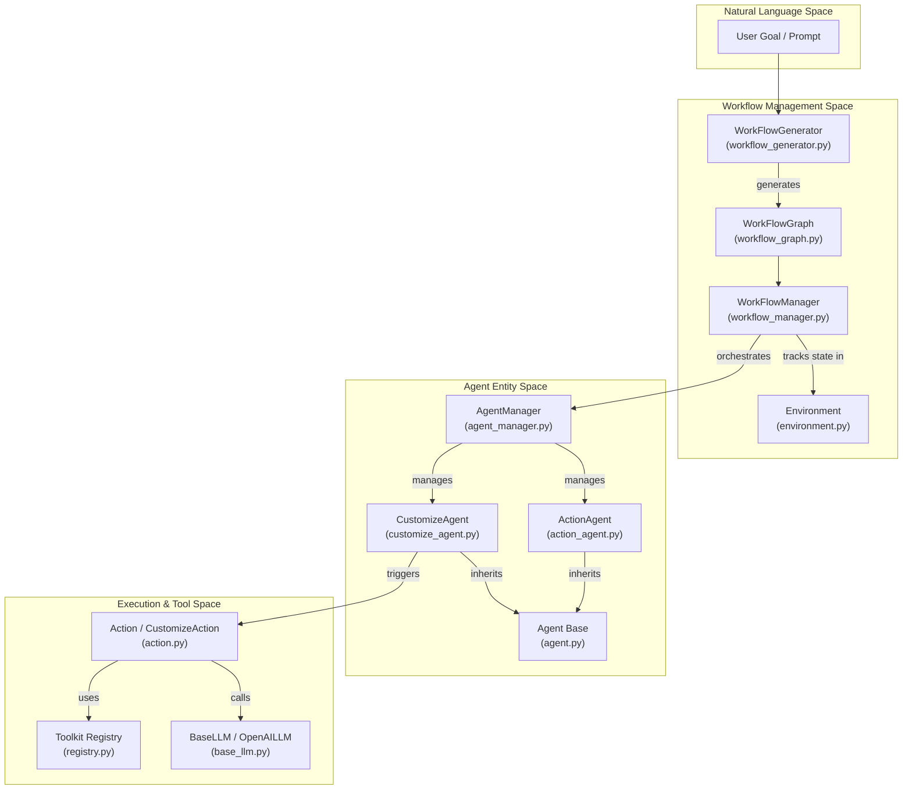
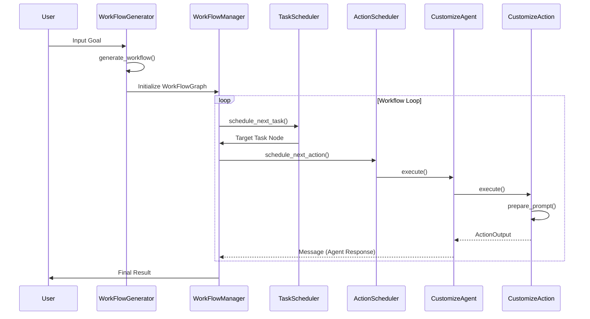

<!-- source: DeepWiki mcp.deepwiki.com · repo EvoAgentX/EvoAgentX · page 1 Overview · fetched 2026-10-26 -->

# Overview

Relevant source files

The following files were used as context for generating this wiki page:

- [README-zh.md](README-zh.md)
- [README.md](README.md)
- [assets/EAXLoGo.svg](assets/EAXLoGo.svg)
- [docs/assets/logo.svg](docs/assets/logo.svg)
- [docs/index.md](docs/index.md)
- [docs/overrides/main.html](docs/overrides/main.html)
- [docs/stylesheets/extra.css](docs/stylesheets/extra.css)
- [docs/zh/index.md](docs/zh/index.md)
- [evoagentx/agents/__init__.py](evoagentx/agents/__init__.py)
- [evoagentx/agents/action_agent.py](evoagentx/agents/action_agent.py)
- [evoagentx/core/registry.py](evoagentx/core/registry.py)
- [evoagentx/workflow/__init__.py](evoagentx/workflow/__init__.py)
- [examples/action_agent.py](examples/action_agent.py)
- [mkdocs.yml](mkdocs.yml)

## Purpose and Scope

This document provides an introduction to the EvoAgentX framework, its core purpose as a framework for building, evaluating, and evolving LLM-based agentic workflows, and a high-level architecture overview. EvoAgentX is an automated ecosystem that enables developers and researchers to move beyond static prompt chaining or manual workflow orchestration by introducing self-evolving capabilities.

For detailed installation instructions, see [Installation and Setup](#1.1). For fundamental concepts and terminology, see [Key Concepts](#1.2).

## What is EvoAgentX

EvoAgentX is an open-source framework designed to automate the complete lifecycle of agentic workflows. The system transforms natural language goals into executable multi-agent workflows, evaluates their performance, and iteratively optimizes them using various evolution algorithms—much like how software is continuously tested and improved.

### Core Design Philosophy

EvoAgentX enables users to go from a vague idea to a fully functional agentic system with minimal engineering. The framework is built on several pillars:

1.  **Workflow Autoconstruction**: Building structured, multi-agent workflows tailored to a task from a single prompt via `WorkFlowGenerator` [evoagentx/workflow/workflow_generator.py:7-7]().
2.  **Built-in Evaluation**: Integrating automatic evaluators to score agent behavior using task-specific criteria.
3.  **Self-Evolution Engine**: Improving workflows using optimization strategies like textual gradients, mutation, and guided search.
4.  **Human-in-the-Loop (HITL)**: Supporting interactive workflows where humans review, correct, and guide agent behavior via the `HITLManager` [evoagentx/hitl/__init__.py]().

**Sources:** [README.md:38-40](), [README.md:41-70](), [docs/index.md:12-46]()

## Core Architecture

EvoAgentX follows a modular, layered architecture that bridges high-level natural language goals with low-level code execution and tool interaction.

### System Architecture Diagram

This diagram illustrates how high-level system components map to specific code entities within the framework.

**Sources:** [evoagentx/workflow/__init__.py:7-10](), [evoagentx/agents/__init__.py:1-4](), [evoagentx/core/registry.py:3-21](), [evoagentx/agents/action_agent.py:15-15]()

## Workflow Execution Process

The execution process in EvoAgentX involves a dual-level scheduling mechanism that handles both high-level task transitions and low-level agent actions.

### Execution Flow and Entity Mapping

The following diagram bridges the execution logic with the specific classes responsible for each phase.

### Key Execution Components

| Component | Code Entity | Role |
| :--- | :--- | :--- |
| **Workflow Orchestrator** | `WorkFlow` [evoagentx/workflow/workflow.py:9-9]() | The main execution loop that drives the graph. |
| **Task Decision Maker** | `TaskScheduler` [evoagentx/workflow/workflow_manager.py]() | Determines the next high-level node in the `WorkFlowGraph`. |
| **Action Decision Maker** | `ActionScheduler` [evoagentx/workflow/workflow_manager.py]() | Determines which specific `Action` an agent should perform. |
| **Dynamic Agent** | `CustomizeAgent` [evoagentx/agents/customize_agent.py:2-2]() | An LLM-powered agent with configurable prompts and tools. |
| **Functional Agent** | `ActionAgent` [evoagentx/agents/action_agent.py:15-15]() | A specialized agent that executes code/functions directly without an LLM. |

**Sources:** [evoagentx/workflow/workflow.py:9-10](), [evoagentx/agents/action_agent.py:15-17](), [README.md:253-276]()

## Core Capabilities Overview

EvoAgentX is distinguished by its ability to not just run agents, but to evolve them.

*   **Self-Evolution Engine**: Includes optimizers like `TextGradOptimizer`, `MiproOptimizer`, and `AFlowOptimizer` to refine prompts and graph structures based on performance data [README.md:51-53]().
*   **Comprehensive Tooling**: Built-in support for Python interpreters, Docker, web search, Gmail, and the Model Context Protocol (MCP) [README.md:58-60]().
*   **Memory System**: Supports both `ShortTermMemory` for session context and `LongTermMemory` for persistent knowledge [README.md:62-64]().
*   **Benchmarking**: Integrated evaluation against standard datasets like HotPotQA, MBPP, and MATH [README.md:47-49]().

For a deep dive into these components, see [Key Concepts](#1.2).

**Sources:** [README.md:41-70](), [docs/index.md:17-46](), [evoagentx/workflow/__init__.py:7-10]()

---

