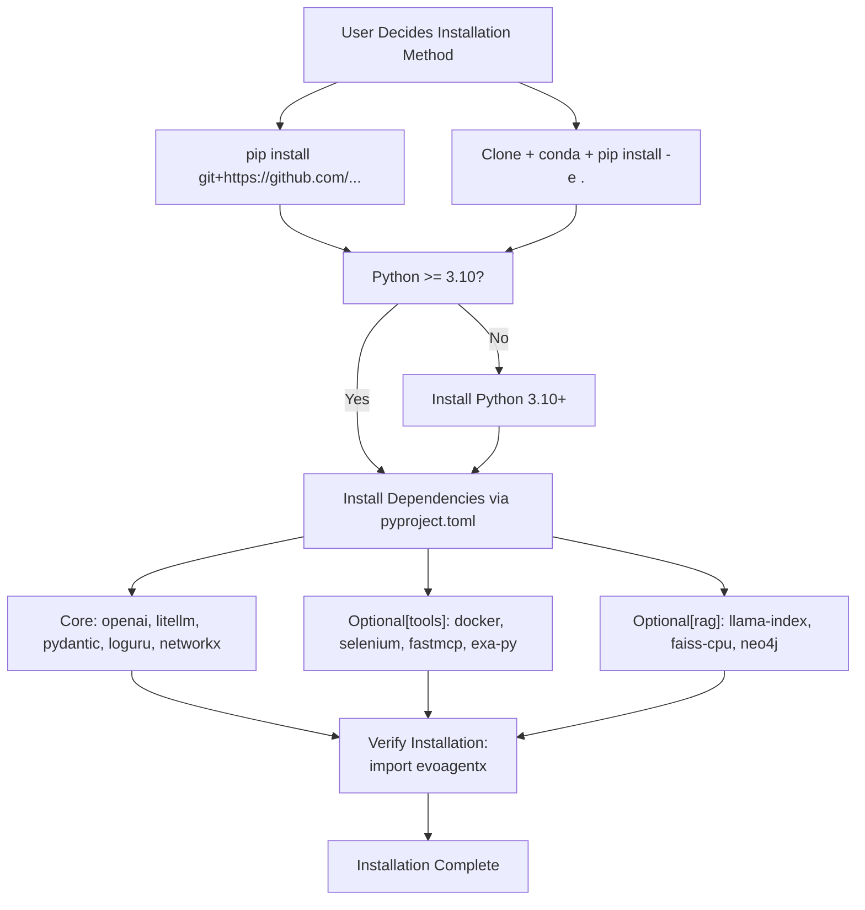
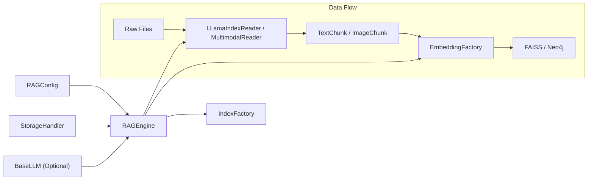

<!-- source: DeepWiki mcp.deepwiki.com · repo EvoAgentX/EvoAgentX · page 1.1 Installation and Setup · fetched 2026-10-26 -->

# Installation and Setup

<details>
<summary>Relevant source files</summary>

The following files were used as context for generating this wiki page:

- [.env.example](.env.example)
- [docs/installation.md](docs/installation.md)
- [docs/quickstart.md](docs/quickstart.md)
- [docs/zh/installation.md](docs/zh/installation.md)
- [docs/zh/quickstart.md](docs/zh/quickstart.md)
- [evoagentx/app/.env.example](evoagentx/app/.env.example)
- [evoagentx/fastapi_docs.md](evoagentx/fastapi_docs.md)
- [evoagentx/rag/embeddings/azure_openai_embedding.py](evoagentx/rag/embeddings/azure_openai_embedding.py)
- [evoagentx/rag/rag.py](evoagentx/rag/rag.py)
- [evoagentx/tools/search_exa.py](evoagentx/tools/search_exa.py)
- [examples/rag/multimodal_rag.py](examples/rag/multimodal_rag.py)
- [examples/rag/rag.py](examples/rag/rag.py)
- [pyproject.toml](pyproject.toml)
- [pytest.ini](pytest.ini)
- [requirements.txt](requirements.txt)

</details>


This document provides comprehensive instructions for installing EvoAgentX and configuring the framework for first use. It covers multiple installation methods, dependency management, LLM provider configuration, and initial verification steps.

For information about building your first agent after installation, see [Quick Start Guide](#2.1). For detailed LLM model configuration options, see [Model Configuration](#6.2).

---

## Installation Methods

EvoAgentX supports three primary installation methods, each suited to different use cases.

### Standard Installation via pip (Recommended)

The recommended installation method for most users is via `pip` directly from the repository:

```bash
pip install git+https://github.com/EvoAgentX/EvoAgentX.git
```

You can also install specific feature sets using extras:

```bash
pip install "evoagentx[rag]"
pip install "evoagentx[tools]"
pip install "evoagentx[server]"
pip install "evoagentx[multimodal]"
pip install "evoagentx[optimizers]"
pip install "evoagentx[benchmarks]"
pip install "evoagentx[viz]"
pip install "evoagentx[all]"
```

**Sources:** [docs/installation.md:18-37](), [docs/quickstart.md:9-12]()

### Local Development Setup

For contributors and developers who need to modify the framework:

```bash
# Clone the repository
git clone https://github.com/EvoAgentX/EvoAgentX.git
cd EvoAgentX

# Create and activate a conda environment
conda create -n evoagentx python=3.11
conda activate evoagentx

# Install in development mode (editable)
pip install -e .
# Or with dev and specific features
pip install -e ".[dev,rag,tools,server]"
```

Development mode (`-e` flag) allows code changes to take effect immediately without reinstalling.

**Sources:** [docs/installation.md:39-71](), [pyproject.toml:1-159]()

---

## Installation Flow Diagram



**Sources:** [pyproject.toml:10-150](), [docs/installation.md:14-71]()

---

## Python Version Requirements

EvoAgentX requires **Python 3.10 or higher**.

Check your Python version:
```bash
python --version
```

**Sources:** [pyproject.toml:10](), [docs/installation.md:9]()

---

## Core Dependencies

The framework relies on several key dependency categories defined in `pyproject.toml`:

| Category | Key Packages | Purpose |
|----------|--------------|---------|
| **LLM Integration** | `openai>=1.55.3`, `litellm>=1.55.6`, `dashscope>=1.23.4` | Interface with multiple LLM providers |
| **Data Validation** | `pydantic>=2.9.0` | Type-safe configuration and data models |
| **Logging** | `loguru>=0.7.3` | Structured logging across the framework |
| **Graph Processing** | `networkx>=3.3` | Workflow graph construction and traversal |
| **Optimization** | `textgrad>=0.1.8`, `dspy` | Self-evolution algorithms (via `[optimizers]`) |
| **RAG System** | `llama-index`, `faiss-cpu==1.8.0.post1`, `neo4j` | Document retrieval and indexing (via `[rag]`) |
| **Server** | `fastapi`, `uvicorn`, `motor`, `redis` | REST API and task queue (via `[server]`) |

**Sources:** [pyproject.toml:19-150](), [requirements.txt:1-104]()

---

## Tool Dependencies

EvoAgentX ships with a comprehensive toolkit requiring additional dependencies (included in the `[tools]` extra):

- `docker>=6.1.2` - For isolated code execution.
- `googlesearch-python`, `wikipedia`, `exa-py>=2.0.0` - Search integration. [evoagentx/tools/search_exa.py:77]()
- `selenium`, `html2text`, `browser-use` - Browser automation.
- `fastmcp>=2.2.0`, `mcp` - Model Context Protocol support.
- `PyPDF2`, `docx2txt`, `python-pptx`, `Pillow` - Document and image processing.

**Sources:** [pyproject.toml:72-86](), [requirements.txt:73-92]()

---

## API Key Configuration

### Method 1: Environment Variables

Set API keys as environment variables in your terminal:

**Linux/macOS:**
```bash
export OPENAI_API_KEY=<your-openai-api-key>
```

**Windows PowerShell:**
```powershell
$env:OPENAI_API_KEY="<your-openai-api-key>"
```

**Sources:** [docs/quickstart.md:19-43]()

### Method 2: .env File (Recommended)

Create a `.env` file in your project root. An example is provided in `.env.example`:

```bash
OPENAI_API_KEY=<your-openai-api-key>
ANTHROPIC_API_KEY=<your-anthropic-api-key>
VOYAGE_API_KEY=<your-voyage-api-key>
EXA_API_KEY=<your-exa-api-key>
AZURE_EMBED_API_KEY=<your-azure-embed-api-key>
```

Load in your application:
```python
from dotenv import load_dotenv
import os

load_dotenv()
```

**Sources:** [.env.example:1-8](), [docs/quickstart.md:44-61]()

---

## LLM Configuration and Initialization

EvoAgentX uses configuration classes to initialize models.

### OpenAI Configuration Example

```python
from evoagentx.models import OpenAILLMConfig, OpenAILLM
import os

# Define LLM configuration
openai_config = OpenAILLMConfig(
    model="gpt-4o-mini",       
    openai_key=os.getenv("OPENAI_API_KEY"), 
    stream=True,               
    output_response=True       
)

# Initialize the language model
llm = OpenAILLM(config=openai_config)
```

**Sources:** [docs/quickstart.md:63-85]()

### Azure OpenAI Embedding Example

For RAG workflows, embedding models are configured similarly.

```python
from evoagentx.rag.rag_config import EmbeddingConfig
import os

embedding = EmbeddingConfig(
    provider="azure_openai",
    model_name=os.environ["AZURE_EMBED_DEPLOYMENT"],
    api_key=os.environ["AZURE_EMBED_API_KEY"],
    azure_endpoint=os.environ["AZURE_EMBED_ENDPOINT"],
    api_version=os.environ["AZURE_EMBED_API_VERSION"],
)
```

**Sources:** [examples/rag/rag.py:91-99](), [evoagentx/rag/embeddings/azure_openai_embedding.py:24-46]()

---

## RAG Engine Setup

The `RAGEngine` bridges storage, embeddings, and document processing.



**Sources:** [evoagentx/rag/rag.py:25-93](), [examples/rag/rag.py:102-146]()

---

## Verification Steps

After installation, verify your setup:

### 1. Version Check
```python
import evoagentx
print(evoagentx.__version__)
```

### 2. LLM Connection Test
```python
from evoagentx.models import OpenAILLM, OpenAILLMConfig
import os

config = OpenAILLMConfig(model="gpt-4o-mini", openai_key=os.getenv("OPENAI_API_KEY"))
llm = OpenAILLM(config=config)
print(llm.generate(prompt="Hello!"))
```

### 3. API Server Setup (Optional)
If you installed the `[server]` extra, you can start the FastAPI server:
```bash
python -m evoagentx.app.main
```
The API will be available at `http://localhost:8000`.

**Sources:** [docs/installation.md:73-85](), [evoagentx/fastapi_docs.md:19-39]()

---

## Common Installation Issues

- **Python Version**: Ensure you are using Python 3.10+. [pyproject.toml:10]()
- **FAISS**: The CPU version `faiss-cpu==1.8.0.post1` is the default. For GPU support, manual installation of `faiss-gpu` is required. [requirements.txt:37-38]()
- **Pydantic**: Framework requires `pydantic>=2.9.0`. [requirements.txt:25]()
- **Exa Search**: Requires `EXA_API_KEY` to be set for the `SearchExa` tool to function. [evoagentx/tools/search_exa.py:60-61]()

**Sources:** [requirements.txt:1-104](), [pyproject.toml:1-159]()

---

