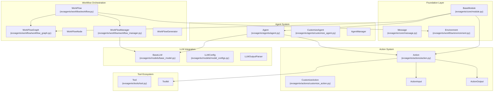
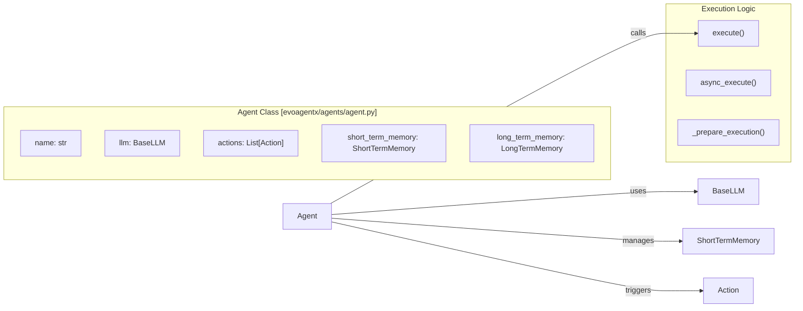

<!-- source: DeepWiki mcp.deepwiki.com · repo EvoAgentX/EvoAgentX · page 1.2 Key Concepts · fetched 2026-10-26 -->

# Key Concepts

Relevant source files

The following files were used as context for generating this wiki page:

- [README-zh.md](README-zh.md)
- [README.md](README.md)
- [assets/EAXLoGo.svg](assets/EAXLoGo.svg)
- [docs/assets/logo.svg](docs/assets/logo.svg)
- [docs/index.md](docs/index.md)
- [docs/overrides/main.html](docs/overrides/main.html)
- [docs/stylesheets/extra.css](docs/stylesheets/extra.css)
- [docs/zh/index.md](docs/zh/index.md)
- [evoagentx/actions/action.py](evoagentx/actions/action.py)
- [evoagentx/agents/agent.py](evoagentx/agents/agent.py)
- [evoagentx/core/message.py](evoagentx/core/message.py)
- [evoagentx/core/module.py](evoagentx/core/module.py)
- [evoagentx/core/module_utils.py](evoagentx/core/module_utils.py)
- [evoagentx/models/base_model.py](evoagentx/models/base_model.py)
- [mkdocs.yml](mkdocs.yml)

This page introduces the fundamental concepts that form the foundation of the EvoAgentX framework. It covers the core abstractions, their relationships, and how they work together to enable the creation and execution of self-evolving agentic workflows.

## Core Architecture Overview

EvoAgentX is built around several interconnected concepts that work together to create intelligent, self-evolving multi-agent workflows. The framework follows a modular design where each concept has specific responsibilities and well-defined interfaces. All major components inherit from `BaseModule` for consistent serialization and lifecycle management [evoagentx/core/module.py:51-51]().

### System Components

The following diagram shows the key components and their relationships, associating high-level concepts with their specific implementation classes.

Sources: [evoagentx/core/module.py:51-51](), [evoagentx/agents/agent.py:20-20](), [evoagentx/actions/action.py:108-108](), [evoagentx/workflow/workflow.py:22-22](), [evoagentx/models/base_model.py:338-338]()

## BaseModule Foundation

All major components in EvoAgentX inherit from `BaseModule`, which provides serialization, deserialization, and lifecycle management capabilities [evoagentx/core/module.py:51-51]().

| Property | Description | Code Location |
|----------|-------------|---------------|
| **MetaModule** | Metaclass for automatic registration in `MODULE_REGISTRY` | [evoagentx/core/module.py:24-48]() |
| **Serialization** | Methods like `to_dict` and `to_json` for exporting state | [evoagentx/core/module.py:385-418]() |
| **Deserialization** | Methods like `from_dict` and `from_json` for instantiation | [evoagentx/core/module.py:182-251]() |
| **Validation** | Uses Pydantic for attribute validation during `__init__` | [evoagentx/core/module.py:83-118]() |

Sources: [evoagentx/core/module.py:24-418]()

## Agents

Agents are autonomous execution units that perform actions using LLMs. The base `Agent` class manages identity, LLM configuration, and memory [evoagentx/agents/agent.py:20-52]().

### Agent Architecture

The `Agent` class serves as the base for specialized agents like `CustomizeAgent` and the tool-heavy `Alita` agent.

Sources: [evoagentx/agents/agent.py:20-127]()

### Key Agent Properties

| Property | Type | Description |
|----------|------|-------------|
| `agent_id` | `str` | Unique ID, auto-generated using `uuid4` [evoagentx/agents/agent.py:42-42]() |
| `system_prompt` | `str` | High-level instructions defining the agent's persona [evoagentx/agents/agent.py:43-43]() |
| `short_term_memory` | `ShortTermMemory` | Stores messages for the current workflow session [evoagentx/agents/agent.py:44-44]() |
| `actions` | `List[Action]` | The set of capabilities the agent can perform [evoagentx/agents/agent.py:49-49]() |

Sources: [evoagentx/agents/agent.py:38-52]()

## Actions and Tools

Actions represent discrete operations. While a standard `Action` defines a fixed operation, `CustomizeAction` integrates with `Toolkit` to provide dynamic tool-calling capabilities [evoagentx/actions/action.py:108-122](), [evoagentx/actions/customize_action.py:19-30]().

### Tool Ecosystem
EvoAgentX ships with a comprehensive suite of built-in tools [README.md:128-135]():
*   **Code Interpreters**: Python and Docker based execution.
*   **Search**: Google, Wikipedia, ArXiv, and Exa.
*   **Databases**: PostgreSQL, MongoDB, and FAISS.
*   **Communication**: Comprehensive Gmail integration.
*   **Browser**: Selenium-based and natural language browser control.

Sources: [README.md:128-135](), [evoagentx/actions/action.py:119-122]()

## Workflow System

Workflows coordinate multiple agents to accomplish complex goals through graph-based task decomposition.

### WorkFlowGraph
A `WorkFlowGraph` consists of `WorkFlowNode` (tasks) and `WorkFlowEdge` (dependencies) [evoagentx/workflow/workflow_graph.py:24-38]().
*   **WorkFlowNode**: Defines a specific task, its required inputs/outputs, and the agents assigned to it [evoagentx/workflow/workflow_graph.py:40-58]().
*   **WorkFlowEdge**: Defines the sequence and priority of task execution [evoagentx/workflow/workflow_graph.py:226-234]().

### WorkFlowManager and Schedulers
The `WorkFlowManager` uses two specialized schedulers to drive execution [evoagentx/workflow/workflow_manager.py:21-44]():
1.  **TaskScheduler**: Decides which node in the `WorkFlowGraph` should run next based on the `Environment` state.
2.  **ActionScheduler**: For a specific task, decides which agent and action to trigger.

Sources: [evoagentx/workflow/workflow_graph.py:24-234](), [evoagentx/workflow/workflow_manager.py:21-44]()

## Self-Evolution

The **Self-Evolution Engine** is a core differentiator of EvoAgentX. It allows the framework to move beyond static workflows by iteratively optimizing them [README.md:51-53]().

| Concept | Implementation | Description |
|----------|----------------|-------------|
| **Optimization** | `BaseOptimizer` | Base class for evolution algorithms like TextGrad, AFlow, and SEW. |
| **Evaluation** | `Evaluator` | Automatically scores agent behavior against task-specific criteria [README.md:47-49](). |
| **Feedback Loop** | Iterative Loop | The engine uses evaluator scores to mutate prompts or workflow structures. |

Sources: [README.md:38-53]()

## Human-in-the-Loop (HITL)

EvoAgentX supports interactive workflows where humans can review, correct, or guide agent behavior [README.md:66-68]().
*   **HITLManager**: Controls the activation of oversight.
*   **HITLInterceptorAgent**: Acts as a gatekeeper for actions, requiring approval for sensitive operations.
*   **Workflow Editor**: Allows LLM-assisted modification of the workflow graph during execution.

Sources: [README.md:66-68]()

---

