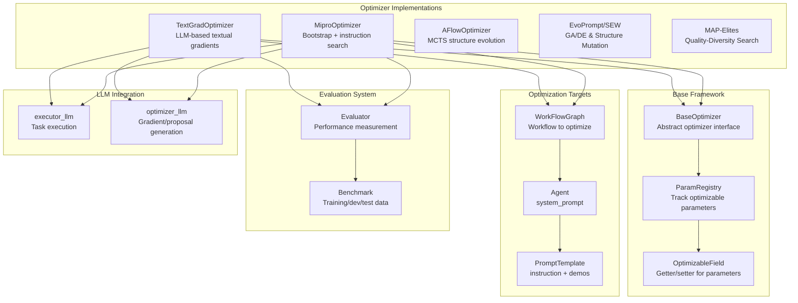

<!-- source: DeepWiki mcp.deepwiki.com · repo EvoAgentX/EvoAgentX · page 10 Optimization and Evolution · fetched 2026-10-26 -->

# Optimization and Evolution

Relevant source files

The following files were used as context for generating this wiki page:

- [Wonderful_workflow_corpus/Fengshui_analysis/tools.json](Wonderful_workflow_corpus/Fengshui_analysis/tools.json)
- [Wonderful_workflow_corpus/Fengshui_analysis/workflow.json](Wonderful_workflow_corpus/Fengshui_analysis/workflow.json)
- [Wonderful_workflow_corpus/README.md](Wonderful_workflow_corpus/README.md)
- [Wonderful_workflow_corpus/travel_recommendation/tools.json](Wonderful_workflow_corpus/travel_recommendation/tools.json)
- [Wonderful_workflow_corpus/travel_recommendation/workflow.json](Wonderful_workflow_corpus/travel_recommendation/workflow.json)
- [evoagentx/optimizers/engine/__init__.py](evoagentx/optimizers/engine/__init__.py)
- [evoagentx/optimizers/engine/base.py](evoagentx/optimizers/engine/base.py)
- [evoagentx/optimizers/engine/decorators.py](evoagentx/optimizers/engine/decorators.py)
- [evoagentx/optimizers/engine/registry.py](evoagentx/optimizers/engine/registry.py)
- [evoagentx/optimizers/example_optimizer.py](evoagentx/optimizers/example_optimizer.py)
- [evoagentx/optimizers/mipro_optimizer.py](evoagentx/optimizers/mipro_optimizer.py)
- [evoagentx/optimizers/optimizer_core.py](evoagentx/optimizers/optimizer_core.py)
- [evoagentx/optimizers/textgrad_optimizer.py](evoagentx/optimizers/textgrad_optimizer.py)
- [evoagentx/prompts/optimizers/textgrad_optimizer.py](evoagentx/prompts/optimizers/textgrad_optimizer.py)
- [evoagentx/utils/mipro_utils/module_utils.py](evoagentx/utils/mipro_utils/module_utils.py)
- [evoagentx/utils/mipro_utils/register_utils.py](evoagentx/utils/mipro_utils/register_utils.py)
- [evoagentx/utils/mipro_utils/signature_utils.py](evoagentx/utils/mipro_utils/signature_utils.py)
- [examples/optimization/mipro/math_mipro.py](examples/optimization/mipro/math_mipro.py)
- [examples/optimization/mipro/math_plug_and_play.py](examples/optimization/mipro/math_plug_and_play.py)

The optimization and evolution system in EvoAgentX provides automated self-improvement capabilities for agent workflows through multiple optimization algorithms. This system enables agents to evolve their prompts, workflow structures, and parameters based on performance feedback from benchmark evaluations.

EvoAgentX implements several primary optimization algorithms: **TextGrad** (prompt optimization through textual gradients), **MIPRO** (multi-stage prompt and demonstration optimization), **AFlow** (workflow structure evolution via Monte Carlo Tree Search), **EvoPrompt/SEW** (evolutionary algorithms for prompts and structures), and **MAP-Elites** (quality-diversity search). Each algorithm optimizes different aspects of agent behavior while sharing a common framework built around `ParamRegistry` and `BaseOptimizer`.

For information about evaluating optimized workflows, see [Benchmarking and Evaluation](#9). For details on the specific agents and workflows being optimized, see [Agent System](#3) and [Workflow System](#4).

## Optimization System Architecture

The optimization framework is built around a modular architecture with three layers: the base framework (`ParamRegistry` and `BaseOptimizer`), optimizer implementations, and evaluation infrastructure. This design enables different optimization algorithms to share common parameter tracking and evaluation mechanisms while implementing their own search strategies.

### Overall Optimization Architecture

Sources: [evoagentx/optimizers/engine/base.py:6-70](), [evoagentx/optimizers/engine/registry.py:109-281](), [evoagentx/optimizers/textgrad_optimizer.py:161-234](), [evoagentx/optimizers/mipro_optimizer.py:309-434]()

## Optimization Framework

The foundation of the evolution engine is the `BaseOptimizer` and `ParamRegistry`. This framework allows any runtime attribute (like a prompt string or a model hyperparameter) to be registered as an `OptimizableField`.

- **ParamRegistry**: Acts as a central repository for parameters. It supports tracking nested attributes using dot-notation or bracket-indexing (e.g., `agent.actions[0].prompt_template.instruction`).
- **BaseOptimizer**: Provides the standard interface for all search algorithms, including methods like `apply_cfg()` to inject new parameters into the live system and `optimize()` to start the search loop.

For details, see [Optimization Framework](#10.1).

Sources: [evoagentx/optimizers/engine/registry.py:109-181](), [evoagentx/optimizers/engine/base.py:14-70](), [evoagentx/optimizers/optimizer_core.py:28-60]()

## TextGrad Optimization

TextGrad treats prompts as differentiable variables. Instead of numeric gradients, it uses LLMs to backpropagate "textual gradients"—natural language feedback that describes how a prompt should be modified to improve the agent's output.

- **Variable System**: Prompts are wrapped in `textgrad.Variable` objects.
- **Backward Pass**: When an agent fails a task, the `optimizer_llm` analyzes the failure and generates a textual gradient.
- **Optimization Step**: The optimizer uses these gradients to synthesize an improved version of the prompt.

For details, see [TextGrad Optimization](#10.2).

Sources: [evoagentx/optimizers/textgrad_optimizer.py:108-158](), [evoagentx/optimizers/textgrad_optimizer.py:161-234](), [evoagentx/prompts/optimizers/textgrad_optimizer.py:41-62]()

## MIPRO Optimization

MIPRO (Multi-stage Instruction Proposal and Refinement Optimizer) is a sophisticated search algorithm derived from DSPy. It optimizes agents by combining bootstrapped few-shot examples with LLM-generated instruction proposals.

- **Bootstrap**: It identifies successful execution traces to create high-quality few-shot demonstrations.
- **Grounding**: It uses the `GroundedProposer` to generate instruction candidates that are relevant to the specific data and program structure.
- **Search**: It uses Optuna to search the combined space of instruction candidates and demonstration sets.

For details, see [MIPRO Optimization](#10.3).

Sources: [evoagentx/optimizers/mipro_optimizer.py:27-39](), [evoagentx/optimizers/mipro_optimizer.py:309-434](), [evoagentx/utils/mipro_utils/module_utils.py:17-83]()

## AFlow Optimization

AFlow focuses on evolving the structure of the agentic workflow itself. It treats the workflow as a graph that can be modified by adding, removing, or reordering nodes (agents/actions).

- **MCTS Search**: Uses Monte Carlo Tree Search to explore the space of possible workflow architectures.
- **Structure Evolution**: Can transform a simple sequential workflow into complex patterns like multi-agent debate or iterative refinement.

For details, see [AFlow Optimization](#10.4).

## EvoPrompt and SEW Optimization

This section covers evolutionary strategies for both prompts and workflow structures.

- **EvoPrompt**: Implements Genetic Algorithms (GA) and Differential Evolution (DE) for prompts. It treats prompts as "chromosomes" that undergo crossover and mutation via LLM.
- **SEW (Self-Evolving Workflow)**: Focuses on mutating the workflow graph. It supports multiple representation schemes and uses LLM-based operators to perform structural mutations.

For details, see [EvoPrompt and SEW Optimization](#10.5).

## MAP-Elites Optimization

MAP-Elites is a Quality-Diversity (QD) algorithm. Unlike standard optimizers that look for a single "best" prompt, MAP-Elites maintains an archive of diverse, high-performing solutions.

- **Archive-based Search**: Maps solutions into a multi-dimensional feature space (e.g., prompt length vs. reasoning complexity).
- **Diversity**: Ensures the engine explores many different ways of solving a task, which is useful for complex agent behaviors where multiple strategies might be viable.

For details, see [MAP-Elites Optimization](#10.6).

---

