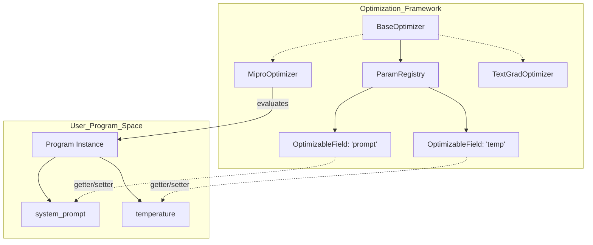
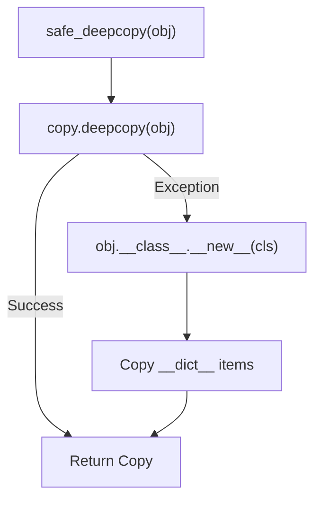
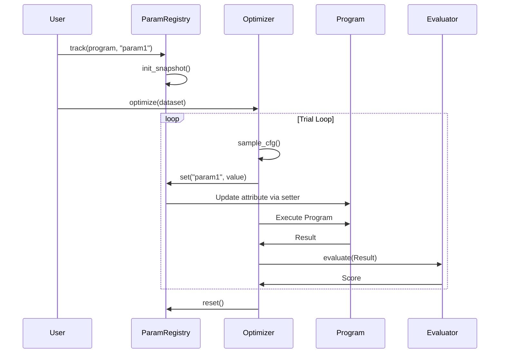

<!-- source: DeepWiki mcp.deepwiki.com · repo EvoAgentX/EvoAgentX · page 10.1 Optimization Framework · fetched 2026-10-26 -->

# Optimization Framework

<details>
<summary>Relevant source files</summary>

The following files were used as context for generating this wiki page:

- [evoagentx/core/callbacks.py](evoagentx/core/callbacks.py)
- [evoagentx/core/logging.py](evoagentx/core/logging.py)
- [evoagentx/core/parser.py](evoagentx/core/parser.py)
- [evoagentx/evaluators/evaluator.py](evoagentx/evaluators/evaluator.py)
- [evoagentx/optimizers/engine/__init__.py](evoagentx/optimizers/engine/__init__.py)
- [evoagentx/optimizers/engine/base.py](evoagentx/optimizers/engine/base.py)
- [evoagentx/optimizers/engine/decorators.py](evoagentx/optimizers/engine/decorators.py)
- [evoagentx/optimizers/engine/registry.py](evoagentx/optimizers/engine/registry.py)
- [evoagentx/optimizers/example_optimizer.py](evoagentx/optimizers/example_optimizer.py)
- [evoagentx/optimizers/mipro_optimizer.py](evoagentx/optimizers/mipro_optimizer.py)
- [evoagentx/optimizers/optimizer.py](evoagentx/optimizers/optimizer.py)
- [evoagentx/optimizers/optimizer_core.py](evoagentx/optimizers/optimizer_core.py)
- [evoagentx/utils/mipro_utils/module_utils.py](evoagentx/utils/mipro_utils/module_utils.py)
- [evoagentx/utils/mipro_utils/register_utils.py](evoagentx/utils/mipro_utils/register_utils.py)
- [evoagentx/utils/mipro_utils/signature_utils.py](evoagentx/utils/mipro_utils/signature_utils.py)
- [examples/optimization/mipro/math_mipro.py](examples/optimization/mipro/math_mipro.py)
- [examples/optimization/mipro/math_plug_and_play.py](examples/optimization/mipro/math_plug_and_play.py)
- [tests/src/evaluator/test_evaluator.py](tests/src/evaluator/test_evaluator.py)

</details>


## Purpose and Scope

This page documents the core optimization framework that enables automatic improvement of agent prompts, workflow structures, and other tunable parameters in EvoAgentX. The framework provides an extensible architecture for implementing various optimization algorithms through a unified parameter registry system and abstract optimizer interface.

For specific optimization algorithm implementations, see [TextGrad Optimization](#10.2), [MIPRO Optimization](#10.3), and [AFlow Optimization](#10.4). For higher-level concepts about self-evolution, see the parent section [Optimization and Evolution](#10).

## Core Components

The optimization framework consists of three fundamental components that work together to enable parameter tuning:

### ParamRegistry

The `ParamRegistry` class serves as the central registry for all parameters that can be exposed to optimization algorithms. It provides dynamic binding and tracking of runtime attributes through getter/setter functions.

**Key Responsibilities:**
- Register parameters from arbitrary Python objects.
- Provide unified get/set interface for optimizers.
- Support nested attribute access (dot notation, dict keys, list indices).
- Maintain parameter snapshots for reset functionality [evoagentx/optimizers/engine/registry.py:121-125]().

**Basic Usage:**

```python
registry = ParamRegistry()
registry.track(program, "system_prompt", name="prompt")
registry.track(program, "sampler.temperature")
registry.track(program, "config['style']")
```

**Class Definition:** [evoagentx/optimizers/engine/registry.py:109-120]()

**Core Methods:**

| Method | Signature | Description |
|--------|-----------|-------------|
| `track()` | `track(root_or_obj, path_or_attr, *, name=None)` | Register a parameter for optimization [evoagentx/optimizers/engine/registry.py:154-179](). |
| `get()` | `get(name: str) -> Any` | Retrieve current value of registered parameter [evoagentx/optimizers/engine/registry.py:126-128](). |
| `set()` | `set(name: str, value: Any)` | Update value of registered parameter [evoagentx/optimizers/engine/registry.py:137-139](). |
| `names()` | `names() -> List[str]` | Return list of all registered parameter names [evoagentx/optimizers/engine/registry.py:141-143](). |
| `reset()` | `reset()` | Roll back all parameters to initial values [evoagentx/optimizers/engine/registry.py:145-148](). |

Sources: [evoagentx/optimizers/engine/registry.py:109-281]()

### OptimizableField

The `OptimizableField` class encapsulates individual runtime attributes using dynamic getter and setter functions. It enables optimizers to manipulate parameters without direct access to the underlying objects.

**Architecture:**

```python
field = OptimizableField(
    name="temperature",
    getter=lambda: sampler.temperature,
    setter=lambda v: setattr(sampler, 'temperature', v)
)
```

**Features:**
- **Snapshot Management**: Captures initial state via `init_snapshot()` for later reset [evoagentx/optimizers/engine/registry.py:75-83]().
- **Custom Reset Logic**: Supports objects with `__reset__()` method [evoagentx/optimizers/engine/registry.py:103-104]().
- **Safe Deep Copy**: Uses `safe_deepcopy()` for reliable state preservation [evoagentx/optimizers/engine/registry.py:83]().

**Class Definition:** [evoagentx/optimizers/engine/registry.py:20-52]()

**State Management:**

| Operation | Method | Description |
|-----------|--------|-------------|
| Capture | `init_snapshot()` | Store deep copy of current value [evoagentx/optimizers/engine/registry.py:75-83](). |
| Retrieve | `get()` | Return current value via getter [evoagentx/optimizers/engine/registry.py:53-62](). |
| Update | `set(value)` | Apply new value via setter [evoagentx/optimizers/engine/registry.py:64-73](). |
| Restore | `reset()` | Revert to initial snapshot [evoagentx/optimizers/engine/registry.py:85-107](). |

Sources: [evoagentx/optimizers/engine/registry.py:20-107]()

### BaseOptimizer

The `BaseOptimizer` abstract class defines the interface that all optimization algorithms must implement. It provides common functionality for parameter access and configuration management.

**Abstract Interface:**

```python
class BaseOptimizer(abc.ABC):
    def __init__(self, registry, program, evaluator):
        self.registry = registry
        self.program = program
        self.evaluator = evaluator
    
    @abc.abstractmethod
    def optimize(self):
        """Implement optimization algorithm"""
        raise NotImplementedError
```

**Required Implementation:**
- `optimize()`: Execute the optimization algorithm [evoagentx/optimizers/engine/base.py:54-70]().

**Provided Utilities:**
- `get_param(name)`: Retrieve parameter value [evoagentx/optimizers/engine/base.py:32-34]().
- `set_param(name, value)`: Update parameter value [evoagentx/optimizers/engine/base.py:36-38]().
- `param_names()`: List all registered parameters [evoagentx/optimizers/engine/base.py:40-42]().
- `get_current_cfg()`: Export configuration as dictionary [evoagentx/optimizers/engine/base.py:44-46]().
- `apply_cfg(cfg)`: Apply configuration dictionary [evoagentx/optimizers/engine/base.py:48-52]().

**Class Definition:** [evoagentx/optimizers/engine/base.py:6-30]()

Sources: [evoagentx/optimizers/engine/base.py:6-70]()

## Architecture Overview

**Bridge: Natural Language to Code Entities (Optimization Framework)**

| System Concept | Code Entity | File Location |
| :--- | :--- | :--- |
| **Optimization Strategy** | `BaseOptimizer` | [evoagentx/optimizers/engine/base.py:6]() |
| **Parameter Tracking** | `ParamRegistry` | [evoagentx/optimizers/engine/registry.py:109]() |
| **Tunable Attribute** | `OptimizableField` | [evoagentx/optimizers/engine/registry.py:20]() |
| **Program Entry Point** | `EntryPoint` | [evoagentx/optimizers/engine/decorators.py:5]() |
| **Evaluation Engine** | `Evaluator` | [evoagentx/evaluators/evaluator.py:20]() |

**Framework Component Diagram**



Sources: [evoagentx/optimizers/engine/registry.py:109-281](), [evoagentx/optimizers/engine/base.py:6-70]()

## Parameter Registration

The framework supports multiple registration patterns to accommodate different use cases and coding styles.

### Direct Attribute Registration

Register a direct attribute of an object:

```python
registry = ParamRegistry()
registry.track(workflow, "system_prompt")
registry.track(workflow, "system_prompt", name="prompt")  # with alias
```

Implementation: [evoagentx/optimizers/engine/registry.py:198-211]()

### Path-Based Registration

Register nested attributes using dot notation:

```python
# Nested attributes
registry.track(workflow, "sampler.temperature")

# Dictionary keys
registry.track(workflow, "config['learning_rate']")

# List indices
registry.track(workflow, "components[0].prefix")
```

**Path Resolution Algorithm:**

The `_track_path()` method uses regex pattern matching to parse complex paths:

```python
_PATH_RE = re.compile(r"""
    ([a-zA-Z_]\w*)               |  # attr name
    \[\s*(-?\d+)\s*\]            |  # list index (allow negative)
    \[\s*['"]([^'\"]+)['"]\s*\]     # dict key (inside quotes)
""", re.VERBOSE)
```

Implementation: [evoagentx/optimizers/engine/registry.py:213-280]()

### Batch Registration

Register multiple parameters at once:

```python
registry.track([
    (program, "prompt.template"),
    (program, "metadata['style']", "style")
])
```

Implementation: [evoagentx/optimizers/engine/registry.py:180-193]()

Sources: [evoagentx/optimizers/engine/registry.py:154-280]()

## Safe Deep Copy Mechanism

The framework uses a robust deep copy mechanism to handle complex objects that may not support standard `copy.deepcopy()`:

**Bridge: Copying Logic to Code Entities**



Implementation: [evoagentx/optimizers/engine/registry.py:331-392]()

Sources: [evoagentx/optimizers/engine/registry.py:331-392]()

## Optimization Workflow

The general optimization workflow follows a consistent pattern across all optimizer implementations:



Sources: [evoagentx/optimizers/engine/base.py:6-70](), [evoagentx/optimizers/mipro_optimizer.py:590-703]()

## Creating Custom Optimizers

To implement a custom optimization algorithm, extend `BaseOptimizer` and implement the `optimize()` method.

### Required Interface

**Constructor:**
```python
def __init__(self, registry: ParamRegistry, 
             program: Callable[..., Dict[str, Any]] = None, 
             evaluator: Optional[Callable[..., Any]] = None)
```
[evoagentx/optimizers/engine/base.py:14-30]()

**Abstract Method:**
```python
@abc.abstractmethod
def optimize(self):
    """Implement optimization algorithm"""
```
[evoagentx/optimizers/engine/base.py:54-70]()

Reference implementation: [evoagentx/optimizers/example_optimizer.py:7-59]()

## Advanced Registry Features

### MiproRegistry Extension

For MIPRO optimization, an extended registry tracks input/output field metadata used for DSPy signature creation:

```python
from evoagentx.utils.mipro_utils.register_utils import MiproRegistry

registry = MiproRegistry()
registry.track(
    program, 
    "prompt",
    input_names=["problem"],
    output_names=["solution"]
)
```

Implementation: [evoagentx/utils/mipro_utils/register_utils.py:6-92]()

### Integration with PromptTuningModule

The MIPRO optimizer integrates with DSPy through the `PromptTuningModule`, which bridges EvoAgentX's parameter registry with DSPy's optimization framework [evoagentx/utils/mipro_utils/module_utils.py:17-38]().

**Key Methods:**

*   **Factory Creation**: `PromptTuningModule.from_registry(program, registry)` [evoagentx/utils/mipro_utils/module_utils.py:41-83]().
*   **Parameter Sync**: `sync_predict_inputs_to_program()` copies optimized values from DSPy predictors back to the program via the registry [evoagentx/utils/mipro_utils/module_utils.py:276-311]().
*   **Execution**: `forward(**inputs)` syncs parameters, executes the program, and constructs traces [evoagentx/utils/mipro_utils/module_utils.py:355-395]().

Sources: [evoagentx/utils/mipro_utils/module_utils.py:17-554]()

## Program Interface Requirements

For compatibility with the optimization framework, programs must implement specific interfaces:

### Required Methods

**Execution:**
Programs are typically expected to be callables that return a dictionary of results [evoagentx/optimizers/engine/base.py:17]().

**Validation Logic:**
The optimizer validates program interface during initialization, checking for `save` and `load` methods to ensure persistence of optimized states [evoagentx/optimizers/mipro_optimizer.py:436-471]().

Sources: [evoagentx/optimizers/mipro_optimizer.py:436-471](), [evoagentx/optimizers/engine/base.py:14-30]()

---

