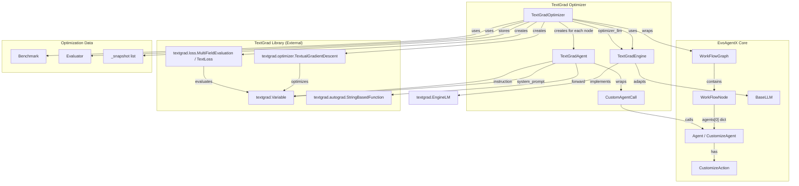
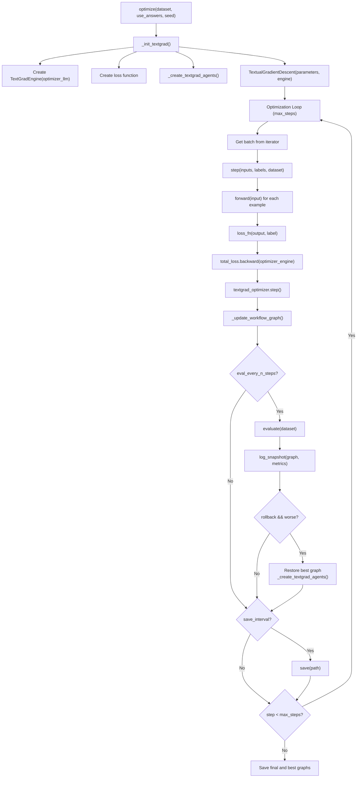
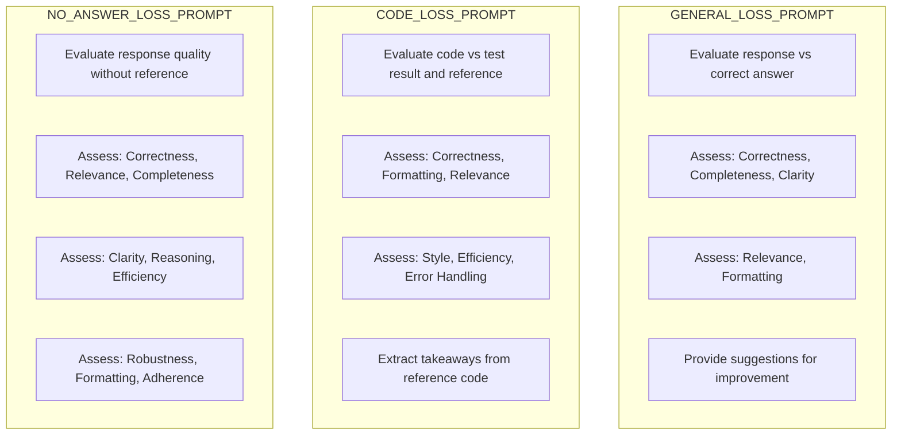
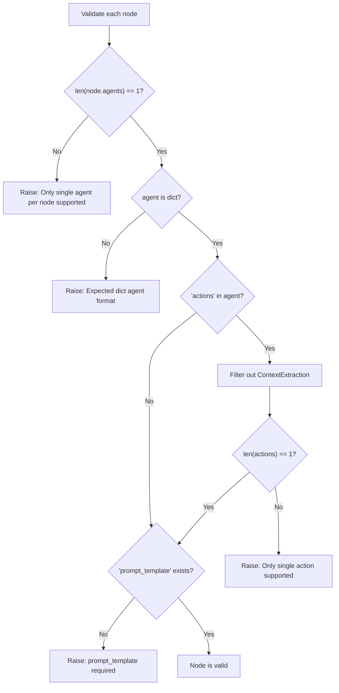
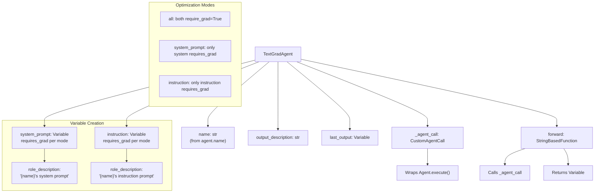

<!-- source: DeepWiki mcp.deepwiki.com · repo EvoAgentX/EvoAgentX · page 10.2 TextGrad Optimization · fetched 2026-10-26 -->

# TextGrad Optimization

<details>
<summary>Relevant source files</summary>

The following files were used as context for generating this wiki page:

- [Wonderful_workflow_corpus/Fengshui_analysis/tools.json](Wonderful_workflow_corpus/Fengshui_analysis/tools.json)
- [Wonderful_workflow_corpus/Fengshui_analysis/workflow.json](Wonderful_workflow_corpus/Fengshui_analysis/workflow.json)
- [Wonderful_workflow_corpus/README.md](Wonderful_workflow_corpus/README.md)
- [Wonderful_workflow_corpus/travel_recommendation/tools.json](Wonderful_workflow_corpus/travel_recommendation/tools.json)
- [Wonderful_workflow_corpus/travel_recommendation/workflow.json](Wonderful_workflow_corpus/travel_recommendation/workflow.json)
- [docs/tutorial/aflow_optimizer.md](docs/tutorial/aflow_optimizer.md)
- [docs/tutorial/textgrad_optimizer.md](docs/tutorial/textgrad_optimizer.md)
- [docs/zh/tutorial/textgrad_optimizer.md](docs/zh/tutorial/textgrad_optimizer.md)
- [evoagentx/optimizers/textgrad_optimizer.py](evoagentx/optimizers/textgrad_optimizer.py)
- [evoagentx/prompts/optimizers/textgrad_optimizer.py](evoagentx/prompts/optimizers/textgrad_optimizer.py)
- [examples/optimization/aflow/aflow_hotpotqa.py](examples/optimization/aflow/aflow_hotpotqa.py)
- [examples/optimization/aflow/aflow_humaneval.py](examples/optimization/aflow/aflow_humaneval.py)
- [examples/optimization/aflow/aflow_math.py](examples/optimization/aflow/aflow_math.py)
- [examples/optimization/aflow/aflow_mbpp.py](examples/optimization/aflow/aflow_mbpp.py)
- [examples/optimization/textgrad/hotpotqa_textgrad.py](examples/optimization/textgrad/hotpotqa_textgrad.py)
- [examples/optimization/textgrad/math_textgrad.py](examples/optimization/textgrad/math_textgrad.py)
- [examples/optimization/textgrad/mbpp_textgrad.py](examples/optimization/textgrad/mbpp_textgrad.py)

</details>


## Purpose and Scope

This document describes the TextGrad optimization system in EvoAgentX, which treats agent prompts as differentiable text variables and optimizes them using LLM-generated "textual gradients". TextGrad enables automatic improvement of system prompts and instruction prompts in multi-agent workflows through iterative feedback-driven refinement.

For information about the general optimization framework and parameter registration, see [Optimization Framework](#10.1). For alternative optimization approaches, see [MIPRO Optimization](#10.3) and [AFlow Optimization](#10.4).

**Key capabilities:**
- Optimizes `system_prompt` and `instruction` in agent configurations [evoagentx/optimizers/textgrad_optimizer.py:112-143]().
- Computes textual gradients via LLM-based feedback rather than numerical gradients [evoagentx/optimizers/textgrad_optimizer.py:161-164]().
- Supports supervised optimization (with labels) and unsupervised optimization (without labels) [evoagentx/optimizers/textgrad_optimizer.py:246-275]().
- Integrates with benchmark datasets for evaluation-driven optimization [evoagentx/optimizers/textgrad_optimizer.py:309-354]().
- Provides automatic rollback to best-performing configurations [evoagentx/optimizers/textgrad_optimizer.py:429-449]().

**Implementation note:** This module re-implements algorithms from the TextGrad project (https://github.com/zou-group/textgrad) with integration into EvoAgentX's workflow system [evoagentx/optimizers/textgrad_optimizer.py:1-12]().

Sources: [evoagentx/optimizers/textgrad_optimizer.py:1-164](), [evoagentx/optimizers/textgrad_optimizer.py:246-449]()

---

## Core Concepts

### Textual Gradients

TextGrad replaces traditional numerical gradients with textual feedback. Instead of computing ∂Loss/∂Parameter, the optimizer uses an LLM to generate natural language critiques describing how to improve a prompt based on observed failures.

**Process:**
1. Execute workflow with current prompts → produce output.
2. Compare output to target (or evaluate quality if no target).
3. LLM generates textual feedback describing deficiencies [evoagentx/prompts/optimizers/textgrad_optimizer.py:3-39]().
4. Another LLM uses feedback to propose improved prompts [evoagentx/prompts/optimizers/textgrad_optimizer.py:41-62]().
5. Update prompts and repeat.

### Variable System

The `textgrad.Variable` class wraps text as an optimizable parameter with:
- `value`: The current text content.
- `requires_grad`: Whether this Variable should be optimized.
- `role_description`: Context about what this Variable represents.
- `gradients`: Accumulated textual feedback for improvement.

In EvoAgentX, agent prompts are converted to Variables:
- `system_prompt` → Variable with role "`{self.name}`'s system prompt" [evoagentx/optimizers/textgrad_optimizer.py:128-132]().
- `instruction` → Variable with role "`{self.name}`'s instruction prompt" [evoagentx/optimizers/textgrad_optimizer.py:134-138]().

Sources: [evoagentx/optimizers/textgrad_optimizer.py:108-158](), [evoagentx/prompts/optimizers/textgrad_optimizer.py:1-62]()

---

## System Architecture

### Integration with EvoAgentX Components

**Bridge: Natural Language Space to Code Entity Space**



**Key Adapter Classes**

| Class | Purpose | Input | Output |
|-------|---------|-------|--------|
| `TextGradEngine` | Adapts EvoAgentX `BaseLLM` to TextGrad's `EngineLM` interface [evoagentx/optimizers/textgrad_optimizer.py:62-73]() | `BaseLLM` instance | Implements `generate()` method |
| `CustomAgentCall` | Wraps `Agent.execute()` to accept Variable inputs [evoagentx/optimizers/textgrad_optimizer.py:75-106]() | Variables for agent inputs | Agent output as string |
| `TextGradAgent` | Replaces Agent in workflow nodes during optimization [evoagentx/optimizers/textgrad_optimizer.py:108-158]() | Agent instance | Callable that returns Variable output |

Sources: [evoagentx/optimizers/textgrad_optimizer.py:62-158]()

---

## TextGradOptimizer Class

### Configuration Fields

```mermaid
graph LR
    TGOpt["TextGradOptimizer"]
    
    TGOpt --> graph["graph: WorkFlowGraph"]
    TGOpt --> mode["optimize_mode: all/system_prompt/instruction"]
    TGOpt --> exec_llm["executor_llm: BaseLLM"]
    TGOpt --> opt_llm["optimizer_llm: BaseLLM"]
    TGOpt --> batch["batch_size: int"]
    TGOpt --> steps["max_steps: int"]
    TGOpt --> eval_obj["evaluator: Evaluator"]
    TGOpt --> eval_freq["eval_every_n_steps: int"]
    TGOpt --> eval_rounds["eval_rounds: int"]
    TGOpt --> save_int["save_interval: int"]
    TGOpt --> rollback["rollback: bool"]
    TGOpt --> constraints["constraints: List[str]"]
```

| Field | Type | Default | Description |
|-------|------|---------|-------------|
| `graph` | `WorkFlowGraph` | Required | The workflow to optimize [evoagentx/optimizers/textgrad_optimizer.py:165]() |
| `optimize_mode` | `Literal["all", "system_prompt", "instruction"]` | `"all"` | Which prompts to optimize [evoagentx/optimizers/textgrad_optimizer.py:166]() |
| `executor_llm` | `BaseLLM` | Required | LLM for executing agent actions [evoagentx/optimizers/textgrad_optimizer.py:167]() |
| `optimizer_llm` | `BaseLLM` | Required | LLM for computing gradients and proposing improvements [evoagentx/optimizers/textgrad_optimizer.py:168]() |
| `batch_size` | `PositiveInt` | `1` | Number of examples per optimization step [evoagentx/optimizers/textgrad_optimizer.py:169]() |
| `max_steps` | `PositiveInt` | `10` | Maximum optimization iterations [evoagentx/optimizers/textgrad_optimizer.py:170]() |
| `evaluator` | `Evaluator` | Required | Evaluator for measuring performance [evoagentx/optimizers/textgrad_optimizer.py:171]() |
| `eval_every_n_steps` | `Optional[PositiveInt]` | `None` | Frequency of evaluation during optimization [evoagentx/optimizers/textgrad_optimizer.py:172]() |
| `eval_rounds` | `PositiveInt` | `1` | Number of evaluation runs to average [evoagentx/optimizers/textgrad_optimizer.py:173]() |
| `eval_config` | `dict` | `{}` | Additional arguments for `evaluate()` method [evoagentx/optimizers/textgrad_optimizer.py:174]() |
| `save_interval` | `Optional[PositiveInt]` | `None` | How often to save checkpoints [evoagentx/optimizers/textgrad_optimizer.py:175]() |
| `save_path` | `str` | `"./"` | Directory for saving optimized workflows [evoagentx/optimizers/textgrad_optimizer.py:176]() |
| `rollback` | `bool` | `True` | Whether to revert to best snapshot if performance degrades [evoagentx/optimizers/textgrad_optimizer.py:177]() |
| `constraints` | `List[str]` | `[]` | Additional optimization constraints [evoagentx/optimizers/textgrad_optimizer.py:178]() |

**Optimization Modes:**
- `"all"`: Optimizes both `system_prompt` and `instruction` [evoagentx/optimizers/textgrad_optimizer.py:119-120]().
- `"system_prompt"`: Only optimizes `system_prompt` [evoagentx/optimizers/textgrad_optimizer.py:121]().
- `"instruction"`: Only optimizes `instruction` [evoagentx/optimizers/textgrad_optimizer.py:122]().

Sources: [evoagentx/optimizers/textgrad_optimizer.py:161-179](), [evoagentx/optimizers/textgrad_optimizer.py:119-122]()

---

## Optimization Process

### Workflow Execution Flow



### Forward Pass Execution

The `forward()` method in `TextGradOptimizer` executes the workflow by recursively computing node outputs [evoagentx/optimizers/textgrad_optimizer.py:481-503]().

**Algorithm:**
1. Convert initial inputs to Variables with `_initial_inputs_to_variables()` [evoagentx/optimizers/textgrad_optimizer.py:483-485]().
2. Find end node(s) of workflow [evoagentx/optimizers/textgrad_optimizer.py:486]().
3. Call `_compute_node(end_node, initial_inputs)` [evoagentx/optimizers/textgrad_optimizer.py:487-490]():
   - For each node input, check if it's an initial input or from another node [evoagentx/optimizers/textgrad_optimizer.py:511-519]().
   - Recursively compute required predecessor nodes [evoagentx/optimizers/textgrad_optimizer.py:521-522]().
   - Call `node.textgrad_agent(input_variables)` [evoagentx/optimizers/textgrad_optimizer.py:532]().
4. Return final output Variable [evoagentx/optimizers/textgrad_optimizer.py:503]().

Sources: [evoagentx/optimizers/textgrad_optimizer.py:481-535]()

---

## Loss Functions and Evaluation

### Loss Function Configurations

The optimizer selects a loss function based on task type and data availability [evoagentx/optimizers/textgrad_optimizer.py:192-211]():

| Scenario | Loss Class | Prompt Template | Inputs to Loss Function |
|----------|------------|-----------------|------------------------|
| Labeled data + general tasks | `MultiFieldEvaluation` | `GENERAL_LOSS_PROMPT` | `[output_variable, answer_variable]` |
| Labeled data + coding tasks | `MultiFieldEvaluation` | `CODE_LOSS_PROMPT` | `[code_variable, formatted_label_variable]` |
| Unlabeled data | `TextLoss` | `NO_ANSWER_LOSS_PROMPT` | `output_variable` |

**Loss Prompt Contents:**



### Coding Task Label Formatting

For `CodingBenchmark` datasets, labels are formatted specially via `_format_code_label()` [evoagentx/optimizers/textgrad_optimizer.py:451-479]():

**Process:**
1. Extract task_id, test, entry_point from label dict [evoagentx/optimizers/textgrad_optimizer.py:455-457]().
2. Run `dataset.check_solution()` to test the code [evoagentx/optimizers/textgrad_optimizer.py:459-463]().
3. Format result as a structured string including Task, Result on test, and Correct Solution [evoagentx/optimizers/textgrad_optimizer.py:465-478]().

Sources: [evoagentx/optimizers/textgrad_optimizer.py:192-211](), [evoagentx/optimizers/textgrad_optimizer.py:451-479](), [evoagentx/prompts/optimizers/textgrad_optimizer.py:3-39]()

---

## Optimizer Prompt Engineering

### System Prompt Structure

The `OPTIMIZER_SYSTEM_PROMPT` instructs the optimizer LLM on how to improve prompts [evoagentx/prompts/optimizers/textgrad_optimizer.py:41-62]():

**Key Instructions:**
- **Role**: "part of an optimization system that improves text (i.e., variable)" [evoagentx/prompts/optimizers/textgrad_optimizer.py:42]().
- **Task**: "creatively and critically improve instruction prompts or system prompts" [evoagentx/prompts/optimizers/textgrad_optimizer.py:43]().
- **Output**: Must wrap improved prompt in `{new_variable_start_tag}` and `{new_variable_end_tag}` [evoagentx/prompts/optimizers/textgrad_optimizer.py:47]().
- **Guidelines**: Includes specific requirements for Role, Behavior, Tone, Capabilities, and Limitations [evoagentx/prompts/optimizers/textgrad_optimizer.py:49-60]().

### Optimization Constraints

The `OPTIMIZER_CONSTRAINTS` list enforces structural requirements [evoagentx/prompts/optimizers/textgrad_optimizer.py:101-107]():

| Constraint | Purpose |
|------------|---------|
| **Consistent Inputs** | Preserve `<input>{input_name}</input>` placeholders |
| **No Input Leakage** | Don't leak actual data into prompts, only placeholders |
| **System Prompts Format** | No input placeholders in system prompts |
| **Coding Task Matching** | Require identifier matching in generated code |

### In-Context Examples

The optimizer is provided with three example prompt pairs showing good system/instruction prompt structure:
1. **Personal Finance Advisor** [evoagentx/prompts/optimizers/textgrad_optimizer.py:64-74]().
2. **Fitness Coach** [evoagentx/prompts/optimizers/textgrad_optimizer.py:76-86]().
3. **Code Review** [evoagentx/prompts/optimizers/textgrad_optimizer.py:88-98]().

Sources: [evoagentx/prompts/optimizers/textgrad_optimizer.py:41-107]()

---

## Workflow Compatibility Requirements

### Graph Validation

The `_validate_graph_compatibility()` method enforces requirements [evoagentx/optimizers/textgrad_optimizer.py:650-675]():

**Requirements:**
1. **Single agent per node**: Each `WorkFlowNode.agents` must have exactly one agent [evoagentx/optimizers/textgrad_optimizer.py:653-655]().
2. **Agent format**: Agent must be a dict (serialized format) [evoagentx/optimizers/textgrad_optimizer.py:656-658]().
3. **Single action per agent**: Each agent can have only one action [evoagentx/optimizers/textgrad_optimizer.py:663-665]().
4. **Prompt template required**: Each action must have a `prompt_template` field [evoagentx/optimizers/textgrad_optimizer.py:668-670]().

**Validation Logic:**



Sources: [evoagentx/optimizers/textgrad_optimizer.py:650-675]()

---

## Snapshot and Rollback System

### Snapshot Structure

The `_snapshot` list stores workflow states during optimization [evoagentx/optimizers/textgrad_optimizer.py:277-295]():

```python
{
    "index": int,              # Snapshot number
    "graph": dict,             # WorkFlowGraph.get_config() output
    "metrics": dict[str, float] # Evaluation metrics
}
```

### Rollback Logic

When `rollback=True`, the optimizer tracks the best-performing snapshot and restores it if performance degrades [evoagentx/optimizers/textgrad_optimizer.py:429-449]().

**Algorithm:**
1. After evaluation, compare current metrics to best seen so far [evoagentx/optimizers/textgrad_optimizer.py:433-434]().
2. If current score >= best score, update `best_snapshot` [evoagentx/optimizers/textgrad_optimizer.py:435-438]().
3. If current score < best score, log rollback and restore `WorkFlowGraph` from `best_snapshot["graph"]` [evoagentx/optimizers/textgrad_optimizer.py:441-446]().
4. Recreate `TextGradAgent` instances for all nodes to sync with restored prompts [evoagentx/optimizers/textgrad_optimizer.py:447-449]().

Sources: [evoagentx/optimizers/textgrad_optimizer.py:277-295](), [evoagentx/optimizers/textgrad_optimizer.py:429-449](), [evoagentx/optimizers/textgrad_optimizer.py:608-623]()

---

## Implementation Details

### TextGradAgent Architecture

**Bridge: Natural Language Space to Code Entity Space**



**Key Methods:**

| Method | Signature | Purpose |
|--------|-----------|---------|
| `__init__()` | `(agent, optimize_mode)` | Creates Variables from agent prompts [evoagentx/optimizers/textgrad_optimizer.py:112-143]() |
| `__call__()` | `(inputs: dict[str, Variable])` | Executes agent with Variable inputs [evoagentx/optimizers/textgrad_optimizer.py:145-158]() |
| `forward` | `StringBasedFunction` | Wraps `_agent_call` for gradient computation [evoagentx/optimizers/textgrad_optimizer.py:141]() |

### CustomAgentCall Execution

The `CustomAgentCall` class bridges Variables to Agent execution [evoagentx/optimizers/textgrad_optimizer.py:75-106]():

**Input Processing:**
1. Extract action input names from `action.inputs_format.get_attrs()` [evoagentx/optimizers/textgrad_optimizer.py:89]().
2. For each Variable input:
   - If key matches input name: use `variable.value` [evoagentx/optimizers/textgrad_optimizer.py:95]().
   - Otherwise: extract from `variable.parsed_outputs` [evoagentx/optimizers/textgrad_optimizer.py:97-98]().

**Execution:**
1. Call `agent.execute(action_name, action_input_data)` [evoagentx/optimizers/textgrad_optimizer.py:101]().
2. Store outputs in `self.last_outputs` dict [evoagentx/optimizers/textgrad_optimizer.py:103]().
3. Return `outputs.content` as string [evoagentx/optimizers/textgrad_optimizer.py:105]().

Sources: [evoagentx/optimizers/textgrad_optimizer.py:75-158]()

---

