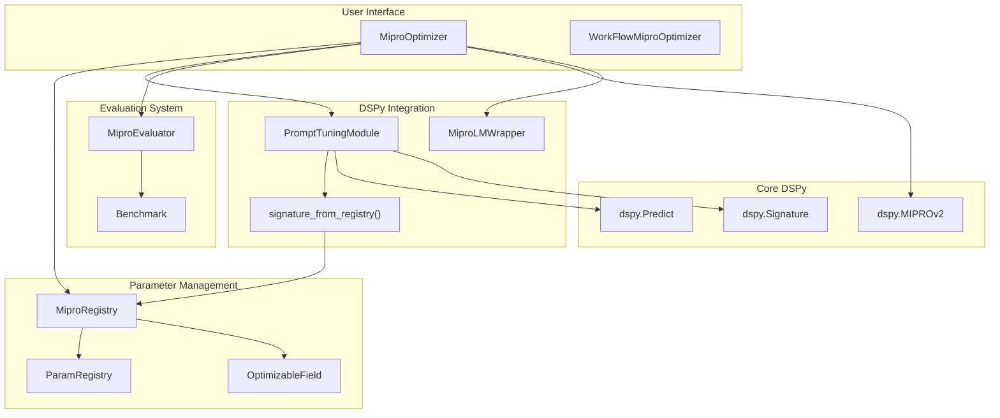
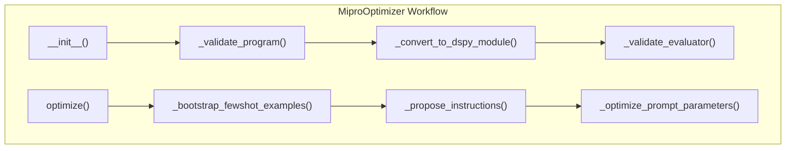
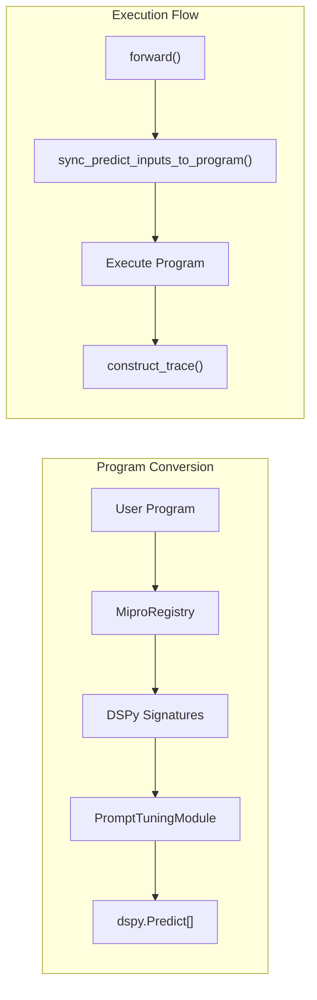
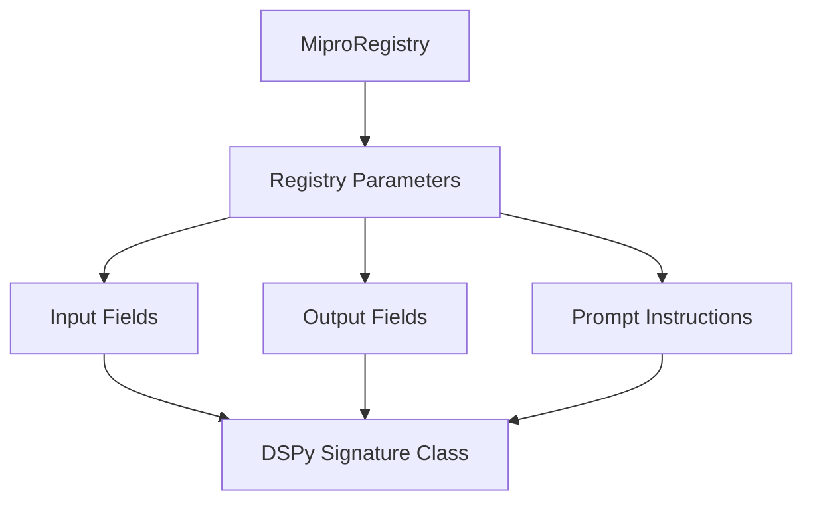
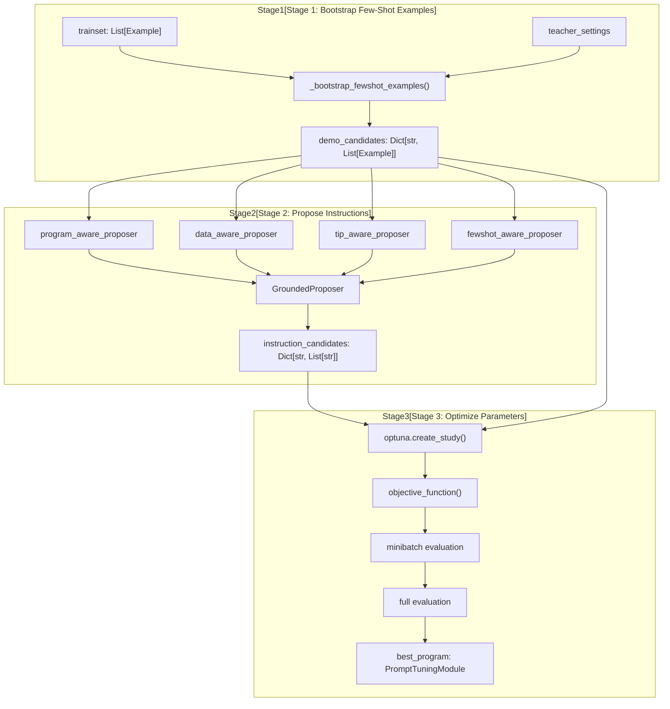
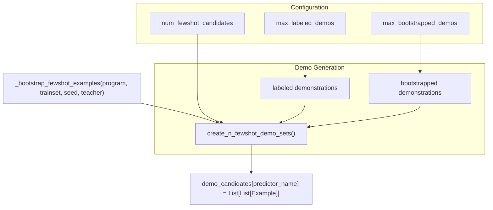
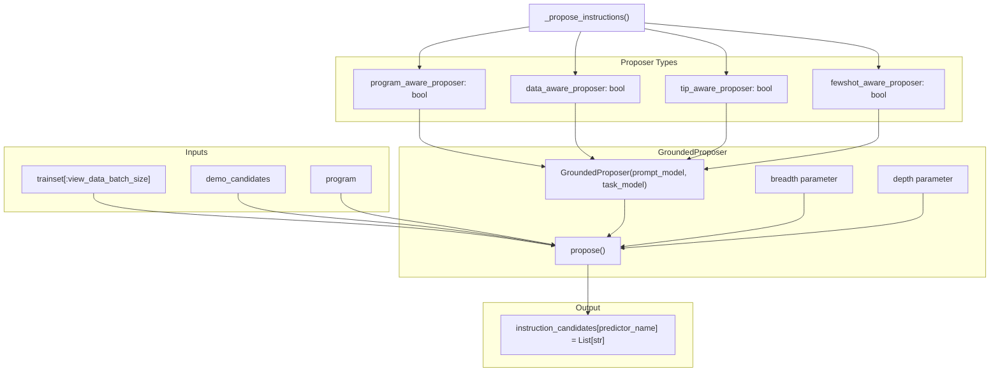
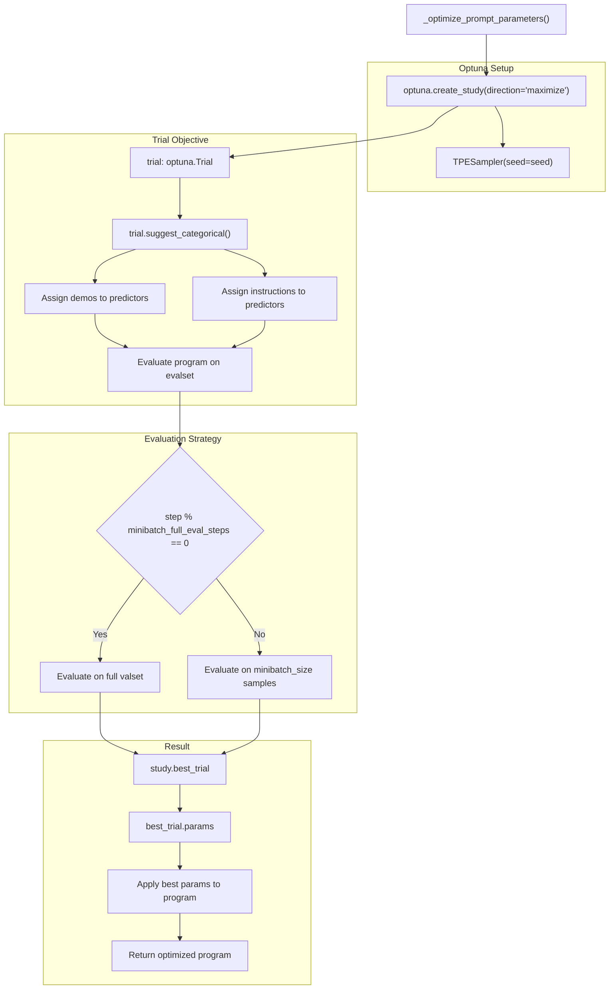
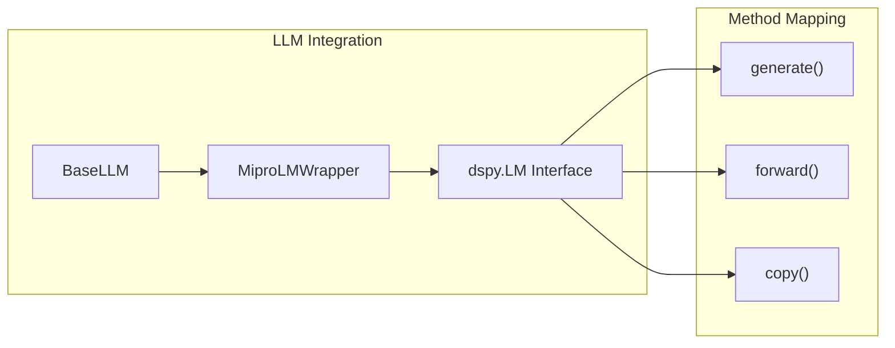

<!-- source: DeepWiki mcp.deepwiki.com · repo EvoAgentX/EvoAgentX · page 10.3 MIPRO Optimization · fetched 2026-10-26 -->

# MIPRO Optimization

<details>
<summary>Relevant source files</summary>

The following files were used as context for generating this wiki page:

- [evoagentx/optimizers/engine/__init__.py](evoagentx/optimizers/engine/__init__.py)
- [evoagentx/optimizers/engine/base.py](evoagentx/optimizers/engine/base.py)
- [evoagentx/optimizers/engine/decorators.py](evoagentx/optimizers/engine/decorators.py)
- [evoagentx/optimizers/engine/registry.py](evoagentx/optimizers/engine/registry.py)
- [evoagentx/optimizers/example_optimizer.py](evoagentx/optimizers/example_optimizer.py)
- [evoagentx/optimizers/mipro_optimizer.py](evoagentx/optimizers/mipro_optimizer.py)
- [evoagentx/optimizers/optimizer_core.py](evoagentx/optimizers/optimizer_core.py)
- [evoagentx/utils/mipro_utils/module_utils.py](evoagentx/utils/mipro_utils/module_utils.py)
- [evoagentx/utils/mipro_utils/register_utils.py](evoagentx/utils/mipro_utils/register_utils.py)
- [evoagentx/utils/mipro_utils/signature_utils.py](evoagentx/utils/mipro_utils/signature_utils.py)
- [examples/optimization/mipro/math_mipro.py](examples/optimization/mipro/math_mipro.py)
- [examples/optimization/mipro/math_plug_and_play.py](examples/optimization/mipro/math_plug_and_play.py)

</details>


MIPRO optimization provides multi-objective prompt and parameter optimization capabilities for EvoAgentX workflows and programs. This system leverages DSPy's MIPROv2 algorithm to automatically optimize prompts, few-shot demonstrations, and other tunable parameters through iterative evaluation and refinement. 

For general optimization concepts, see [Optimization Framework](#10.1). For other optimization algorithms, see [TextGrad Optimization](#10.2) and [AFlow Optimization](#10.4).

## Architecture Overview

The MIPRO optimization system consists of several interconnected components that work together to optimize program parameters:



Sources: [evoagentx/optimizers/mipro_optimizer.py:296-425](), [evoagentx/utils/mipro_utils/module_utils.py:17-144](), [evoagentx/utils/mipro_utils/register_utils.py:6-92]()

## Core Components

### MiproOptimizer

The `MiproOptimizer` class serves as the main entry point for MIPRO optimization, extending DSPy's `MIPROv2` with EvoAgentX-specific functionality:



The optimizer requires programs to implement `save()` and `load()` methods with `path` parameters for persistence during optimization.

Sources: [evoagentx/optimizers/mipro_optimizer.py:296-425](), [evoagentx/optimizers/mipro_optimizer.py:423-457]()

### Parameter Registry System

The MIPRO system uses an enhanced parameter registry that supports input/output field metadata:

| Component | Purpose | Key Methods |
|-----------|---------|-------------|
| `MiproRegistry` | Extended registry with I/O field support | `track()`, `get_input_names()`, `get_output_names()` |
| `ParamRegistry` | Base parameter tracking | `get()`, `set()`, `names()`, `reset()` |
| `OptimizableField` | Individual parameter wrapper | `get()`, `set()`, `init_snapshot()`, `reset()` |

The `MiproRegistry.track()` method supports additional parameters for optimization:

```python
registry.track(
    program, "prompt", 
    input_names=["problem"], 
    output_names=["solution"],
    input_descs={"problem": "Math problem to solve"},
    output_descs={"solution": "Generated solution"}
)
```

Sources: [evoagentx/utils/mipro_utils/register_utils.py:6-92](), [evoagentx/optimizers/engine/registry.py:109-432]()

### PromptTuningModule

The `PromptTuningModule` bridges EvoAgentX programs with DSPy's optimization framework:



The module automatically creates DSPy signatures from registry parameters and synchronizes optimized prompts back to the original program during execution.

Sources: [evoagentx/utils/mipro_utils/module_utils.py:17-144](), [evoagentx/utils/mipro_utils/module_utils.py:276-395]()

## Parameter Registration

### Basic Parameter Tracking

Parameters are registered using the `MiproRegistry.track()` method with dot-notation paths:

```python
# Simple attribute tracking
registry.track(program, "system_prompt")

# Nested attribute tracking  
registry.track(program, "config.temperature")

# Dictionary key tracking
registry.track(program, "metadata['style']")

# List index tracking
registry.track(program, "components[0].prefix")
```

### MIPRO-Specific Registration

MIPRO optimization requires additional metadata for proper signature generation:

```python
# Register with input/output specifications
registry.track(
    program, "math_prompt",
    input_names=["problem", "context"],
    output_names=["solution", "confidence"],
    input_descs={
        "problem": "Mathematical problem statement",
        "context": "Additional context or examples"
    },
    output_descs={
        "solution": "Step-by-step solution",
        "confidence": "Confidence score (0-1)"
    }
)
```

### Signature Generation

The system automatically creates DSPy signatures from registered parameters using `signature_from_registry()`:



Sources: [evoagentx/utils/mipro_utils/register_utils.py:12-78](), [evoagentx/utils/mipro_utils/signature_utils.py:228-293]()

## Optimization Process

### Three-Stage MIPRO Algorithm

The MIPRO optimizer implements a three-stage optimization process via the `optimize()` method:



**Optimization Flow in `MiproOptimizer.optimize()`**

Sources: [evoagentx/optimizers/mipro_optimizer.py:590-700]()

### Stage 1: Bootstrap Few-Shot Examples

The `_bootstrap_fewshot_examples()` method generates demonstration candidates using labeled training data:



**Bootstrap Process**

The bootstrapping process:
1. Executes `program` on `trainset` examples to collect predictions
2. Filters successful examples using `metric_threshold` or `metric > 0`
3. Creates `num_fewshot_candidates` different combinations of demonstrations
4. Each combination includes up to `max_labeled_demos` + `max_bootstrapped_demos` examples
5. Returns a dictionary mapping each `dspy.Predict` predictor name to its demo sets

Sources: [evoagentx/optimizers/mipro_optimizer.py:660-662]()

### Stage 2: Propose Instructions

The `_propose_instructions()` method generates instruction candidates using multiple proposer strategies:



**Instruction Proposer Strategies**

| Strategy | Parameter | Description |
|----------|-----------|-------------|
| Program-Aware | `program_aware_proposer` | Analyzes program structure to suggest relevant instructions |
| Data-Aware | `data_aware_proposer` | Examines training data patterns to generate instructions |
| Tip-Aware | `tip_aware_proposer` | Incorporates best practices and prompting tips |
| Few-Shot Aware | `fewshot_aware_proposer` | Leverages few-shot examples to inform instructions |

The `dspy.propose.GroundedProposer` combines enabled strategies to generate `num_instruct_candidates` instruction variations for each predictor.

Sources: [evoagentx/optimizers/mipro_optimizer.py:664-674]()

### Stage 3: Optimize with Optuna

The `_optimize_prompt_parameters()` method uses Optuna to search the combined space of instructions and demonstrations:



**Optuna Search Process**

The optimization loop:
1. Creates an `optuna.Study` with TPESampler for efficient hyperparameter search
2. For each trial (`num_trials` iterations):
   - Uses `trial.suggest_categorical()` to select instruction variant for each predictor
   - Uses `trial.suggest_categorical()` to select demo set for each predictor
   - Assigns selected instructions/demos to program's predictors
   - Evaluates program on validation set (minibatch or full based on `minibatch_full_eval_steps`)
3. Optuna's TPE algorithm learns from trial scores to suggest better combinations
4. Returns program configured with best-performing parameter combination

**Minibatch Strategy**

To reduce evaluation cost:
- Most trials evaluate on random subset of size `minibatch_size`
- Every `minibatch_full_eval_steps` trials, evaluates on full `valset`
- Final best configuration evaluated on full validation set
- Controlled by `minibatch` and `minibatch_size` parameters

Sources: [evoagentx/optimizers/mipro_optimizer.py:676-689]()

### Evaluation Integration

The system supports both custom evaluators and automatic benchmark evaluation:

| Evaluator Type | Description | Interface |
|----------------|-------------|-----------|
| Custom Evaluator | User-provided evaluation function | `__call__(program, evalset, **kwargs) -> float` |
| `MiproEvaluator` | Auto-generated from `Benchmark` | Wraps `benchmark.evaluate()` method |

The `MiproEvaluator` class provides thread-safe parallel evaluation:

```mermaid
graph TB
    evaluator["MiproEvaluator(benchmark, num_threads, ...)"]
    
    subgraph "Call Interface"
        call["__call__(program, evalset)"]
        executor["ParallelExecutor or tqdm loop"]
        process["process_item(example)"]
    end
    
    subgraph "Metric Method"
        metric["metric(example, prediction)"]
        extract["benchmark.evaluate(prediction, label)"]
        score_dict["_extract_score_from_dict()"]
    end
    
    subgraph "Score Handling"
        single_score["Single score: return value"]
        multi_score["Multiple scores: average or metric_name"]
    end
    
    evaluator --> call
    call --> executor
    executor --> process
    process --> metric
    
    metric --> extract
    extract --> score_dict
    
    score_dict --> single_score
    score_dict --> multi_score
```

**Key Features:**
- Parallel execution via `ParallelExecutor` with configurable `num_threads`
- Automatic score extraction from metric dictionaries
- Thread-safe cost logging suppression
- Progress tracking with running averages
- Error handling with `max_errors` threshold

Sources: [evoagentx/optimizers/mipro_optimizer.py:140-306](), [evoagentx/optimizers/mipro_optimizer.py:472-576]()

## Configuration Options

### Optimization Settings

The `MiproOptimizer` supports extensive configuration through initialization parameters:

| Parameter | Type | Description | Default |
|-----------|------|-------------|---------|
| `auto` | `Literal["light", "medium", "heavy"]` | Automatic configuration mode | `"medium"` |
| `max_steps` | `int` | Maximum optimization trials | From auto setting |
| `num_candidates` | `int` | Candidates per optimization step | From auto setting |
| `max_bootstrapped_demos` | `int` | Maximum bootstrapped examples | `4` |
| `max_labeled_demos` | `int` | Maximum labeled examples | `4` |
| `minibatch_size` | `int` | Evaluation batch size | `35` |
| `num_threads` | `int` | Parallel evaluation threads | `None` |

### Auto Configuration Modes

Pre-defined optimization configurations balance speed and thoroughness:

| Mode | Candidates | Validation Size | Use Case |
|------|------------|----------------|----------|
| `"light"` | 6 | 100 | Quick prototyping |
| `"medium"` | 12 | 300 | Standard optimization |
| `"heavy"` | 18 | 1000 | Comprehensive tuning |

Sources: [evoagentx/optimizers/mipro_optimizer.py:48-52](), [evoagentx/optimizers/mipro_optimizer.py:298-421]()

## Usage Patterns

### Plug-and-Play Program Optimization

To optimize a custom program, implement the required interface:

**Program Requirements:**

```python
class CustomProgram:
    # Required: Persistence methods
    def save(self, path: str):
        """Save program state to file"""
        pass
    
    def load(self, path: str):
        """Load program state from file"""
        pass
    
    # Required: Execution method
    def __call__(self, **inputs) -> Tuple[Any, dict]:
        """
        Execute program with inputs.
        
        Returns:
            prediction: Program output for evaluation
            execution_data: Dict mapping parameter inputs/outputs
        """
        pass
```

**Complete Example:**

```python
# Define program
class MathSolver:
    def __init__(self, model):
        self.model = model
        self.prompt = "Solve step by step: {problem}"
    
    def save(self, path: str):
        with open(path, "w") as f:
            json.dump({"prompt": self.prompt}, f)
    
    def load(self, path: str):
        with open(path, "r") as f:
            self.prompt = json.load(f)["prompt"]
    
    def __call__(self, problem: str) -> Tuple[str, dict]:
        prompt = self.prompt.format(problem=problem)
        solution = self.model.generate(prompt=prompt).content
        return solution, {"problem": problem, "solution": solution}

# Register parameters
registry = MiproRegistry()
registry.track(
    program, "prompt",
    input_names=["problem"],  # Must match execution_data keys
    output_names=["solution"]  # Must match execution_data keys
)

# Optimize
optimizer = MiproOptimizer(
    registry=registry,
    program=program,
    optimizer_llm=optimizer_llm,
    max_bootstrapped_demos=4,
    max_labeled_demos=4,
    auto="medium",
    num_threads=20
)

optimizer.optimize(dataset=benchmark, metric_name="accuracy")
optimizer.restore_best_program()
```

**Key Points:**
- `input_names` and `output_names` must correspond to keys in `execution_data`
- The `execution_data` dict enables DSPy to track input/output flow through predictors
- `metric_name` selects which metric to optimize when benchmark returns multiple scores

Sources: [examples/optimization/mipro/math_plug_and_play.py:54-124]()

### Workflow Graph Optimization

For `WorkFlowGraph` optimization, use `WorkFlowMiproOptimizer`:

**Workflow Definition with MiproPromptTemplate:**

```python
from evoagentx.prompts import MiproPromptTemplate

workflow_data = {
    "goal": "Answer math questions in boxed format",
    "tasks": [{
        "name": "answer_generate",
        "description": "Generate step-by-step solution",
        "inputs": [
            {"name": "problem", "type": "str", "required": True}
        ],
        "outputs": [
            {"name": "solution", "type": "str", "required": True}
        ],
        "prompt_template": MiproPromptTemplate(
            instruction="Think step by step to solve this problem"
        ),
        "parse_mode": "title"
    }]
}

# Create workflow
workflow_graph = SequentialWorkFlowGraph.from_dict(workflow_data)
agent_manager = AgentManager()
agent_manager.add_agents_from_workflow(workflow_graph, llm_config=config)

# Define evaluator
evaluator = Evaluator(
    llm=executor_llm,
    agent_manager=agent_manager,
    collate_func=lambda ex: {"problem": ex["problem"]},
    num_workers=20
)

# Optimize
optimizer = WorkFlowMiproOptimizer(
    graph=workflow_graph,
    evaluator=evaluator,
    optimizer_llm=optimizer_llm,
    max_bootstrapped_demos=4,
    max_labeled_demos=4,
    auto="medium"
)

optimizer.optimize(dataset=benchmark)
optimizer.restore_best_program()
```

**MiproPromptTemplate vs PromptTemplate:**

| Feature | `MiproPromptTemplate` | `PromptTemplate` |
|---------|----------------------|------------------|
| Optimization Support | Full MIPRO optimization | Limited support |
| Demonstrations | Automatically managed | Manual management |
| Instruction Evolution | Yes, via proposers | No |
| Required for MIPRO | Yes | No |

The `WorkFlowMiproOptimizer` automatically:
1. Extracts `MiproPromptTemplate` instances from workflow tasks
2. Registers them in `MiproRegistry` with correct I/O mappings
3. Creates `PromptTuningModule` from workflow execution
4. Optimizes all prompt templates simultaneously
5. Restores optimized prompts back to workflow graph

Sources: [examples/optimization/mipro/math_mipro.py:39-104]()

### Custom Benchmark Integration

To use a custom benchmark with MIPRO:

**Benchmark Requirements:**

```python
class CustomBenchmark(Benchmark):
    def get_input_keys(self) -> List[str]:
        """Define which keys are passed to program.__call__()"""
        return ["input_field"]
    
    def evaluate(self, prediction: Any, label: Any) -> dict:
        """
        Evaluate prediction against label.
        
        Returns:
            dict: Metric scores (e.g., {"accuracy": 0.85, "f1": 0.82})
        """
        return {"accuracy": compute_accuracy(prediction, label)}
```

**Multi-Metric Optimization:**

When `evaluate()` returns multiple metrics:
- Specify `metric_name` in `optimize()` to select optimization target
- If not specified, optimizer uses average of all metrics
- First occurrence logs which strategy is being used

```python
# Optimize for specific metric
optimizer.optimize(dataset=benchmark, metric_name="accuracy")

# Optimize for average of all metrics
optimizer.optimize(dataset=benchmark)  # Uses average
```

Sources: [evoagentx/optimizers/mipro_optimizer.py:169-193](), [evoagentx/optimizers/mipro_optimizer.py:590-608]()

## Integration with DSPy

### LLM Wrapper

The `MiproLMWrapper` adapts EvoAgentX LLMs for DSPy compatibility:



The wrapper preserves EvoAgentX model configurations while providing DSPy-compatible interfaces for optimization.

Sources: [evoagentx/optimizers/mipro_optimizer.py:62-125]()

---

