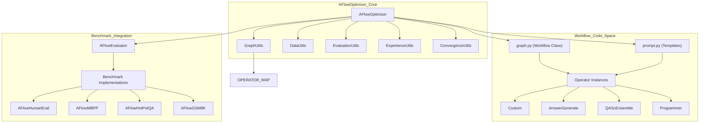
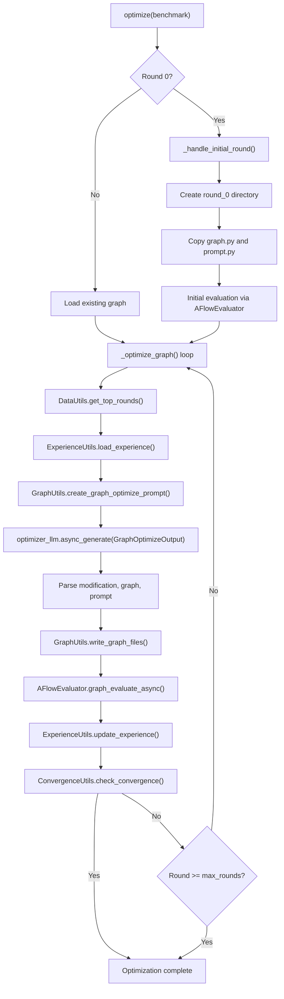
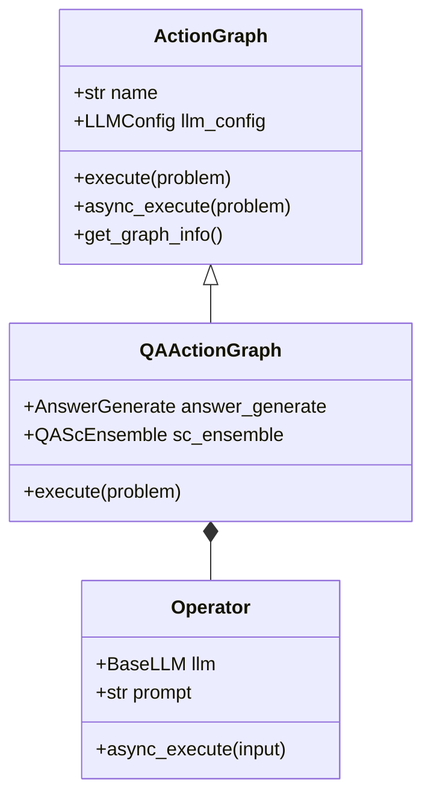

<!-- source: DeepWiki mcp.deepwiki.com · repo EvoAgentX/EvoAgentX · page 10.4 AFlow Optimization · fetched 2026-10-26 -->

# AFlow Optimization

<details>
<summary>Relevant source files</summary>

The following files were used as context for generating this wiki page:

- [LICENSE](LICENSE)
- [evoagentx/benchmark/gsm8k.py](evoagentx/benchmark/gsm8k.py)
- [evoagentx/benchmark/hotpotqa.py](evoagentx/benchmark/hotpotqa.py)
- [evoagentx/evaluators/aflow_evaluator.py](evoagentx/evaluators/aflow_evaluator.py)
- [evoagentx/optimizers/aflow_optimizer.py](evoagentx/optimizers/aflow_optimizer.py)
- [evoagentx/prompts/operators.py](evoagentx/prompts/operators.py)
- [evoagentx/prompts/optimizers/aflow_optimizer.py](evoagentx/prompts/optimizers/aflow_optimizer.py)
- [evoagentx/utils/aflow_utils/convergence_utils.py](evoagentx/utils/aflow_utils/convergence_utils.py)
- [evoagentx/utils/aflow_utils/evaluation_utils.py](evoagentx/utils/aflow_utils/evaluation_utils.py)
- [evoagentx/utils/aflow_utils/experience_utils.py](evoagentx/utils/aflow_utils/experience_utils.py)
- [evoagentx/utils/aflow_utils/graph_utils.py](evoagentx/utils/aflow_utils/graph_utils.py)
- [evoagentx/utils/sanitize.py](evoagentx/utils/sanitize.py)
- [evoagentx/workflow/action_graph.py](evoagentx/workflow/action_graph.py)
- [evoagentx/workflow/operators.py](evoagentx/workflow/operators.py)
- [examples/optimization/aflow/aflow_hotpotqa.py](examples/optimization/aflow/aflow_hotpotqa.py)
- [examples/optimization/aflow/aflow_humaneval.py](examples/optimization/aflow/aflow_humaneval.py)
- [examples/optimization/aflow/aflow_math.py](examples/optimization/aflow/aflow_math.py)
- [examples/optimization/aflow/aflow_mbpp.py](examples/optimization/aflow/aflow_mbpp.py)
- [examples/optimization/textgrad/hotpotqa_textgrad.py](examples/optimization/textgrad/hotpotqa_textgrad.py)
- [examples/optimization/textgrad/math_textgrad.py](examples/optimization/textgrad/math_textgrad.py)
- [examples/optimization/textgrad/mbpp_textgrad.py](examples/optimization/textgrad/mbpp_textgrad.py)
- [tests/src/workflow/test_action_graph.py](tests/src/workflow/test_action_graph.py)

</details>


This document covers the AFlow Optimization system for automatically evolving workflow structures and prompts within EvoAgentX. AFlow optimization uses iterative large language model-guided refinement to improve workflow performance through multiple optimization rounds, utilizing Monte Carlo Tree Search (MCTS) principles for exploration.

For information about other optimization approaches, see [TextGrad Optimization](#10.2) and [MIPRO Optimization](#10.3). For general optimization framework concepts, see [Optimization Framework](#10.1). For workflow evaluation, see [Evaluation System](#9.3).

## Architecture Overview

AFlow optimization operates as a multi-round iterative process that evaluates, optimizes, and evolves workflow graphs using language model feedback and performance metrics. It treats the workflow as a graph of operators that can be structurally modified or prompt-optimized.

### Core Components


Sources: [evoagentx/optimizers/aflow_optimizer.py:30-77](), [evoagentx/workflow/operators.py:34-150](), [evoagentx/evaluators/aflow_evaluator.py:14-30](), [evoagentx/utils/aflow_utils/graph_utils.py:22-30]()

### Optimization Process Flow

The optimizer performs a search over the space of possible workflow configurations. In each round, it samples from previously successful "rounds" (nodes in the search tree) and requests the `optimizer_llm` to propose a modification.


Sources: [evoagentx/optimizers/aflow_optimizer.py:96-118](), [evoagentx/optimizers/aflow_optimizer.py:168-268](), [evoagentx/utils/aflow_utils/graph_utils.py:89-109]()

## Core Classes and Interfaces

### AFlowOptimizer

The `AFlowOptimizer` class (inheriting from `BaseModule`) orchestrates the iteration loop. It manages the filesystem structure where each "round" of optimization is stored as a separate Python package.

| Field | Type | Description |
|-------|------|-------------|
| `question_type` | `str` | Task type (qa, match, code, etc.) |
| `graph_path` | `str` | Source folder containing initial `graph.py` and `prompt.py` |
| `optimizer_llm` | `BaseLLM` | LLM used to generate code/prompt modifications |
| `executor_llm` | `BaseLLM` | LLM used within the workflow operators |
| `max_rounds` | `int` | Limit for the optimization loop (default: 20) |
| `validation_rounds` | `int` | Number of times to run validation for variance reduction |

Sources: [evoagentx/optimizers/aflow_optimizer.py:30-66]()

### GraphOptimizeOutput

The optimizer uses a structured parser to ensure the LLM returns valid code and prompts.

```python
class GraphOptimizeOutput(LLMOutputParser):
    modification: str = Field(default="", description="Description of the change")
    graph: str = Field(default="", description="The complete Python code for the Workflow class")
    prompt: str = Field(default="", description="The complete Python code for prompt templates")
```
Sources: [evoagentx/optimizers/aflow_optimizer.py:23-28]()

## Operators and Workflow Components

### Available Operators

The `OPERATOR_MAP` in `graph_utils.py` defines the building blocks that the optimizer can use to construct new workflows. These are high-level abstractions over LLM calls.

| Operator | Class | Description |
|----------|-------|-------------|
| `AnswerGenerate` | `AnswerGenerate` | Generates step-by-step reasoning and a final answer. |
| `QAScEnsemble` | `QAScEnsemble` | Uses self-consistency to select the best answer from multiple candidates. |
| `Custom` | `Custom` | Executes a customized instruction on a given input. |
| `Programmer` | `Programmer` | Specialized for code-related tasks and execution. |

Sources: [evoagentx/workflow/operators.py:121-156](), [evoagentx/utils/aflow_utils/graph_utils.py:22-30]()

### ActionGraph vs Workflow

While EvoAgentX uses `WorkFlowGraph` for general tasks, AFlow optimization specifically targets `ActionGraph` structures (often defined as a `Workflow` class in `graph.py`). These graphs encapsulate the logic of calling various `Operator` instances.


Sources: [evoagentx/workflow/action_graph.py:12-110](), [evoagentx/workflow/operators.py:34-45]()

## Benchmark Integration

AFlow uses specialized benchmark wrappers to support the `async_evaluate` pattern required for high-throughput optimization.

### AFlow-Specific Benchmarks

| Benchmark | File | Key Evaluation Logic |
|-----------|------|----------------------|
| `AFlowHotPotQA` | `hotpotqa.py` | Joins context paragraphs, calls graph, evaluates F1. |
| `AFlowGSM8K` | `gsm8k.py` | Extracts last number from output, compares with label. |
| `AFlowHumanEval` | `humaneval.py` | Extracts code, runs against test cases using `Programmer`. |

Sources: [evoagentx/benchmark/hotpotqa.py:75-108](), [evoagentx/benchmark/gsm8k.py:110-156](), [evoagentx/benchmark/humaneval.py:159-228]()

### AFlowEvaluator

The `AFlowEvaluator` handles the concurrent execution of the workflow across the entire dataset split (dev or test).

- **Concurrency**: Uses `asyncio.Semaphore` to limit concurrent LLM requests (default `max_concurrent_tasks=20`).
- **Cost Management**: Integrates with `cost_manager` to calculate the financial cost of each optimization round.

Sources: [evoagentx/evaluators/aflow_evaluator.py:30-97]()

## Optimization Workflow Details

### 1. Sampling and Experience
The optimizer doesn't just modify the latest round. It uses `DataUtils.get_top_rounds()` to select successful previous configurations. It then loads the "experience" (a history of what worked and what didn't) via `ExperienceUtils`.

### 2. Prompt Generation
`GraphUtils.create_graph_optimize_prompt()` constructs a massive system prompt for the `optimizer_llm` including:
- Current workflow code.
- Current prompts.
- Available operators and their interfaces.
- Experience/feedback from previous rounds.
- Performance logs (errors or failed cases).

### 3. Code Generation and Update
The LLM generates a new `Workflow` class. `GraphUtils.write_graph_files()` saves this to a new round directory and `update_prompt_import()` dynamically updates the Python `import` statements in the generated code to ensure the `Workflow` class points to the correct `prompt_custom` module for that specific round.

Sources: [evoagentx/optimizers/aflow_optimizer.py:185-215](), [evoagentx/utils/aflow_utils/graph_utils.py:129-170]()

### 4. Convergence
`ConvergenceUtils` monitors the `avg_metrics` over time. If the performance plateaus (no significant improvement for several rounds), the optimization terminates early.

Sources: [evoagentx/optimizers/aflow_optimizer.py:113-114](), [evoagentx/utils/aflow_utils/convergence_utils.py]()

## Usage Example

```python
from evoagentx.models import OpenAILLM, OpenAILLMConfig
from evoagentx.optimizers.aflow_optimizer import AFlowOptimizer
from evoagentx.benchmark.hotpotqa import AFlowHotPotQA

# Setup LLMs
opt_llm = OpenAILLM(config=OpenAILLMConfig(model="gpt-4o"))
exec_llm = OpenAILLM(config=OpenAILLMConfig(model="gpt-4o-mini"))

# Initialize Optimizer
optimizer = AFlowOptimizer(
    question_type="qa",
    graph_path="./initial_workflow",
    optimizer_llm=opt_llm,
    executor_llm=exec_llm,
    max_rounds=15
)

# Run Optimization
benchmark = AFlowHotPotQA(mode="train")
optimizer.optimize(benchmark)

# Test Best Result
test_benchmark = AFlowHotPotQA(mode="test")
optimizer.test(test_benchmark)
```
Sources: [evoagentx/optimizers/aflow_optimizer.py:53-66](), [examples/optimization/aflow/aflow_hotpotqa.py]()

---

