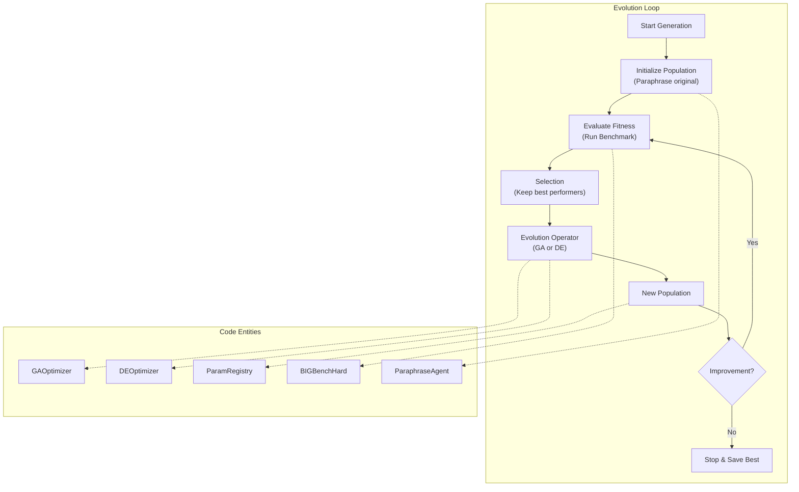
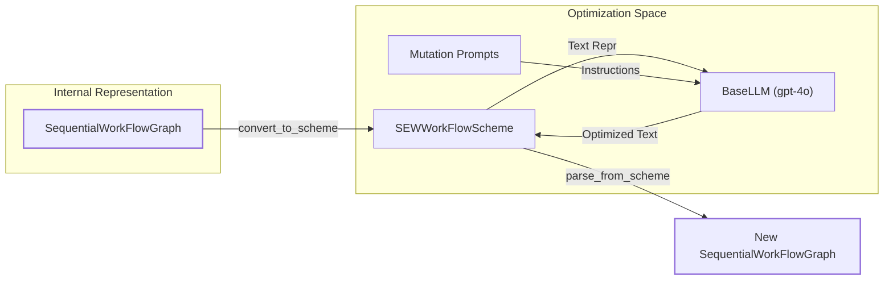

<!-- source: DeepWiki mcp.deepwiki.com · repo EvoAgentX/EvoAgentX · page 10.5 EvoPrompt and SEW Optimization · fetched 2026-10-26 -->

# EvoPrompt and SEW Optimization

<details>
<summary>Relevant source files</summary>

The following files were used as context for generating this wiki page:

- [docs/tutorial/evoprompt_optimizer.md](docs/tutorial/evoprompt_optimizer.md)
- [docs/tutorial/sew_optimizer.md](docs/tutorial/sew_optimizer.md)
- [docs/zh/tutorial/evoprompt_optimizer_zh.md](docs/zh/tutorial/evoprompt_optimizer_zh.md)
- [evoagentx/benchmark/bigbenchhard.py](evoagentx/benchmark/bigbenchhard.py)
- [evoagentx/optimizers/evoprompt_optimizer.py](evoagentx/optimizers/evoprompt_optimizer.py)
- [evoagentx/optimizers/sew_optimizer.py](evoagentx/optimizers/sew_optimizer.py)
- [evoagentx/prompts/workflow/sew_optimizer.py](evoagentx/prompts/workflow/sew_optimizer.py)
- [examples/optimization/evoprompt/evoprompt_bestconfig_json.py](examples/optimization/evoprompt/evoprompt_bestconfig_json.py)
- [examples/optimization/evoprompt/evoprompt_save_load_json_min.py](examples/optimization/evoprompt/evoprompt_save_load_json_min.py)
- [examples/optimization/evoprompt/evoprompt_workflow.py](examples/optimization/evoprompt/evoprompt_workflow.py)
- [examples/sew_optimizer.py](examples/sew_optimizer.py)
- [tests/src/optimizers/test_sew_workflow_scheme.py](tests/src/optimizers/test_sew_workflow_scheme.py)
- [tests/src/workflow/test_sequential_graph.py](tests/src/workflow/test_sequential_graph.py)

</details>


## Purpose and Scope

This page documents two advanced optimization strategies within the EvoAgentX self-evolution engine: **EvoPrompt** and **SEW (Self-Evolving Workflow)**. 

- **EvoPrompt** is a framework for evolutionary prompt optimization that utilizes Genetic Algorithms (GA) and Differential Evolution (DE) to iteratively refine prompts in multi-agent workflows [evoagentx/optimizers/evoprompt_optimizer.py:38-44]().
- **SEW** focuses on structural and content evolution, enabling the mutation of workflow graphs across multiple representation schemes (e.g., Python, YAML, BPMN) and the optimization of both prompts and task sequences [evoagentx/optimizers/sew_optimizer.py:22-26]().

---

## EvoPrompt Optimizer

The `EvopromptOptimizer` implements algorithms from the paper *"Connecting Large Language Models with Evolutionary Algorithms Yields Powerful Prompt Optimizers"*. It treats prompts as "individuals" in a population and applies evolutionary operators (selection, crossover, mutation) to find high-performing prompt configurations [evoagentx/optimizers/evoprompt_optimizer.py:2-9]().

### Evolutionary Algorithms

EvoAgentX provides two concrete implementations of the evolutionary strategy:

| Algorithm | Class | Mechanism |
|-----------|-------|-----------|
| **Genetic Algorithm** | `GAOptimizer` | Uses selection based on fitness, followed by crossover (combining two prompts) and mutation [evoagentx/optimizers/evoprompt_optimizer.py:465-470](). |
| **Differential Evolution** | `DEOptimizer` | Generates a donor prompt by calculating the difference between existing individuals, then performs crossover with the target individual [evoagentx/optimizers/evoprompt_optimizer.py:532-538](). |

### Core Components and Data Flow

The optimization process relies on a `ParamRegistry` to track specific prompt nodes within a program. It supports optimizing multiple nodes simultaneously, either independently or as a combined set [evoagentx/optimizers/evoprompt_optimizer.py:141-144]().

**EvoPrompt Execution Logic:**



**Sources:** [evoagentx/optimizers/evoprompt_optimizer.py:38-124](), [evoagentx/optimizers/evoprompt_optimizer.py:465-538]()

### Key Functions
- `_setup_logging_directory`: Initializes CSV-based logging for tracking fitness scores and prompt text across generations [evoagentx/optimizers/evoprompt_optimizer.py:125-146]().
- `paraphrase_agent`: A specialized `CustomizeAgent` used to generate the initial population by creating semantically equivalent but differently worded versions of the base prompt [evoagentx/optimizers/evoprompt_optimizer.py:102-123]().
- `optimize`: The main entry point that iterates through generations, calling `_evolve_step` and updating the `ParamRegistry` with the best found prompts [evoagentx/optimizers/evoprompt_optimizer.py:291-320]().

---

## SEW (Self-Evolving Workflow) Optimizer

The `SEWOptimizer` is designed to evolve the architecture of a `SequentialWorkFlowGraph`. Unlike prompt-only optimizers, SEW can modify the sequence of tasks, add/remove nodes, and change how data flows between agents [evoagentx/optimizers/sew_optimizer.py:22-26]().

### Multi-Scheme Representation

A unique feature of SEW is its ability to transform the internal `WorkFlowGraph` into different text-based representations for the LLM to "reason" over and mutate. The `SEWWorkFlowScheme` class handles these conversions [evoagentx/optimizers/sew_optimizer.py:27-31]().

| Scheme | Description | Function |
|--------|-------------|----------|
| `python` | List of dictionaries defining steps and args | `get_workflow_python_repr` [evoagentx/optimizers/sew_optimizer.py:102-120]() |
| `yaml` | Standard YAML task list | `get_workflow_yaml_repr` [evoagentx/optimizers/sew_optimizer.py:122-140]() |
| `code` | Functional representation: `task(in) -> out` | `get_workflow_code_repr` [evoagentx/optimizers/sew_optimizer.py:142-163]() |
| `bpmn` | XML-based Business Process Model and Notation | `get_workflow_bpmn_repr` [evoagentx/optimizers/sew_optimizer.py:165-185]() |

### SEW Optimization Process

The SEW optimizer uses a "thinking style" and mutation prompts to guide the LLM in suggesting improvements to the workflow structure [evoagentx/optimizers/sew_optimizer.py:18]().

**Workflow Mutation Diagram:**



**Sources:** [evoagentx/optimizers/sew_optimizer.py:31-65](), [evoagentx/workflow/workflow_graph.py:3-6]()

### Implementation Details
- **Optimization Modes**: Supports `prompt` (refine instructions), `structure` (change node order/count), or `all` [examples/sew_optimizer.py:57]().
- **Zero-Order vs First-Order**: SEW can operate in "zero-order" mode (purely black-box evolution based on scores) or "first-order" (using textual gradients/feedback) [examples/sew_optimizer.py:58]().
- **Evaluator Integration**: Uses the `Evaluator` class to compute metrics (like `Pass@1` on HumanEval) to determine if a mutated workflow is superior to the parent [examples/sew_optimizer.py:47-59]().

---

## Comparison and Performance

### EvoPrompt Benchmarks
Based on experimental results using the `BIGBenchHard` benchmark, EvoPrompt provides significant gains over standard Chain-of-Thought (COT) baselines [docs/tutorial/evoprompt_optimizer.md:17-26]().

| Task | COT Baseline | GA Best | DE Best | Improvement |
|------|--------------|---------|---------|-------------|
| **snarks** | 0.7109 | 0.8281 | 0.8281 | +16.5% |
| **ruin_names** | 0.5150 | 0.6850 | 0.7400 | +43.7% (DE) |

**Sources:** [docs/tutorial/evoprompt_optimizer.md:19-27](), [evoagentx/benchmark/bigbenchhard.py:66-80]()

### SEW Workflow Example
The SEW optimizer is typically applied to complex multi-step tasks like code generation (`HumanEval`). It iteratively updates the `SequentialWorkFlowGraph` and saves the result as a JSON configuration for deployment [examples/sew_optimizer.py:65-74]().

```python
# Minimal SEW Optimization Setup
sew_graph = SEWWorkFlowGraph(llm_config=llm_config)
optimizer = SEWOptimizer(
    graph=sew_graph, 
    evaluator=evaluator, 
    max_steps=10,
    repr_scheme="python", 
    optimize_mode="prompt"
)
optimizer.optimize(dataset=humaneval)
optimizer.save("optimized_workflow.json")
```

**Sources:** [examples/sew_optimizer.py:36-74](), [evoagentx/optimizers/sew_optimizer.py:27-65]()

---

## Logging and Persistence

Both optimizers emphasize reproducibility and transparency:
1. **Best Config JSON**: EvoPrompt automatically saves a `best_config.json` in the log directory, which can be loaded back into a `ParamRegistry` to restore the optimized state [examples/optimization/evoprompt/evoprompt_bestconfig_json.py:138-141]().
2. **Generation Summaries**: Detailed CSV logs record every individual prompt, its fitness score, and its rank within the node population for each generation [evoagentx/optimizers/evoprompt_optimizer.py:147-174]().
3. **Visualization**: The system generates performance summary plots (`performance_summary_OVERALL.png`) to visualize convergence over iterations [docs/tutorial/evoprompt_optimizer.md:32]().

**Sources:** [evoagentx/optimizers/evoprompt_optimizer.py:147-174](), [examples/optimization/evoprompt/evoprompt_save_load_json_min.py:102-115]()

---

