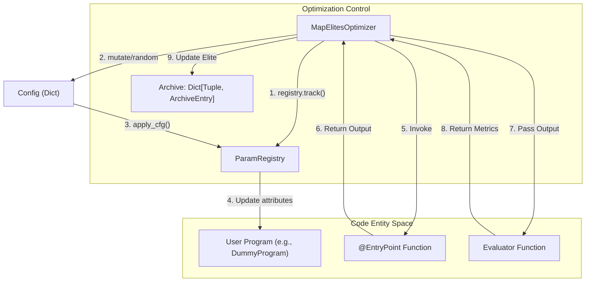
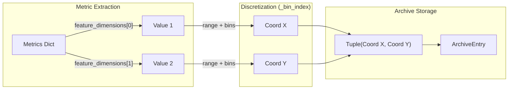

<!-- source: DeepWiki mcp.deepwiki.com · repo EvoAgentX/EvoAgentX · page 10.6 MAP-Elites Optimization · fetched 2026-10-26 -->

# MAP-Elites Optimization

<details>
<summary>Relevant source files</summary>

The following files were used as context for generating this wiki page:

- [evoagentx/models/siliconflow_model.py](evoagentx/models/siliconflow_model.py)
- [evoagentx/models/siliconflow_model_cost.py](evoagentx/models/siliconflow_model_cost.py)
- [evoagentx/optimizers/__init__.py](evoagentx/optimizers/__init__.py)
- [evoagentx/optimizers/map_elites_optimizer.py](evoagentx/optimizers/map_elites_optimizer.py)
- [examples/optimization/map_elites_demo.py](examples/optimization/map_elites_demo.py)
- [tests/src/optimizers/test_optimizer_package_imports.py](tests/src/optimizers/test_optimizer_package_imports.py)

</details>


The MAP-Elites (Multi-dimensional Archive of Phenotypic Elites) optimizer is a quality-diversity algorithm implemented in EvoAgentX to explore the search space of agent configurations. Unlike standard optimizers that seek a single global optimum, MAP-Elites maintains an archive of "elites" across different feature dimensions, ensuring both high performance and diversity in the evolved solutions. This is particularly useful for hyperparameter tuning and prompt optimization where different "types" of successful strategies may exist.

## Architecture and Core Logic

The `MapElitesOptimizer` class [evoagentx/optimizers/map_elites_optimizer.py:25-25]() implements the optimization loop. It partitions the search space into a multi-dimensional grid (the archive) based on user-defined "feature dimensions." Each cell in this grid stores the best-performing configuration found so far for that specific combination of features.

### Archive Management
The optimizer uses the `ArchiveEntry` dataclass [evoagentx/optimizers/map_elites_optimizer.py:18-22]() to store:
*   `cfg`: The parameter configuration (e.g., specific prompt versions or hyperparameters).
*   `fitness`: The primary scalar quality metric (e.g., accuracy).
*   `metrics`: A dictionary containing all evaluation results, including feature values.
*   `cell`: The multi-dimensional index (coordinates) in the archive grid.

### The Optimization Loop
The `optimize` method [evoagentx/optimizers/map_elites_optimizer.py:61-108]() follows these steps:
1.  **Selection**: With probability defined by `exploration_ratio`, it either generates a completely `_random_cfg` or selects an existing elite from the `archive` to perform `_mutate_cfg` [evoagentx/optimizers/map_elites_optimizer.py:73-79]().
2.  **Execution**: It applies the configuration to the target program using the `ParamRegistry` and executes the `EntryPoint` function [evoagentx/optimizers/map_elites_optimizer.py:81-82]().
3.  **Evaluation**: The `evaluator` function returns metrics, which are mapped to a specific archive `cell` [evoagentx/optimizers/map_elites_optimizer.py:83-84]().
4.  **Replacement**: If the cell is empty or the new configuration has higher `fitness` than the current occupant, the archive is updated [evoagentx/optimizers/map_elites_optimizer.py:87-93]().

### Data Flow and System Mapping

The following diagram illustrates how the `MapElitesOptimizer` interacts with the code entities to bridge the gap between abstract optimization and execution.

**MAP-Elites Execution Flow**

Sources: [evoagentx/optimizers/map_elites_optimizer.py:25-108](), [examples/optimization/map_elites_demo.py:20-48]()

## Feature Dimensions and Binning

MAP-Elites discretizes continuous feature values into discrete "bins" to form the archive grid. 

*   **Feature Dimensions**: Specified via `feature_dimensions` [evoagentx/optimizers/map_elites_optimizer.py:43-43](). These must be keys present in the dictionary returned by the `evaluator`.
*   **Feature Ranges**: Defined in `feature_ranges` as `(min, max)` tuples [evoagentx/optimizers/map_elites_optimizer.py:44-44]().
*   **Binning**: The `_bin_index` method [evoagentx/optimizers/map_elites_optimizer.py:148-159]() calculates the coordinate for a value. If a value exceeds the range, it is clipped to the boundary bins (0 or `bins-1`).

**Mapping Metrics to Archive Cells**

Sources: [evoagentx/optimizers/map_elites_optimizer.py:131-159]()

## Implementation Details

### Configuration Mutation
The `_mutate_cfg` method [evoagentx/optimizers/map_elites_optimizer.py:164-175]() implements a simple categorical mutation. It randomly selects one parameter from the `search_space` and changes its value to a different available option from the provided list.

### Evaluator Interface
The `evaluator` must return either a `float` (treated as the fitness score) or a `Metrics` dictionary [evoagentx/optimizers/map_elites_optimizer.py:110-124](). If a dictionary is returned, it must contain the `fitness_key` (defaulting to `"score"`) and all keys listed in `feature_dimensions`.

## Usage Example

To use MAP-Elites for optimizing an agent or workflow, you define a search space of possible parameter values and features to track.

```python
# From examples/optimization/map_elites_demo.py
opt = MapElitesOptimizer(
    registry=registry,
    evaluator=evaluator,
    search_space={"x": [0, 1, 2, 3, 4], "y": [0, 1, 2, 3, 4]},
    feature_dimensions=["complexity", "diversity"],
    feature_ranges={"complexity": (0.0, 4.0), "diversity": (0.0, 4.0)},
    feature_bins=5,
    n_iterations=60
)
best_cfg, result = opt.optimize()
```
Sources: [examples/optimization/map_elites_demo.py:36-48]()

## Configuration Parameters

| Parameter | Type | Description |
| :--- | :--- | :--- |
| `registry` | `ParamRegistry` | Tracks parameters within the agent/program to be optimized. |
| `evaluator` | `Callable` | Function that takes program output and returns fitness/metrics. |
| `search_space` | `Mapping[str, List[Any]]` | Dictionary of parameter names and their possible values. |
| `feature_dimensions`| `List[str]` | Keys in the metrics dict used to define the archive axes. |
| `feature_ranges` | `Mapping[str, Tuple]` | Min/Max values for each feature dimension. |
| `feature_bins` | `int` or `Mapping` | Number of subdivisions for each feature dimension. |
| `fitness_key` | `str` | The metric key used as the primary optimization objective. |
| `exploration_ratio` | `float` | Probability of picking a random config instead of mutating an elite. |

Sources: [evoagentx/optimizers/map_elites_optimizer.py:26-49]()

---

