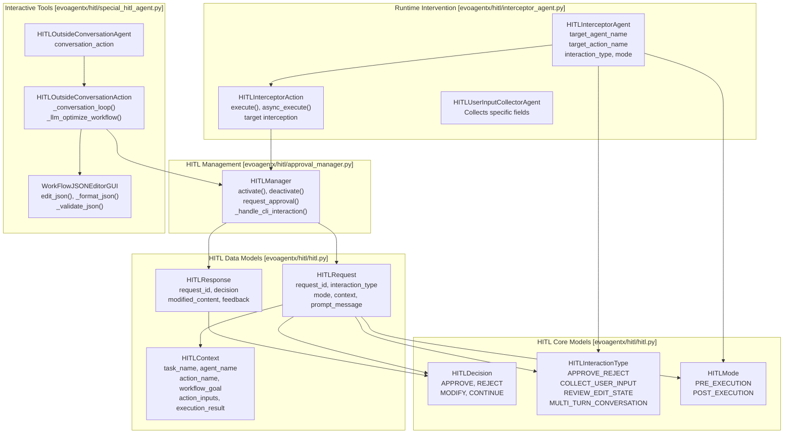
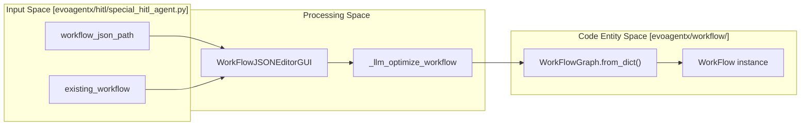

<!-- source: DeepWiki mcp.deepwiki.com · repo EvoAgentX/EvoAgentX · page 11 Human-in-the-Loop · fetched 2026-10-26 -->

# Human-in-the-Loop

<details>
<summary>Relevant source files</summary>

The following files were used as context for generating this wiki page:

- [evoagentx/hitl/__init__.py](evoagentx/hitl/__init__.py)
- [evoagentx/hitl/approval_manager.py](evoagentx/hitl/approval_manager.py)
- [evoagentx/hitl/hitl.py](evoagentx/hitl/hitl.py)
- [evoagentx/hitl/hitl_gui.py](evoagentx/hitl/hitl_gui.py)
- [evoagentx/hitl/interceptor_agent.py](evoagentx/hitl/interceptor_agent.py)
- [evoagentx/hitl/special_hitl_agent.py](evoagentx/hitl/special_hitl_agent.py)
- [examples/hitl/hitl_multi_conversation_example.py](examples/hitl/hitl_multi_conversation_example.py)

</details>


The Human-in-the-Loop (HITL) system provides capabilities for integrating human oversight and intervention into automated agent workflows. This system allows workflows to pause execution at critical points and request human approval, modification, or guidance before proceeding.

The HITL system enables workflows to be semi-automated, where human judgment can be incorporated at strategic decision points. This is particularly valuable for workflows that involve sensitive operations, data validation, or complex decision-making that benefits from human oversight. The system includes both runtime intervention capabilities and interactive tools for workflow design and modification.

Key HITL capabilities include:
- **Runtime Intervention**: Intercept workflow execution for approval/rejection decisions.
- **Interactive Workflow Editing**: GUI and conversation-based tools for modifying workflow structures.
- **LLM-Assisted Optimization**: Use LLMs to optimize workflow designs based on human feedback.
- **Multiple Interaction Modes**: Support for different types of human interaction patterns (e.g., approval, input collection).

For information about the overall workflow system architecture, see [Workflow System](#4). For details about agent integration, see [Agent System](#3).

## Core Components

The HITL system consists of several key components that work together to provide human oversight capabilities:

### HITL System Architecture



**Sources:** [evoagentx/hitl/hitl.py:1-50](), [evoagentx/hitl/approval_manager.py:10-105](), [evoagentx/hitl/interceptor_agent.py:110-210](), [evoagentx/hitl/special_hitl_agent.py:14-112]()

## HITL Overview
HITL concepts cover the use cases for human oversight, defining when to use different interaction modes such as `APPROVE_REJECT` for gatekeeping or `COLLECT_USER_INPUT` for parameter injection.
For details, see [HITL Overview](#11.1).

## HITLManager
The `HITLManager` is the central registry for human interactions. It handles the activation state, manages pending requests using `asyncio.Future`, and maps human-provided data back into the workflow via `hitl_input_output_mapping`.
For details, see [HITLManager](#11.2).

**Sources:** [evoagentx/hitl/approval_manager.py:10-23]()

## HITLInterceptorAgent
The `HITLInterceptorAgent` is designed to halt the workflow at specific points. It can operate in `PRE_EXECUTION` (before an action runs) or `POST_EXECUTION` (after an action finishes) modes. It uses a `HITLInterceptorAction` to communicate with the `HITLManager`.
For details, see [HITLInterceptorAgent](#11.3).

**Sources:** [evoagentx/hitl/interceptor_agent.py:110-158]()

## HITLUserInputCollectorAgent
This specialized agent is used when the workflow requires specific data that only a human can provide. It utilizes the `HITLUserInputCollectorAction` to prompt the user for specific `input_fields` and returns them to the workflow environment.
For details, see [HITLUserInputCollectorAgent](#11.4).

**Sources:** [evoagentx/hitl/interceptor_agent.py:166-210]()

## Workflow Editor
The Workflow Editor components, including `WorkFlowJSONEditorGUI` and `HITLOutsideConversationAgent`, allow for dynamic modification of the `WorkFlowGraph`.
- **GUI Editor**: A `tkinter` interface for manual JSON editing, validation, and node/edge management [evoagentx/hitl/hitl_gui.py:6-91]().
- **Conversation Agent**: An LLM-powered agent that optimizes workflow structures based on natural language feedback using the `_llm_optimize_workflow` method [evoagentx/hitl/special_hitl_agent.py:152-157]().

For details, see [Workflow Editor](#11.5).

### Workflow Modification Flow



**Sources:** [evoagentx/hitl/special_hitl_agent.py:61-112](), [evoagentx/hitl/hitl_gui.py:9-25]()

## Data Mapping and Integration

The HITL system integrates with the workflow system through the `HITLManager` parameter in the `WorkFlow` constructor. It requires explicit mapping to ensure human input reaches the correct target agents.

```python
# Example of hitl_input_output_mapping in HITLManager
hitl_manager.hitl_input_output_mapping = {
    "human_verified_data": "extracted_data"
}
```

**Sources:** [evoagentx/hitl/approval_manager.py:22-23](), [evoagentx/hitl/interceptor_agent.py:75-79]()

---

