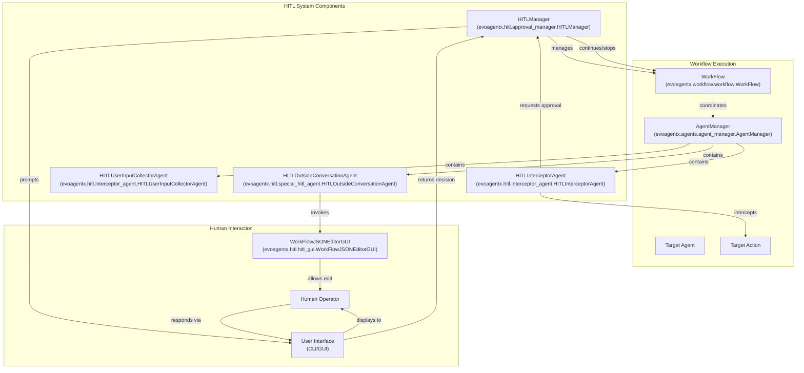
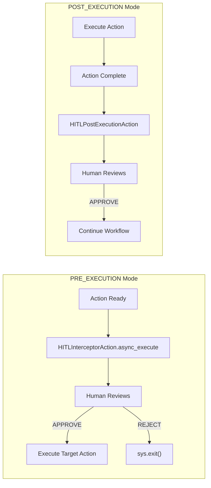
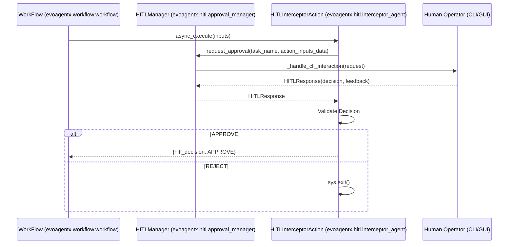

<!-- source: DeepWiki mcp.deepwiki.com · repo EvoAgentX/EvoAgentX · page 11.1 HITL Overview · fetched 2026-10-26 -->

# HITL Overview

Relevant source files

The following files were used as context for generating this wiki page:

- [evoagentx/hitl/__init__.py](evoagentx/hitl/__init__.py)
- [evoagentx/hitl/approval_manager.py](evoagentx/hitl/approval_manager.py)
- [evoagentx/hitl/hitl.py](evoagentx/hitl/hitl.py)
- [evoagentx/hitl/hitl_gui.py](evoagentx/hitl/hitl_gui.py)
- [evoagentx/hitl/interceptor_agent.py](evoagentx/hitl/interceptor_agent.py)
- [evoagentx/hitl/special_hitl_agent.py](evoagentx/hitl/special_hitl_agent.py)
- [examples/hitl/hitl_example2.py](examples/hitl/hitl_example2.py)
- [examples/hitl/hitl_multi_conversation_example.py](examples/hitl/hitl_multi_conversation_example.py)

The Human-in-the-Loop (HITL) system provides mechanisms for integrating human oversight and intervention into automated agentic workflows. This capability enables workflows to pause execution at critical points and request human approval, input, or guidance before proceeding.

HITL is essential for deploying AI agents in sensitive domains where human judgment is required for critical decisions, such as finance, healthcare, legal operations, or any scenario involving irreversible actions.

This page provides an overview of HITL concepts, use cases, and decision guidelines. For implementation details, see [HITLManager](11.2), [HITLInterceptorAgent](11.3), and [HITLUserInputCollectorAgent](11.4).

## Why HITL?

AI agents can automate complex workflows, but certain operations require human oversight to ensure safety, compliance, and correctness. HITL addresses several critical needs:

| Need | Description |
|------|-------------|
| **Safety** | Prevent irreversible actions like sending emails, deleting data, or executing financial transactions without review |
| **Compliance** | Meet regulatory requirements that mandate human approval for certain operations |
| **Quality Assurance** | Verify agent outputs before they affect production systems or external parties |
| **Error Recovery** | Allow humans to intervene when agents encounter unexpected situations |
| **Trust Building** | Gradually increase confidence in agent capabilities by monitoring early executions |

Sources: [evoagentx/hitl/approval_manager.py:10-15](), [evoagentx/hitl/hitl.py:6-21]()

## Core Components

The HITL system consists of three main components that work together to enable human oversight:

### Component Architecture Diagram

| Component | Purpose | Details |
|-----------|---------|---------|
| `HITLManager` | Central control for all HITL interactions | Activates/deactivates HITL, manages request-response lifecycle [evoagentx/hitl/approval_manager.py:10-22]() | 
| `HITLInterceptorAgent` | Intercepts and pauses workflow execution | Targets specific agent/action combinations for approval [evoagentx/hitl/interceptor_agent.py:110-119]() |
| `HITLUserInputCollectorAgent` | Actively solicits human input | Collects structured data from humans during execution [evoagentx/hitl/interceptor_agent.py:166-186]() |
| `HITLOutsideConversationAgent` | Workflow modification | Supports multi-turn conversation and GUI editing to modify workflow JSON [evoagentx/hitl/special_hitl_agent.py:255-260]() |

Sources: [evoagentx/hitl/approval_manager.py:10-54](), [evoagentx/hitl/interceptor_agent.py:110-186](), [evoagentx/hitl/special_hitl_agent.py:255-260]()

## Interception Modes

HITL supports two primary interception modes defined in `HITLMode` that determine when human intervention occurs during action execution:

### Mode Comparison Diagram

### Mode Characteristics

| Mode | Timing | Use Case | Decision Options |
|------|--------|----------|------------------|
| **PRE_EXECUTION** | Before action executes | Approve risky operations before they occur | `APPROVE`, `REJECT` [evoagentx/hitl/interceptor_agent.py:140-146]() |
| **POST_EXECUTION** | After action completes | Review results and decide whether to proceed | `APPROVE`, `REJECT` [evoagentx/hitl/interceptor_agent.py:147-152]() |

Sources: [evoagentx/hitl/hitl.py:19-21](), [evoagentx/hitl/interceptor_agent.py:140-154]()

## Common Use Cases

### Workflow JSON Modification
The `HITLOutsideConversationAgent` allows a human to modify the `WorkFlowGraph` structure dynamically. This is useful for:
- Correcting generated workflow structures.
- Adding or removing nodes/edges via a `WorkFlowJSONEditorGUI` [evoagentx/hitl/hitl_gui.py:6-25]().
- Using LLM-assisted optimization with human feedback [evoagentx/hitl/special_hitl_agent.py:152-157]().

### Structured Data Collection
`HITLUserInputCollectorAgent` is used to pause the workflow and request specific fields from the user.
- **Example**: Collecting user profile information (name, age, email) to be used in subsequent workflow nodes [examples/hitl/hitl_example2.py:39-70]().
- **Implementation**: Uses `HITLUserInputCollectorAction` to map user inputs to the workflow state [evoagentx/hitl/interceptor_agent.py:166-186]().

### Decision Matrix

| Situation | Recommendation | Mode |
|-----------|---------------|------|
| **High-risk irreversible actions** | ✅ Always use HITL | `PRE_EXECUTION` |
| **External communications** | ✅ Use HITL in production | `PRE_EXECUTION` |
| **Workflow structure validation** | ✅ Use `HITLOutsideConversationAgent` | Manual/GUI |
| **Collecting user preferences** | ✅ Use `HITLUserInputCollectorAgent` | Active Collection |

Sources: [examples/hitl/hitl_multi_conversation_example.py:31-56](), [examples/hitl/hitl_example2.py:39-70](), [evoagentx/hitl/special_hitl_agent.py:113-140]()

## Integration with Workflows

HITL integrates into EvoAgentX workflows as specialized agents that intercept or provide data.

### Technical Data Flow Diagram

### Basic Integration Steps

1. **Activate HITLManager**: Instantiate and call `.activate()` [evoagentx/hitl/approval_manager.py:28-31]().
2. **Configure Mappings**: Set `hitl_input_output_mapping` in the manager to route human inputs to the correct workflow variables [evoagentx/hitl/approval_manager.py:22]().
3. **Assign to Workflow**: Pass the manager to the `WorkFlow` instance [examples/hitl/hitl_example2.py:150-155]().

Sources: [evoagentx/hitl/approval_manager.py:10-107](), [evoagentx/hitl/interceptor_agent.py:50-89](), [examples/hitl/hitl_example2.py:140-155]()

## CLI and GUI Interaction

### CLI Interaction
The `HITLManager` handles CLI-based interactions for binary decisions.
- **Approve/Reject**: Users input 'a' or 'r' in the terminal [evoagentx/hitl/approval_manager.py:143-150]().
- **Feedback**: Rejections can include optional text feedback [evoagentx/hitl/approval_manager.py:157-160]().

### GUI Interaction
The `WorkFlowJSONEditorGUI` provides a `tkinter`-based interface for complex JSON modifications.
- **Features**: Format, Validate, Reset, and Quick-add nodes/edges [evoagentx/hitl/hitl_gui.py:46-57]().
- **Validation**: Includes internal logic to check for duplicate node names and valid edge source/targets [evoagentx/hitl/hitl_gui.py:119-139]().

Sources: [evoagentx/hitl/approval_manager.py:140-166](), [evoagentx/hitl/hitl_gui.py:6-141]()

---

