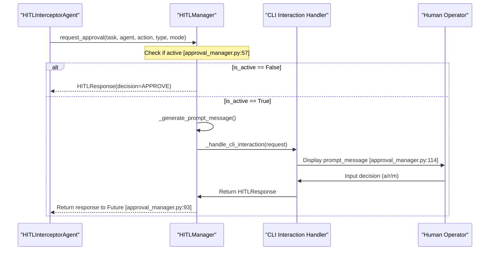
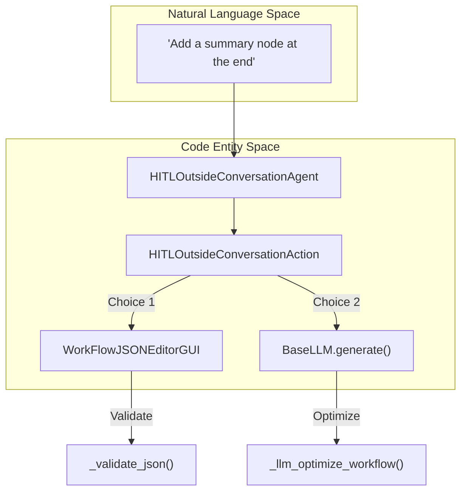

<!-- source: DeepWiki mcp.deepwiki.com · repo EvoAgentX/EvoAgentX · page 11.2 HITLManager · fetched 2026-10-26 -->

# HITLManager

<details>
<summary>Relevant source files</summary>

The following files were used as context for generating this wiki page:

- [evoagentx/hitl/__init__.py](evoagentx/hitl/__init__.py)
- [evoagentx/hitl/approval_manager.py](evoagentx/hitl/approval_manager.py)
- [evoagentx/hitl/hitl.py](evoagentx/hitl/hitl.py)
- [evoagentx/hitl/hitl_gui.py](evoagentx/hitl/hitl_gui.py)
- [evoagentx/hitl/interceptor_agent.py](evoagentx/hitl/interceptor_agent.py)
- [evoagentx/hitl/special_hitl_agent.py](evoagentx/hitl/special_hitl_agent.py)
- [examples/hitl/hitl_multi_conversation_example.py](examples/hitl/hitl_multi_conversation_example.py)

</details>


## Purpose and Scope

`HITLManager` is the central coordination module for Human-in-the-Loop (HITL) interactions within the EvoAgentX framework. Inheriting from `BaseModule`, it manages the lifecycle of human intervention requests, maintains activation states, and handles field mapping between human-provided inputs and workflow variables [evoagentx/hitl/approval_manager.py:10-14]().

It acts as a bridge between the automated `WorkFlow` execution and the `HITLBaseAgent` implementations that perform the actual interaction [evoagentx/hitl/interceptor_agent.py:93-96]().

Sources: [evoagentx/hitl/approval_manager.py:10-14](), [evoagentx/hitl/interceptor_agent.py:93-96]()

## Core Implementation

The `HITLManager` class provides mechanisms to activate/deactivate the HITL system and a request-response pattern for handling human decisions [evoagentx/hitl/approval_manager.py:17-41]().

### Key Attributes and Methods

| Attribute/Method | Type | Description |
|------------------|------|-------------|
| `active` | `bool` | Pydantic field indicating if HITL is enabled [evoagentx/hitl/approval_manager.py:17](). |
| `hitl_input_output_mapping` | `dict` | Maps human-provided output keys to workflow input keys [evoagentx/hitl/approval_manager.py:22](). |
| `activate()` / `deactivate()` | Method | Sets the `active` state and logs the transition [evoagentx/hitl/approval_manager.py:28-36](). |
| `request_approval()` | Async Method | Entry point for agents to request human intervention [evoagentx/hitl/approval_manager.py:42-54](). |

Sources: [evoagentx/hitl/approval_manager.py:17-54]()

## HITL Interaction Flow

The following diagram illustrates how `HITLManager` facilitates communication between a `HITLInterceptorAgent` and the human operator.



**HITL Request Lifecycle**

When an agent calls `request_approval`, the manager checks its `active` status [evoagentx/hitl/approval_manager.py:57-63](). If active, it creates a `HITLRequest` and a corresponding `asyncio.Future` to track the pending interaction [evoagentx/hitl/approval_manager.py:80-89]().

Sources: [evoagentx/hitl/approval_manager.py:57-115]()

## Interaction Types and Decisions

`HITLManager` supports multiple interaction modes defined in `HITLInteractionType` [evoagentx/hitl/hitl.py:12-18]().

### Supported Interaction Types
*   **APPROVE_REJECT**: Binary choice for the human [evoagentx/hitl/approval_manager.py:118]().
*   **COLLECT_USER_INPUT**: Requests specific data fields from the user [evoagentx/hitl/interceptor_agent.py:174]().
*   **MULTI_TURN_CONVERSATION**: Allows back-and-forth chat to refine a task [evoagentx/hitl/approval_manager.py:124]().
*   **REVIEW_TOOL_CALLS**: Specific review for tool execution parameters [evoagentx/hitl/approval_manager.py:122]().

### Decision Enums
The `HITLDecision` enum [evoagentx/hitl/hitl.py:6-10]() governs the outcome of an interaction:
*   `APPROVE`: Continue execution.
*   `REJECT`: Stop execution (often triggers `sys.exit()` in interceptors [evoagentx/hitl/interceptor_agent.py:87]()).
*   `MODIFY`: Human provided updated data.
*   `CONTINUE`: Used in multi-turn loops.

Sources: [evoagentx/hitl/hitl.py:6-18](), [evoagentx/hitl/approval_manager.py:118-125](), [evoagentx/hitl/interceptor_agent.py:87-174]()

## Specialized HITL Components

### HITLOutsideConversationAgent
This specialized agent allows humans to modify a workflow's JSON structure outside of the standard execution flow [evoagentx/hitl/special_hitl_agent.py:14-27](). It uses a `HITLOutsideConversationAction` to loop through edits [evoagentx/hitl/special_hitl_agent.py:113-122]().

### WorkFlowJSONEditorGUI
A Tkinter-based GUI provided for visual editing of workflow JSON during HITL sessions [evoagentx/hitl/hitl_gui.py:6-25](). It includes validation logic to ensure the edited JSON maintains a valid node/edge structure [evoagentx/hitl/hitl_gui.py:106-141]().



**Workflow Modification Path**

Sources: [evoagentx/hitl/special_hitl_agent.py:14-157](), [evoagentx/hitl/hitl_gui.py:6-141]()

## Integration with Workflow

To use HITL, the `HITLManager` must be instantiated and passed to the `WorkFlow` [evoagentx/hitl/approval_manager.py:13]().

```python
from evoagentx.hitl import HITLManager
from evoagentx.workflow import WorkFlow

# 1. Initialize and activate
hitl_manager = HITLManager()
hitl_manager.activate()

# 2. Configure mapping (optional)
# Maps HITL agent output 'user_text' to workflow input 'query'
hitl_manager.hitl_input_output_mapping = {"user_text": "query"}

# 3. Inject into Workflow
workflow = WorkFlow(
    graph=graph,
    llm=llm,
    agent_manager=agent_manager,
    hitl_manager=hitl_manager
)
```

During execution, `HITLInterceptorAction` uses the manager to apply these mappings to the result dictionary [evoagentx/hitl/interceptor_agent.py:75-78]().

Sources: [evoagentx/hitl/approval_manager.py:13-22](), [evoagentx/hitl/interceptor_agent.py:75-78](), [examples/hitl/hitl_multi_conversation_example.py:39-40]()

## CLI Interaction Details

The `_handle_cli_interaction` method is the default implementation for human contact [evoagentx/hitl/approval_manager.py:108](). It uses `loop.run_in_executor` to handle blocking `input()` calls without freezing the asynchronous event loop [evoagentx/hitl/approval_manager.py:153-154]().

If no response is received within the `timeout` (default 1800s), the manager automatically returns a `REJECT` decision [evoagentx/hitl/approval_manager.py:53-103]().

Sources: [evoagentx/hitl/approval_manager.py:53-154]()

---

