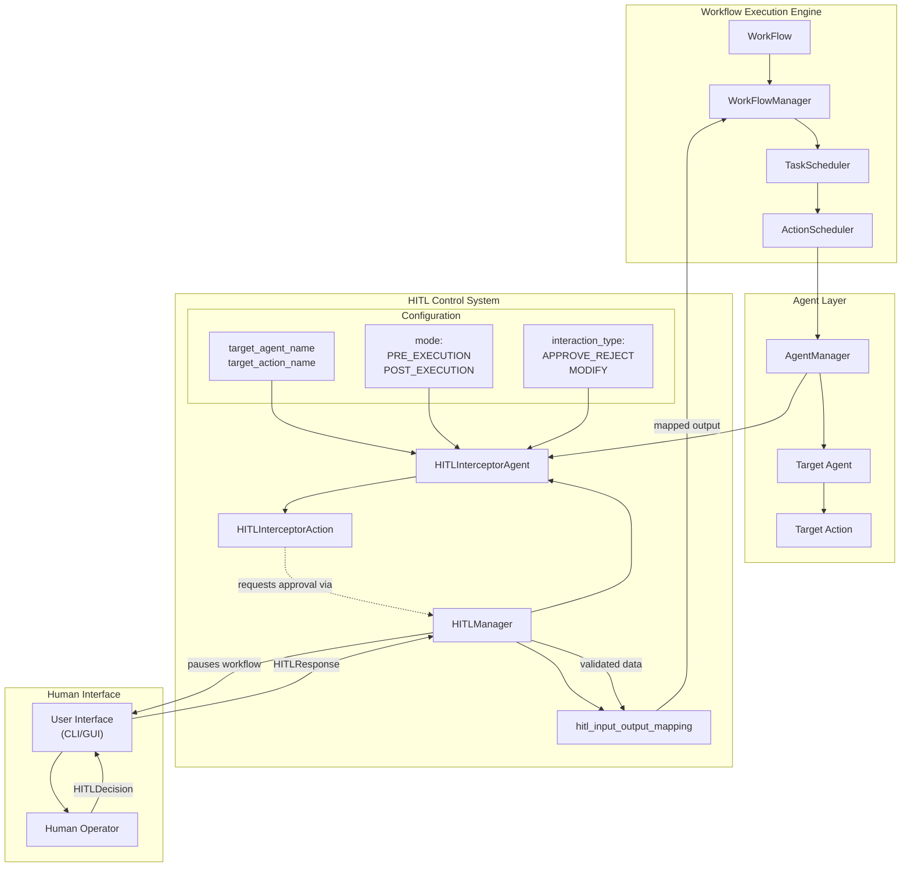
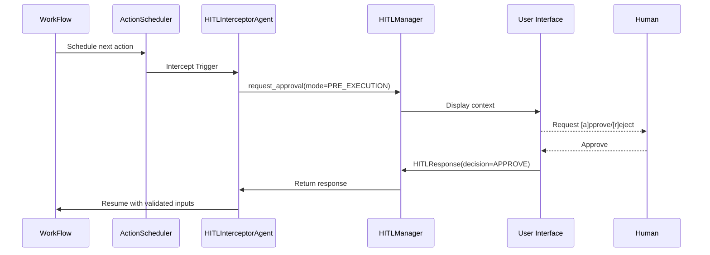

<!-- source: DeepWiki mcp.deepwiki.com · repo EvoAgentX/EvoAgentX · page 11.3 HITLInterceptorAgent · fetched 2026-10-26 -->

# HITLInterceptorAgent

<details>
<summary>Relevant source files</summary>

The following files were used as context for generating this wiki page:

- [evoagentx/hitl/__init__.py](evoagentx/hitl/__init__.py)
- [evoagentx/hitl/approval_manager.py](evoagentx/hitl/approval_manager.py)
- [evoagentx/hitl/hitl.py](evoagentx/hitl/hitl.py)
- [evoagentx/hitl/hitl_gui.py](evoagentx/hitl/hitl_gui.py)
- [evoagentx/hitl/interceptor_agent.py](evoagentx/hitl/interceptor_agent.py)
- [evoagentx/hitl/special_hitl_agent.py](evoagentx/hitl/special_hitl_agent.py)
- [examples/hitl/hitl_multi_conversation_example.py](examples/hitl/hitl_multi_conversation_example.py)

</details>


## Purpose and Scope

This document describes the `HITLInterceptorAgent`, a specialized agent that intercepts and pauses workflow execution at critical points to request human approval, rejection, or modification of actions. This agent is the primary mechanism for implementing human oversight in automated workflows.

For general HITL concepts and when to use human oversight, see [HITL Overview](#11.1). For managing HITL activation and configuration, see [HITLManager](#11.2). For collecting user input during execution, see [HITLUserInputCollectorAgent](#11.4).

## Overview

`HITLInterceptorAgent` is a control-flow agent that monitors workflow execution and pauses before or after specific actions execute, allowing human operators to review and validate critical decisions. Unlike regular agents that perform tasks, interceptor agents serve as checkpoints in the workflow, ensuring that sensitive operations (e.g., sending emails, executing financial transactions, deleting data) receive explicit human approval before proceeding.

The interceptor operates by targeting specific agent-action pairs within a workflow and triggering at configurable lifecycle points. When triggered, the workflow execution halts, presents relevant information to the human operator via a user interface, and waits for a decision before continuing.

**Sources:** [evoagentx/hitl/interceptor_agent.py:110-132](), [evoagentx/hitl/hitl.py:19-21]()

## System Architecture

The following diagram illustrates how the `HITLInterceptorAgent` integrates with the core workflow and the human interaction layer.

### HITL Interaction Flow


**Sources:** [evoagentx/hitl/interceptor_agent.py:13-37](), [evoagentx/hitl/approval_manager.py:42-107](), [evoagentx/hitl/hitl.py:45-50]()

## Interception Modes

`HITLInterceptorAgent` supports multiple interception modes defined in the `HITLMode` enum that determine when the workflow pauses for human interaction:

### PRE_EXECUTION Mode

Intercepts actions **before** they execute, allowing humans to approve or reject the action before any side effects occur. This is the default mode for `HITLInterceptorAction`.

| Property | Value |
|----------|-------|
| **Trigger Point** | Before `Action.execute()` is called |
| **Use Cases** | Approving emails before sending, validating database writes |
| **Data Available** | Action input parameters (`action_inputs_data`) |
| **Human Decision** | `APPROVE` (continue), `REJECT` (stop/exit) |

**Workflow Flow:**


### POST_EXECUTION Mode

Intercepts actions **after** they execute. This is implemented via the `HITLPostExecutionAction` class.

| Property | Value |
|----------|-------|
| **Trigger Point** | After `Action.execute()` completes |
| **Use Cases** | Verifying generated content quality, validating computation results |
| **Data Available** | `execution_result`, side effects |
| **Human Decision** | `APPROVE` (accept result), `REJECT` (rollback/fail) |

**Sources:** [evoagentx/hitl/hitl.py:19-21](), [evoagentx/hitl/interceptor_agent.py:13-37](), [evoagentx/hitl/interceptor_agent.py:90-91]()

## Interaction Types

The `HITLInteractionType` enum specifies how the human operator interacts with the intercepted action:

### APPROVE_REJECT

A binary decision where the user selects `[a]pprove` or `[r]eject`. Rejection can optionally include feedback text.

```python
# Defined in HITLManager
decision = await self._handle_approve_reject(request)
```

### MULTI_TURN_CONVERSATION

Supported by `HITLConversationAgent` and `HITLOutsideConversationAgent`. This allows a back-and-forth between the human and an LLM to refine data or workflow structures.

### COLLECT_USER_INPUT

Used by `HITLUserInputCollectorAgent` to gather specific fields from the user.

**Sources:** [evoagentx/hitl/hitl.py:12-17](), [evoagentx/hitl/approval_manager.py:118-126](), [evoagentx/hitl/special_hitl_agent.py:14-28]()

## Field Mapping and Data Validation

The interceptor uses `hitl_input_output_mapping` within the `HITLManager` to transform data between the interceptor's output and the workflow's state.

### Mapping Logic

In `HITLInterceptorAction.async_execute`, the agent iterates through its expected outputs and pulls values from the `inputs` (which may have been modified by human interaction) using the mapping defined in the manager.

```python
for output_name in self.outputs_format.get_attrs():
    try:
        result |= {output_name: inputs[hitl_manager.hitl_input_output_mapping[output_name]]}
    except Exception as e:
        logger.exception(e)
```

**Sources:** [evoagentx/hitl/interceptor_agent.py:75-79](), [evoagentx/hitl/approval_manager.py:22]()

## Special Interceptor: WorkFlow Editor

EvoAgentX includes a specialized version of the interceptor pattern for modifying the workflow itself: `HITLOutsideConversationAgent`.

### JSON GUI Editor
When modifying a workflow JSON structure, the system can launch a `WorkFlowJSONEditorGUI` (built with `tkinter`) to provide a visual interface for:
- Formatting and Validating JSON.
- Adding nodes and edges.
- Loading templates.


**Sources:** [evoagentx/hitl/hitl_gui.py:6-25](), [evoagentx/hitl/special_hitl_agent.py:113-151]()

## Configuration

### Constructor Parameters

The `HITLInterceptorAgent` is initialized with the target it intends to watch.

| Parameter | Type | Description |
|-----------|------|-------------|
| `target_agent_name` | `str` | The name of the agent to intercept. |
| `target_action_name` | `str` | The specific action to intercept (or "any"). |
| `interaction_type` | `HITLInteractionType` | The type of UI/Interaction to present. |
| `mode` | `HITLMode` | `PRE_EXECUTION` or `POST_EXECUTION`. |

### Example Usage

```python
from evoagentx.hitl import HITLInterceptorAgent, HITLInteractionType, HITLMode

# Intercept a specific agent's email action before it runs
interceptor = HITLInterceptorAgent(
    target_agent_name="EmailAgent",
    target_action_name="SendEmail",
    interaction_type=HITLInteractionType.APPROVE_REJECT,
    mode=HITLMode.PRE_EXECUTION
)
```

**Sources:** [evoagentx/hitl/interceptor_agent.py:113-156]()

## Implementation Details

### HITLInterceptorAction Lifecycle

1. **`async_execute`**: Triggered by the workflow scheduler.
2. **`request_approval`**: Calls the `HITLManager` to pause and get human input.
3. **Decision Handling**: 
   - If `HITLDecision.APPROVE`: Continues and returns mapped outputs.
   - If `HITLDecision.REJECT`: Currently calls `sys.exit()` to halt the process entirely.
4. **Output Mapping**: Merges inputs into the final result dictionary based on `hitl_input_output_mapping`.

**Sources:** [evoagentx/hitl/interceptor_agent.py:50-88](), [evoagentx/hitl/approval_manager.py:42-107]()

---

