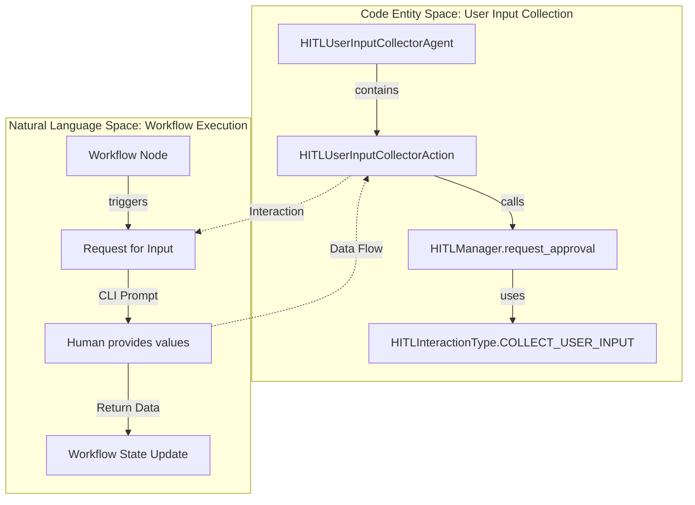
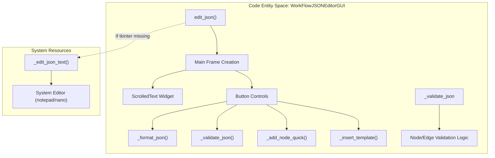

<!-- source: DeepWiki mcp.deepwiki.com · repo EvoAgentX/EvoAgentX · page 11.4 HITLUserInputCollectorAgent · fetched 2026-10-26 -->

# HITLUserInputCollectorAgent

<details>
<summary>Relevant source files</summary>

The following files were used as context for generating this wiki page:

- [evoagentx/hitl/__init__.py](evoagentx/hitl/__init__.py)
- [evoagentx/hitl/approval_manager.py](evoagentx/hitl/approval_manager.py)
- [evoagentx/hitl/hitl.py](evoagentx/hitl/hitl.py)
- [evoagentx/hitl/hitl_gui.py](evoagentx/hitl/hitl_gui.py)
- [evoagentx/hitl/interceptor_agent.py](evoagentx/hitl/interceptor_agent.py)
- [evoagentx/hitl/special_hitl_agent.py](evoagentx/hitl/special_hitl_agent.py)
- [examples/hitl/hitl_example2.py](examples/hitl/hitl_example2.py)
- [examples/hitl/hitl_multi_conversation_example.py](examples/hitl/hitl_multi_conversation_example.py)

</details>


The `HITLUserInputCollectorAgent` is a specialized Human-in-the-Loop (HITL) agent designed to actively solicit human input during workflow execution. Unlike the `HITLInterceptorAgent`, which gates existing actions for approval/rejection, the user input collector prompts humans to provide new data, parameters, or decisions that the workflow requires to proceed.

This agent enables workflows to dynamically request information that cannot be predetermined, such as user profiles, specific preferences, or domain-specific knowledge required for subsequent processing nodes.

## Core Architecture

The system utilizes a specialized agent and action pair to manage the input collection lifecycle.

### HITLUserInputCollectorAgent and Action


Sources: [evoagentx/hitl/interceptor_agent.py:166-231](), [evoagentx/hitl/approval_manager.py:42-107]()

The `HITLUserInputCollectorAgent` is initialized with a dictionary of `input_fields` that defines the schema of the data to be collected from the human [evoagentx/hitl/interceptor_agent.py:223-228]().

### Data Flow and Field Mapping
When the agent executes, it uses the `HITLManager` to prompt the user. A critical component is the `hitl_input_output_mapping`, which maps the collected human input to the specific output parameters required by the workflow node [evoagentx/hitl/approval_manager.py:22-22]().

| Component | Role | Source |
|-----------|------|--------|
| `input_fields` | Defines names, types, and descriptions of requested data | [evoagentx/hitl/interceptor_agent.py:184-184]() |
| `HITLInteractionType` | Set to `COLLECT_USER_INPUT` to trigger input prompts | [evoagentx/hitl/hitl.py:14-14]() |
| `hitl_input_output_mapping` | Dictionary mapping internal HITL keys to workflow output keys | [evoagentx/hitl/approval_manager.py:22-22]() |

## WorkFlow JSON Editor GUI

The `WorkFlowJSONEditorGUI` class provides a comprehensive graphical interface for editing workflow JSON structures using `tkinter`. This tool enables visual workflow modification with real-time validation, formatting, and template insertion capabilities.

### GUI Architecture and Components


Sources: [evoagentx/hitl/hitl_gui.py:6-341]()

### Key Features
The GUI editor provides several core capabilities:
- **JSON Formatting**: Automatically formats and indents JSON structure via `_format_json` [evoagentx/hitl/hitl_gui.py:94-105]().
- **Structure Validation**: Validates nodes (unique names) and edges (source/target existence) via `_validate_json` [evoagentx/hitl/hitl_gui.py:106-145]().
- **Quick Operations**: Interactive dialogs for adding nodes and edges [evoagentx/hitl/hitl_gui.py:162-246]().
- **Template System**: Provides predefined JSON structures for `WorkFlowNode` and `CustomizeAgent` [evoagentx/hitl/hitl_gui.py:248-268]().

## Interactive Conversation Agent

The `HITLOutsideConversationAgent` (and its associated `HITLOutsideConversationAction`) provides a multi-turn conversation loop to modify workflow structures outside of standard execution.

### Conversation Flow and Menu
The loop provides an interactive menu for the user to manipulate the workflow JSON:

| Option | Functionality | Code Reference |
|--------|---------------|----------------|
| **1** | Open GUI Editor | `WorkFlowJSONEditorGUI` [evoagentx/hitl/special_hitl_agent.py:140-151]() |
| **2** | LLM Optimization | `_llm_optimize_workflow()` [evoagentx/hitl/special_hitl_agent.py:152-157]() |
| **3** | View JSON | Print current structure [evoagentx/hitl/special_hitl_agent.py:159-162]() |
| **4** | Finish Edit | Break loop and instantiate [evoagentx/hitl/special_hitl_agent.py:164-167]() |
| **6** | Reload | Restore original JSON [evoagentx/hitl/special_hitl_agent.py:173-176]() |

Sources: [evoagentx/hitl/special_hitl_agent.py:130-180]()

### LLM-Assisted Optimization
The `_llm_optimize_workflow` method sends the current JSON and user advice to an LLM. The prompt instructs the LLM to optimize descriptions, parameters, and dependencies while maintaining the original JSON format [evoagentx/hitl/special_hitl_agent.py:208-241]().

## Usage Example: User Profile Collection

In a typical implementation, the `HITLUserInputCollectorAgent` is placed in a workflow node to gather data for subsequent processing nodes.

```python
# 1. Define fields to collect
user_input_fields = {
    "user_name": {"type": "string", "description": "please input your name", "required": True},
    "user_age": {"type": "int", "description": "please input your age", "required": True}
}

# 2. Create the collector agent
user_input_collector = HITLUserInputCollectorAgent(
    name="UserProfile",
    llm_config=llm_config,
    input_fields=user_input_fields,
)

# 3. Map HITL fields to Workflow outputs
hitl_manager.hitl_input_output_mapping = {
    "user_name": "user_name",
    "user_age": "user_age"
}
```
Sources: [examples/hitl/hitl_example2.py:40-70](), [examples/hitl/hitl_example2.py:140-146]()

## Technical Implementation Details

### Fallback Mechanism
If `tkinter` is unavailable on the host system, `WorkFlowJSONEditorGUI` gracefully degrades to `_edit_json_text()`, which exports the JSON to a temporary file and opens the system's default text editor (e.g., `notepad` or `nano`) [evoagentx/hitl/hitl_gui.py:309-341]().

### Integration Constraints
The `HITLOutsideConversationAgent` is explicitly marked with `forbidden_in_workflow = True` [evoagentx/hitl/special_hitl_agent.py:278-278](). This prevents the agent from being accidentally scheduled as a task node within an automated workflow, ensuring it is only used for manual structural modifications.

Sources: [evoagentx/hitl/special_hitl_agent.py:277-285]()

---

