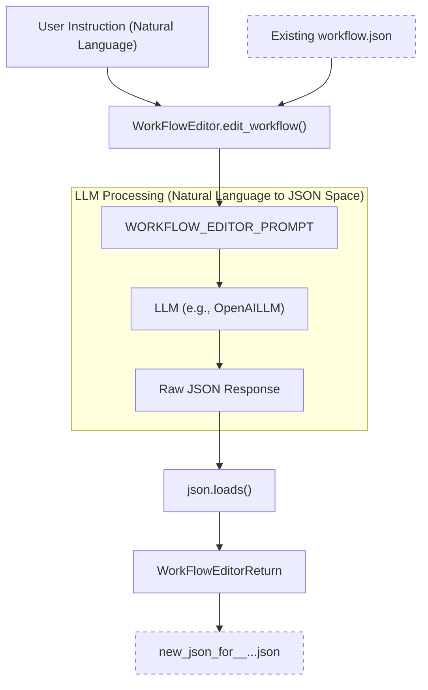
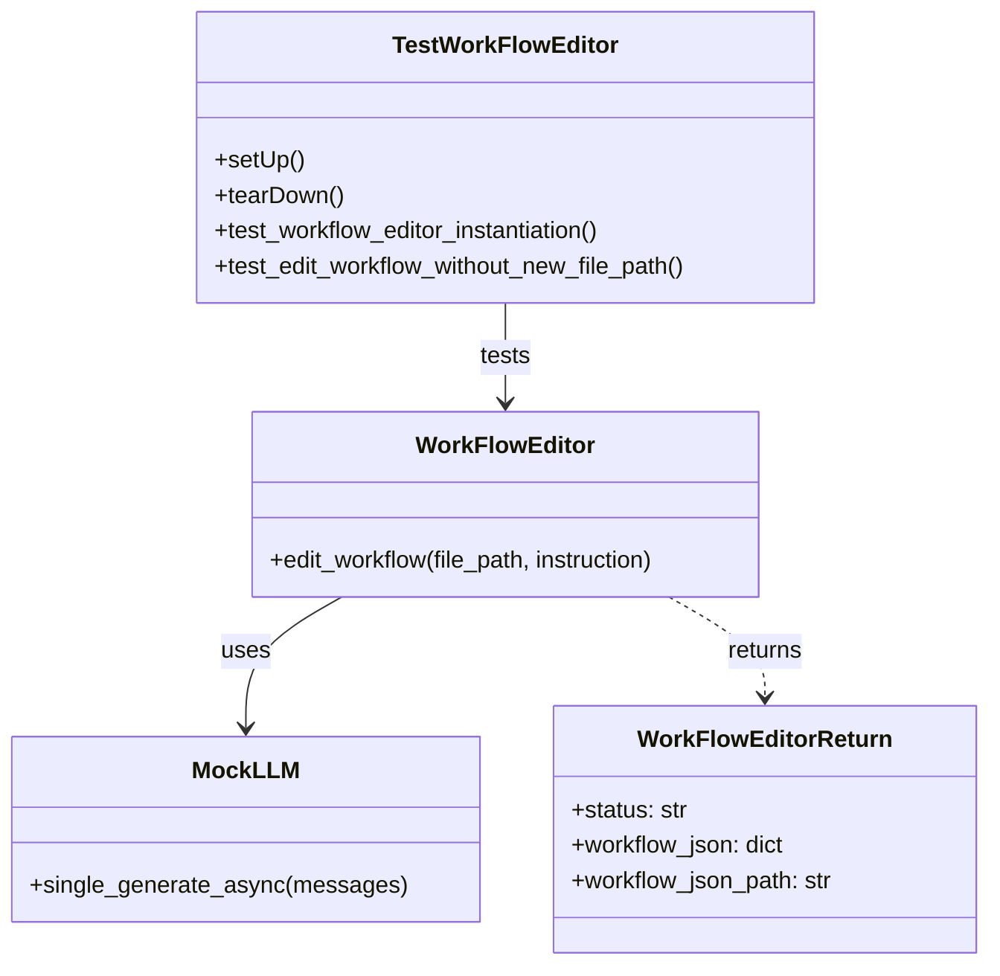

<!-- source: DeepWiki mcp.deepwiki.com · repo EvoAgentX/EvoAgentX · page 11.5 Workflow Editor · fetched 2026-10-26 -->

# Workflow Editor

<details>
<summary>Relevant source files</summary>

The following files were used as context for generating this wiki page:

- [evoagentx/hitl/workflow_editor.py](evoagentx/hitl/workflow_editor.py)
- [evoagentx/prompts/workflow/workflow_editor.py](evoagentx/prompts/workflow/workflow_editor.py)
- [tests/src/hitl/__init__.py](tests/src/hitl/__init__.py)
- [tests/src/hitl/test_workflow_editor.py](tests/src/hitl/test_workflow_editor.py)

</details>


The `WorkFlowEditor` is a Human-in-the-Loop (HITL) component designed for asynchronous or API-oriented workflow modification. Unlike interactive agents that engage in dialogue, the `WorkFlowEditor` leverages LLMs to programmatically transform a workflow's JSON structure based on natural language instructions.

## Overview

The `WorkFlowEditor` serves as a bridge between high-level user requirements and the underlying `WorkFlowGraph` representation. It allows developers or users to provide optimization advice (e.g., "merge these two steps" or "add error handling to the data fetch node") which the LLM then applies to the JSON schema while maintaining structural integrity.

### Key Capabilities
*   **Structure Optimization**: Merging, splitting, or re-ordering nodes in a `WorkFlowGraph` [evoagentx/prompts/workflow/workflow_editor.py:10-14]().
*   **Dependency Correction**: Ensuring node relationships and input/output parameters remain valid after edits [evoagentx/prompts/workflow/workflow_editor.py:12-13]().
*   **Persistence**: Automatically saving modified workflows to a versioned directory with timestamps [evoagentx/hitl/workflow_editor.py:143-145]().
*   **Testing Infrastructure**: Includes a `MockLLM` for validating workflow transformations without incurring API costs [evoagentx/hitl/workflow_editor.py:24-63]().

---

## Technical Implementation

### Core Class: WorkFlowEditor
The `WorkFlowEditor` inherits from `BaseModule` and manages the lifecycle of a workflow modification request.

| Attribute | Type | Description |
| :--- | :--- | :--- |
| `save_dir` | `str` | Directory where the modified JSON files are stored [evoagentx/hitl/workflow_editor.py:126](). |
| `llm` | `BaseLLM` | The language model used to process instructions. Defaults to GPT-4o or `MockLLM` [evoagentx/hitl/workflow_editor.py:127](). |
| `max_retries` | `int` | Number of attempts to generate valid JSON if parsing fails [evoagentx/hitl/workflow_editor.py:128](). |

### Data Flow: Workflow Modification
The following diagram illustrates how a natural language instruction is transformed into a code-compatible `WorkFlowGraph` JSON structure.

**Workflow Transformation Flow**

**Sources:** [evoagentx/hitl/workflow_editor.py:133-172](), [evoagentx/prompts/workflow/workflow_editor.py:1-19]()

---

## Prompting Logic

The editor uses a specialized prompt template, `WORKFLOW_EDITOR_PROMPT`, which enforces strict rules on the LLM to ensure the resulting JSON is compatible with the `WorkFlow` engine.

### Constraints and Rules
The LLM is instructed to follow these specific criteria during the transformation:
1.  **Structural Preservation**: Keep the original keys and general hierarchy [evoagentx/prompts/workflow/workflow_editor.py:2-5]().
2.  **Clarity**: Ensure node descriptions are clear [evoagentx/prompts/workflow/workflow_editor.py:11]().
3.  **Parameter Logic**: Validate that input/output parameters between nodes are reasonable [evoagentx/prompts/workflow/workflow_editor.py:12]().
4.  **Agent/Tool Context**: In advanced modes, the editor can be provided with `pre_defined_agents_examples` and `pre_defined_tools_examples` to ensure the workflow uses valid components [evoagentx/prompts/workflow/workflow_editor.py:23-30]().

**Sources:** [evoagentx/prompts/workflow/workflow_editor.py:1-32]()

---

## Test Infrastructure

The component includes a robust testing suite that utilizes a `MockLLM` to simulate workflow edits without external dependencies.

### Mock System Components
To facilitate unit testing, the framework provides:
*   **`MockLLMConfig`**: A configuration class for the mock model [evoagentx/hitl/workflow_editor.py:18-22]().
*   **`MockLLM`**: Implements `single_generate` to return a static empty workflow or user-defined JSON for validation [evoagentx/hitl/workflow_editor.py:24-63]().
*   **`default_llm_config()`**: A helper function that automatically switches to `MockLLM` if `PYTEST_CURRENT_TEST` or `CI` environment variables are detected [evoagentx/hitl/workflow_editor.py:65-86]().

### Test Case: Node Deletion
The test suite validates that the editor can successfully process an instruction like "delete the last node" by comparing the LLM output against an expected dictionary structure.

**Test Architecture**

**Sources:** [tests/src/hitl/test_workflow_editor.py:16-153](), [evoagentx/hitl/workflow_editor.py:24-63]()

---

## Usage Example

```python
from evoagentx.hitl.workflow_editor import WorkFlowEditor

# Initialize the editor
editor = WorkFlowEditor(save_dir="./optimized_workflows")

# Modify a workflow via natural language
result = await editor.edit_workflow(
    file_path="original_workflow.json",
    instruction="Add a validation node after the data extraction step to check for null values."
)

if result.status == "success":
    print(f"New workflow saved at: {result.workflow_json_path}")
```
**Sources:** [evoagentx/hitl/workflow_editor.py:133-145](), [evoagentx/hitl/workflow_editor.py:96-117]()

---

