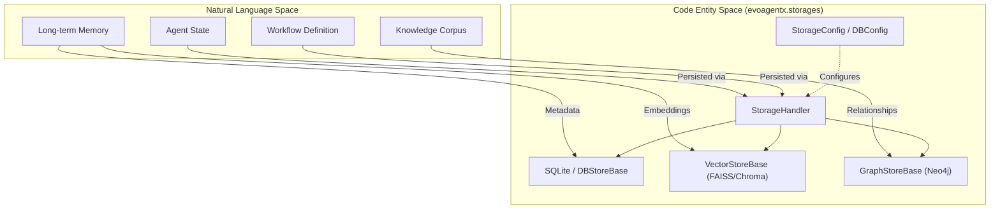
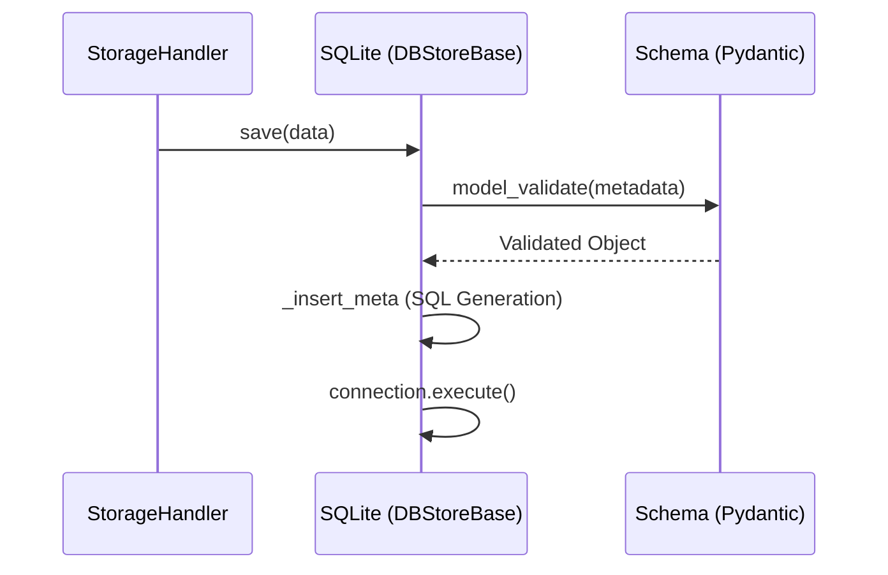

<!-- source: DeepWiki mcp.deepwiki.com · repo EvoAgentX/EvoAgentX · page 12 Storage and Persistence · fetched 2026-10-26 -->

# Storage and Persistence

Relevant source files

The following files were used as context for generating this wiki page:

- [evoagentx/storages/base.py](evoagentx/storages/base.py)
- [evoagentx/storages/db_stores/base.py](evoagentx/storages/db_stores/base.py)
- [evoagentx/storages/db_stores/posgre_sql.py](evoagentx/storages/db_stores/posgre_sql.py)
- [evoagentx/storages/db_stores/sqlite.py](evoagentx/storages/db_stores/sqlite.py)
- [evoagentx/storages/graph_stores/base.py](evoagentx/storages/graph_stores/base.py)
- [evoagentx/storages/schema.py](evoagentx/storages/schema.py)
- [evoagentx/storages/storages_config.py](evoagentx/storages/storages_config.py)
- [evoagentx/storages/vectore_stores/base.py](evoagentx/storages/vectore_stores/base.py)
- [evoagentx/storages/vectore_stores/chroma.py](evoagentx/storages/vectore_stores/chroma.py)
- [evoagentx/storages/vectore_stores/qdrant.py](evoagentx/storages/vectore_stores/qdrant.py)

The Storage and Persistence system in EvoAgentX provides a unified abstraction layer for managing agent states, workflow definitions, long-term memory, and RAG-related indices. By utilizing a modular architecture, the framework supports relational databases, vector stores, and graph databases through a centralized `StorageHandler`.

## High-Level Storage Abstraction

The `StorageHandler` serves as the primary interface for all persistence operations within the framework. It manages the lifecycle of multiple backends simultaneously, allowing the system to store structured metadata in a relational database while maintaining embeddings in a vector store and relationships in a graph store.

### System Architecture Overview

The following diagram illustrates how natural language concepts (Memory, Workflows) map to the underlying code entities and storage implementations.

**Storage Mapping: Logic to Implementation**

**Sources:** [evoagentx/storages/base.py:15-25](), [evoagentx/storages/storages_config.py:43-51]()

## Storage Components

The framework categorizes data into specific schemas defined by Pydantic models, ensuring type safety across different storage backends.

| Storage Type | Code Entity | Primary Use Case |
|:---|:---|:---|
| **Relational** | `DBStoreBase` | Metadata for agents, workflows, and memory history. |
| **Vector** | `VectorStoreBase` | Storing and retrieving document embeddings for RAG. |
| **Graph** | `GraphStoreBase` | Managing complex entities and relationships (e.g., Neo4j). |
| **File-based** | `StoreConfig.path` | Local caching of indices and SQLite files. |

**Sources:** [evoagentx/storages/schema.py:7-16](), [evoagentx/storages/base.py:22-25]()

### Data Schemas and Table Types
EvoAgentX uses a predefined set of table types to organize data. These are defined in the `TableType` enum and validated using specific Pydantic models:
*   `AgentStore`: For agent configurations and details [evoagentx/storages/schema.py:40-47]().
*   `WorkflowStore`: For graph structures and execution logic [evoagentx/storages/schema.py:31-38]().
*   `MemoryStore`: For long-term memory content and associated metadata [evoagentx/storages/schema.py:19-29]().
*   `HistoryStore`: For tracking changes and events in memory [evoagentx/storages/schema.py:49-59]().
*   `IndexStore`: For RAG corpus and indexing metadata [evoagentx/storages/schema.py:61-69]().

## Storage Architecture and Relational Data
The core of the persistence layer is the `StorageHandler`, which uses factories to instantiate specific backends based on `StoreConfig`. The default relational backend is **SQLite**, which implements the `DBStoreBase` interface. This layer handles the serialization of complex Python objects into JSON strings for database storage and provides thread-safe operations via locking mechanisms.

For details, see [Storage Architecture](#12.1).

**Relational Data Flow**

**Sources:** [evoagentx/storages/base.py:110-132](), [evoagentx/storages/db_stores/sqlite.py:68-109](), [evoagentx/storages/db_stores/sqlite.py:114-129]()

## Vector and Graph Stores
For unstructured data and complex relationship mapping, EvoAgentX integrates with specialized stores. 
*   **Vector Stores:** Support for `FAISS`, `Chroma`, and `Qdrant`. These are primarily used within the RAG system to store embeddings for semantic search.
*   **Graph Stores:** Support for `Neo4j`, enabling agents to traverse structured knowledge graphs.

These stores are often interfaced through `LlamaIndex` compatible wrappers to provide a standard API for retrieval.

For details, see [Vector and Graph Stores](#12.2).

**Sources:** [evoagentx/storages/vectore_stores/base.py:7-12](), [evoagentx/storages/graph_stores/base.py:8-12](), [evoagentx/storages/storages_config.py:18-41]()

---

