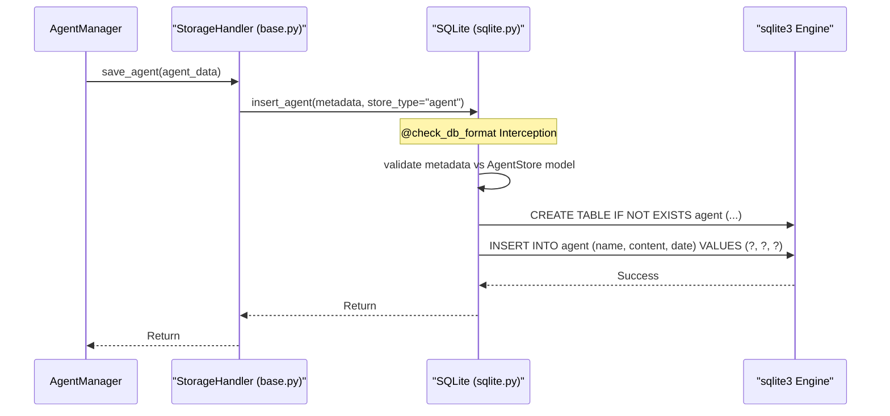

<!-- source: DeepWiki mcp.deepwiki.com · repo EvoAgentX/EvoAgentX · page 12.1 Storage Architecture · fetched 2026-10-26 -->

# Storage Architecture

<details>
<summary>Relevant source files</summary>

The following files were used as context for generating this wiki page:

- [evoagentx/storages/base.py](evoagentx/storages/base.py)
- [evoagentx/storages/db_stores/sqlite.py](evoagentx/storages/db_stores/sqlite.py)
- [evoagentx/storages/schema.py](evoagentx/storages/schema.py)
- [evoagentx/storages/storages_config.py](evoagentx/storages/storages_config.py)
- [tests/src/storages/test_storagehandler.py](tests/src/storages/test_storagehandler.py)
- [tests/src/storages/workflow_demo_4o_mini.json](tests/src/storages/workflow_demo_4o_mini.json)

</details>


The Storage Architecture in EvoAgentX provides a unified abstraction layer for managing persistent data across different storage backends, including relational databases, vector stores, and graph databases. This system ensures that agents, workflows, and memories can be serialized, stored, and retrieved consistently regardless of the underlying infrastructure.

## Core Abstractions

The storage system is built upon a modular architecture where the `StorageHandler` acts as the primary interface for the rest of the framework.

### StorageHandler
The `StorageHandler` class is a `BaseModule` responsible for initializing and coordinating different storage backends [evoagentx/storages/base.py:15-25](). It manages three main types of stores:
*   **Relational Database (`storageDB`)**: Handles structured data like agent configurations and workflow definitions.
*   **Vector Store (`vector_store`)**: Manages embeddings for semantic search and RAG.
*   **Graph Store (`graph_store`)**: Manages relational knowledge graphs.

### Storage Configuration
All storage settings are encapsulated in `StoreConfig` [evoagentx/storages/storages_config.py:43-51](). This configuration object aggregates specific settings for each backend:
*   `DBConfig`: Settings for SQLite or PostgreSQL (name, path, IP, port) [evoagentx/storages/storages_config.py:8-15]().
*   `VectorStoreConfig`: Settings for FAISS or Qdrant (dimensions, index type) [evoagentx/storages/storages_config.py:18-27]().
*   `GraphStoreConfig`: Settings for Neo4j (URI, credentials) [evoagentx/storages/storages_config.py:30-40]().

**Sources:**
* [evoagentx/storages/base.py:15-40]()
* [evoagentx/storages/storages_config.py:8-51]()

## Data Schema Definitions

EvoAgentX uses Pydantic models to define strict schemas for data persistence. These models ensure data integrity when moving between the "Natural Language Space" (LLM outputs) and the "Code Entity Space" (Database records).

| Model | Purpose | Key Fields |
| :--- | :--- | :--- |
| `AgentStore` | Persists agent definitions | `name`, `content` (Dict), `date` |
| `WorkflowStore` | Persists workflow graphs | `name`, `content` (Dict), `date` |
| `MemoryStore` | Stores long-term memory | `memory_id`, `content`, `embedding`, `key_words` |
| `HistoryStore` | Tracks memory changes | `old_memory`, `new_memory`, `event`, `created_at` |
| `IndexStore` | Stores RAG index metadata | `corpus_id`, `content`, `metadata` |

The `TableType` enum defines the physical table names used in the underlying database backends [evoagentx/storages/schema.py:7-16]().

**Sources:**
* [evoagentx/storages/schema.py:7-69]()

## Relational Storage (SQLite Backend)

The default relational backend is implemented via the `SQLite` class [evoagentx/storages/db_stores/sqlite.py:114-119](). It utilizes a decorator-based approach to ensure schema compliance at runtime.

### The `check_db_format` Decorator
The `check_db_format` decorator is a critical component that intercepts insertion calls. It performs two main tasks:
1.  **Schema Validation**: It maps the `store_type` to the corresponding Pydantic model (e.g., `AgentStore`) and validates the incoming metadata [evoagentx/storages/db_stores/sqlite.py:79-98]().
2.  **Auto-Table Creation**: It generates and executes `CREATE TABLE IF NOT EXISTS` SQL statements based on the Pydantic model fields if the table does not exist [evoagentx/storages/db_stores/sqlite.py:100-106]().

### Data Flow: Saving an Agent
The following diagram illustrates the flow from a code entity to a SQLite record.

**Code Entity to SQLite Persistence Flow**


**Sources:**
* [evoagentx/storages/db_stores/sqlite.py:57-111]()
* [evoagentx/storages/db_stores/sqlite.py:156-179]()
* [evoagentx/storages/base.py:186-198]()

## Implementation Details

### Serialization and Parsing
Because SQLite is a relational database, complex Python dictionaries (like agent configurations or workflow nodes) must be serialized. 
*   **Saving**: The `SQLite` class uses `json.dumps()` on any non-string metadata values before execution [evoagentx/storages/db_stores/sqlite.py:174-177]().
*   **Loading**: The `StorageHandler.parse_result` method inspects the Pydantic model fields. If a field is not annotated as a string, it automatically applies `json.loads()` to the database result to restore the Python object [evoagentx/storages/base.py:133-151]().

### Initialization Logic
When `StorageHandler.init_module()` is called, it ensures the local directory path exists and then sequentially initializes the DB, Vector, and Graph stores via their respective factories [evoagentx/storages/base.py:27-40]().

**Storage System Class Relationships**
```mermaid
classDiagram
    class "StorageHandler" {
        +storageConfig: StoreConfig
        +storageDB: DBStoreBase
        +vector_store: VectorStoreBase
        +init_module()
        +save_agent(data)
        +load_agent(agent_id)
    }
    class "DBStoreFactory" {
        +create(db_name, config)
    }
    class "SQLite" {
        +connection: sqlite3.Connection
        +insert_agent(metadata)
        +get_by_id(id)
    }
    class "AgentStore" {
        +name: str
        +content: dict
    }

    "StorageHandler" ..> "DBStoreFactory" : uses
    "DBStoreFactory" ..> "SQLite" : creates
    "SQLite" ..> "AgentStore" : validates with
    "StorageHandler" *-- "SQLite" : manages
```

**Sources:**
* [evoagentx/storages/base.py:27-75]()
* [evoagentx/storages/base.py:133-151]()
* [evoagentx/storages/db_stores/sqlite.py:120-130]()

---

