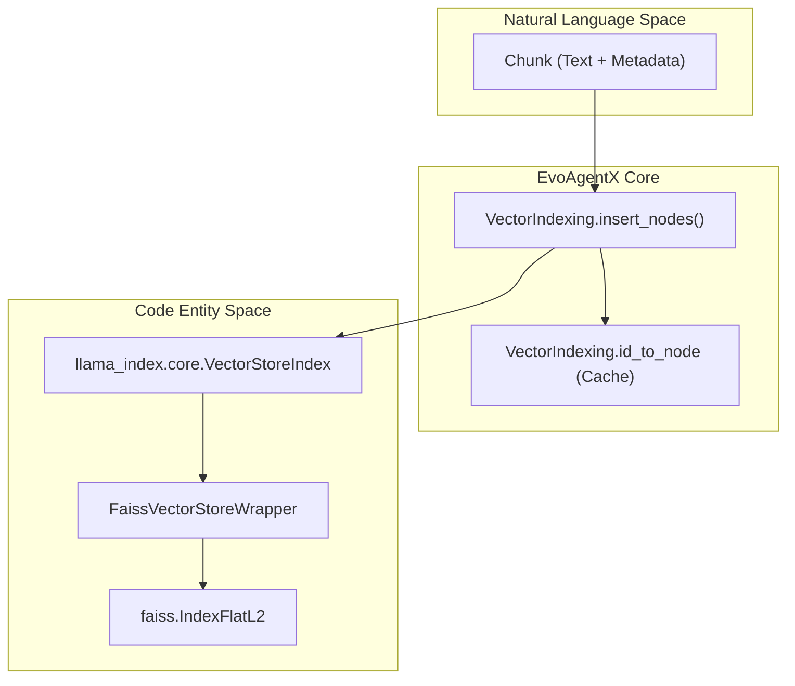
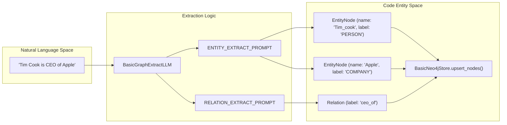

<!-- source: DeepWiki mcp.deepwiki.com · repo EvoAgentX/EvoAgentX · page 12.2 Vector and Graph Stores · fetched 2026-10-26 -->

# Vector and Graph Stores

<details>
<summary>Relevant source files</summary>

The following files were used as context for generating this wiki page:

- [evoagentx/prompts/rag/graph_extract.py](evoagentx/prompts/rag/graph_extract.py)
- [evoagentx/prompts/rag/graph_synonym.py](evoagentx/prompts/rag/graph_synonym.py)
- [evoagentx/prompts/rag/hyde.py](evoagentx/prompts/rag/hyde.py)
- [evoagentx/rag/indexings/__init__.py](evoagentx/rag/indexings/__init__.py)
- [evoagentx/rag/indexings/base.py](evoagentx/rag/indexings/base.py)
- [evoagentx/rag/indexings/graph_index.py](evoagentx/rag/indexings/graph_index.py)
- [evoagentx/rag/indexings/vector_index.py](evoagentx/rag/indexings/vector_index.py)
- [evoagentx/rag/retrievers/graph_retriever.py](evoagentx/rag/retrievers/graph_retriever.py)
- [evoagentx/rag/transforms/graph_extract.py](evoagentx/rag/transforms/graph_extract.py)
- [evoagentx/rag/transforms/query/HyDE.py](evoagentx/rag/transforms/query/HyDE.py)
- [evoagentx/rag/transforms/query/base.py](evoagentx/rag/transforms/query/base.py)
- [evoagentx/storages/db_stores/base.py](evoagentx/storages/db_stores/base.py)
- [evoagentx/storages/db_stores/posgre_sql.py](evoagentx/storages/db_stores/posgre_sql.py)
- [evoagentx/storages/graph_stores/base.py](evoagentx/storages/graph_stores/base.py)
- [evoagentx/storages/graph_stores/neo4j.py](evoagentx/storages/graph_stores/neo4j.py)
- [evoagentx/storages/vectore_stores/base.py](evoagentx/storages/vectore_stores/base.py)
- [evoagentx/storages/vectore_stores/chroma.py](evoagentx/storages/vectore_stores/chroma.py)
- [evoagentx/storages/vectore_stores/faiss.py](evoagentx/storages/vectore_stores/faiss.py)
- [evoagentx/storages/vectore_stores/qdrant.py](evoagentx/storages/vectore_stores/qdrant.py)

</details>


The EvoAgentX framework utilizes a sophisticated storage abstraction layer to handle high-dimensional vector data and complex relational knowledge graphs. These stores serve as the backbone for the RAG (Retrieval-Augmented Generation) system, enabling agents to persist and retrieve information across different semantic spaces.

## Vector Storage System

Vector stores in EvoAgentX are designed to provide efficient similarity search capabilities. The system abstracts various backends (FAISS, Chroma, Qdrant) through a unified interface that integrates seamlessly with LlamaIndex.

### Implementation Architecture

The core of the vector system is the `VectorIndexing` wrapper, which manages the lifecycle of nodes and their embeddings within a `VectorStoreIndex` [evoagentx/rag/indexings/vector_index.py:14-15]().

#### Data Flow: Natural Language to Vector Space
The following diagram illustrates how raw text is transformed into indexed vector entities.

**Diagram: Text to Vector Indexing Flow**

*Sources: [evoagentx/rag/indexings/vector_index.py:54-86](), [evoagentx/storages/vectore_stores/faiss.py:11-31]()*

### Supported Vector Stores

| Store | Implementation Class | Key Characteristics |
| :--- | :--- | :--- |
| **FAISS** | `FaissVectorStoreWrapper` | Supports `flat_l2` and `ivf_flat` metrics for high-performance local indexing [evoagentx/storages/vectore_stores/faiss.py:11-28](). |
| **Chroma** | `ChromaVectorStoreWrapper` | Managed vector database suitable for persistent local or client-server setups. |
| **Qdrant** | `QdrantVectorStoreWrapper` | High-performance production-grade vector database with advanced filtering. |

### FAISS Integration Details
The `FaissVectorStoreWrapper` initializes a `FaissMapVectorStore` using `IndexIDMap2` to ensure that unique IDs are preserved and searchable [evoagentx/storages/vectore_stores/faiss.py:19](). It includes logic to prevent duplicate insertions by checking the `_node_id_to_faiss_id_map` before adding new nodes [evoagentx/storages/vectore_stores/faiss.py:48-51]().

*Sources: [evoagentx/storages/vectore_stores/faiss.py:11-59](), [evoagentx/rag/indexings/vector_index.py:14-52]()*

---

## Graph Storage System

The Graph Store system manages structured knowledge in the form of triplets (Subject-Predicate-Object). It allows agents to perform complex reasoning that goes beyond simple semantic similarity.

### Neo4j Implementation
The primary graph backend is `Neo4jGraphStoreWrapper`, which utilizes a specialized `BasicNeo4jStore` [evoagentx/storages/graph_stores/neo4j.py:21-106]().

#### Entity and Relation Extraction
Knowledge is extracted from text using the `BasicGraphExtractLLM` transformation [evoagentx/rag/transforms/graph_extract.py:18-33](). This process involves:
1.  **Entity Extraction**: Identifying specific objects and their types (e.g., PERSON, COMPANY) using `ENTITY_EXTRACT_PROMPT` [evoagentx/prompts/rag/graph_extract.py:1-33]().
2.  **Relation Extraction**: Identifying directed connections (e.g., "works_for") using `RELATION_EXTRACT_PROMPT` [evoagentx/prompts/rag/graph_extract.py:35-51]().

**Diagram: Text to Graph Entity Mapping**

*Sources: [evoagentx/rag/transforms/graph_extract.py:89-155](), [evoagentx/storages/graph_stores/neo4j.py:25-58](), [evoagentx/prompts/rag/graph_extract.py:1-51]()*

### Retrieval Patterns
Graph retrieval is managed by the `GraphRetriever`, which supports multi-modal retrieval strategies [evoagentx/rag/retrievers/graph_retriever.py:113-145]():
*   **Synonym Expansion**: Uses `BasicLLMSynonymRetriever` to generate related keywords (using the `^` separator) to increase recall in the graph [evoagentx/rag/retrievers/graph_retriever.py:20-56]().
*   **Hybrid Search**: If the graph backend supports vector queries (like modern Neo4j versions), it integrates `VectorContextRetriever` to combine graph traversal with vector similarity [evoagentx/rag/retrievers/graph_retriever.py:130-141]().

### Version Compatibility
The `Neo4jGraphStoreWrapper` includes a `verify_version` method that checks the Neo4j server version. It specifically looks for version `>= 5.23.0` to enable native vector indexing features [evoagentx/storages/graph_stores/neo4j.py:138-161]().

*Sources: [evoagentx/storages/graph_stores/neo4j.py:106-161](), [evoagentx/rag/retrievers/graph_retriever.py:113-182](), [evoagentx/rag/indexings/graph_index.py:25-68]()*

---

## Configuration and Usage

### Storage Handler
The `StorageHandler` acts as a container for both vector and graph stores. When initializing an index via the `IndexFactory`, the handler ensures the correct backend is available [evoagentx/rag/indexings/__init__.py:16-51]().

### Usage Example: Index Initialization
```python
# Create a Vector Index
vector_index = IndexFactory().create(
    index_type=IndexType.VECTOR,
    embed_model=embedding_instance,
    storage_handler=storage_handler_instance
)

# Create a Graph Index (requires an LLM for extraction)
graph_index = IndexFactory().create(
    index_type=IndexType.GRAPH,
    embed_model=embedding_instance,
    storage_handler=storage_handler_instance,
    llm=llm_instance
)
```
*Sources: [evoagentx/rag/indexings/__init__.py:16-61](), [evoagentx/rag/indexings/vector_index.py:17-42](), [evoagentx/rag/indexings/graph_index.py:28-65]()*

### Persistence Operations
Both index types support standard CRUD operations:
*   `insert_nodes()`: Converts internal `Chunk` objects to LlamaIndex nodes and persists them [evoagentx/rag/indexings/vector_index.py:54-86]().
*   `delete_nodes()`: Removes data based on IDs or metadata filters [evoagentx/rag/indexings/vector_index.py:92-129]().
*   `clear()`: Completely wipes the store [evoagentx/storages/graph_stores/neo4j.py:162-169]().

*Sources: [evoagentx/rag/indexings/vector_index.py:54-171](), [evoagentx/rag/indexings/graph_index.py:83-141]()*

---

